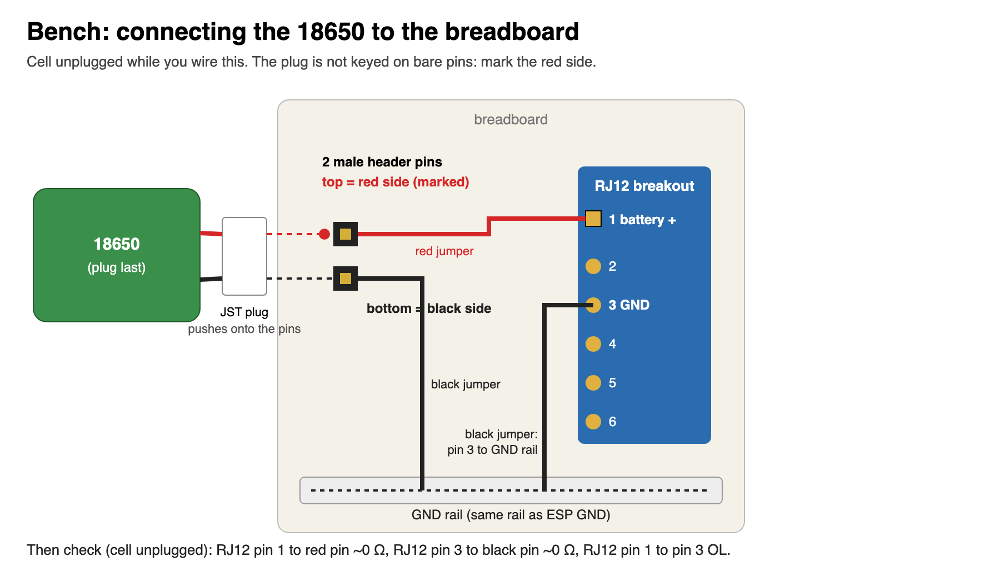

# Bench test: one tilter on a breadboard

The tilter is wired exactly as it will be on a blind ([tilter-wiring.md](tilter-wiring.md)); the controller side is one
port on a breadboard with the controller PCB's pins, joined by a **real RJ12 cord**. So the test also proves the cord,
the tilter's wiring and the firmware's pin plan. Sketch: [firmware/bench_test](../firmware/bench_test/bench_test.ino).

## Parts
- The tilter, wired per [tilter-wiring.md](tilter-wiring.md) (motor leads soldered to the N20 for this test)
- One RJ12 cord (continuity-checked pin 1 to pin 1)
- ESP32-C6 SuperMini, a spare **RJ12 breakout** (controller side), an 18650 cell with its JST-XH lead
- 1 kΩ + 100 nF (angle filter), 100 kΩ (EN pull-down), a breadboard and jumper wires
- USB-C cable to the computer (ESP power + serial), the USB power meter or a multimeter

The SuperMini's two pin rows are 0.6" apart: it straddles the breadboard's centre gap like a wide DIP chip. The RJ12
breakout's 6 pins plug into the breadboard too.

## Wiring (controller side, on the breadboard)

| From | To | Note |
|---|---|---|
| ESP **USB-C** | computer | powers the ESP, serial monitor at 115200 |
| ESP **GND** | breadboard GND rail | |
| 2 male header pins | breadboard, two rows side by side | the cell's JST-XH plug pushes onto them (not keyed: **mark the red side**) |
| header pin, **red** side | jumper to the row of RJ12 breakout **pin 1** | battery + for the tilter's motor driver (the real 3.0–4.2 V) |
| header pin, **black** side | jumper to the GND rail | grounds must be shared |
| RJ12 breakout **pin 3** | GND rail | |
| ESP **GPIO 18** | RJ12 breakout **pin 2** (IN1) | |
| ESP **GPIO 19** | RJ12 breakout **pin 6** (IN2) | |
| ESP **GPIO 1** | RJ12 breakout **pin 5** (EN) | wakes the driver and powers the sensor |
| 100 kΩ | RJ12 pin 5 ↔ GND | keeps EN low while the ESP boots |
| RJ12 breakout **pin 4** (angle) | 1 kΩ → ESP **GPIO 0** | |
| 100 nF | ESP GPIO 0 ↔ GND | angle filter |

Then plug the cord into the breadboard's RJ12 breakout and into the tilter's jack. Bench pins (as the sketch uses
them): IN1 = 18, IN2 = 19, EN = 1, angle = 0.

Before the battery goes on: meter beep mode, breadboard RJ12 **pin 1 to pin 3 (GND): no beep**; with the cord
plugged in, still no beep (checks the tilter side too).

The ESP runs from USB here; the 18650 only feeds the tilter. **Never** also connect the 18650 to the ESP's 5V pin while USB
is plugged in (no diode on the board's 5V pin).

## Flash the ESP (once by USB, then over Wi-Fi)
Battery and charger **unplugged**; only the ESP's own USB-C to the computer.
1. Install the **Arduino IDE** (arduino.cc). In *Settings → Additional boards manager URLs* add
   `https://espressif.github.io/arduino-esp32/package_esp32_index.json`, then *Boards Manager* → install **esp32 by
   Espressif** (version 3.x).
2. **Your Wi-Fi details:** in `firmware/bench_test/`, copy `secrets.h.example` to **`secrets.h`** and fill in your
   Wi-Fi name, Wi-Fi password and an update password of your choice. `secrets.h` stays on your computer (it's in
   `.gitignore`, never committed).
3. Open [firmware/bench_test/bench_test.ino](../firmware/bench_test/bench_test.ino). *Tools*:
   - Board: **ESP32C6 Dev Module**
   - **USB CDC On Boot: Enabled** (without this the Serial Monitor stays blank)
   - Partition Scheme: the default (**4MB with spiffs**: it has the two app slots Wi-Fi updates need)
   - Port: the `/dev/cu.usbmodem…` that appears when the ESP is plugged in
4. **Upload.** If it can't connect: hold **BOOT**, tap **RST**, release BOOT, upload again; tap RST afterwards.
5. *Tools → Serial Monitor*, **115200** baud. Tap RST: it prints the command list and `Wi-Fi <address>, telnet
   blinds-bench.local port 23`. If it says "Wi-Fi not connected", check `secrets.h` (it must be a 2.4 GHz network).

**From now on, no cable:**
- **Update:** in the IDE, *Tools → Port* shows **blinds-bench at 192.168.x.x** (a network port). Pick it and Upload;
  it asks for your update password. The motor switches off while it updates.
- **Commands over Wi-Fi:** in Terminal, `nc blinds-bench.local 23`, then type the same letters and press Enter.
  (Ctrl-C to leave.)
- The ESP runs from the battery through the charger and D3, so it stays on with USB unplugged.
- **From Terminal instead of the IDE** (arduino-cli is in `firmware/bin/`, not committed):
  `cd firmware && bin/arduino-cli compile --upload --fqbn esp32:esp32:esp32c6:CDCOnBoot=cdc -p blinds-bench.local --upload-field password=<your update password> bench_test`

Commands (type one letter, Enter): `e` EN on, `x` EN off (and stop), `f` forward, `r` reverse, `s` stop,
`1`–`9` speed (10–100 %), `0` speed 0, `a` angle readout on/off. **The motor only runs after `e`.**

## Tests
1. **Angle:** EN on (`e`), turn the wand by hand: the angle should change smoothly over the whole travel, without
   jumping or wrapping past 0/360°. Note the readings at both ends.
2. **Unloaded:** rod out. `f` / `r` at full duty: smooth running in both directions. Note the current (meter in the
   battery lead).
3. **Loaded:** rod in, blind hanging. `f` / `r`. Watch what fails, if it does:
   - **motor hums but doesn't turn** (current high, near stall): real torque shortage, or something binds under load;
   - **motor spins, blind doesn't move:** the pinion slips on the D-shaft, or the helical mesh skips (pinion pushed
     out of mesh: motor or lid flexing);
   - **turns in one direction, not the other:** the worm's thrust steps binding (one direction loads one step);
   - **works mid-travel, stalls near closed:** the slats' squeeze at the ends; measure the wand torque there.
4. **Hand check under load:** with the motor removed, turn the pinion's D-bore with a 3 mm shaft or hex key. If the
   blind turns easily from there, the drivetrain is fine and the motor side (supply, slip, mounting) is the problem.
5. **Sleep current:** EN off (`x`), motor stopped: driver + sensor draw should be ≈ 0 (multimeter µA range).

Record: supply voltage under load, current running and at stall, where in the travel it struggles, direction.
