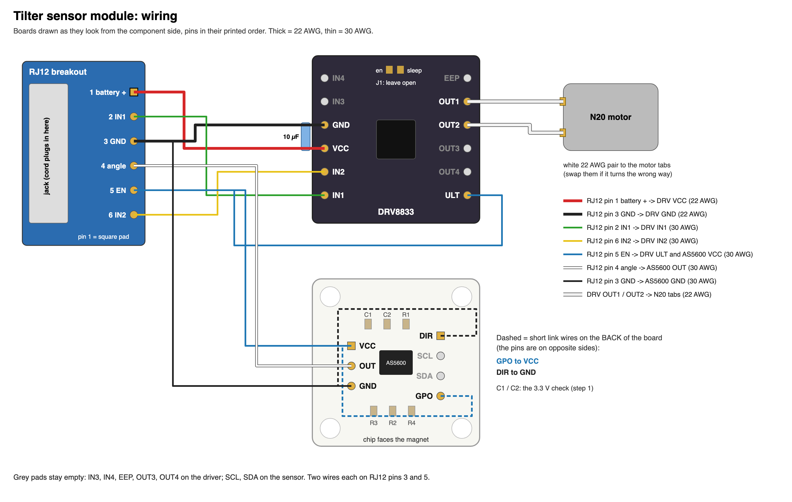
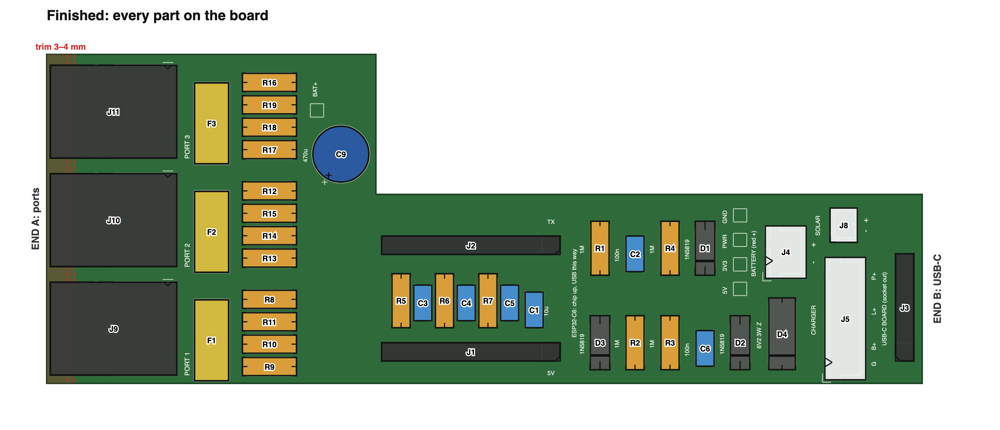

# Build guide

From parts to blinds in Apple Home, in order. Each step links to the detailed page. One controller drives up to 3
blinds; each blind gets one tilter.

| Step | What | Detail |
|---|---|---|
| 1 | Measure your blinds (if they are not the owner's kind) | [measure-your-blinds.md](measure-your-blinds.md) |
| 2 | Order the parts | [BOM](../hardware/BOM.md) |
| 3 | Print the tilters and the box | [tilter](../hardware/mechanical/stl/tilter/README.md#printed-parts), [box](controller-box.md) |
| 4 | Build each tilter | [tilter wiring](tilter-wiring.md), [tilter assembly](../hardware/mechanical/stl/tilter/README.md#assembly) |
| 5 | Flash the ESP32-C6 | [firmware](../firmware/README.md#first-flash-over-usb-on-the-bench) |
| 6 | Build the controller: PCB, then box | [PCB build](pcb-build.md), [box assembly](controller-box.md#assembly) |
| 7 | Set up in the Tilt app | below |
| 8 | Add to Apple Home | below |
| 9 | Add to Alexa (if you have an Echo) | below |

## 1. Measure your blinds
The tilter is drawn for the owner's cordless blinds: a headrail about 55.5 × 36.5 mm inside, a 4 mm square steel
tilt rod 24 mm above the floor, and 110 mm free between the end cap and the first tilt drum
([headrail notes](../hardware/mechanical/README.md#the-headrail)). If yours differ, measure first; the CAD is
parametric.

## 2. Order the parts
Everything is in the [BOM](../hardware/BOM.md): per tilter, per controller, and a buy list for 8 blinds on 3
controllers. Order the PCBs early ([how](../hardware/pcb/README.md#ordering)): they take the longest.

When parts arrive, do the [checks on arrival](../hardware/BOM.md#check-on-arrival), and switch every AS5600 to PWM
output with the bench tool ([as5600_setup](../firmware/README.md#as5600_setup-sensor-bench-tool)).

## 3. Print
- **Tilter:** one set of parts per blind, white PLA and white PETG. The Bambu Studio project puts PLA and PETG on
  their own plates. Only the tray lid needs support (under its gear shelf).
  [Parts and how they sit](../hardware/mechanical/stl/tilter/README.md#printed-parts).
- **Box:** tray and lid in white PLA, no supports ([controller box](controller-box.md)).

## 4. Build each tilter
1. Wire the sensor module on the bench: RJ12 breakout, DRV8833, AS5600, motor leads
   ([tilter wiring](tilter-wiring.md)).

   

2. Do the meter checks at the end of the wiring page.
3. Assemble the gearbox and fit the boards ([tilter assembly](../hardware/mechanical/stl/tilter/README.md#assembly)).
   Leave it out of the blind until it is set up in the app.

## 5. Flash the ESP32-C6
Over its own USB-C, on the bench, before it goes on the PCB
([first flash](../firmware/README.md#first-flash-over-usb-on-the-bench)). In the box there is no room for a cable.
Later updates come from the app.

## 6. Build the controller
1. **PCB:** solder it part by part, lowest first, with the meter checks ([PCB build](pcb-build.md)). Step 11 makes
   the charger harness and the battery splice; step 13 plugs in the ESP.

   

2. **Charge the cell** before the ESP goes on: it needs the cell above about 3.8 V
   ([bench charging](pcb-build.md#charging-the-battery-on-the-bench)).
3. **Box:** inserts, PCB, cell, charger, lid, 3 screws, then **4 stick-on feet** in the corners of the floor
   ([box assembly](controller-box.md#assembly)).
4. Plug each tilter into a port with a white RJ12 cord. Check each cord first: pin 1 to pin 1.

## 7. Set up in the Tilt app
Install **Tilt** from the App Store on an iPhone or iPad on your home Wi-Fi. Plug in the **Tilt Hub** first
([firmware/tilt_hub](../firmware/tilt_hub/README.md)) and add it to Apple Home once.

1. Power the controller (plug in its cell). A new controller shows up in the app for 15 minutes after power-on.
2. The app says **New controller found**: tap **Set Up**, pick it under **New, over Bluetooth**, then **Connect to the
   Tilt Hub**. The first phone to set it up is its **Owner**. It shows up in Apple Home by itself, through the hub.
3. Open the room, use the gear, pick a blind and tap **Set Up**. The app asks for three **Marks**: turn the wand
   until the slats are **closed up**, then **level (open)**, then **closed down**, and save each one. The blind then
   moves to Open by itself. That first move checks the motor's wiring: if the wires are the other way round, the
   controller turns it round and remembers it, so nothing needs rewiring. Then try each position.
4. In the room's settings, name the blinds, and pick which way **"Close"** tilts the slats (up or down).
5. Put the tilters and the box in their headrails, push the rods through, and check each blind once more.

To share the blinds, the Owner invites the people they live with from the room's settings.

## 8. Add to Apple Home
1. In the room's settings, under **Apple Home**, tap **Add to Apple Home**.
2. Tap **Add to Apple Home** again in the sheet. When Home says **"Uncertified Accessory"**, choose **Add Anyway**.
   The controller accepts this for 10 minutes.
3. Or add it by hand: copy the code shown, open Home, tap **+**, **Add Accessory**, **More Options**, and pick the
   controller (or paste the code). From another iPhone or iPad, point its camera at the QR code in the sheet.

Each controller makes its own setup code. **Show each blind separately** (same section) chooses one tile per blind or
one for the room; changing it restarts the controller.

## 9. Add to Alexa
With a Tilt Hub, the blinds can also be in Alexa, so an Echo opens and closes them by voice. Apple Home keeps working:
Matter lets the hub be in both. It needs an Echo with Matter on the same Wi-Fi as the hub: Amazon lists which ones
([Matter on Alexa](https://developer.amazon.com/docs/alexaplus/smarthome/matter-support)). Alexa opens, closes and sets
a percent; check the battery in Tilt or Apple Home (Amazon lists no battery for blinds).
1. In Tilt, open **Settings > Tilt Hub**. Under **Integrations**, tap **Add** next to **Alexa** (owners only).
2. Tilt shows a one-time code, good for 15 minutes. Tap **Open Alexa**: it copies the code and opens the Alexa app.
3. In Alexa: **Devices**, **+**, **Add Device**, **Other**, **Matter**, say **Yes** to the Matter logo, then
   **Try numeric code** and paste the code. If Alexa says the device is not Matter certified, continue.
4. Alexa finds one blind per tile (as in Apple Home). Put each in a room.
5. Say **"Alexa, open the living room blinds"** or **"Alexa, close the living room blinds"**.

Names come from Tilt: rename a blind in Tilt, not in Alexa. To take the hub out of Alexa, remove it in the Alexa app.
A code adds one Alexa home. After it is used or 15 minutes pass, tap again for a new one.

## The Tilt Hub

One hub serves every controller in the home. It stays plugged in.

| Part | Notes |
|---|---|
| ESP32-C6 SuperMini, no pins soldered | Wi-Fi, Thread and Bluetooth on one chip |
| USB-C male-to-male adapter | the hub's plug ([BOM](../hardware/BOM.md#tilt-hub-1)) |
| Printed box | printed round the ESP and the adapter ([hub box](hub-box.md)) |
| A 5 V USB-C wall plug (1 A is plenty) | always on |
| A label | the 8-digit setup code `build.sh` prints on its first build |

1. Copy `firmware/tilt_hub/main/secrets.h.example` to `secrets.h` and fill in the Wi-Fi network.
2. `firmware/tilt_hub/build.sh -p <USB port> flash`. The first build makes the setup code: put it on the label.
3. Print the box round the ESP and the adapter ([hub box](hub-box.md)). Flash first: the box has no way in afterward.
4. Plug the hub into the wall plug. In the Tilt app, the Blinds page shows "New Tilt Hub found": Connect, and type
   the code.

Later updates come over Wi-Fi (`tools/flash_hub.sh`, or "Update
Tilt Hub" on the hub page in the app).

## If something is wrong
- PCB readings: [PCB build, "If something reads wrong"](pcb-build.md#if-something-reads-wrong).
- A blind moves the wrong way: nothing to rewire. The motor leads can go either way round; on its first moves the
  controller sees which way the angle changes, turns the motor the other way if needed, and remembers it.
- Open problems and planned work: [GitHub issues](https://github.com/DrakeAnglin/tilt/issues).
