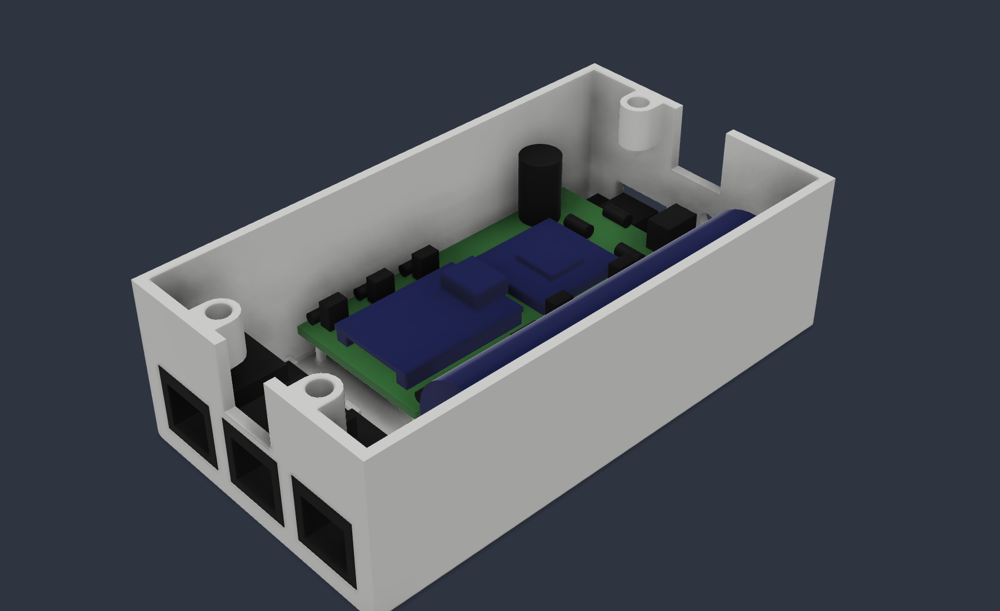
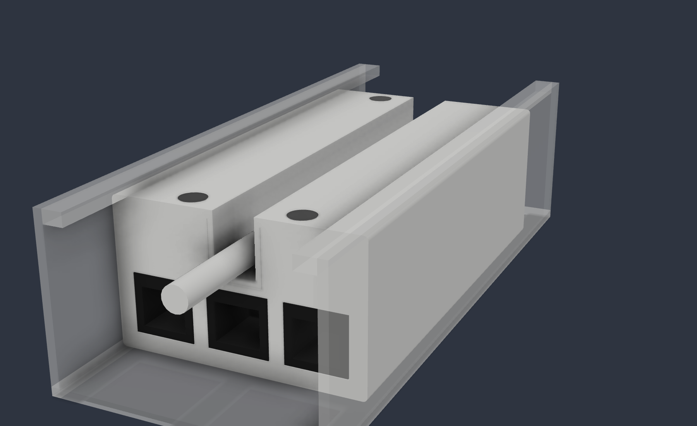

# Controller (ControllerV3)

Generator: [ControllerV3.py](../hardware/mechanical/fusion/ControllerV3/ControllerV3.py) (plain Python: hole map +
wiring table) and `tools/fusion_controller_v3.py` (Fusion model, exact interference check, STLs, renders).

## Box
- **100.7 × 55.4 × 33.3 mm**, tray + lid, white, rounded long edges (tilter width). Slides into the rail from its end
  and sits **under the tilt rod**: the rod lies in a 9 mm groove along the lid (0.97 mm under its sweep).
- End A: three RJ12 jacks, flush. End B: USB-C (charge only) and the solar lead (Ø3.5 hole).
- Lid: 3 × M3 × 8 flat head into heat-set inserts in bosses on the end walls; ribs under it hold the jacks and the
  cell down.
- Print: tray floor down, lid top face down (the groove floor bridges 9 mm); no supports.

## Inside (X from end A)
| Part | Where |
|---|---|
| RJ12 breakouts ×3, **trimmed to 15 mm wide** (cut off the mounting-hole ears), jack pins trimmed to 0.4 mm | X 4.5–24.4 across the full width, on ledges: front step + 1 mm rear lip |
| 18650 (68.1 × 19.05) | room side, X 27–95, two saddles |
| Dev board (perfboard 25 × 12 holes, 63.5 × 30.5 mm) on 6 posts | back side, X 27–91 |
| USB-C breakout | hung under the dev board's end on its header, socket in end wall B |

## Dev board
Hole map: [ctrl-v3-holemap.svg](renders/ctrl-v3-holemap.svg). Wiring: [ctrl-v3-wiring.md](renders/ctrl-v3-wiring.md).

| ESP32-C6 GPIO | Use |
|---|---|
| 18 / 19 | Port 1 IN1 / IN2 |
| 20 / 14 | Port 2 IN1 / IN2 |
| TX16 / RX17 | Port 3 IN1 / IN2 (log over USB-CDC) |
| 4 / 5 / 6 | Port 1 / 2 / 3 EN (AS5600 power + DRV8833 sleep) |
| 0 / 1 / 2 | Port 1 / 2 / 3 angle (ADC, 1 k + 100 n) |
| 3 | Battery voltage (1 M / 1 M + 100 n) |
| 7 | Charger STAT (10 k pull-up) |
| 8, 9, 15 | spare (strapping pins) |

The ESP's own USB-C faces the charger with no room for a cable inside the box: flash it on the bench before fitting
it, later updates over the air.

## Assembly
1. RJ12 boards (trimmed, 6 leads each): tilt the board back-up, jack nose into its window, lower it so the front edge
   sits at the step and the back edge drops behind the lip.
2. Dev board (bench-tested) onto its posts with the USB-C breakout's socket in its window; solar lead through its hole.
3. 18650 into its saddles, XH plug onto the battery pins.
4. Lid, 3 × M3 × 8.
