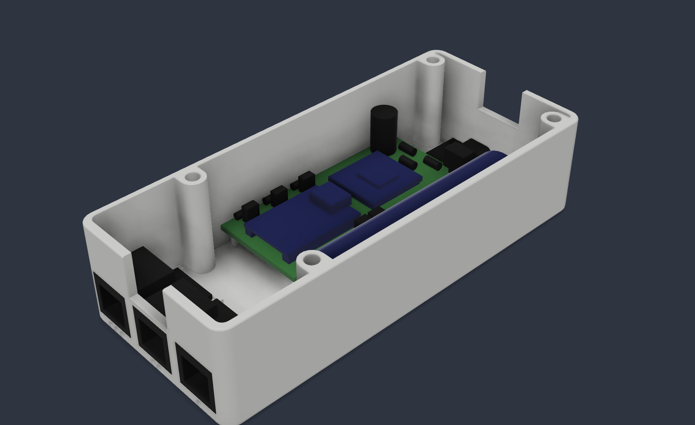
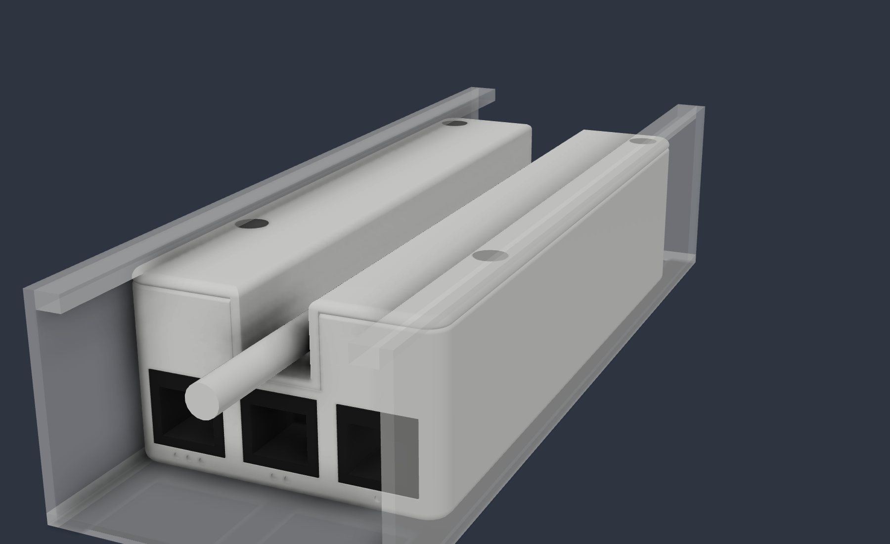

# Controller (ControllerV4)

One per 3 blinds (3 boxes). Earlier layouts are in [archive/](archive/). Parts per box: [BOM](../hardware/BOM.md#per-unit-what-each-build-uses).

Generator: [ControllerV4.py](../hardware/mechanical/fusion/ControllerV4/ControllerV4.py) (plain Python: hole map +
wiring table) and `tools/fusion_controller_v4.py` (Fusion model, exact interference check, STLs, renders).

## Box
- **126.6 x 55.4 x 33.3 mm**, tray + lid, white. Vertical corners r4, other outer edges r1.5, a 0.6 mm reveal at the
  lid joint, a rounded rod groove along the lid (the box sits under the tilt rod, 0.97 mm below its sweep), port marks
  (1-3 engraved dots) under the jacks.
- **Nothing floats:** the four lid-screw pillars are full-height columns from the floor, built into the side walls,
  between the port bay and the electronics bay and at end B. Every ledge, saddle, stop and post grows from the floor.
- Lid: 4 x M3 x 8 flat head, flush in countersinks, into heat-set inserts at the pillar tops. Ribs under the lid hold
  the jacks, the cell, the dev board's corners and the USB-C board down.
- Print: tray floor down, lid top face down (the groove floor is a 12 mm bridge); no supports.

## Bays (X from end A)
| Bay | What |
|---|---|
| Ports, X 4.5-25.8 | three RJ12 breakouts trimmed to 15 mm wide, on ledges with a front step and a 1 mm rear lip |
| Pillars, X ~31 | room for the 18 port leads to cross to the dev board |
| Electronics, X 40-110 | 18650 along the room side (two saddles + end stops), dev board (26 x 12 holes) beside it on 6 posts |
| USB-C, X 110-124 | the breakout (Cermant 21.6 × 12.8; holes and socket stick-out scaled from its photo, confirm before printing) lies on two flat posts, its front edge in a pocket in end wall B so the socket sits flush in a rounded (stadium) window; two tapered pins under the lid drop through its mounting holes into the posts, so the lid locks it; solar lead hole beside it |

## Dev board
**Step-by-step build guide with pictures and polarity notes: [dev-board-build.md](dev-board-build.md).**
Built on the kit's **3 × 7 cm perfboard: columns a–j, rows 1–24** (row 1 toward the ports, column a toward the battery).
**Where every part and wire goes: [ctrl-v4-wiring.md](renders/ctrl-v4-wiring.md)**; picture: [ctrl-v4-holemap.svg](renders/ctrl-v4-holemap.svg).
Checked by [`tools/devboard_check.py`](../tools/devboard_check.py): parts ≥ 0.3 mm apart, all 25 nets connected, none shorted.
(The box still has to be updated to this board: later.)

| ESP32-C6 GPIO | Use |
|---|---|
| 18 / 19 | Port 1 IN1 / IN2 |
| 20 / 14 | Port 2 IN1 / IN2 |
| TX16 / RX17 | Port 3 IN1 / IN2 (log over USB-CDC) |
| 4 / 5 / 7 | Port 1 / 2 / 3 EN (AS5600 power + DRV8833 sleep) |
| 0 / 1 / 2 | Port 1 / 2 / 3 angle (ADC, 1 k + 100 n) |
| 3 | Battery voltage (1 M / 1 M + 100 n) |
| 6 | Input-power sense: USB / solar voltage (1 M / 1 M, ADC); the charger board has no STAT pad |
| 8, 9, 15 | spare (strapping pins) |

The ESP's own USB-C faces the charger with no room for a cable inside the box: flash it on the bench before fitting
it, later updates over the air.

## Assembly
1. RJ12 boards (trimmed, 6 leads each): tilt the board back-up, jack nose into its window, lower it so the front edge
   sits at the step and the back edge drops behind the lip.
2. Dev board (bench-tested) onto its posts; solar lead (if used) through its hole in end wall B.
3. 18650 into its saddles, XH plug onto the battery pins.
4. USB-C breakout (VBUS and GND leads to the dev board's USB pads): lay it on its two posts and slide it forward until
   the socket is flush in its window. The lid's pins locate it through its mounting holes.
5. Lid, 4 × M3 × 8.
