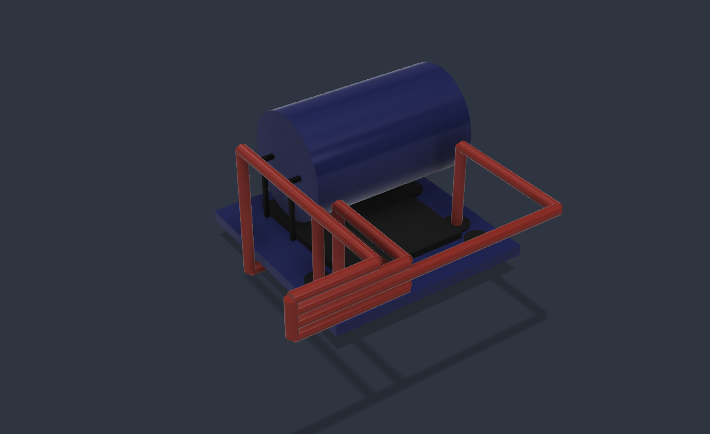
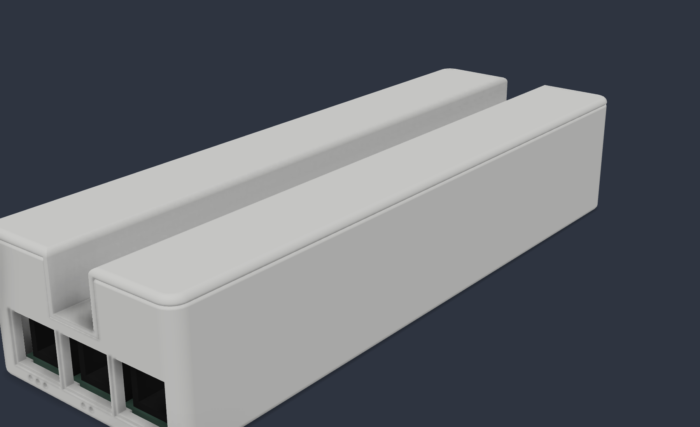
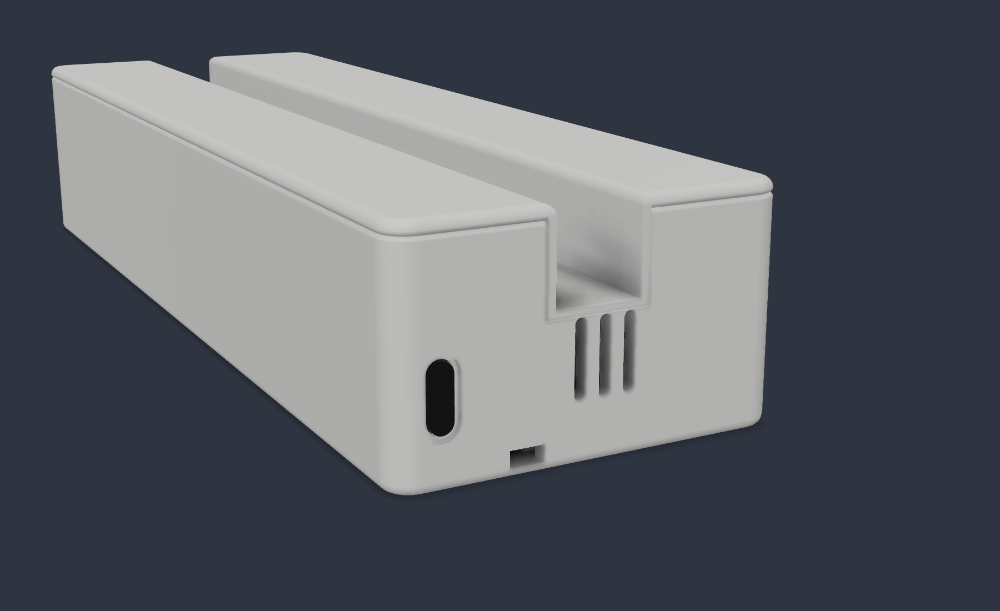
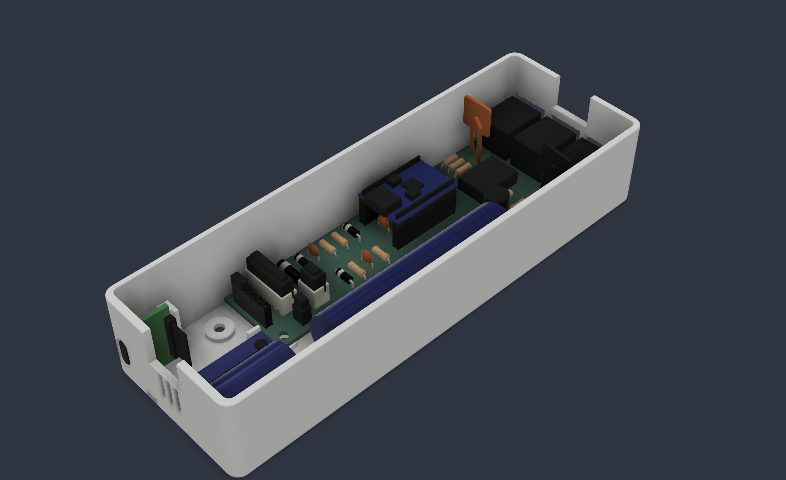
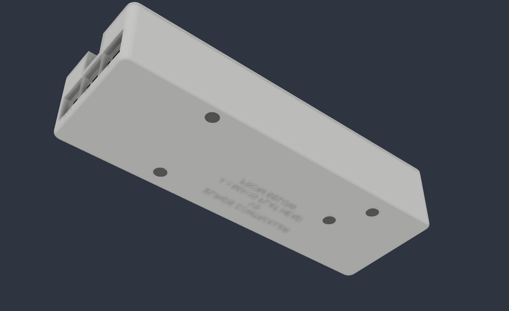
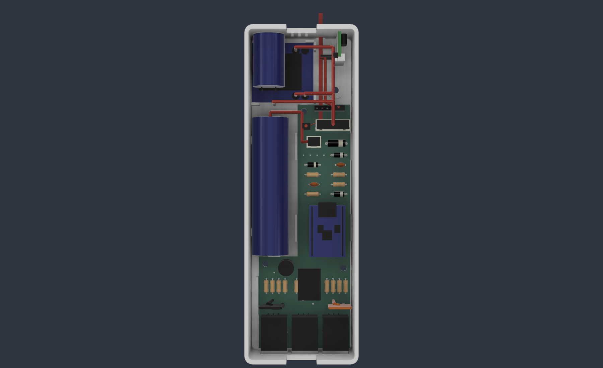

# Controller box V5 (for the carrier PCB)

The box for the controller PCB (`hardware/pcb`, v2.1), the 18650, the MCP73871 charger module with its big capacitor,
and the USB-C charge port. It is built by [ControllerV5.py](../hardware/mechanical/fusion/ControllerV5/ControllerV5.py)
and checked in Fusion by [fusion_controller_v5.py](../tools/fusion_controller_v5.py). The PCB in the model is KiCad's own
3D export of the real board, with every part on it. Everything the export lacks is mocked up from its datasheet or the
listing photos: RJ12 jacks, ESP32-C6, plugs, cell, charger, capacitor and USB-C board.

| | |
|---|---|
| Size | **165.2 × 55.4 × 33.3 mm**: same cross-section as V4 (fits the rail, rod in the lid's groove), 39 mm longer |
| Prints | `hardware/mechanical/stl/v0.5/controller_v5_tray.stl` (floor down), `controller_v5_lid.stl` (top face down), white PLA, no supports |
| Hardware | 4 × M3 heat-set inserts (the M3 × 5.7 ones you have), **4 × M3 × 10 flat-head** (one screw size for the whole box) |
| Check | Exact interference check of every part against the tray, lid and each other: **none** |

## Why it is longer than V4
The rod's groove runs down the middle of the lid, so under it there is only **19.2 mm** of height. The PCB is 47 mm wide
at the jacks and 27 mm beside the cell, so the cell takes the back side. The charger (31.5 × 30.5 mm) is wider than
the space left anywhere beside the PCB, so it gets its own bay past the PCB's end. Its capacitor (16 × 26 mm) lies on its
side across the module, soldered in the module's own holes (see below).

That bay sits where the USB-C board used to plug into J3, so the **USB-C board moves to end wall B**, standing on
edge in a slot. A short 2-wire lead joins it to J3.

## The tight spots (all checked in the model)
| Where | Room |
|---|---|
| ESP32-C6 header pin tips (on the side under the groove) | **0.8 mm** below the groove (2.3 mm if you clip the tips flush) |
| Under the PCB | 2.1 mm (the floor is recessed 0.4 under the board). The tallest tails (JST-XH headers) reach 1.8 mm: **trim every other lead to 1.8 mm or less**. The jacks' tails and pegs sit in deeper pockets |
| Fuse F1 (room side, standing) | 3 mm under the lid |
| 470 µF capacitor | 2–3 mm under the groove (standing, as soldered) |
| Battery plug wires (J4) | 1.5 mm under the groove: bend them over as they leave the plug |
| Cell, jacks, charger, capacitor, USB-C board | held by pads on the lid (0.05–0.3 mm, by design) |

## Before it goes in the box
1. **Fuse F2 (the middle one)** sits under the groove. Upright it is 23.5 mm tall, so after soldering, **fold it flat
   back over its four resistors**, toward the ESP.
2. **Fuse F3 (beside the cell)**: lean it slightly toward the cell side (about 8°, a gentle push) so its top clears the groove.
3. **Fuse F1** stays upright.
4. **USB-C lead**: two wires, about 45 mm. Solder one end to the USB-C board's **VBUS** and **GND** pins. Solder the
   other end to a 2-pin piece of male header that plugs into **J3 pins 1 (VBUS) and 2 (GND)**. Use red for VBUS and black for GND,
   or the white flat 2-core cable with the VBUS side marked.
5. **Charger subassembly**: build it on the bench first. It goes into the box as one piece.

## The charger subassembly

The capacitor belongs to the module: its footprint is the pair of holes **7 mm apart** in the module's corner, with
the **+** mark beside one of them. Standing up, it would make the module 33 mm tall, more than any box that fits the
rail. So it lies on its side across its own module. The order matters, because once the capacitor is on, it covers
the LOAD pad:

1. **LOAD wire first, from underneath.** Push the J5 harness's LOAD lead (pin 4) up through the **LOAD** pad from the
   bottom of the module and solder it on top. Keep the top joint low; the capacitor will lie 1.5 mm over it. Lay the
   wire flat along the underside. The module stands 3 mm off the floor, so the wire runs under it.
2. **PWR (pin 6), BATT (pin 2) and GND (pin 1)** from the top. Use the **GND next to PWR** (or the one next to BATT),
   not the one beside LOAD, which goes under the capacitor.
3. **Capacitor**: bend both legs 90° about 1.5 mm from its body, so it lies flat with its body over the
   LOAD/BATT edge of the module. Put the **+ leg in the hole by the "+" mark** (the stripe on the can is −). Hold a 1.5 mm
   spacer (a piece of PCB or two business cards) under it while you solder, so it sits clear of the parts and is held
   by its legs.
4. Check before it goes in: + to − on the capacitor matches PWR to GND (beep the legs to the pads).

In the box, the module sits on four 3 mm corner pads between guides. A saddle in the tray carries the capacitor's free
end. Two pins on the lid clamp the module's edges where it has no pads, and a pad on the lid sits 0.2 mm over the capacitor.
Nothing presses on the capacitor's legs.

## Assembly
1. Press the 4 inserts into the lid's 4 posts (lid upside down, soldering iron).
2. Drop the PCB into its nest: it sits on its 3 floor bosses, located 0.2 mm all round by stops on end wall A and ribs along its edges, so it can't go in crooked.
3. Cell into its two saddles along the back wall, lead at end B. Plug it into J4.
4. Charger subassembly into its bay: capacitor end toward end wall B (its free end drops into the saddle), module onto its corner pads between the guides. Plug the harness into J5.
5. USB-C board: slide it down into its slot at end B, socket into the window, component side toward the room-side wall.
   Plug its lead into J3.
6. Solar lead (if used): flat through the slot in end wall B, along the floor on the room side of the bay (beside the module, past the bay's screw post), into J8.
7. Lid on: its posts land on the PCB's 3 holes and the boss in the charger bay; its two pins land on the module's edges.
8. Turn the box over and drive the 4 **M3 × 10** flat-head screws up through the floor, snug only (they go into
   plastic-held inserts). Three clamp the PCB between the floor bosses and the lid posts; the fourth is in the charger
   bay. Together they hold the lid on.

The top stays clean (no screw heads) and the screw heads sit flush with the bottom, so it still slides into the rail.

## Engineering review (rev B)
Changes made after a design review against production practice:

| Finding (rev A) | Rev B |
|---|---|
| ESP pin tips 0.6 mm under the groove. The tolerance stack (socket ±0.2, header spacer ±0.1, PCB ±0.1, print ±0.2) could use all of it | Floor recessed 0.4 under the PCB and the PCB lowered 0.3: **0.8 mm**, with 2.1 mm still under the board for leads |
| PCB loose until the lid goes on | **Locating nest**: stops on end wall A between the jacks, ribs on both long edges, all 0.2 clear and below the board's top face |
| Two screw lengths | **One part number: M3 × 10 flat head ×4**; the charger-bay post is bored past its insert for the longer screw |
| Insert posts Ø7 (1.2 mm wall left round a Ø4.6 insert); no root fillets; long Ø4 hold-down pins on the charger | Posts **Ø8** (1.7 mm wall), **45° root fillets** wherever there's room, **0.4 mm lead-in chamfer** on every insert bore; charger hold-downs **Ø6** with fillets |
| Sharp-edged jack and USB openings | **0.5 mm bezels** round all three jack windows and the USB-C window (finished look, plug lead-in) |
| Charger heat (MCP73871 is linear: ~0.6 W while charging), no vents | **3 vent slots** in end wall B beside the charger (the floor sits on the rail, so not there) |
| Cell end stops 0.7 mm, a USB-slot rib 1.0 mm | 1.2 mm and 1.4 mm |
| No part marking | Engraved: tray bottom `BLINDS CONTROLLER V5 / 4 x M3x10 FLAT HEAD FROM BELOW`, lid underside `V5 LID - 4 x M3 INSERTS` |

**Checks on rev B:**
- **Interference:** exact B-rep check of every part on the PCB (KiCad's 3D export) and every mock-up against the tray, the lid and each other: **none**.
- **Print (DFM) scan of the STLs:** no unsupported islands. The bridges are:
  - lid: the 12 mm groove floor
  - tray: the 13.7 mm jack-window tops, plus 2 mm tops on the slots, vents and the capacitor-leg notch
  - everything else at 45° or less
- **Thinnest walls:** 1.2 mm (the floor under the PCB is 0.8 mm, supported flat on the rail).

**Print settings:** PLA, 0.2 mm layers, 3 walls, 20 % infill, no supports. Tray floor down, lid top face down.
Inserts at 220 °C, pressed square, flush.

**Critical-to-function dimensions** (check the first print):

| Feature | Size |
|---|---|
| Jack windows | 13.7 × 11.9 mm |
| USB-C window | 3.7 × 9.5 mm stadium |
| Cell saddles | Ø19.4 mm |
| Charger bay | 31.5 mm wide (module), 33.4 mm long (to the capacitor's end) |
| Capacitor saddle | Ø16.6 mm |
| Insert bores | Ø4.0 × 6.7 mm |

## Measure when the parts arrive (the model uses these)
| Part | Model | If yours is different |
|---|---|---|
| Charger module | 31.5 × 30.5 mm board, pads and the capacitor's 7 mm holes as in the listing photo | tell me the real size and the hole spacing |
| Charger capacitor | Ø16 × 26 mm, 7.5 mm lead spacing | lies over the module; its end saddle is Ø16.6 |
| 18650 | Ø19.0 × 69.0 mm | saddles are Ø19.4; length between the stops 69.2 |
| USB-C board | 22.1 × 13.05 mm, socket 9.1 × 3.26 sticking out 1.45 | the slot and pocket are cut to this |
| RJ12 jack 87180-066LF | 13.2 W × 11.5 H (Amphenol drawing) | |
| ESP32-C6 header spacers | 2.5 mm, pins 1.9 above the board | clip the tips if taller |

## Renders
| | |
|---|---|
|  |  |
|  |  |
|  |  |
|  |  |
|  |  |
