# Controller box V5 (for the carrier PCB)

The box for the controller PCB (`hardware/pcb`, v2.1), the 18650, the MCP73871 charger module with its big capacitor,
and the USB-C charge port. It is built by [ControllerV5.py](../hardware/mechanical/fusion/ControllerV5/ControllerV5.py)
and checked in Fusion by [fusion_controller_v5.py](../tools/fusion_controller_v5.py). The PCB in the model is KiCad's own
3D export of the real board, with every part on it. Everything the export lacks is mocked up from its datasheet or the
listing photos: RJ12 jacks, ESP32-C6, plugs, cell, charger, capacitor and USB-C board.

| | |
|---|---|
| Size | **164.6 × 52.5 × 25.8 mm** (+2 rail bumpers on the back wall): fits the rail with the rod in the lid's round groove |
| Prints | `hardware/mechanical/stl/v0.5/controller_v5_tray.stl` (floor down), `controller_v5_lid.stl` (top face down), white PLA, no supports. **Print `controller_v5_end_a_coupon.stl` first** (just end wall A, ~10 min) and check the plug fit against a soldered jack |
| Hardware | 3 × M3 heat-set inserts (the M3 × 5.7 ones you have), **3 × M3 × 10 flat-head** (one screw size for the whole box) |
| Check | Exact interference check of every part against the tray, lid and each other: **none** |

## Why it is longer than V4
The rod's groove runs down the middle of the lid, so under it there is only **19.2 mm** of height. The PCB is 47 mm wide
at the jacks and 27 mm beside the cell, so the cell takes the back side. The charger (31.5 × 30.5 mm) is wider than
the space left anywhere beside the PCB, so it gets its own bay past the PCB's end. Its capacitor (16 × 26 mm) lies on its
side across the module, soldered in the module's own holes (see below).

That bay sits where the USB-C board used to plug into J3, so the **USB-C board moves to end wall B**, standing on
edge in a slot. A short 2-wire lead joins it to J3.

## The tight spots (all checked in the model)
| Where | Room |
|---|---|
| ESP32-C6 header pin tips (on the side under the groove) | **1.5–2.0 mm** below the groove's channel (the round groove rises away from the middle) |
| Under the PCB | 2.4 mm over a full 1.2 mm floor. The tallest tails (JST-XH headers) reach 1.8 mm: **trim every other lead to 1.8 mm or less**. The jacks' tails clear the floor by 0.3 mm |
| Fuses (folded) | 2–3 mm under the lid / groove |
| 470 µF capacitor | 2–3 mm under the groove (standing, as soldered) |
| Battery plug wires (J4) | 1.5 mm under the groove: bend them over as they leave the plug |
| Cell, jacks, charger, capacitor, USB-C board | held by pads on the lid (0.05–0.3 mm, by design). **The capacitor lying on the charger is now the tallest part outside the groove**: it sets the lid height |

## Before it goes in the box
Soldering the PCB itself: [PCB build guide](pcb-build.md), step by step.

1. **Fold all three fuses** after soldering. Each one is an 11.5 mm disc on about 12 mm of legs (Bel 0ZRE0075FF:
   23.4 mm seated). Bend both legs over toward the ESP **about 1.6 mm below the body** (not at the body: the coating
   can crack), so the disc lies flat over its own four resistors, roughly 8–13 mm above the board. The H1 screw post is
   0.35 mm past the end of F1's disc, and the 470 µF is 1.3 mm past F3's, so fold them straight, not skewed.
2. **USB-C board's header pins: clip them to 3 mm** past their plastic (the charger module sits beside them now). **USB-C lead**: two wires, **65 mm** each (the route in the box is 50 / 57 mm). Solder one end to the USB-C board's **VBUS** and **GND** pins. Solder the
   other end to a 2-pin piece of male header that plugs into **J3 pins 1 (VBUS) and 2 (GND)**. Use red for VBUS and black for GND,
   or the white flat 2-core cable with the VBUS side marked.
3. **Charger subassembly**: build it on the bench first. It goes into the box as one piece.

## The charger subassembly

The capacitor belongs to the module: its footprint is the pair of holes **7 mm apart** in the module's corner, with
the **+** mark beside one of them. Standing up, it would make the module 33 mm tall, more than any box that fits the
rail. So it lies on its side across its own module. The order matters, because once the capacitor is on, it covers
the LOAD pad:

The J5 harness has **4 wires**: GND (pin 1), BATT (2), LOAD (4), PWR (6). Pins 3 and 5 aren't connected on the PCB. If
your 6-pin XH lead comes with all six wires, pull the pin 3 and 5 wires out of the housing: lift the little tab over each
crimp with a pin and pull. Or cut them off flush at the housing.

1. **LOAD wire first, from underneath.** Push the J5 harness's LOAD lead (pin 4) up through the **LOAD** pad from the
   bottom of the module and solder it on top. Keep the top joint low; the capacitor will lie 2.1 mm over it. Lay the
   wire flat along the underside. The module stands 2.4 mm off the floor, so the wire runs under it.
2. **PWR (pin 6), BATT (pin 2) and GND (pin 1)** from the top. Use the **GND next to PWR** (or the one next to BATT),
   not the one beside LOAD, which goes under the capacitor.
3. **NTC wires** (the cell's temperature sensor). The module's **THERM** pads carry a 10 k resistor marked "103" that
   fakes a cool cell. Remove it and solder two **30 AWG** wires, about **60 mm**, one to each pad, with your 10 k NTC on
   the other end (sleeve the joints). Lay them flat along the module toward the capacitor's **leg end**; they leave
   from under the capacitor there. Do this before the capacitor: afterward the pads are covered.
4. **Capacitor**: bend both legs 90° about 1.5 mm from its body, so it lies flat with its body over the
   LOAD/BATT edge of the module. Put the **+ leg in the hole by the "+" mark** (the stripe on the can is −). Hold a 2 mm
   spacer (a piece of 1.6 mm PCB plus a business card) under it while you solder, so it sits clear of the parts and is held
   by its legs.
5. Check before it goes in: + to − on the capacitor matches PWR to GND (beep the legs to the pads).

In the box, the module sits on four 2.4 mm corner pads between guides. A saddle in the tray carries the capacitor's free
end. Two pins on the lid clamp the module's edges where it has no pads, and a pad on the lid sits 0.2 mm over the capacitor.
Nothing presses on the capacitor's legs.

## Assembly
1. Press the 3 inserts into the lid's 3 posts (lid upside down, soldering iron).
2. Drop the PCB into its nest: it sits on its 3 floor bosses, located 0.2 mm all round by stops on end wall A and ribs along its edges, so it can't go in crooked.
3. Cell into its two saddles along the back wall, lead at end B. Plug it into J4.
4. Charger subassembly into its bay: capacitor end toward end wall B (its free end drops into the saddle), module onto its corner pads between the guides. Plug the harness into J5.
5. USB-C board: component side toward the room-side wall, socket into the window with the back end tipped up, then push the back end down until it snaps in over the floor channel's rounded back end. The lid's channel locks it.
   Plug its lead into J3.
6. Solar lead (if used): flat through the slot in end wall B, along the floor on the room side of the bay (beside the module), into J8.
7. Lid on: its posts land on the PCB's 3 holes; its two pins land on the module's edges.
8. Turn the box over and drive the 3 **M3 × 10** flat-head screws up through the floor, snug only (they go into
   plastic-held inserts). They clamp the PCB between the floor bosses and the lid posts, and hold the lid on.

The top stays clean (no screw heads) and the screw heads sit flush with the bottom, so it still slides into the rail.

## Print 2: USB-C board held by its edges (rev L)
The board didn't stay in well, and the supports at its back edge (the component-side rib, over the header's solder joints) could foul the joints. Now nothing touches its faces:
- **Bottom edge:** in a U-channel on the floor (walls 2.5 mm tall, 1.2 mm thick, 0.25 mm clear a side). Its back end is as tall as the sides, only 0.15 mm behind the board's back edge, its top edge on the board's side rounded (r 0.8), so the board's corner rolls over it and snaps in. The board stands on the floor (0.05 mm gap); the old floor groove is gone, so the floor is a full 1.2 mm. The board is 0.55 mm higher than before, and its wires moved up with it.
- **Top edge:** in a U-channel on the lid, 2 mm deep, from the board's back edge to 1 mm short of the wall.
- **Back edge:** the tall tray stop and its buttress are gone. The lid channel's back end is closed. It comes down 2.5 mm thick behind the board's back edge, to the top of the socket (where a plug pushes), on the component side of the header.
- **Front edge:** in its pocket in end wall B, as before, with the socket in the closed round window. The wall isn't cut. The pocket is open at the top inside the wall; closed, it left a 0.25 mm sliver under the rim.
- **To fit it:** socket into the window first with the board's back end tipped up, then push the back end down. Its bottom corner rolls over the back end's rounded edge and snaps in. Then put the lid on.
- **Fourth screw removed:** the post in the charger bay (room side) is gone, from the tray and the lid. Wires crowd that corner, and it was only 24 mm from H3. Three screws and inserts now. The lid still locates on its lip and the three PCB posts.
- **Lid seam:** no rounding where the lid meets the tray (the two 0.6 mm rounds read as a groove round the box). Only the box's bottom and top edges are rounded (1.5 mm).
- **Groove channel:** 2.0 mm thick, the same as the lid (was 1.0). It sits in the end walls' notches with 0.05 mm round it (was 0.15, a visible gap). The thicker channel hangs 1.0 mm lower: the cell's + lead now crosses under it at 17.6 mm, the harness GND drops before it, and the ESP's pin tips have 1.5–2.0 mm under it (was 2.3). The PWR, BATT and cell + wires pass 0.2 mm under it.
- **RJ12 openings:** cut to your measured plug + 0.35 a side (body 10.25 × 7.25, latch notch 6.7 wide to the PCB). The old notch was 5.0, narrower than the 6.0 latch. See RJ12 ports.
- If the board has a part within 2 mm of its top edge on the component side, the lid channel's wall would hit it. Tell me and I'll shorten it.

## Print 1 fixes, part 2 (rev K)
- **Rod groove:** stays a circle (a teardrop was tried and reverted).
- **USB-C end stop:** behind the board's back edge, it takes the push when a cable is plugged in. It now runs to 2 mm under the board's top (20.8 mm tall), 2.75 mm thick with an 8 mm buttress behind it. A tab on the lid continues it to the top (0.4 mm gap between them), so the board can't be pushed back. The component-side rib is full height again. The socket window's stepped bezel is gone.
- **Vents:** the lowest slot (Y −4) sat behind the charger module's corner seat. The three slots are now at Y −1, 2.5 and 6 (1.5 mm webs): nothing printed within 8 mm behind any of them (checked).
- **USB-C window sliver:** the board's pocket in end wall B overlapped the window's edge by 0.45 mm, leaving a one-line sliver of wall above the window that started in mid-air. The pocket now spans the window's full width from its bottom up, so above the window there is one even 1.25 mm skin with a plain round top. Window and vents keep round ends.
- **PCB raised 0.7 mm** (2.4 mm off the floor, was 1.7). The floor under the RJ12 jacks was cut to 0.5 mm for their tails and pegs, and the floor under the whole board was recessed to 0.8 mm for the header pins. Both are gone: the floor is a full 1.2 mm everywhere, with the jack tails 0.3 mm and the header pins 0.6 mm above it. The wire runs over the plugs moved up 0.7 to match (still clear of the lid and groove). ESP pin tips to the groove channel: 2.3 mm (was 3.0).
- **RJ12 openings:** the 0.4 mm stepped bezel washed out on a 0.4 nozzle, so it's gone; the openings are plain (plug outline + latch notch; resized to the measured plug in rev L).

Checked: no interference; STLs manifold.

## Print 1 fixes (rev J)
From the first test print (0.4 mm nozzle):
- **Charger module:** its two sides were swapped in the model. It's 30.5 mm across the box and 31.5 along it (pad layout unchanged). Its corner seats are now a **press fit**: 0 nominal clearance, which FDM prints slightly tight, so it pushes in and stays. It sits against the back wall.
- **Capacitor:** its bore now runs right through to the back wall (0.3 into the wall's face, leaving 1.7 mm), so nothing stands between the can and the wall.
- **USB-C board:** the low rib on the header side is gone, so the board can be angled in. Its back edge is still held by the end stop and the component-side rib. Slot clearance 0.25 a side.
- **18650:** sized to the measured 65.7 mm cell. The end plates are 0.4 mm off each end (0.8 mm play in all), **2.5 mm thick** and 10 mm wide (were 1.2 × 8, with 0.2 + 3.3 mm play). The cell moved 1.7 mm toward end B so the end-A plate clears the H2 screw post.
- **Harness GND** now drops to its pad 2.5 mm earlier (the pad moved 1.3 mm toward the groove).
- **Printability:** bottom text 6 mm tall (was 3.2), lid text shortened to "V5 LID" at 5 mm. New features are ≥1.2 mm walls and ≥0.25 mm clearances.

Checked: no interference (all parts and wires, lid closed); tray, lid and coupon STLs manifold.

## Wiring review (rev I)
Every wire is now in the model at its real size, along the route you'd actually take. The collision check
covers them against the tray, the lid (closed), every part, the screw posts and each other: **no interference**.

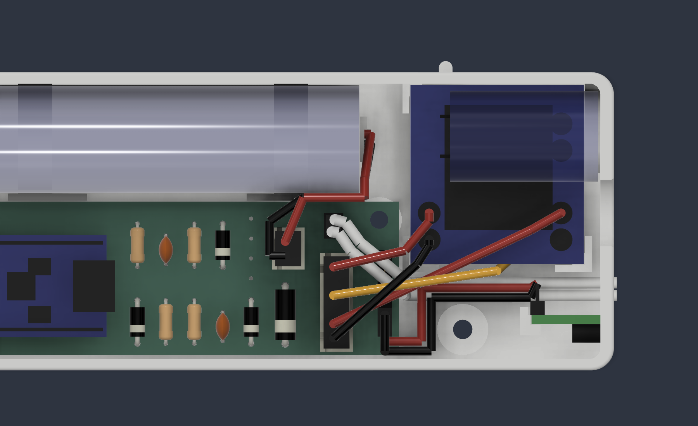
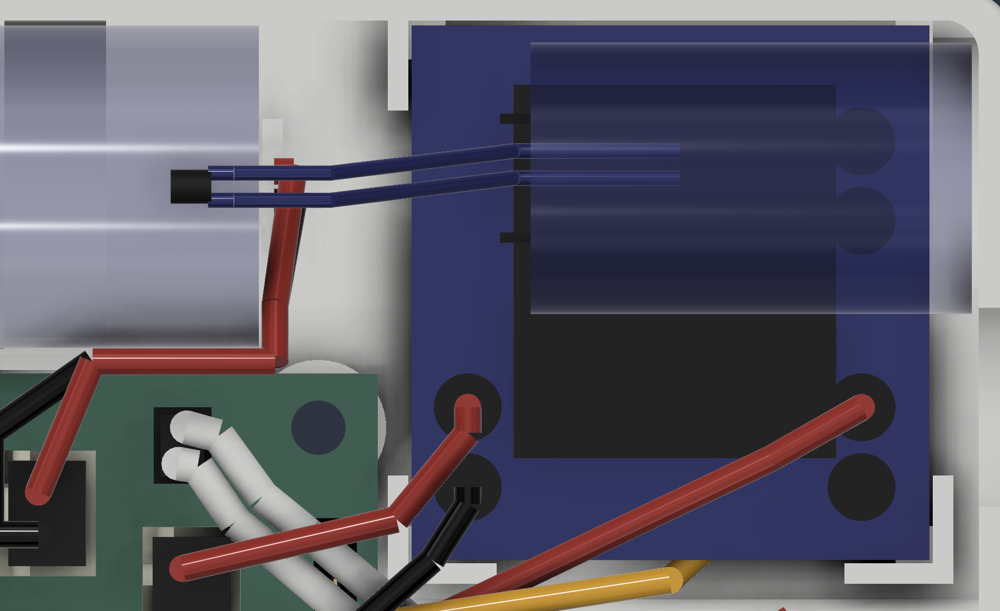

| Wire | Route | Length in the box | Room |
|---|---|---|---|
| **LOAD** (J5 pin 4 → charger LOAD, *under the capacitor*) | up out of J5 at 18.7 mm → across to the room side of the module → **down to the floor** between the two room-side corner seats → **under the module** (it stands 2.4 mm off the floor; the wire is 1.6) → bare end bent up into the LOAD pad from below. Nothing runs between the capacitor and the module | **79 mm** | >3 mm |
| PWR (J5-6 → PWR) | at 17.0 mm, past the H3 post's room side, down onto the pad | 33 mm | 2 mm to the lid |
| BATT (J5-2 → BATT) | at 17.0 mm diagonally over the module (room side of the capacitor), down onto the pad | 56 mm | 2 mm |
| GND (J5-1 → GND by PWR) | at 20.4 mm, over the other three where they cross | 43 mm | 0.8 mm to the lid |
| **Cell lead** (cell → J4) | out of the cell's end-B face, down its PCB side, past the H3 post's back, then **along the channel between the cell's PCB-side shoulder and the PCB's back edge** (the two wires one above the other, under the groove), into J4 | **40 mm** | 0.8 mm |
| USB lead (USB-C board → J3 pins 1–2) | from the board's VBUS/GND pins low (~5–8 mm) along the room side, along the room-side wall, up into the 2-pin plug | 50 / 57 mm | >3 mm |
| **NTC pair** (THERM pads → NTC on the cell) | flat on the module under the capacitor (2.1 mm gap, 30 AWG is 0.9), out at the capacitor's leg end, down past the legs, up over the bay's back corner to the cell's top, taped on near end B | 36 / 37 mm (cut 60) | >0.5 mm |
| Solar cable (flat 2-core) | in through the end-B slot, on the floor beside the module, up beside the PCB's end, over J3, into J8 | 68 mm | — |

**What the review changed:**
- **The 18650 moved back against the back wall (+2.7 mm).** Beside the PCB, the space between the cell's shoulder and the groove's underside only fit one wire, and the H3 post blocked the cell's end. The move opens a real channel for the lead. The box width is unchanged: the PCB and the H2 post set it, not the cell.
- **The lid's cell cradles** now start at Y 4.6 instead of 2.6, so they stay clear of that channel.
- **NTC wires added** (missed in the first pass). To make room for them under the capacitor, the module's corner pads drop 3.0 → 2.4 mm and the capacitor's spacer grows 1.5 → 2.1 mm; the capacitor's top is still 0.4 mm under the lid.
- **The bumpers are now 6 mm tall**, at the bottom of the back wall only, so wires can run along the rail above them.

**Lead lengths to cut** (pre-crimped 6" / 152 mm JST leads, crimped both ends):

| Lead | Cut |
|---|---|
| LOAD | **100 mm**. Half a lead (76 mm) is too short for its 79 mm route |
| PWR | the leftover 52 mm (33 mm needed) |
| BATT | half a lead, 76 mm |
| GND | half a lead, 76 mm |

That's 1.5 leads per box. The USB lead is two ~65 mm wires you make up.

**Assembly order that works with these routes:**
1. Charger subassembly on the bench: LOAD wire first, from below, then the others, then the NTC pair, then the capacitor.
2. Tray: PCB in. Cell into its saddles with its lead on the end-B end, tucked down the PCB side and along the channel to J4.
3. Charger subassembly in: lay the LOAD wire on the floor, under where the module goes, out to the room side. Seat the module. Plug J5.
4. USB-C board into its slot. Its lead goes low along the room side, then up into J3.
5. Solar cable (if used): along the floor, up beside the PCB's end, into J8.
6. Tape the NTC onto the top of the cell, about 4 mm from its end-B end (Kapton or a dab of thermal glue).
7. Lid on. Check nothing is pinched at the cell's end or over the module.

**To confirm when the parts arrive:**
- **The cell's lead:** it needs at least ~45 mm, and it should leave the cell's end face. If it comes out the side, tell me.
- ~~Where the THERM pads are~~ **confirmed** on the real module: the NTC route stands.
- ~~USB-C board's CC resistors~~ **confirmed**: it has both 5.1 k ("512"), so USB-C-to-C chargers give it 5 V. Only VBUS and GND are wired; the data pins aren't used (the ESP is flashed through its own USB-C on the bench).
- **The 30 AWG wire:** the model uses 0.9 mm OD. Anything under 1.2 mm fits.
- **Which USB-C board pins are VBUS and GND:** the route assumes the two at the bottom. If they're at the top, the wires run the same path, just higher.

## Clean-up (rev H)
- **USB-C slot:** the back rib used to sit behind the board's edge, holding nothing, with a 0.15 mm sliver gap to the
  end stop. It's now a low rib under the board's header that holds its back face, joined to the end stop and the side
  rib as one piece.
- **Cell cradles:** the PCB-edge ribs that run through the cradles are now level with the cradles' PCB-side horns (3.7 mm), with no step.
- **Capacitor:** its saddle and the module's back corner seat are now one block. It's bored for the capacitor, its face
  0.2 mm off the module's end locates the module, its ledge carries the module's corner, and its room-side horn stops
  flat at 1.5 mm wall like the cell cradles. The end-wall vents no longer cut into it.
- **Fix:** the lid cradles were being trimmed at the wrong height (a reused variable). Now they match the tray's.

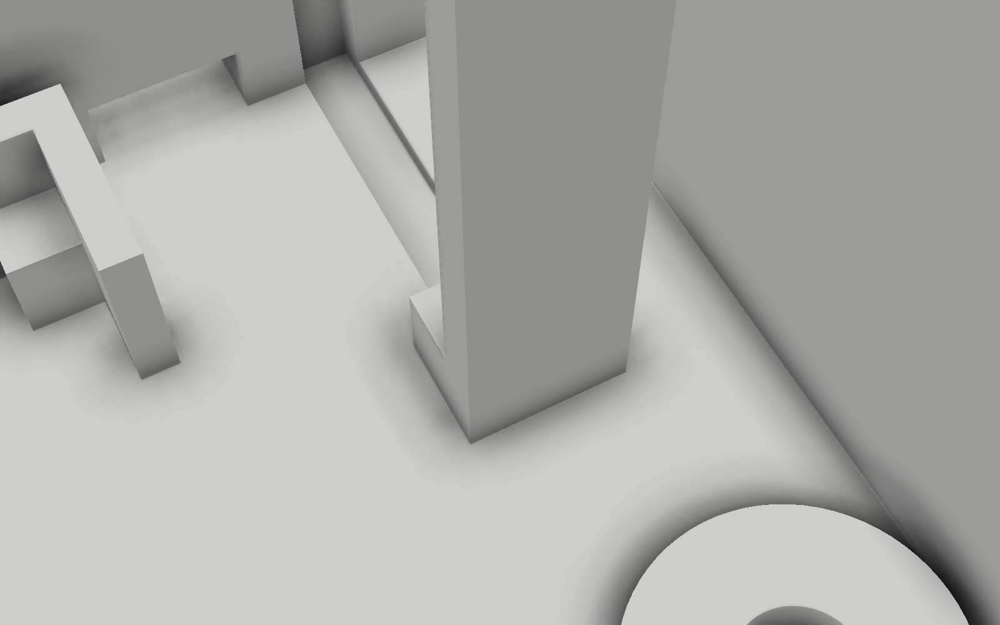 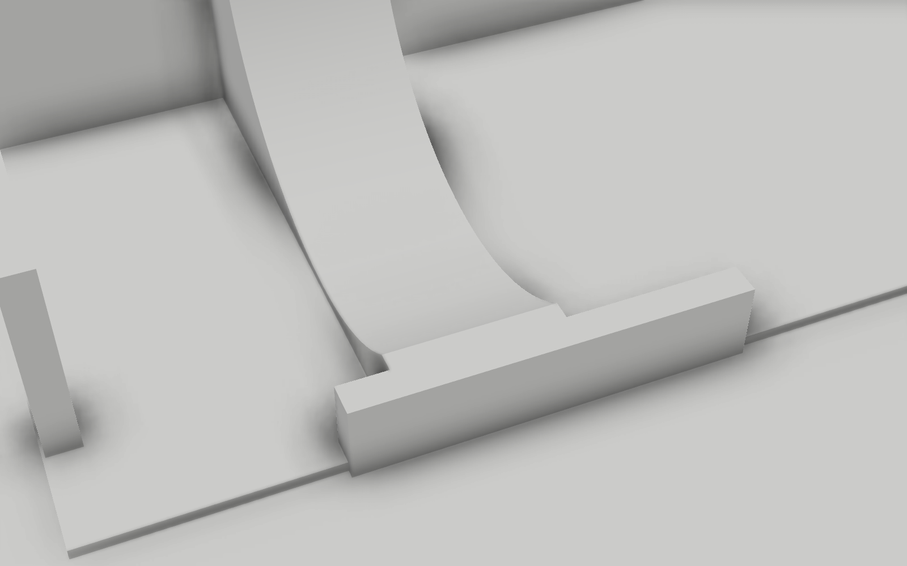 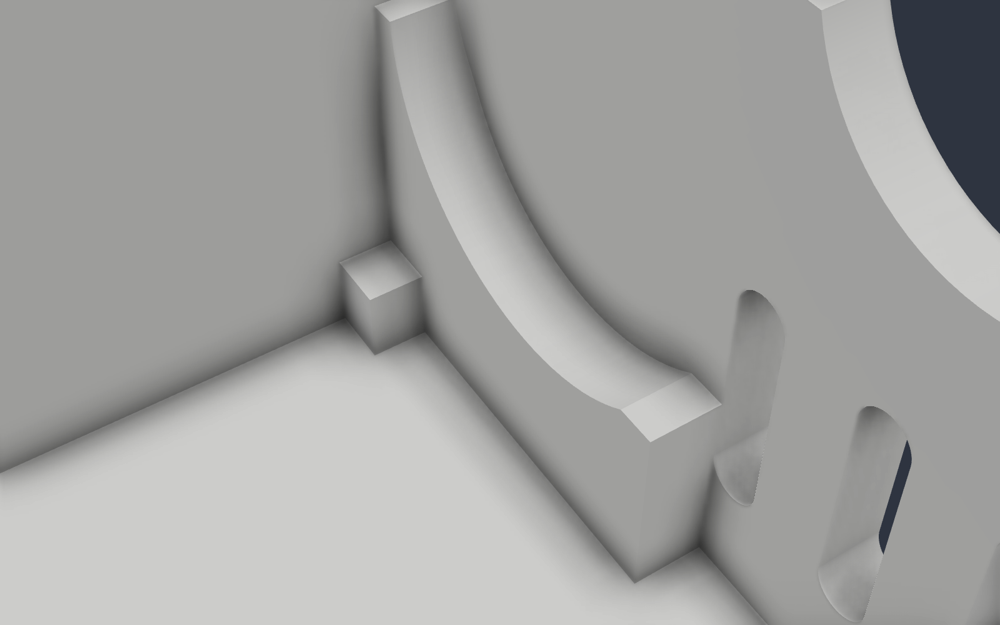

## Width, groove and battery cradle (rev G)
- **Narrower:** the back wall comes in to 0.4 mm past the PCB's 47 mm jack strip (the widest part) and 0.3 mm past the H2
  screw post. The 18650 moves 5.6 mm toward the PCB. It now starts 1.2 mm in from the PCB's edge, above it, and its
  top clears the groove's channel. The charger module moves 3.3 mm toward the room side, which is why the USB-C board's
  header pins get clipped to 3 mm. The bay's screw post and the solar cable's floor route moved with it. The box no
  longer fills the rail, so **two rounded bumpers** on the back wall stop 1.0 mm short of the rail's wall. That's an
  easy squeeze-in fit, and the box can't shift more than 1 mm, less than the groove's 1.9 mm side clearance.
- **Round groove:** a circle, r 5 mm, centered 1.67 mm above the rod's axis. The 4 mm square rod's corners (they sweep r 2.83)
  clear it by 0.5 mm at the bottom and about 1.9 mm each side at the axis. Printed upside down, it's a 7 mm arch that
  flattens to about a 2 mm bridge at its crown, so no supports. The channel under it rises away from the middle, leaving the ESP's pins
  over 3 mm of room.
- **Battery cradle:** two stations, each a tray saddle plus a matching lid cradle: 6 mm wide, the same 19.4 mm bore, and
  never thinner than 1.5 mm, so there are no feathered edges. On the back side, the saddle's horn runs up to just under
  the cell's centerline and blends into the back wall (so the cell still drops straight in), and the lid cradle comes
  down to the centerline. On the PCB side, both stop flat where their wall is still 1.5 mm thick; they can't reach further
  without going over the PCB's edge. The lid cradles sit 0.4 mm over the cell.

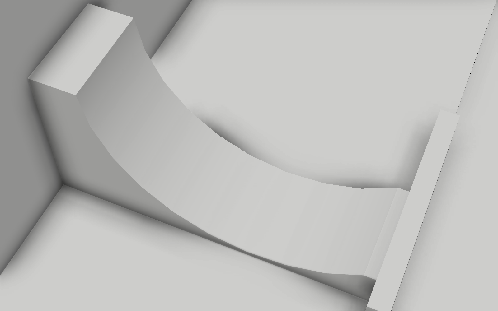 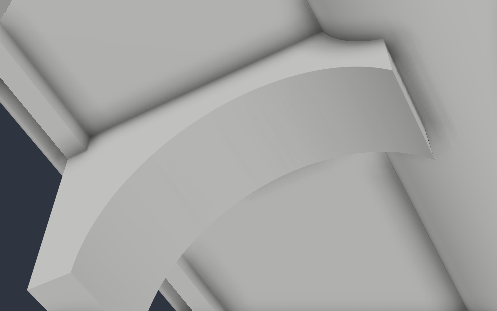

## Height (rev F)
Folding the fuses brought the box from 33.3 to **25.8 mm** tall. Nothing else changed in length or width: the length is
the PCB (125 mm) plus the charger bay, and folding parts doesn't change either. What sets each height now:

| | Top |
|---|---|
| Charger capacitor (lying on the module) | 23.3 → lid underside 23.8, top 25.8 |
| USB-C board (on edge) | 22.8 |
| 18650 | 20.7 |
| Under the rod's groove (fixed by the blind) | 19.2: ESP pins 18.4, folded F2 17.1, 470 µF 16.7, jacks 15.9 |

The rod's corners sweep about 1 mm above the lid's top face inside the groove. That's fine: the groove is open at the
top. The lid has no locating lip along end wall B, where the capacitor and USB-C board come within 1 mm of it.

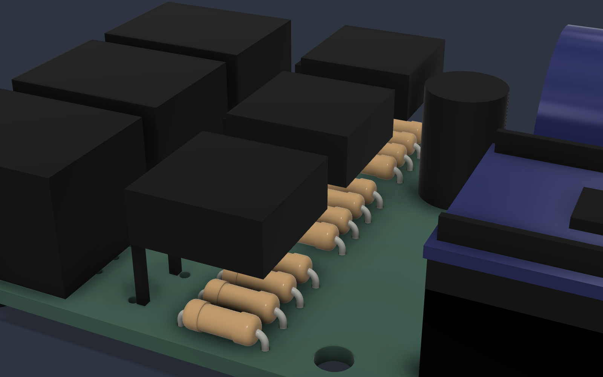

## RJ12 ports (rev D)
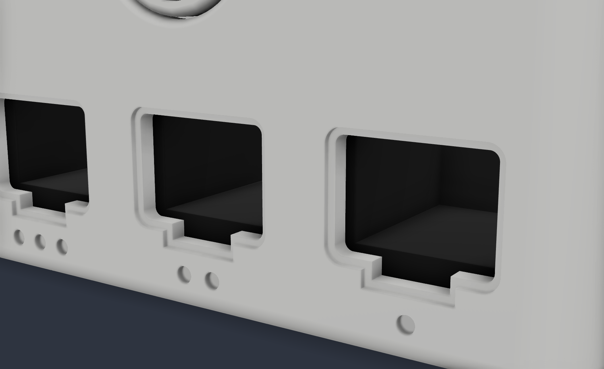

- **Openings (rev L, print 2):** the plug's outline, from your phone cord's plug: body **9.55 × 6.55**, latch **6.0 wide,
  1.5 under the body**. Each gets **0.35 mm a side** (FDM prints holes small): body opening 10.25 × 7.25 mm (corners
  r 0.6) at 1.49–8.74 mm above the PCB, centered on the jack's mouth (1.73–8.50). The latch notch is 6.7 mm wide, down to
  the PCB's top (0.34 under the latch). The jack's face fills everything behind the opening, so you see the jack, not the
  inside of the box.
- **What went wrong on print 1:** the latch notch was 5.0 mm wide. Your plug's latch is 6.0. (A middle version opened
  the whole jack face, 13.8 × 13.3. Too open: you could see the PCB.)
- **Depth:** the jack's face sits **2.35 mm** behind the outer face. End wall A is 1.6 mm, and the PCB sits 0.2 mm off it,
  with a small relief in the corner fillet for the board's corner. No bezel (0.4 nozzle).
- **Fit coupon:** `controller_v5_end_a_coupon.stl` is the 12 mm end of the tray. Print it and push your phone cord's plug
  through all three openings. It should slide through with a little play, latch and all. When the jacks arrive, check that
  it clicks into a soldered jack and releases with the latch pressed. Sizes: `plug_w`, `plug_h`, `plug_latch_w`,
  `plug_latch_h`, `ap_clear`.
- **Openings before (rev D–K):** the plug's outline + 0.25 a side, 10.15 × 7.35 mm, with a 5 mm notch for the latch.

## Mount review (rev E)
| Mount | Rev E |
|---|---|
| Charger module | **Four one-piece corner seats.** Each is a 2 × 2 ledge under the board's corner joined to a closed L of 1.2 mm walls round it (0.2 clear of the board, 1 mm above its top). On the back-wall side there is no wall leg (the tray wall, 0.3 away, does that); the ledge runs into the wall. The legs at the capacitor end stay below the capacitor. The bay moved 1 mm toward end B so the seat by the PCB clears the board's end and the H3 post |
| Capacitor | Saddle under its free end, merged with the end-B corner seat; lid pad 0.2 over it |
| 18650 | Two saddles (into the back wall) + two end stops centered on the cell's axis, bearing on its end below the + button. The cell moved 0.4 mm toward end B so the end-A stop clears the H2 post without being cut short |
| PCB | Three bosses (screw clamps) + end wall A (0.2) + the room-side wall (0.7) + free-standing ribs on the bar's and body's back edges (0.2). The thin ribs that only narrowed the gap to the room-side wall are gone (they did nothing the wall doesn't) |
| USB-C board | Edges only: end-wall pocket, floor U-channel, lid U-channel with a closed back end (rev L) |
| Lid | Three screw posts, edge pins on the charger, pads over the jacks, cell, capacitor, ESP (0.5 clear) |

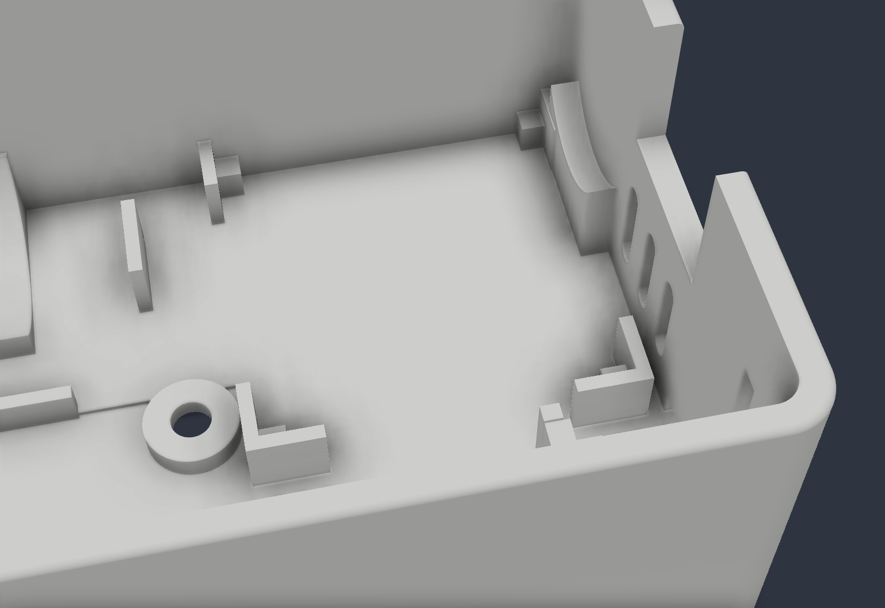

## Engineering review (rev B)
Changes made after a design review against production practice:

| Finding (rev A) | Rev B |
|---|---|
| ESP pin tips 0.6 mm under the groove. The tolerance stack (socket ±0.2, header spacer ±0.1, PCB ±0.1, print ±0.2) could use all of it | Floor recessed 0.4 under the PCB and the PCB lowered 0.3: **0.8 mm**, with 2.1 mm still under the board for leads |
| PCB loose until the lid goes on | **Locating nest**: stops on end wall A between the jacks, ribs on both long edges, all 0.2 clear and below the board's top face |
| Two screw lengths | **One part number: M3 × 10 flat head ×4**; the charger-bay post is bored past its insert for the longer screw |
| Insert posts Ø7 (1.2 mm wall left round a Ø4.6 insert); no root fillets; long Ø4 hold-down pins on the charger | Posts **Ø8** (1.7 mm wall), **45° root fillets** wherever there's room, **0.4 mm lead-in chamfer** on every insert bore; charger hold-downs **Ø6** with fillets |
| Sharp-edged jack and USB openings | **0.5 mm bezels** round all three jack windows and the USB-C window (finished look, plug lead-in) |
| Charger heat (MCP73871 is linear: ~0.6 W while charging), no vents | **3 vent slots** in end wall B beside the charger, 2 mm wide on a 5 mm pitch (3 mm webs), tops 5 mm below the groove notch (the floor sits on the rail, so not there) |
| Cell end stops 0.7 mm, a USB-slot rib 1.0 mm | 1.2 mm and 1.4 mm |
| No part marking | Engraved (sketched on the faces themselves, so it reads right when you look at them): tray bottom `BLINDS CONTROLLER / V5`, centered, lid underside `V5 LID - 4 x M3 INSERTS` |

**Checks on rev B:**
- **Interference:** exact B-rep check of every part on the PCB (KiCad's 3D export) and every mock-up against the tray, the lid and each other: **none**.
- **Print (DFM) scan of the STLs:** no unsupported islands. The bridges are:
  - lid: the 12 mm groove floor
  - tray: the 13.7 mm jack-window tops, plus 2 mm tops on the slots, vents and the capacitor-leg notch
  - everything else at 45° or less
- **Thinnest walls:** 1.2 mm (the floor under the PCB is 0.8 mm, supported flat on the rail).

**Print settings:** PLA, 0.2 mm layers, 3 walls, 20 % infill, no supports. Tray floor down, lid top face down.
Inserts at 220 °C, pressed square, flush.

**Critical-to-function dimensions** (check the first print):

| Feature | Size |
|---|---|
| Jack windows | 13.7 × 11.9 mm |
| USB-C window | 3.7 × 9.5 mm stadium |
| Cell saddles | Ø19.4 mm |
| Charger bay | 31.5 mm wide (module), 33.4 mm long (to the capacitor's end) |
| Capacitor saddle | Ø16.6 mm |
| Insert bores | Ø4.0 × 6.7 mm |

## Measure when the parts arrive (the model uses these)
| Part | Model | If yours is different |
|---|---|---|
| Charger module | 31.5 × 30.5 mm board, pads and the capacitor's 7 mm holes as in the listing photo | tell me the real size and the hole spacing |
| Charger capacitor | Ø16 × 26 mm, 7.5 mm lead spacing | lies over the module; its end saddle is Ø16.6 |
| 18650 | Ø19.0 × 69.0 mm | saddles are Ø19.4; length between the stops 69.2 |
| USB-C board | 22.1 × 13.05 mm, socket 9.1 × 3.26 sticking out 1.45 | the slot and pocket are cut to this |
| RJ12 jack 87180-066LF | 13.2 W × 11.5 H (Amphenol drawing) | |
| ESP32-C6 header spacers | 2.5 mm, pins 1.9 above the board | clip the tips if taller |

## Renders
| | |
|---|---|
|  |  |
| 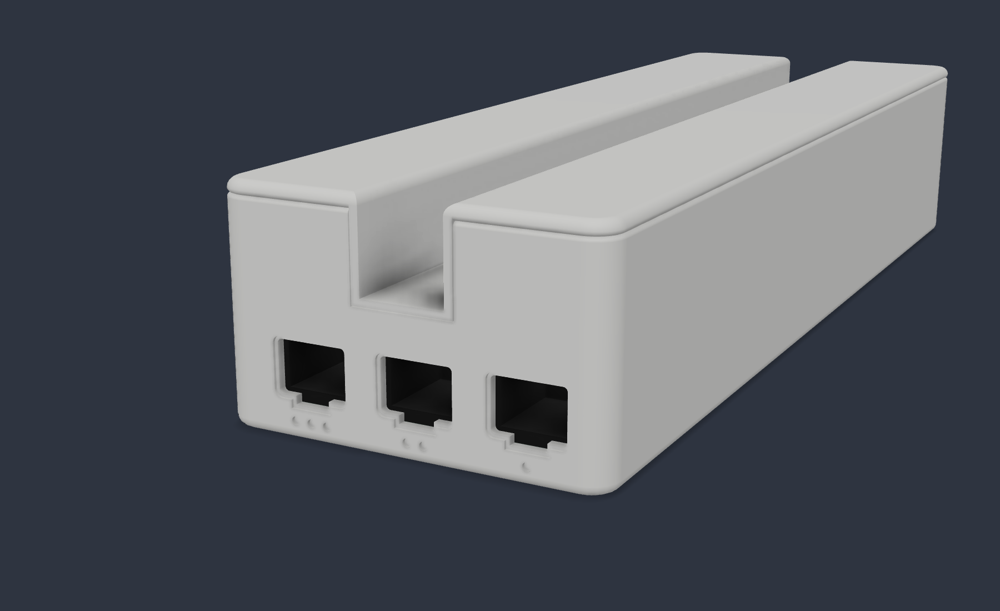 |  |
|  | 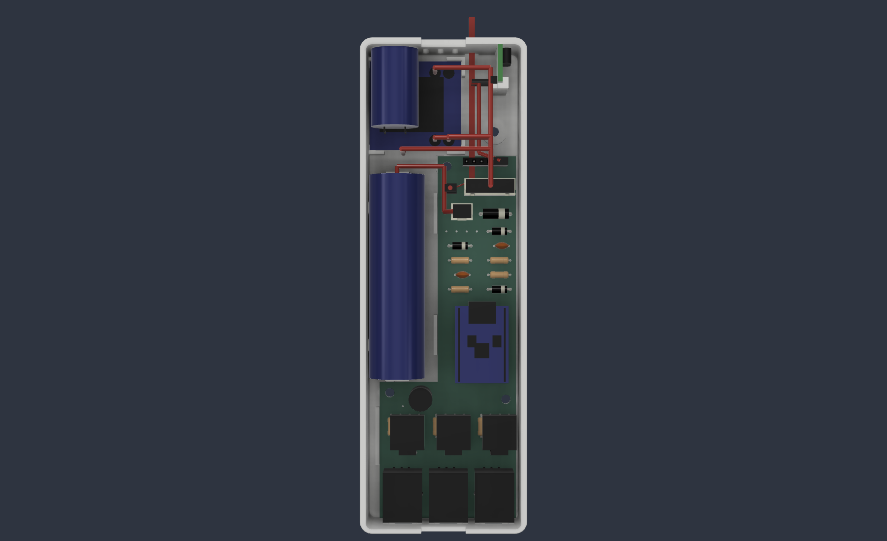 |
| 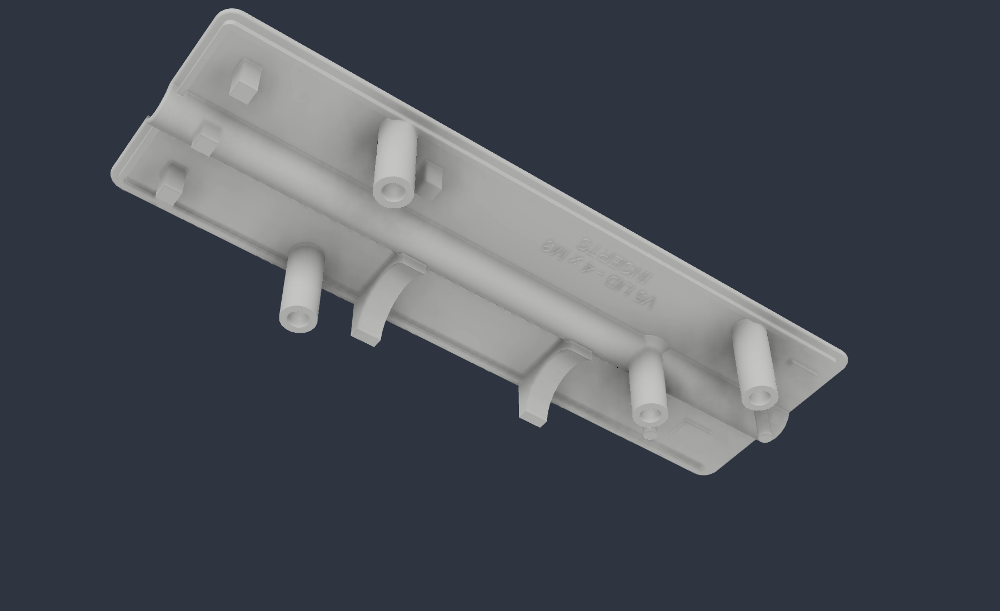 |  |
|  |  |
