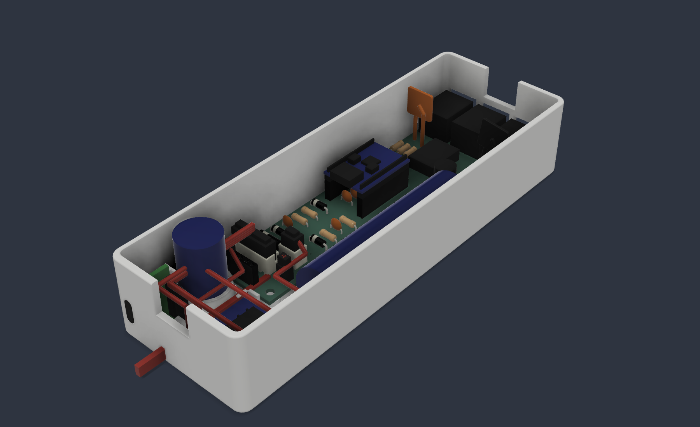
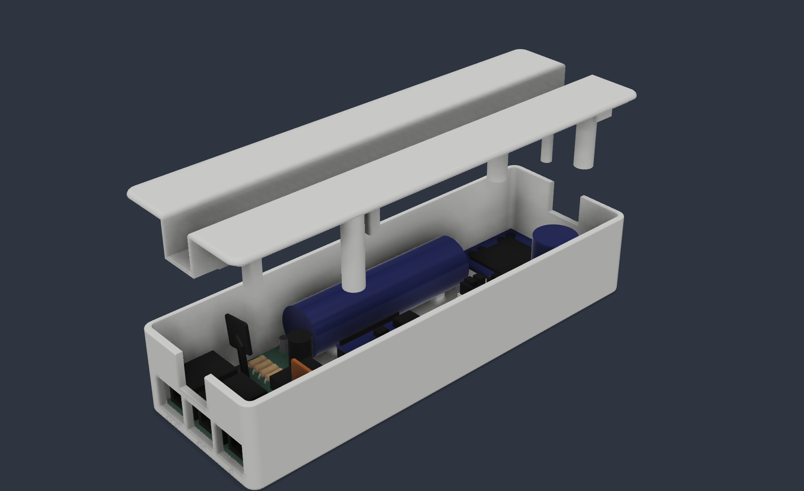

# Controller box V5 (for the carrier PCB)

The box for the controller PCB (`hardware/pcb`, v2.1), the 18650, the MCP73871 charger module with its big capacitor,
and the USB-C charge port. It is built by [ControllerV5.py](../hardware/mechanical/fusion/ControllerV5/ControllerV5.py)
and checked in Fusion by [fusion_controller_v5.py](../tools/fusion_controller_v5.py). The PCB in the model is KiCad's own
3D export of the real board, with every part on it. Everything the export lacks is mocked up from its datasheet or the
listing photos: RJ12 jacks, ESP32-C6, plugs, cell, charger, capacitor and USB-C board.

| | |
|---|---|
| Size | **164.9 × 55.4 × 33.3 mm**: same cross-section as V4 (fits the rail, rod in the lid's groove), 39 mm longer |
| Prints | `hardware/mechanical/stl/v0.5/controller_v5_tray.stl` (floor down), `controller_v5_lid.stl` (top face down), white PLA, no supports |
| Hardware | 4 × M3 heat-set inserts (the M3 × 5.7 ones you have), 3 × M3 × 10 + 1 × M3 × 8 flat-head (countersunk) screws |
| Check | Exact interference check of every part against the tray, lid and each other: **none** |

## Why it is longer than V4
The rod's groove runs down the middle of the lid, so under it there is only **19.2 mm** of height. The PCB is 47 mm wide
at the jacks and 27 mm beside the cell, so the cell takes the back side. The charger (31.5 × 30.5 mm) is wider than
the space left anywhere beside the PCB, so it gets its own bay past the PCB's end. Its capacitor (16 × 26 mm) stands
in a cup beside it.

That bay sits where the USB-C board used to plug into J3, so the **USB-C board moves to end wall B**, standing on
edge in a slot. A short 2-wire lead joins it to J3.

## The tight spots (all checked in the model)
| Where | Room |
|---|---|
| ESP32-C6 header pin tips (on the side under the groove) | **0.6 mm** below the groove. Clip the pin tips flush with flush cutters for more room (optional) |
| Under the PCB | 2.0 mm gap. The tallest tails (JST-XH headers) reach 1.8 mm; trim any other lead that sticks out further. The jacks' tails and pegs sit in pockets in the floor |
| Fuse F1 (room side, standing) | 2.0 mm under the lid |
| 470 µF capacitor | 2–3 mm under the groove (standing, as soldered) |
| Battery plug wires (J4) | 1.5 mm under the groove: bend them over as they leave the plug |
| Cell, jacks, charger, capacitor, USB-C board | held by pads on the lid (0.05–0.3 mm, by design) |

## Before it goes in the box
1. **Fuse F2 (the middle one)** sits under the groove. Upright it is 23.5 mm tall, so after soldering, **fold it flat
   back over its four resistors**, toward the ESP.
2. **Fuse F3 (beside the cell)**: lean it slightly toward the cell side (about 8°, a gentle push) so its top clears the groove.
3. **Fuse F1** stays upright.
4. **USB-C lead**: two wires, about 45 mm. Solder one end to the USB-C board's **VBUS** and **GND** pins. Solder the
   other end to a 2-pin piece of male header that plugs into **J3 pins 1 (VBUS) and 2 (GND)**. Use red for VBUS and black for GND,
   or the white flat 2-core cable with the VBUS side marked.
5. **Charger harness**: the 6-pin JST-XH plug (J5) with four leads, soldered to the module's **GND, BATT, LOAD, PWR**
   pads (see [hardware/pcb/README.md](../hardware/pcb/README.md)).
6. **Charger capacitor**: it stands in the cup with its legs to the module side. The legs run under the module and up
   through its capacitor holes, soldered on top. If the legs are too short, extend them with wire. Check **+** is right.

## Assembly
1. Press the 4 inserts into the lid's 4 posts (lid upside down, soldering iron).
2. Drop the PCB onto its 3 floor bosses (jacks toward the windows in end A). It just sits there for now.
3. Cell into its two saddles along the back wall, lead at end B. Plug it into J4.
4. Charger module into its bay (corner guides), capacitor into its cup, harness into J5.
5. USB-C board: slide it down into its slot at end B, socket into the window, component side toward the room-side wall.
   Plug its lead into J3.
6. Solar lead (if used): through the slot in end wall B, along the floor between the capacitor cup and the module, into J8.
7. Lid on: its posts land on the PCB's 3 holes and the boss in the charger bay.
8. Turn the box over and drive the 4 flat-head screws up through the floor: **M3 × 10** at the three PCB holes,
   **M3 × 8** in the charger bay. They clamp the PCB between the floor and the lid posts, and hold the lid on.

The top stays clean (no screw heads) and the screw heads sit flush with the bottom, so it still slides into the rail.

## Measure when the parts arrive (the model uses these)
| Part | Model | If yours is different |
|---|---|---|
| Charger module | 31.5 × 30.5 mm board, pads as in the listing photo | the bay is 31.5 + 0.8 long; tell me the real size |
| Charger capacitor | Ø16 × 26 mm | the cup is Ø16.6 |
| 18650 | Ø19.0 × 69.0 mm | saddles are Ø19.4; length between the stops 69.2 |
| USB-C board | 22.1 × 13.05 mm, socket 9.1 × 3.26 sticking out 1.45 | the slot and pocket are cut to this |
| RJ12 jack 87180-066LF | 13.2 W × 11.5 H (Amphenol drawing) | |
| ESP32-C6 header spacers | 2.5 mm, pins 1.9 above the board | clip the tips if taller |

## Renders
| | |
|---|---|
|  |  |
|  |  |
|  |  |
|  |  |
