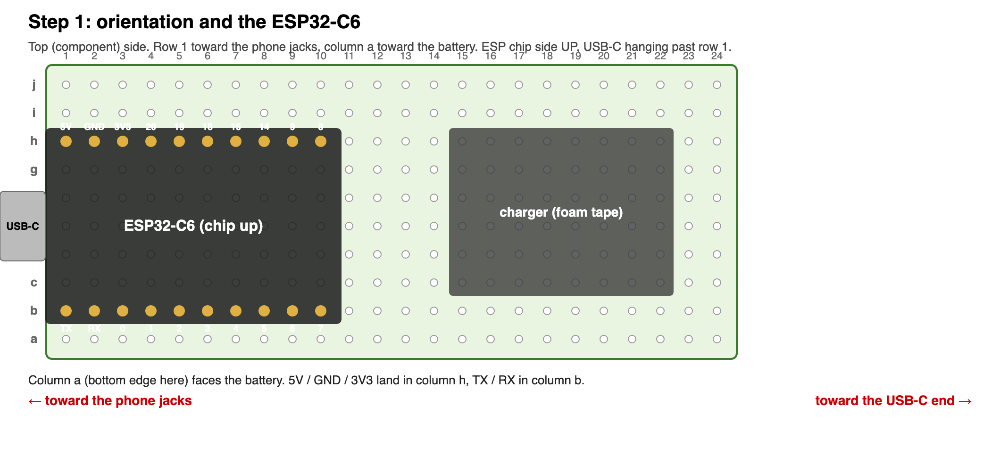
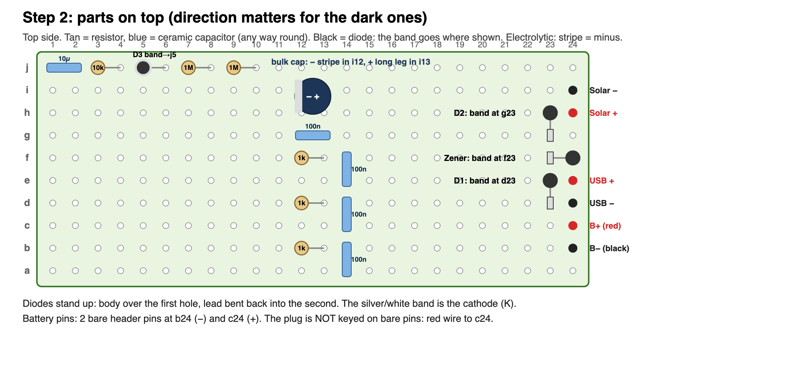
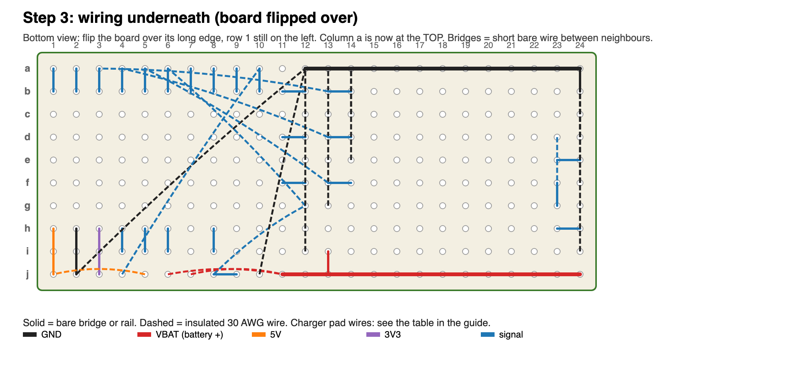

# Building the controller dev board, step by step

For the kit's **3 × 7 cm perfboard (columns a–j, rows 1–24)**. Every hole and wire is also listed in
[ctrl-v4-wiring.md](renders/ctrl-v4-wiring.md); the pictures here are drawn from the same data
([`tools/devboard_guide.py`](../tools/devboard_guide.py)), and [`tools/devboard_check.py`](../tools/devboard_check.py)
checks that the wiring makes every connection with no shorts.

## Which parts have a direction?

| Part | Direction matters? | How to tell |
|---|---|---|
| Resistors (1k, 10k, 1M) | **No** | either way round |
| Ceramic capacitors (100n, 10µ, small blue/yellow blocks) | **No** | either way round |
| **1N5819 diodes** (D1, D2, D3) | **YES** | the silver/white **band is the cathode (K)**; put the band where the picture shows |
| **6.2 V zener** (Z) | **YES** | same: band = cathode |
| **Bulk electrolytic** (the can that comes with the charger) | **YES** | stripe with "−" marks minus; the **long leg is +** |
| **ESP32-C6** | **YES** | chip side up, USB-C past row 1, 5V/GND/3V3 in column h |
| **Battery plug** on the 2 header pins | **YES, and it can go on backwards** | red wire on **c24 (+)**, black on **b24 (−)**; mark c24 with a marker |
| USB-C and solar leads | **YES** | red/+ to e24 (USB) and h24 (solar), black/− to d24 and i24 |
| Charger pads | **YES** | follow the pad table at the end |

A reversed diode just won't conduct (nothing gets power); a reversed electrolytic or a battery plugged in backwards
can damage parts. Check those three twice before connecting the battery.

## Tools and tips
- Soldering iron (~330 °C), thin solder, flush cutters, tweezers, multimeter (beep / continuity mode).
- Work on the **top** to place parts, solder them **underneath**, trim the leads ~1 mm long.
- **Bridge** = join two neighbouring holes underneath with a short piece of bare wire (a cut-off resistor leg works
  well) or a solder blob. **Wire** = 30 AWG insulated wire between holes further apart.
- Lowest parts first: header pins, then resistors and diodes, then capacitors.

## Step 1: orientation and the ESP32-C6

1. Mark the board: **row 1 is the end toward the phone jacks**, **column a is the edge toward the battery**.
2. Solder header pins into the ESP's **inner** holes (long side down), then set the ESP on the perfboard **chip side up**,
   USB-C hanging past row 1: its pins go into **b1–b10** and **h1–h10**. Check: **5V is in h1, GND in h2, 3V3 in h3,
   TX in b1**. Solder one pin at each corner, check it sits flat, then the rest.
3. Leave the charger for later (it's taped on in step 4).

## Step 2: parts on top

Resistors and diodes **stand up**: body over the first hole, the other lead bent down into the second hole.

| Part | Holes | Direction |
|---|---|---|
| 10 µF ceramic | j1, j2 | any |
| 10 kΩ (R stat) | j3, j4 | any |
| **D3** 1N5819 | j5, j6 | **band at j5** |
| 1 MΩ (divider top) | j7, j8 | any |
| 1 MΩ (divider bottom) | j9, j10 | any |
| 100 nF (divider) | g12, g13 | any |
| 1 kΩ ×3 (angle filters) | b12–b13, d12–d13, f12–f13 | any |
| 100 nF ×3 (angle filters) | a14–b14, c14–d14, e14–f14 | any |
| **Bulk electrolytic** | i12, i13 | **stripe (−) in i12, long leg (+) in i13** |
| **D1** 1N5819 (USB) | e23, d23 | **band at d23** |
| **D2** 1N5819 (solar) | h23, g23 | **band at g23** |
| **Zener** 6.2 V | f24, f23 | **band at f23** |
| 2 header pins (battery) | b24 (−), c24 (+) | mark c24 "+" |

## Step 3: wiring underneath

Flip the board over its **long** edge: row 1 stays on the left, column a is now at the **top**. The colours match the
nets: black GND, red battery +, orange 5V, purple 3V3, blue signals.

1. **Rails first:** a bare wire along column **a**, rows 12–24 (GND), and along column **j**, rows 11–24 (battery +),
   soldered at every hole.
2. **Bridges** next to the ESP (a1–b1 … a10–b10; h1–i1–j1, h2–i2–j2, h3–i3–j3; h4–i4, h5–i5, h6–i6, h8–i8) and the
   short ones in rows 11–14 and 23–24.
3. **Wires** (dashed in the picture): every one is in the "Underside wiring" table of
   [ctrl-v4-wiring.md](renders/ctrl-v4-wiring.md), with what it connects.
4. After each group, check with the meter's beep mode: the two ends beep, and **GND (a12) must NOT beep to battery +
   (j11)** or to 5V (h1).

## Step 4: charger
1. Before mounting: remove the charger's THERM resistor and solder the 10 kΩ NTC's two leads there (the NTC gets taped
   to the cell later). Tin its pads.
2. Stick it on with foam tape over **c15–h22**, pads facing where the wires will reach.
3. Wire its pads (short insulated wires, from the top):

| Charger pad | Goes to |
|---|---|
| PWR + (input) | g23 |
| PWR − / GND | a20 |
| BATT + | c24 |
| BATT − | a21 |
| LOAD + (output) | j20 |
| LOAD − | a22 |
| STAT (STAT1 if there are two) | a10 |

(Pad names assumed from the Adafruit-style board; send a photo of the real board's pads before wiring them.)

## Step 5: leads in
Solder the 18 leads from the three RJ12 boards from the top (pin 1 = the square pad on each RJ12 board):

| RJ12 pin | Port 1 | Port 2 | Port 3 |
|---|---|---|---|
| 1 battery + | j15 | j16 | j17 |
| 2 IN1 | i6 | i4 | a1 |
| 3 GND | a15 | a16 | a17 |
| 4 angle | b11 | d11 | f11 |
| 5 EN | a7 | a8 | a9 |
| 6 IN2 | i5 | i8 | a2 |

Then the USB-C breakout's VBUS → e24 and GND → d24, and the solar lead's + → h24 and − → i24.

## Step 6: first power-up (no battery yet)
1. Meter check: GND (a12) to battery + (j11): no beep. GND to 5V (h1): no beep. GND to 3V3 (h3): no beep.
2. Plug USB into the **ESP's own** USB-C only (battery unplugged). Its LED should light; upload the test sketch.
3. Unplug USB, then push the cell's plug onto b24/c24 (**red on c24**). Measure j11 to a12: the cell voltage (3.0–4.2 V).
4. Never plug USB into the ESP and the battery at the same time unless D3 is fitted.
