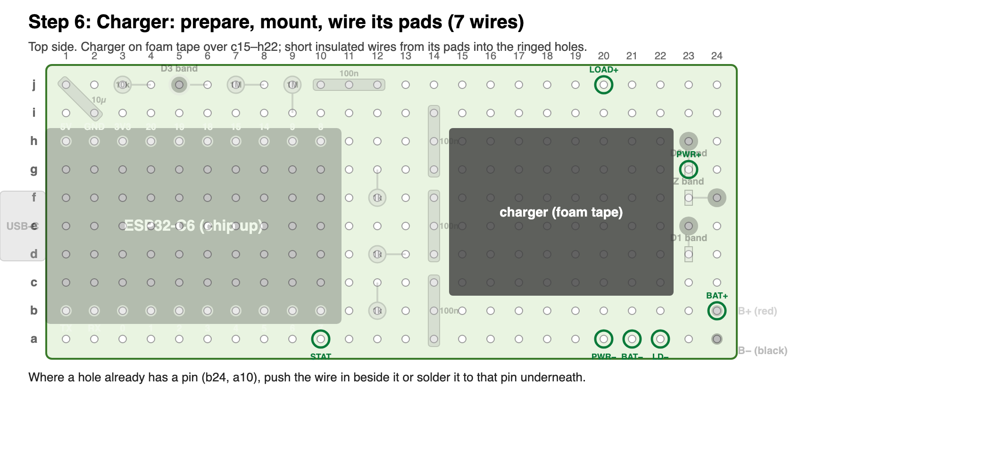
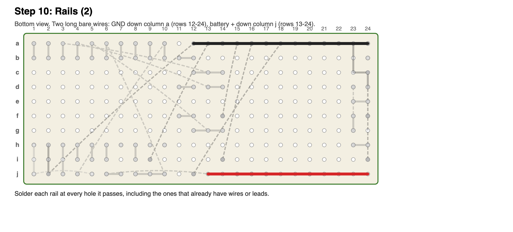
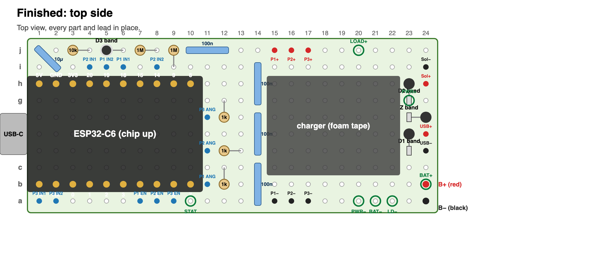
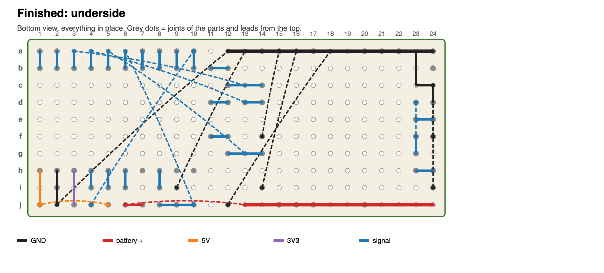

# Building the controller dev board, step by step

For the kit's **3 × 7 cm perfboard (columns a–j, rows 1–24)**. Everything here (pictures, tables, counts) is generated
from the layout in [ControllerV4.py](../hardware/mechanical/fusion/ControllerV4/ControllerV4.py) by
[`tools/devboard_guide.py`](../tools/devboard_guide.py); [`tools/devboard_check.py`](../tools/devboard_check.py)
checks that the wiring makes every connection with no shorts. Full wiring list:
[ctrl-v4-wiring.md](renders/ctrl-v4-wiring.md).

**Order:** all parts and leads first (steps 1–7, holes still open), then the insulated wires (8), then the bare
bridges (9), then the rails (10). That way solder never fills a hole that something still has to go through. Each
step does one kind of part, and in its picture that step is in colour while everything already done is grey.

## Parts for one board

| Part | Count | Step | From (BOM) |
|---|---|---|---|
| ESP32-C6 SuperMini | 1 | 1 | ESP32-C6 SuperMini 5-pack |
| Header pins | 22 | 1 (2 × 10), 5 (2) | perfboard kit headers |
| Resistor 1 kΩ | 3 | 2 | resistor kit |
| Resistor 10 kΩ | 1 | 2 | resistor kit |
| Resistor 1 MΩ | 2 | 2 | resistor kit |
| Diode 1N5819 | 3 | 3 | 1N5819 150-pack |
| Zener 6.2 V | 1 | 3 | zener kit |
| Ceramic capacitor 100 nF (104) | 4 | 4 | ceramic capacitor kit |
| Ceramic capacitor 10 µF (106) | 1 | 4 | ceramic capacitor kit |
| MCP73871 charger board (+ its bulk capacitor) | 1 | 6 | Comimark MCP73871 |
| NTC thermistor 10 kΩ | 1 | 6 | NTC 10-pack |
| Foam tape | 1 piece | 6 |  |
| RJ12 breakout board | 3 | 7 (18 leads) | RJ11/RJ12 breakout 4-pack |
| USB-C breakout (Cermant) | 1 | 7 (2 leads) | USB-C breakout 10-pack |
| Solar lead (optional) | 1 | 7 (2 leads) | solar panel + extension |
| 30 AWG insulated wire | 22 pieces | 6 (7), 8 (15) | 30 AWG silicone wire |
| Bare wire or trimmed resistor legs | 35 bridges + 2 rails | 9, 10 | tinned wire / leg offcuts |
| Perfboard 3 × 7 cm (a–j × 1–24) | 1 | all | perfboard kit |
| 18650 cell with JST-XH plug | 1 | 11 | 18650 cell |

For all 3 controllers, triple every count. Links and prices: [BOM](../hardware/BOM.md).

## Which parts have a direction?

| Part | Direction matters? | How to tell |
|---|---|---|
| Resistors | **No** | either way round |
| Ceramic capacitors | **No** | either way round; legs 3 holes apart, the middle hole stays empty |
| **1N5819 diodes, 6.2 V zener** | **YES** | the silver/white **band is the cathode (K)** |
| **ESP32-C6** | **YES** | chip side up, USB-C past row 1, 5V/GND/3V3 in column h |
| **Battery plug** on the 2 header pins | **YES, and it can go on backwards** | red wire on **b24 (+)**, black on **a24 (−)** |
| **Charger bulk capacitor** (on the charger board) | **YES** | stripe = −, long leg = + |
| USB-C and solar leads, charger pads | **YES** | follow the tables |

A reversed diode just won't conduct; a reversed electrolytic or battery can damage parts. Check those twice.

## Tools and tips
- Soldering iron (~330 °C), thin solder, flush cutters, tweezers, multimeter (beep / continuity mode), marker.
- Place parts on the **top**, solder **underneath**, trim leads to ~1 mm.
- Use just enough solder for a small cone on the pad. Too much spreads to the next pad or fills holes.
- If a hole fills by accident, heat it and clear it with a desoldering pump or wick before going on.

## Step 1: ESP32-C6 and its headers

1. Mark the board with a marker: **row 1 = the end toward the phone jacks**, **column a = the edge toward the battery**.
2. Push two 10-pin header strips into the ESP's **inner** holes (long side down), set the ESP on the perfboard **chip side
   up**, USB-C hanging past row 1: the pins go into **b1–b10** and **h1–h10**.
3. Check before soldering: **5V in h1, GND in h2, 3V3 in h3, TX in b1**. Solder one pin at each corner, check it sits
   flat, then the rest. Keep each joint on its own pad.

| Part | Holes | Note |
|---|---|---|
| ESP32-C6 | b1–b10, h1–h10 | chip up, USB-C past row 1 |

## Step 2: Resistors (6)

Resistors have no direction. Bend the top lead back down, push both leads through, splay them slightly underneath so
the part stays put, solder, and **trim to ~1 mm**. Keep the trimmed legs: they make good bridges in step 9.

| Resistor | Holes | How |
|---|---|---|
| R stat 10k | j3, j4 | body over j3, lead bent back into j4 |
| R div top 1M | j7, j8 | body over j7, lead bent back into j8 |
| R div bot 1M | j9, i9 | body over j9, lead bent sideways into i9 |
| R ADC1 1k | b12, c12 | body over b12, lead bent sideways into c12 |
| R ADC2 1k | d12, d13 | body over d12, lead bent back into d13 |
| R ADC3 1k | f12, g12 | body over f12, lead bent sideways into g12 |

## Step 3: Diodes (3 × 1N5819, 1 × 6.2 V zener)

These **only work one way round**; the band end is the cathode (K). D3 stands with its body over j5, band end down.
For D1, D2 and the zener the body stands over the anode hole and the **bent-back lead is the cathode**, so the band is at
the top. Check each one against the table before soldering.

| Diode | Holes | Direction |
|---|---|---|
| D3 1N5819 | j5, j6 | **band (K) at j5**, other end (A) at j6 |
| D1 1N5819 USB | e23, d23 | **band (K) at d23**, other end (A) at e23 |
| D2 1N5819 solar | h23, g23 | **band (K) at g23**, other end (A) at h23 |
| Z 6.2V | f24, f23 | **band (K) at f23**, other end (A) at f24 |

## Step 4: Ceramic capacitors (4 × 100 nF, 1 × 10 µF)

No direction. Push them straight down so the body sits low; don't bend the legs at the body. The 10 µF goes corner
to corner (j1 to i2): pull its legs in slightly and lean the body **away from the ESP**.

| Capacitor | Holes | Note |
|---|---|---|
| C 10u | j1, i2 | corner to corner: pull the legs in slightly, lean the body away from the ESP |
| C div 100n | j10, j12 | middle hole j11 stays empty |
| C ADC1 100n | a14, c14 | middle hole b14 stays empty |
| C ADC2 100n | d14, f14 | middle hole e14 stays empty |
| C ADC3 100n | g14, i14 | middle hole h14 stays empty |

## Step 5: Battery pins (2 header pins)

Snap 2 pins off a header strip and solder them in **a24 (−)** and **b24 (+)**, long side up. Mark **b24 "+"** in red.

| Part | Holes | Note |
|---|---|---|
| Battery pins | a24 (−), b24 (+) | red wire of the plug on b24 |

## Step 6: Charger: prepare, mount, wire its pads (7 wires)

1. On the bench first: remove the charger's fixed THERM resistor and solder the 10 kΩ NTC's two leads there (the NTC
   gets taped to the cell later). If the charger came with a loose bulk capacitor, solder it across its LOAD pads
   (**long leg / + to LOAD +**, stripe / − to LOAD −). Tin the pads.
2. Stick it on with foam tape over **c15–h22**.
3. Cut 7 short pieces of 30 AWG wire, strip ~3 mm, solder one end to each pad and push the other end through its hole
   from the top. Solder them underneath.

(Pad names assumed from the Adafruit-style board: check them against the real board before wiring.)

| Charger pad | Board hole | Net |
|---|---|---|
| PWR + (input) | g23 | PWR node: D1 + D2 cathodes, zener |
| PWR - / GND | a20 | GND rail |
| BATT + | b24 | battery pin B+ (the cell reaches the VBAT rail only through the charger) |
| BATT - | a21 | GND rail |
| LOAD + (output) | j20 | VBAT rail |
| LOAD - | a22 | GND rail |
| STAT | a10 | GPIO7 (pulled up by R stat) |
| THERM | (NTC) | remove the board's THERM resistor; NTC from THERM to GND, taped to the cell |

## Step 7: Leads from the RJ12, USB-C and solar boards (22)

Solder the 18 leads from the three RJ12 boards (pin 1 = square pad), then the USB-C breakout's VBUS → e24 and
GND → d24, and the solar lead's + → h24 and − → i24. Trim underneath to ~1 mm.

| RJ12 pin | Port 1 | Port 2 | Port 3 |
|---|---|---|---|
| 1 battery + | j15 | j16 | j17 |
| 2 IN1 | i6 | i4 | a1 |
| 3 GND | a15 | a16 | a17 |
| 4 angle | b11 | d11 | f11 |
| 5 EN | a7 | a8 | a9 |
| 6 IN2 | i5 | i8 | a2 |

| Lead | Hole |
|---|---|
| USB-C VBUS (+) | e24 |
| USB-C GND (−) | d24 |
| Solar + | h24 |
| Solar − | i24 |

## Step 8: Insulated wires underneath (15)

Wires go in **before** the bridges and rails, while their holes are still open. For each wire: cut it a little long,
strip ~2 mm at each end, push the ends into the two holes **from underneath**, solder, trim. Where a hole already has a
lead, solder the wire end to that lead. Beep each wire out with the meter as you go.

| From | To | What |
|---|---|---|
| j2 | a12 | ESP GND -> GND rail |
| j4 | a10 | R stat -> STAT / GPIO7 |
| j5 | j1 | D3 cathode -> ESP 5V (straight along column j) |
| j6 | j13 | D3 anode -> VBAT rail (straight along column j) |
| j10 | a6 | divider node -> GPIO3 |
| i9 | a13 | R div bot -> GND rail |
| j12 | a18 | C div -> GND rail |
| c13 | a3 | filter 1 -> GPIO0 |
| d13 | a4 | filter 2 -> GPIO1 |
| g13 | a5 | filter 3 -> GPIO2 |
| f14 | a15 | C ADC2 -> GND rail |
| i14 | a16 | C ADC3 -> GND rail |
| d23 | f23 | D1 cathode -> PWR node (zener cathode) |
| f24 | c24 | zener anode -> GND link (straight along row 24) |
| i24 | c24 | solar - -> GND link (straight along row 24) |

## Step 9: Bare bridges underneath (35)

A bridge is a short piece of **bare** wire laid across neighbouring pads (a trimmed resistor leg is ideal), soldered at
both ends; don't rely on a solder blob alone. Work one area at a time and check each with the meter: the two ends beep,
and neither beeps to the pad next to it.

| From | To | What |
|---|---|---|
| a1 | b1 | port 3 IN1 -> GPIO16 |
| a2 | b2 | port 3 IN2 -> GPIO17 |
| a3 | b3 | angle 1 -> GPIO0 |
| a4 | b4 | angle 2 -> GPIO1 |
| a5 | b5 | angle 3 -> GPIO2 |
| a6 | b6 | battery divider -> GPIO3 |
| a7 | b7 | port 1 EN -> GPIO4 |
| a8 | b8 | port 2 EN -> GPIO5 |
| a9 | b9 | port 3 EN -> GPIO6 |
| a10 | b10 | charger STAT -> GPIO7 |
| h1 | j1 | ESP 5V -> C 10u |
| h2 | j2 | ESP GND -> C 10u |
| h3 | j3 | ESP 3V3 -> R stat |
| h4 | i4 | port 2 IN1 -> GPIO20 |
| h5 | i5 | port 1 IN2 -> GPIO19 |
| h6 | i6 | port 1 IN1 -> GPIO18 |
| h8 | i8 | port 2 IN2 -> GPIO14 |
| j6 | j7 | D3 anode -> R div top (VBAT) |
| j8 | j9 | divider node |
| j9 | j10 | divider node -> C div |
| b11 | b12 | port 1 ANGLE -> R ADC1 |
| d11 | d12 | port 2 ANGLE -> R ADC2 |
| f11 | f12 | port 3 ANGLE -> R ADC3 |
| c12 | c13 | R ADC1 -> filter 1 node |
| c13 | c14 | filter 1 node -> C ADC1 |
| d13 | d14 | R ADC2 -> C ADC2 |
| g12 | g13 | R ADC3 -> filter 3 node |
| g13 | g14 | filter 3 node -> C ADC3 |
| e23 | e24 | USB V+ -> D1 anode |
| h23 | h24 | solar + -> D2 anode |
| f23 | g23 | PWR node -> D2 cathode |
| d24 | c24 | USB V- -> GND link |
| c24 | c23 | GND link |
| c23 | b23 | GND link |
| b23 | a23 | GND link -> GND rail |

## Step 10: Rails (2)

Last: lay a straight bare tinned wire along column **a** from row 12 to row 24 (GND) and along column **j** from row 13
to row 24 (battery +), soldering it at every hole. Then do the checks in step 11.

| From | To | What |
|---|---|---|
| a12 | a24 | bare wire down column a, rows 12-24 |
| j13 | j24 | bare wire down column j, rows 13-24 |

## Step 11: checks and first power-up

The battery + rail (column j) gets most of its connections from the top: the three port leads (j15–j17) and the
charger's LOAD + wire (j20); underneath, only the wire from D3 (j6 → j13) joins it. The cell never connects to the
rail directly: battery + (b24) goes to the charger's BATT + pad and the charger feeds the rail from LOAD +.

1. Meter, beep mode, no power: GND (a12) to battery + (j13): **no beep**. GND to 5V (h1): no beep. GND to 3V3 (h3):
   no beep. GND to the battery + pin (b24): no beep.
2. Plug USB into the **ESP's own** USB-C only (battery unplugged). Its LED should light; upload the test sketch.
3. Unplug USB, then push the cell's plug onto a24/b24 (**red on b24**). Measure j13 to a12: about the cell voltage
   (3.0–4.2 V).
4. Never plug USB into the ESP and the battery at the same time unless D3 is fitted.
