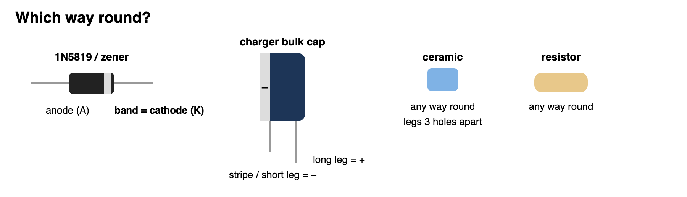
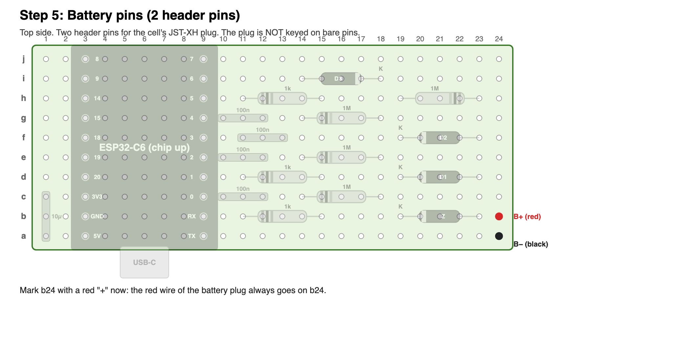
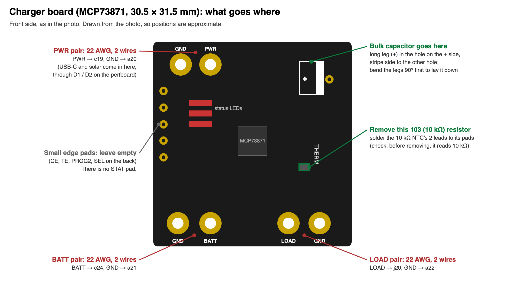
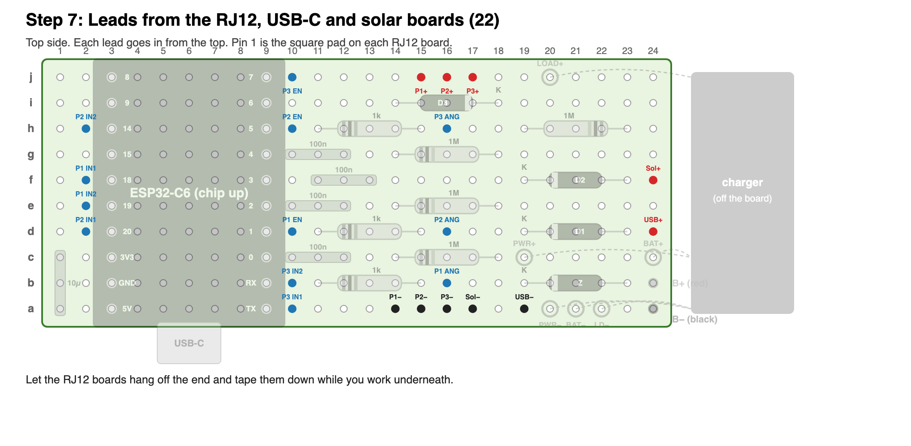
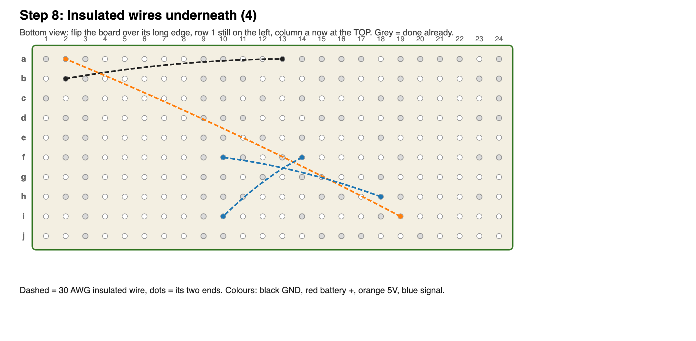
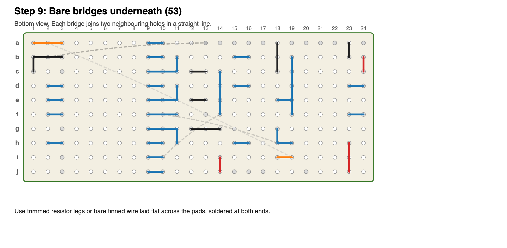

# Building the controller dev board, step by step

For the kit's **3 × 7 cm perfboard (columns a–j, rows 1–24)**. Everything here (pictures, tables, counts) is generated
from the layout in [DevBoardR.py](../hardware/mechanical/fusion/ControllerV4/DevBoardR.py) (ESP turned across the
board, resistors and diodes lying flat) by [`tools/devboard_guide.py`](../tools/devboard_guide.py);
[`tools/devboard_check.py`](../tools/devboard_check.py) checks every connection, no shorts, no parts touching, and that
every hole holds exactly one thing (a part leg, a lead or a wire end).

**Totals:** 76 parts and leads on top, 4 insulated wires, 53 bare bridges, 3 rails.

**Order:** all parts and leads first (steps 1–7, holes still open), then the insulated wires (8), then the bare
bridges (9), then the rails (10). That way solder never fills a hole that something still has to go through. Each
step does one kind of part, and in its picture that step is in colour while everything already done is grey.

## Parts for one board

| Part | Count | Step | From (BOM) |
|---|---|---|---|
| ESP32-C6 SuperMini | 1 | 1 | ESP32-C6 SuperMini 5-pack |
| Header pins | 22 | 1 (2 × 10), 5 (2) | perfboard kit headers |
| Resistor 1 kΩ | 3 | 2 | resistor kit |
| Resistor 1 MΩ | 4 | 2: battery and input-power dividers | resistor kit |
| Diode 1N5819 | 3 | 3 | 1N5819 150-pack |
| Zener 6.2 V | 1 | 3 | zener kit |
| Ceramic capacitor 100 nF (104) | 4 | 4 | ceramic capacitor kit |
| Ceramic capacitor 10 µF (106) | 1 | 4 | ceramic capacitor kit |
| MCP73871 charger board, 30.5 × 31.5 mm, off the board (+ its 16 × 26 mm bulk capacitor) | 1 | 6 | Comimark MCP73871 |
| NTC thermistor 10 kΩ | 1 | 6 | NTC 10-pack |
| White 22 AWG two-conductor wire | 3 pairs × 6-8 cm | 6 (charger power) | solar extension wire |
| RJ12 breakout board | 3 | 7 (18 leads) | RJ11/RJ12 breakout 4-pack |
| USB-C breakout (Cermant) | 1 | 7 (2 leads) | USB-C breakout 10-pack |
| Solar lead (optional) | 1 | 7 (2 leads) | solar panel + extension |
| 30 AWG insulated wire | 4 pieces | 8 | 30 AWG silicone wire |
| Bare wire or trimmed resistor legs | 53 bridges + 3 rails | 9, 10 | tinned wire / leg offcuts |
| Perfboard 3 × 7 cm (a–j × 1–24) | 1 | all | perfboard kit |
| 18650 cell with JST-XH plug | 1 | 11 | 18650 cell |

For all 3 controllers, triple every count. Links and prices: [BOM](../hardware/BOM.md).

## Which parts have a direction?

| Part | Direction matters? | How to tell |
|---|---|---|
| Resistors | **No** | either way round |
| Ceramic capacitors | **No** | either way round; legs 3 holes apart, the middle hole stays empty |
| **1N5819 diodes, 6.2 V zener** | **YES** | the silver/white **band is the cathode (K)** |
| **ESP32-C6** | **YES** | chip side up, 5V in a3, TX in a9 |
| **Battery plug** on the 2 header pins | **YES, and it can go on backwards** | red wire on **b24 (+)**, black on **a24 (−)** |
| **Charger bulk capacitor** (on the charger board) | **YES** | stripe = −, long leg = + |
| USB-C and solar leads, charger pads | **YES** | follow the tables |

A reversed diode just won't conduct; a reversed electrolytic or battery can damage parts. Check those twice.

## Tools and tips
- Soldering iron (~330 °C), thin solder, flush cutters, tweezers, multimeter (beep / continuity mode), marker.
- Place parts on the **top**, solder **underneath**, trim leads to ~1 mm.
- Use just enough solder for a small cone on the pad. Too much spreads to the next pad or fills holes.
- If a hole fills by accident, heat it and clear it with a desoldering pump or wick before going on.

## Step 1: ESP32-C6 and its headers

1. Mark the board with a marker: **row 1 = the end toward the phone jacks**, **column a = the edge toward the battery**
   (the edge with the row numbers printed on it).
2. Push two 10-pin header strips into the ESP's holes (long side down) and set it on the perfboard **chip side up**, USB-C over the column-a edge (nothing overhangs on the 30 mm board):
   the pins go into **a3–j3** and **a9–j9**.
3. Check before soldering: **5V in a3, GND in b3, TX in a9**. Solder one pin at each corner, check it sits flat, then the
   rest. Keep each joint on its own pad.

| Part | Holes | Note |
|---|---|---|
| ESP32-C6 | a3–j3, a9–j9 | chip up |

## Step 2: Resistors (7)

Resistors have no direction. Bend both legs down 90° about 2 mm from the body so they are 4 holes apart (10 mm), push
them through so the body lies flat on the board, splay the legs slightly underneath, solder, and **trim to ~1 mm**. Keep
the trimmed legs: they make good bridges in step 9. The holes under each body stay empty.

| Resistor | Holes | How |
|---|---|---|
| R div top 1M | h23, h19 | flat, legs in h23 and h19 |
| R div bot 1M | g14, g18 | flat, legs in g14 and g18 |
| R pwr top 1M | e14, e18 | flat, legs in e14 and e18 |
| R pwr bot 1M | c14, c18 | flat, legs in c14 and c18 |
| R ADC1 1k | b11, b15 | flat, legs in b11 and b15 |
| R ADC2 1k | d11, d15 | flat, legs in d11 and d15 |
| R ADC3 1k | h11, h15 | flat, legs in h11 and h15 |

## Step 3: Diodes (3 × 1N5819, 1 × 6.2 V zener)

These **only work one way round**; the band end is the cathode (K). Bend the legs like the resistors (4 holes apart)
and lay each one flat with its **band at the K hole** in the table and the picture. Check each one before soldering.

| Diode | Holes | Direction |
|---|---|---|
| D3 1N5819 | i14, i18 | flat, **band (K) at i18**, other end (A) at i14 |
| D1 1N5819 USB | d23, d19 | flat, **band (K) at d19**, other end (A) at d23 |
| D2 1N5819 solar | f23, f19 | flat, **band (K) at f19**, other end (A) at f23 |
| Z 6.2V | b19, b23 | flat, **band (K) at b19**, other end (A) at b23 |

## Step 4: Ceramic capacitors (4 × 100 nF, 1 × 10 µF)

No direction. Push them straight down so the body sits low; don't bend the legs at the body.

| Capacitor | Holes | Note |
|---|---|---|
| C 10u | a1, c1 | middle hole b1 stays empty |
| C div 100n | f11, f13 | middle hole f12 stays empty |
| C ADC1 100n | c10, c12 | middle hole c11 stays empty |
| C ADC2 100n | e10, e12 | middle hole e11 stays empty |
| C ADC3 100n | g10, g12 | middle hole g11 stays empty |

## Step 5: Battery pins (2 header pins)

Snap 2 pins off a header strip and solder them in **a24 (−)** and **b24 (+)**, long side up. Mark **b24 "+"** in red.

| Part | Holes | Note |
|---|---|---|
| Battery pins | a24 (−), b24 (+) | red wire of the plug on b24 |

## Step 6: Charger: prepare it, wire it in from off the board (3 wire pairs)

The charger board (30.5 × 31.5 mm) is wider than the perfboard, and its bulk capacitor is 16 mm across and 26 mm tall,
so it sits **off the board**, beside the row-24 end, on wires about 6–8 cm long.

1. On the bench first: remove the small **103** (10 kΩ) resistor beside the **THERM** label and solder the 10 kΩ NTC's
   two leads to its pads (the NTC gets taped to the cell later).
2. The bulk capacitor has its own footprint on the charger, at the top right (the outline with **+** on one side):
   **long leg into the + hole**, stripe side into the other. To make it lie on its side, bend both leads 90° about 2 mm
   from the body first (hold the lead with pliers at the body so the bend doesn't strain it).
3. **Power wires (they carry the battery and motor current): 3 pairs of the white 22 AWG two-conductor wire.**
   PWR + / PWR −, BATT + / BATT −, LOAD + / LOAD −. Solder each pair to its two pads, then the other ends into the
   holes in the table from the top. Keep + and − straight: mark the + conductor with a marker before you start.
4. Solder all 6 underneath. Leave the small edge pads (CE, TE, PROG2, SEL) unconnected. The board has no STAT pad;
   the ESP watches the input voltage instead (the input-power 1 MΩ pair from step 2).

(Pad names assumed from the Adafruit-style board: check them against the real board before wiring.)

| Charger pad | Board hole | Net |
|---|---|---|
| PWR + (input) | c19 | PWR node: D1 + D2 cathodes, zener (22 AWG pair with PWR -) |
| PWR - / GND | a20 | GND rail |
| BATT + | c24 | battery pin B+ (bridged from b24), 22 AWG pair with BATT - (the cell reaches the VBAT rail only through the charger) |
| BATT - | a21 | GND rail |
| LOAD + (output) | j20 | VBAT rail (22 AWG pair with LOAD -) |
| LOAD - | a22 | GND rail |
| THERM | (NTC) | remove the 103 (10 k) resistor beside the THERM label; NTC across its two pads, taped to the cell |
| CE, TE, PROG2, SEL (edge pads) | - | leave unconnected (board defaults); the board has no STAT pad, status is on its LEDs |

## Step 7: Leads from the RJ12, USB-C and solar boards (22)

Solder the 18 leads from the three RJ12 boards (pin 1 = square pad), then the USB-C breakout's VBUS → d24 and
GND → a19, and the solar lead's + → f24 and − → a17. Trim underneath to ~1 mm.

| RJ12 pin | Port 1 | Port 2 | Port 3 |
|---|---|---|---|
| 1 battery + | j15 | j16 | j17 |
| 2 IN1 | f2 | d2 | a10 |
| 3 GND | a14 | a15 | a16 |
| 4 angle | b16 | d16 | h16 |
| 5 EN | d10 | h10 | j10 |
| 6 IN2 | e2 | h2 | b10 |

| Lead | Hole |
|---|---|
| USB-C VBUS (+) | d24 |
| USB-C GND (−) | a19 |
| Solar + | f24 |
| Solar − | a17 |

## Step 8: Insulated wires underneath (4)

Wires go in **before** the bridges and rails, while their holes are still open. For each wire: cut it a little long,
strip ~2 mm at each end, push the ends into the two holes **from underneath**, solder, trim. Beep each wire out with the
meter as you go.

| From | To | What |
|---|---|---|
| b2 | a13 | ESP GND -> GND rail (under the ESP) |
| i19 | a2 | D3 cathode -> ESP 5V (under the ESP) |
| h18 | f10 | divider node -> GPIO3 |
| f14 | i10 | input-power sense -> GPIO6 |

## Step 9: Bare bridges underneath (53)

A bridge is a short piece of **bare** wire laid across neighbouring pads (a trimmed resistor leg is ideal), soldered at
both ends; don't rely on a solder blob alone. Work one area at a time and check each with the meter: the two ends beep,
and neither beeps to the pad next to it.

| From | To | What |
|---|---|---|
| a3 | a2 | ESP 5V |
| a2 | a1 | ESP 5V -> C 10u |
| b3 | b2 | ESP GND |
| b2 | b1 | ESP GND |
| b1 | c1 | ESP GND -> C 10u |
| d3 | d2 | port 2 IN1 -> GPIO20 |
| e3 | e2 | port 1 IN2 -> GPIO19 |
| f3 | f2 | port 1 IN1 -> GPIO18 |
| h3 | h2 | port 2 IN2 -> GPIO14 |
| a9 | a10 | port 3 IN1 -> GPIO16 |
| b9 | b10 | port 3 IN2 -> GPIO17 |
| d9 | d10 | port 1 EN -> GPIO1 |
| h9 | h10 | port 2 EN -> GPIO5 |
| j9 | j10 | port 3 EN -> GPIO7 |
| c9 | c10 | filter 1 -> GPIO0 |
| c10 | c11 | filter 1 node |
| c11 | b11 | filter 1 node -> R ADC1 |
| b15 | b16 | port 1 ANGLE -> R ADC1 |
| c12 | c13 | C ADC1 GND -> GND rail |
| e9 | e10 | filter 2 -> GPIO2 |
| e10 | e11 | filter 2 node |
| e11 | d11 | filter 2 node -> R ADC2 |
| d15 | d16 | port 2 ANGLE -> R ADC2 |
| e12 | e13 | C ADC2 GND -> GND rail |
| g9 | g10 | filter 3 -> GPIO4 |
| g10 | g11 | filter 3 node |
| g11 | h11 | filter 3 node -> R ADC3 |
| h15 | h16 | port 3 ANGLE -> R ADC3 |
| g12 | g13 | C ADC3 GND -> GND rail |
| f9 | f10 | battery divider -> GPIO3 |
| f10 | f11 | battery divider -> C div |
| i9 | i10 | input-power sense -> GPIO6 |
| i14 | j14 | VBAT rail -> D3 anode (battery +) |
| i18 | i19 | D3 cathode (5V) |
| h23 | i23 | R div top (battery +) |
| i23 | j23 | VBAT rail -> R div top |
| h19 | h18 | divider node |
| h18 | g18 | divider node -> R div bot |
| g14 | g13 | R div bot -> GND rail |
| e19 | e18 | PWR node -> R pwr top |
| e14 | d14 | input-power sense node |
| d14 | c14 | input-power sense node -> R pwr bot |
| e14 | f14 | input-power sense node |
| c18 | b18 | R pwr bot GND |
| b18 | a18 | R pwr bot -> GND rail |
| b19 | c19 | PWR node (zener cathode) |
| c19 | d19 | PWR node (D1 cathode) |
| d19 | e19 | PWR node |
| e19 | f19 | PWR node (D2 cathode) |
| b23 | a23 | zener anode -> GND rail |
| d24 | d23 | USB V+ -> D1 anode |
| f24 | f23 | solar + -> D2 anode |
| b24 | c24 | battery + -> charger BATT + hole |

## Step 10: Rails (3)

Last: lay straight bare tinned wire for each rail (GND a13–i13, GND a13–a24, battery + j11–j24), soldering it at every hole it passes. Where two GND rails
meet at a corner, solder them together there. Then do the checks in step 11.

| From | To | What |
|---|---|---|
| a13 | i13 | bare wire across row 13, a-i |
| a13 | a24 | bare wire down column a, rows 13-24 |
| j11 | j24 | bare wire down column j, rows 11-24 |

## Step 11: checks and first power-up

The battery + rail (battery + j11–j24) gets most of its connections from the top: the three port leads and the charger's LOAD +
wire (j20). The cell never connects to the rail directly: battery + (b24) goes to the charger's BATT + pad and the
charger feeds the rail from LOAD +.

1. Meter, beep mode, no power: GND (a13) to battery + (j11): **no beep**. GND to 5V (a3): no beep. GND to 3V3 (c3):
   no beep. GND to the battery + pin (b24): no beep. GND to the PWR node (c19): no beep.
2. Plug USB into the **ESP's own** USB-C only (battery unplugged). Its LED should light; upload the test sketch.
3. Unplug USB, then push the cell's plug onto a24/b24 (**red on b24**). Measure j11 to a13: about the cell voltage
   (3.0–4.2 V).
4. Never plug USB into the ESP and the battery at the same time unless D3 is fitted.
