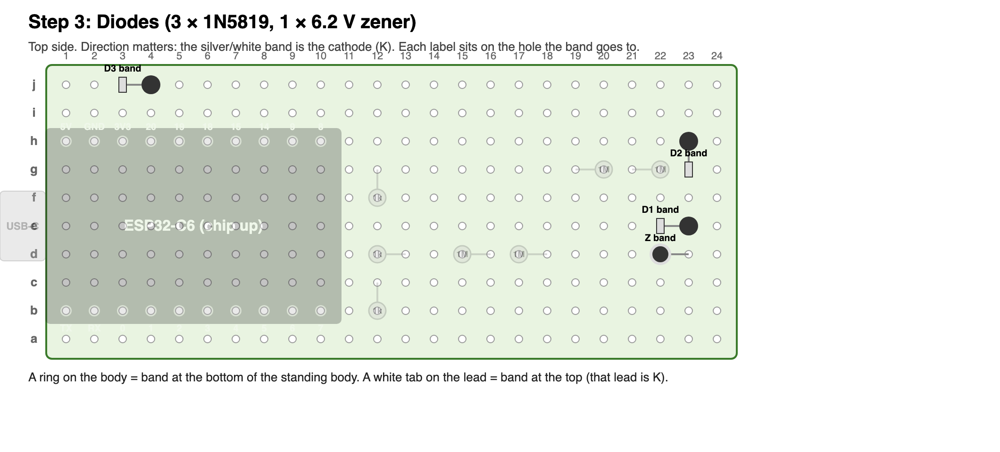

# Building the controller dev board, step by step

For the kit's **3 × 7 cm perfboard (columns a–j, rows 1–24)**. Everything here (pictures, tables, counts) is generated
from the layout in [DevBoardR.py](../hardware/mechanical/fusion/ControllerV4/DevBoardR.py) (ESP turned across the
board, resistors and diodes lying flat) by [`tools/devboard_guide.py`](../tools/devboard_guide.py);
[`tools/devboard_check.py`](../tools/devboard_check.py) checks every connection, no shorts, no parts touching, and that
every hole holds exactly one thing (a part leg, a lead or a wire end).

**Totals:** 87 parts and leads on top, 4 insulated wires, 61 bare bridges, 3 rails.

**Order:** all parts and leads first (steps 1–7, holes still open; step 7, solar, is optional), then the insulated
wires (8), then the bare bridges (9), then the rails (10); the ESP and the USB-C board plug in last (11). That way solder never fills a hole that something still has to go through. Each
step does one kind of part, and in its picture that step is in colour while everything already done is grey.

## Parts for one board

| Part | Count | Step | From (BOM) |
|---|---|---|---|
| ESP32-C6 SuperMini, with its male pins soldered on | 1 | plugs in at the end | ESP32-C6 SuperMini 5-pack |
| Female header sockets ("pin stands") | 2 × 10 + 1 × 6 | 4: ESP and USB-C sockets | perfboard kit headers |
| JST-XH header, 2-pin top entry | 3 | 4: battery, charger +, charger LOAD + | JST-XH kit (to buy) |
| JST-XH header, 3-pin right angle | 1 | 4: charger GND | JST-XH kit (to buy) |
| JST-XH housings (2-pin × 2, 3-pin × 1) + 6 crimp pins | 1 | 5: charger plugs | JST-XH kit (to buy) |
| Resistor 1 kΩ | 3 | 2 | resistor kit |
| Resistor 1 MΩ | 4 | 2: battery and input-power dividers | resistor kit |
| Diode 1N5819 | 3 | 3 | 1N5819 150-pack |
| Zener 6.2 V | 1 | 3 | zener kit |
| Ceramic capacitor 100 nF (104) | 4 | 4 | ceramic capacitor kit |
| Ceramic capacitor 10 µF (106) | 1 | 4 | ceramic capacitor kit |
| MCP73871 charger board, 30.5 × 31.5 mm, off the board (+ its 16 × 26 mm bulk capacitor) | 1 | 6 | Comimark MCP73871 |
| NTC thermistor 10 kΩ | 1 | 6 | NTC 10-pack |
| 22 AWG wire (the white two-conductor, split) | 6 × 6-8 cm | 5 (charger power) | solar extension wire |
| RJ12 breakout board | 3 | 7 (18 leads) | RJ11/RJ12 breakout 4-pack |
| USB-C breakout (Cermant), with its 6 male pins | 1 | plugs in at the end | USB-C breakout 10-pack |
| Solar lead (optional) | 1 | 7 (2 leads, optional) | solar panel + extension |
| 30 AWG insulated wire | 4 pieces | 8 | 30 AWG silicone wire |
| Bare wire or trimmed resistor legs | 61 bridges + 3 rails | 9, 10 | tinned wire / leg offcuts |
| Perfboard 3 × 7 cm (a–j × 1–24) | 1 | all | perfboard kit |
| 18650 cell with JST-XH plug | 1 | 11 | 18650 cell |

For all 3 controllers, triple every count. Links and prices: [BOM](../hardware/BOM.md).

## Which parts have a direction?

| Part | Direction matters? | How to tell |
|---|---|---|
| Resistors | **No** | either way round |
| Ceramic capacitors | **No** | either way round; legs 3 holes apart, the middle hole stays empty |
| **1N5819 diodes, 6.2 V zener** | **YES** | the silver/white **band is the cathode (K)** |
| **ESP32-C6** | **YES** | chip side up, 5V in a3, TX in a9 |
| **Battery JST header** | **YES** | keyed, but check before soldering it: the cell's red wire must land on **b19 (+)** |
| **Charger bulk capacitor** (on the charger board) | **YES** | stripe = −, long leg = + |
| USB-C and solar leads, charger pads | **YES** | follow the tables |

A reversed diode just won't conduct; a reversed electrolytic or battery can damage parts. Check those twice.

## Tools and tips
- Soldering iron (~330 °C), thin solder, flush cutters, tweezers, multimeter (beep / continuity mode), marker.
- Place parts on the **top**, solder **underneath**, trim leads to ~1 mm.
- Use just enough solder for a small cone on the pad. Too much spreads to the next pad or fills holes.
- If a hole fills by accident, heat it and clear it with a desoldering pump or wick before going on.

## Step 1: Resistors (7)

**You need:** 4 × 1 MΩ resistor, 3 × 1 kΩ resistor.

First mark the board: **row 1 = the end toward the phone jacks**, **column a = the edge with the row numbers printed on
it** (toward the battery).

Resistors have no direction. Bend both legs down 90° right at the body so they drop into holes 4 apart (3 spaces), push
them through so the body lies flat on the board, splay the legs slightly underneath, solder, and **trim to ~1 mm**. Keep
the trimmed legs: they make good bridges later. The holes under each body stay empty.

| Resistor | Holes | How |
|---|---|---|
| R div top 1M | h23, h20 | flat, legs in h23 and h20 |
| R div bot 1M | g15, g18 | flat, legs in g15 and g18 |
| R pwr top 1M | e15, e18 | flat, legs in e15 and e18 |
| R pwr bot 1M | c15, c18 | flat, legs in c15 and c18 |
| R ADC1 1k | b11, b14 | flat, legs in b11 and b14 |
| R ADC2 1k | d11, d14 | flat, legs in d11 and d14 |
| R ADC3 1k | h11, h14 | flat, legs in h11 and h14 |

## Step 2: Diodes (3 × 1N5819, 1 × 6.2 V zener)

**You need:** 3 × 1N5819 diode, 1 × 6.2 V zener.

These **only work one way round**; the band end is the cathode (K). Bend the legs like the resistors (4 holes)
and lay each one flat with its **band at the K hole** in the table and the picture. Check each one before soldering.

| Diode | Holes | Direction |
|---|---|---|
| D3 1N5819 | i15, i18 | flat, **band (K) at i18**, other end (A) at i15 |
| D1 1N5819 USB | b23, b20 | flat, **band (K) at b20**, other end (A) at b23 |
| D2 1N5819 solar | f23, f20 | flat, **band (K) at f20**, other end (A) at f23 (for the solar input; fit it anyway) |
| Z 6.2V | d20, d23 | flat, **band (K) at d20**, other end (A) at d23 (for the solar input; fit it anyway) |

## Step 3: Ceramic capacitors (4 × 100 nF, 1 × 10 µF)

**You need:** 1 × 10 µF (106) ceramic capacitor, 4 × 100 nF (104) ceramic capacitor.

No direction. Push them straight down so the body sits low; don't bend the legs at the body.

| Capacitor | Holes | Note |
|---|---|---|
| C 10u | a1, c1 | middle hole b1 stays empty |
| C div 100n | f11, f13 | middle hole f12 stays empty |
| C ADC1 100n | c10, c12 | middle hole c11 stays empty |
| C ADC2 100n | e10, e12 | middle hole e11 stays empty |
| C ADC3 100n | g10, g12 | middle hole g11 stays empty |

## Step 4: Sockets and connectors: ESP (2 × 10), USB-C (1 × 6), JST: battery, charger (3)

**You need:** 2 × 10-way female header socket (pin stand), 1 × 6-way female header socket (cut from a strip), 3 × JST-XH 2-pin top-entry header, 1 × JST-XH 3-pin right-angle header.

All the header parts at once:

1. **ESP socket:** two 10-way female socket strips in **a3–j3** and **a9–j9**. To get them straight, push the strips onto the
   ESP's own pins, set ESP + sockets on the board (chip side up, USB-C over the column-a edge), solder one end pin of each
   strip, check they sit flat, solder the rest, then lift the ESP back out.
2. **USB-C socket:** one 6-way socket strip in **b24–g24**, the same way with the breakout: its USB-C socket points **out past
   the row-24 end**, pins VBUS, GND, CC1, D−, D+, CC2 from column b. Solder, then lift it out.
3. **JST-XH headers** (2.5 mm pitch, fits the holes; they're keyed, so plugs only go in one way). It's tight around
   a19–a23 but they fit:
   - **Battery:** 2-pin top-entry header in **a19 (−) / b19 (+)**. Before soldering, hold the cell's plug against it: its
     **red wire must land on b19**. Turn the header round if it doesn't.
   - **Charger +:** 2-pin top-entry header in **d19 (BATT +) / e19 (PWR +)**.
   - **Charger LOAD +:** 2-pin top-entry header in **j20–j21** (both pins are on the battery + rail).
   - **Charger GND:** 3-pin **right-angle** header in **a21 / a22 / a23** (PWR −, BATT −, LOAD −), opening outward over the
     column-a edge.

| Part | Holes | Note |
|---|---|---|
| ESP socket | a3–j3, a9–j9 | ESP plugs in chip side up, USB-C over the column-a edge |
| USB-C socket | b24–g24 | VBUS, GND, CC1, D−, D+, CC2; its socket points past row 24 |
| JST battery (2-pin) | a19 (−), b19 (+) | red wire of the cell's plug on b19 |
| JST charger + (2-pin) | d19 (BATT +), e19 (PWR +) | top entry |
| JST charger LOAD + (2-pin) | j20, j21 | top entry, both pins battery + |
| JST charger GND (3-pin) | a21 (PWR −), a22 (BATT −), a23 (LOAD −) | right angle, opening over the column-a edge |

## Step 5: Charger: prepare it, put JST plugs on its wires (3 plugs)

**You need:** 1 × MCP73871 charger board (+ its bulk capacitor), 1 × 10 kΩ NTC thermistor, 6 × 22 AWG wire, 6–8 cm, 1 × JST-XH 3-pin housing, 2 × JST-XH 2-pin housing, 6 × JST-XH crimp pins.

The charger board (30.5 × 31.5 mm) is wider than the perfboard, and its bulk capacitor is 16 mm across and 26 mm tall,
so it sits **off the board**, beside the row-24 end, on wires about 6–8 cm long.

1. On the bench first: remove the small **103** (10 kΩ) resistor beside the **THERM** label and solder the 10 kΩ NTC's
   two leads to its pads (the NTC gets taped to the cell later).
2. The bulk capacitor has its own footprint on the charger, at the top right (the outline with **+** on one side):
   **long leg into the + hole**, stripe side into the other. To make it lie on its side, bend both leads 90° about 2 mm
   from the body first (hold the lead with pliers at the body so the bend doesn't strain it).
3. **Power wires (they carry the battery and motor current): 6 pieces of 22 AWG** (the white two-conductor wire, split),
   6–8 cm. Solder one end of each to the charger's PWR +, PWR −, BATT +, BATT −, LOAD + and LOAD − holes. Mark the +
   wires before you start.
4. **Crimp JST-XH pins** on the other ends and push them into the housings, matching the headers from step 4:
   - **3-pin housing (GND):** PWR − / BATT − / LOAD −, in that order, to match a21 / a22 / a23.
   - **2-pin housing (charger +):** BATT + on the d19 side, PWR + on the e19 side.
   - **2-pin housing (LOAD +):** LOAD + in either position (both pins of that header are battery +).
   Check each one with the meter against the board before plugging in: a swapped + and − here can damage parts.
5. Leave the small edge pads (CE, TE, PROG2, SEL) unconnected. The board has no STAT pad; the ESP watches the input
   voltage instead (the input-power 1 MΩ pair from step 1).

(Pad names assumed from the Adafruit-style board: check them against the real board before wiring.)

| Charger pad | Board hole | Net |
|---|---|---|
| PWR + (input) | e19 | PWR node: D1 + D2 cathodes, zener; plugs into the 2-pin JST d19-e19 |
| PWR - / GND | a21 | GND rail; plugs into the 3-pin angled JST a21-a23 |
| BATT + | d19 | battery pin B+ (bridged from b19) (the cell reaches the VBAT rail only through the charger); plugs into the 2-pin JST d19-e19 |
| BATT - | a22 | GND rail; plugs into the 3-pin angled JST a21-a23 |
| LOAD + (output) | j20 | VBAT rail; plugs into the 2-pin JST j20-j21 |
| LOAD - | a23 | GND rail; plugs into the 3-pin angled JST a21-a23 |
| THERM | (NTC) | remove the 103 (10 k) resistor beside the THERM label; NTC across its two pads, taped to the cell |
| CE, TE, PROG2, SEL (edge pads) | - | leave unconnected (board defaults); the board has no STAT pad, status is on its LEDs |

## Step 6: Leads from the RJ12 boards (18)

**You need:** 3 × RJ12 breakout board (6 leads each).

Solder the 18 leads from the three RJ12 boards (pin 1 = square pad) into the holes in the table. Trim underneath
to ~1 mm.

| RJ12 pin | Port 1 | Port 2 | Port 3 |
|---|---|---|---|
| 1 battery + | j16 | j17 | j18 |
| 2 IN1 | f2 | d2 | a10 |
| 3 GND | a14 | a15 | a16 |
| 4 angle | b15 | e14 | h15 |
| 5 EN | d10 | h10 | j10 |
| 6 IN2 | e2 | h2 | b10 |

## Step 7: Solar lead (optional)

**You need:** 1 × solar panel lead (2 wires): optional.

**Optional.** Only if this controller gets a solar panel: solder the panel lead's **+ (red) → g23** and **− (black) → a17**
(a17 is on the GND rail). Trim underneath.

Without solar, skip it: the board charges over USB-C alone. D2 and the zener from step 2 are only there for the
solar input, but fit them anyway so a panel can be added later without re-soldering.

| Lead | Hole | Goes to |
|---|---|---|
| Solar + | g23 | to D2's anode (bridge in step 9) |
| Solar − | a17 | GND rail |

## Step 8: Insulated wires underneath (4)

**You need:** 4 × 30 AWG insulated wire (cut to length).

Wires go in **before** the bridges and rails, while their holes are still open. For each wire: cut it a little long,
strip ~2 mm at each end, push the ends into the two holes **from underneath**, solder, trim. Beep each wire out with the
meter as you go.

| From | To | What |
|---|---|---|
| b2 | a13 | ESP GND -> GND rail (under the ESP) |
| i19 | a2 | D3 cathode -> ESP 5V (under the ESP) |
| h19 | f10 | divider node -> GPIO3 |
| d16 | i10 | input-power sense -> GPIO6 |

## Step 9: Bare bridges underneath (61)

**You need:** 61 × short bare wire: the ~32 leg offcuts saved from steps 1-3, the rest cut from bare tinned wire.

A bridge is a short piece of **bare** wire laid across neighbouring pads (a trimmed resistor leg is ideal), soldered at
both ends; don't rely on a solder blob alone. Work one area at a time and check each with the meter: the two ends beep,
and neither beeps to the pad next to it.

| From | To | What |
|---|---|---|
| a3 | a2 | ESP 5V |
| a2 | a1 | ESP 5V -> C 10u |
| b3 | b2 | ESP GND |
| b2 | b1 | ESP GND |
| b1 | c1 | ESP GND -> C 10u |
| d3 | d2 | port 2 IN1 -> GPIO20 |
| e3 | e2 | port 1 IN2 -> GPIO19 |
| f3 | f2 | port 1 IN1 -> GPIO18 |
| h3 | h2 | port 2 IN2 -> GPIO14 |
| a9 | a10 | port 3 IN1 -> GPIO16 |
| b9 | b10 | port 3 IN2 -> GPIO17 |
| d9 | d10 | port 1 EN -> GPIO1 |
| h9 | h10 | port 2 EN -> GPIO5 |
| j9 | j10 | port 3 EN -> GPIO7 |
| c9 | c10 | filter 1 -> GPIO0 |
| c10 | c11 | filter 1 node |
| c11 | b11 | filter 1 node -> R ADC1 |
| b14 | b15 | port 1 ANGLE -> R ADC1 |
| c12 | c13 | C ADC1 GND -> GND rail |
| e9 | e10 | filter 2 -> GPIO2 |
| e10 | e11 | filter 2 node |
| e11 | d11 | filter 2 node -> R ADC2 |
| d14 | e14 | port 2 ANGLE -> R ADC2 |
| e12 | e13 | C ADC2 GND -> GND rail |
| g9 | g10 | filter 3 -> GPIO4 |
| g10 | g11 | filter 3 node |
| g11 | h11 | filter 3 node -> R ADC3 |
| h14 | h15 | port 3 ANGLE -> R ADC3 |
| g12 | g13 | C ADC3 GND -> GND rail |
| f9 | f10 | battery divider -> GPIO3 |
| f10 | f11 | battery divider -> C div |
| i9 | i10 | input-power sense -> GPIO6 |
| i15 | j15 | VBAT rail -> D3 anode (battery +) |
| i18 | i19 | D3 cathode (5V) |
| h23 | i23 | R div top (battery +) |
| i23 | j23 | VBAT rail -> R div top |
| g15 | g14 | R div bot GND |
| g14 | g13 | R div bot -> GND rail |
| g18 | h18 | divider node |
| h18 | h19 | divider node |
| h19 | h20 | divider node -> R div top |
| e18 | e19 | PWR node -> R pwr top |
| e19 | e20 | PWR node |
| e15 | d15 | input-power sense node |
| d15 | c15 | input-power sense node -> R pwr bot |
| d15 | d16 | input-power sense node |
| c18 | b18 | R pwr bot GND |
| b18 | a18 | R pwr bot -> GND rail |
| b20 | c20 | PWR node (D1 cathode) |
| c20 | d20 | PWR node (zener cathode) |
| d20 | e20 | PWR node |
| e20 | f20 | PWR node (D2 cathode) |
| b24 | b23 | USB VBUS -> D1 anode |
| f23 | g23 | solar + -> D2 anode |
| c24 | c23 | USB GND |
| c23 | d23 | USB GND -> zener anode |
| c23 | c22 | USB GND |
| c22 | b22 | USB GND |
| b22 | a22 | USB GND -> GND rail |
| b19 | c19 | battery + -> charger BATT + hole |
| c19 | d19 | battery + -> charger BATT + hole |

## Step 10: Rails (3)

**You need:** 3 × bare tinned wire: GND a13–i13 ~30 mm; GND a13–a24 ~37 mm; battery + j11–j24 ~43 mm.

Last: lay straight bare tinned wire for each rail (GND a13–i13, GND a13–a24, battery + j11–j24), soldering it at every hole it passes. Where two GND rails
meet at a corner, solder them together there. Then do the checks in step 11.

| From | To | What |
|---|---|---|
| a13 | i13 | bare wire across row 13, a-i |
| a13 | a24 | bare wire down column a, rows 13-24 |
| j11 | j24 | bare wire down column j, rows 11-24 |

## Step 11: checks, then plug in the ESP and the USB-C board

**You need:** multimeter, 1 × ESP32-C6 SuperMini (its male pins soldered on), 1 × USB-C breakout (its 6 male pins soldered on), 1 × 18650 cell with JST-XH plug.

The battery + rail (battery + j11–j24) gets most of its connections from the top: the three port leads and the charger's LOAD +
wire (j20). The cell never connects to the rail directly: battery + (b19) goes to the charger's BATT + pad and the
charger feeds the rail from LOAD +.

With the ESP and the USB-C board still **out** of their sockets:

1. Meter, beep mode, no power: GND (a13) to battery + (j11): **no beep**. GND to 5V (a3): no beep. GND to 3V3 (c3):
   no beep. GND to the battery + pin (b19): no beep. GND to the PWR node (e19): no beep.
2. Plug the ESP into its socket (chip side up, USB-C over the column-a edge) and the USB-C board into its socket
   (its USB-C pointing out past row 24). Then plug USB into the **ESP's own** USB-C only (battery unplugged): its LED
   should light; upload the test sketch.
3. Unplug USB, then push the cell's plug onto a19/b19 (**red on b19**). Measure j11 to a13: about the cell voltage
   (3.0–4.2 V).
4. Never plug USB into the ESP and the battery at the same time unless D3 is fitted.
