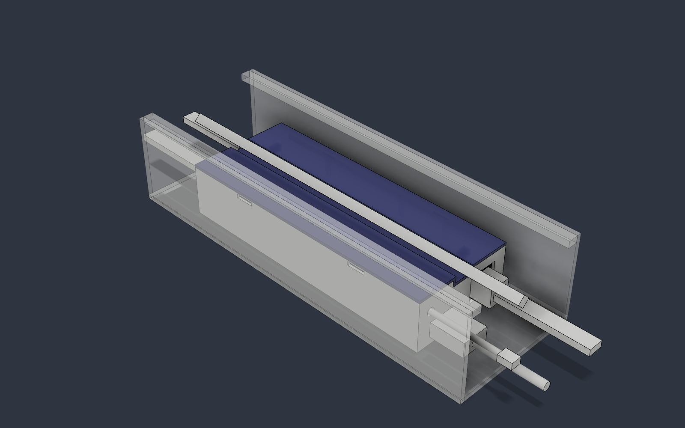
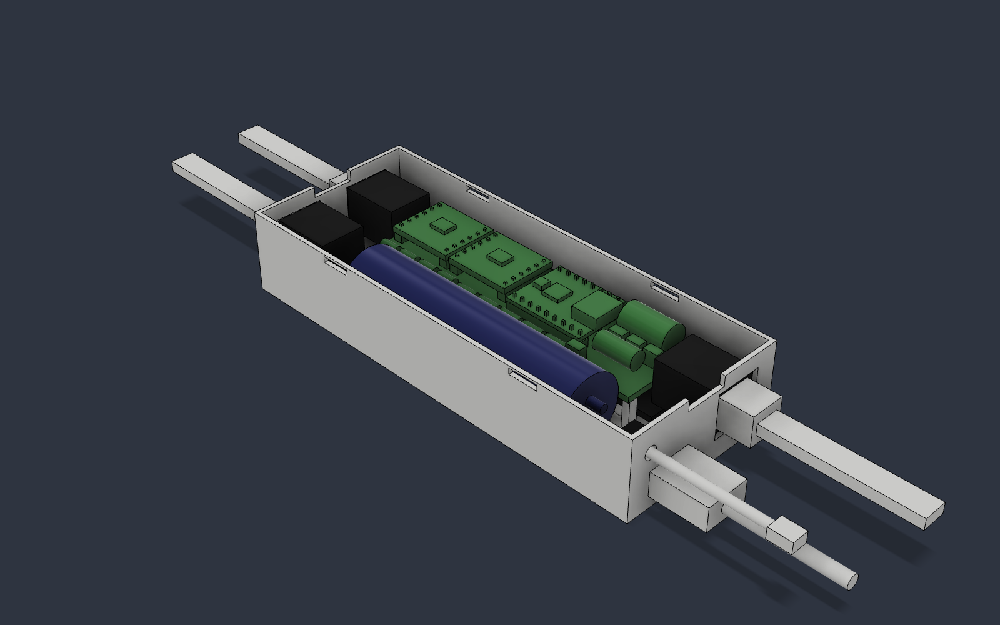

# Controller dev board and case (ControllerV1)

One controller = one ESP32-C6 SuperMini driving up to 3 tilters. This is the soldered dev-board stage: bought
modules on a perfboard strip, in a printed case that sits on the headrail floor under the tilt rod. The Fusion model
is built by [ControllerV1.py](../hardware/mechanical/fusion/ControllerV1/ControllerV1.py):

```bash
python3 hardware/mechanical/fusion/fusion.py exec tools/fusion_controller_v1.py --timeout 600
```

It opens a new document, mocks every part at its listed / measured size, runs an interference check between all
parts (including the tilt rod's sweep) and saves renders to `docs/renders/ctrl-v1-*.png`.




## Case
- **Outer 118.2 × 46.0 × 23.0 mm.** 46 mm wide drops in between the rail lips (46.5 mm opening) and sits on the rail
  floor, centred. A groove along the lid (|Y| < 4.5 mm, top at Z 20.2) leaves 0.97 mm under the tilt rod's sweep
  (4 mm square rod at Z 24 sweeps down to Z 21.17).
- Two parts: **tray** (floor, walls, all supports) and **lid** (snap skirts with 4 bumps into windows in the long
  walls, plus fingers that hold down the jacks, the battery and the perfboard edge). No screws.
- **End A:** RJ12 #1 (room side) and RJ12 #2 (back side). **End B:** RJ12 #3 (back side), USB-C (room side), solar
  pigtail hole (Ø3.5).
- Cords run along the rail both ways, so blinds on either side plug into the nearest end.

## Layout (X along the rail, Y across, −Y = room side, Z up from the rail floor)
| Part | Where | Height |
|---|---|---|
| RJ12 breakouts ×3 (20.3 × 13.1 board, jack overhangs 12.9) | on 2 pegs + collars, jack face on the end wall | board 4.2–5.8, jack to 17.5 |
| USB-C breakout (≈ 18 × 15) | end B, room side, on two rails | board 4.2–5.8 |
| 18650 (18.6 × 69) | room side, X 28.5–97.5, two saddles | to 20.1 |
| Perfboard strip **24 × 82** | back side, X 18–100, on a wall ledge + 3 posts | 9.0–10.6 |
| DRV8833 ×2, ESP32-C6 | on the perfboard, header spacers 2.5 | to ≈ 17.4 (ESP's USB-C) |
| Electrolytic (Ø8 × 13), 10 µF, 100 nF ×3 | perfboard, X 84–97 | lying down |
| Diodes, zener, resistors, 100 nF | strip along the perfboard's room-side edge | low |
| MCP73871 charger (20 × 19) | **under** the perfboard, X 70–90, on two ribs | 2.2–4.7 |

The perfboard sits over the back halves of the RJ12 boards, so **solder the RJ12 and USB-C wires first**, then
place the perfboard. Cut the strip from the largest board in the kit (24 mm = 9 hole rows).

## Pin plan (header pins only; physical order to confirm against the board)
The SuperMini has 9 pins down each side plus pads on the bottom edge (the "Do not connect USB and battery without a
diode" warning on its 5V pin is handled by D3).

| GPIO | Use |
|---|---|
| 0, 1, 2 | Angle sensor 1/2/3 (ADC, 1 kΩ + 100 nF filter) |
| 3 | Battery voltage (1 MΩ / 1 MΩ divider from BATT+, 100 nF) |
| 4, 5, 6 | Sensor 1/2/3 power (3V3, one on at a time) |
| 18, 19 | Motor 1 (DRV8833 #1 IN1/IN2) |
| 20, 14 | Motor 2 (DRV8833 #1 IN3/IN4) |
| 16, 17 | Motor 3 (DRV8833 #2 IN1/IN2); TX/RX are free because logging goes over USB |
| 15 | DRV8833 sleep (ULT on both; on-board LED removed) |
| 12, 13 | USB D−/D+ (bottom pads), wired to the case's USB-C breakout |
| 7 | Charger STAT (bottom pad, optional) |
| 8 | RGB LED: remove the LED; spare (strapping pin) |
| 9 | Boot button; spare |

## Wiring list
**Power**
- USB-C breakout VBUS → D1 (1N5819) → charger PWR+. GND → PWR−. D+/D− → ESP GPIO13/GPIO12, so the case's USB-C
  both charges and programs / logs the ESP.
- Solar pigtail (ZH socket, + red) → D2 (1N5819) → charger PWR+. **6.2 V zener** across PWR+/PWR− (band to PWR+).
- 18650 → charger BATT+/BATT− (cut the XH plug, splice a JST-PH 2-pin lead, heat-shrink).
- 10 kΩ NTC taped to the cell → charger THERM (remove the board's fixed THERM resistor).
- Charger LOAD+ → D3 (1N5819) → ESP **5V** pin; LOAD+ → both DRV8833 **VCC** (motors run from the battery);
  electrolytic across LOAD+/GND; 10 µF at the ESP 5V pin.

**Each tilter port (RJ12 n = 1, 2, 3)**
| RJ12 pin | Net |
|---|---|
| 1 | Motor + (DRV OUT) |
| 2 | Motor − (DRV OUT) |
| 3 | GND |
| 4 | Angle OUT → 1 kΩ → ADC GPIO (0/1/2), 100 nF to GND |
| 5 | 3V3 sensor power ← GPIO 4/5/6 |
| 6 | GND |

Ports 1 and 2 use DRV8833 #1 (OUT1/2, OUT3/4); port 3 uses DRV8833 #2 OUT1/2. DRV8833 #2's second channel is a
spare (lift later).

## Before soldering (check on arrival)
- **DRV8833:** cut the **J2** pad on the back of each board, or the ULT (sleep) pin does nothing (per the listing).
  Confirm the pin order on the silkscreen.
- **ESP32-C6 SuperMini:** measure the row spacing (assumed 0.6") and confirm which pads are on the bottom edge.
  Remove the RGB LED (GPIO8) and the power LED.
- **Charger:** confirm the pads: PWR, BATT, LOAD, THERM, PROG and the 5-pin header (the photos show no USB or DC
  jack).
- **USB-C breakout:** measure the board (modelled 18 × 15); the case opening and rails follow it.
- **RJ12 cords:** pin 1 → pin 1 continuity on every cord.
- **Solar panel:** open-circuit voltage behind glass.

## Still open
- **Where in the rail:** the case needs 118 mm of rail with nothing on the rod in the way (tilt drums, cord
  spools, spring motors). Need the free length and position in each controller's headrail.
- Solar panel (70 × 69 mm) is taller than the rail face (≈ 38 mm), so it can't go on the rail. It needs its own
  white frame on the glass (suction cup or tape) with the extension lead to the case. To design next.
- The boost module is for the bench comparison only and has no place in the case.
