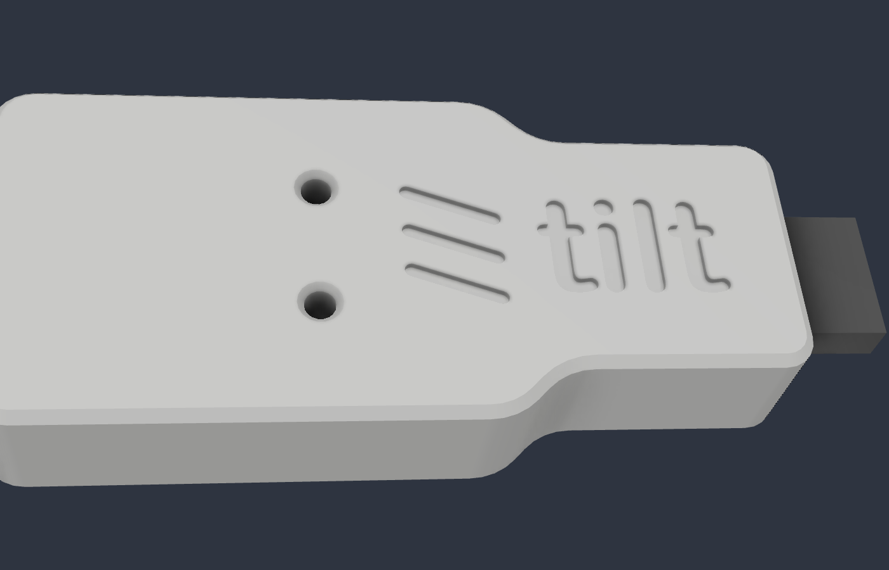

# Tilt Hub box

One printed piece, 46.9 × 21.8 × 9.0 mm, closed all round. The ESP32-C6 and a USB-C male-to-male adapter are printed
into it. The plug sticks out the front: push the hub into any USB-C charger or computer port.

- Generator: [`Hub.py`](../hardware/mechanical/fusion/Hub/Hub.py), built by `tools/fusion_hub.py`.
- Print file: [`hub_box.stl`](../hardware/mechanical/stl/hub/hub_box.stl), already in print orientation (pinhole face on the bed).
- Parts: [bill of materials](../hardware/BOM.md#tilt-hub-1).

The ESP and the adapter are both measured (sizes and notes at the top of `Hub.py`).

The pinhole face carries the mark: the app icon's three slats and "tilt", engraved 0.4 mm deep, no groove under
0.8 mm wide (for a 0.4 mm nozzle).

## Print it

1. Flash the ESP on the bench first ([firmware](../firmware/tilt_hub/README.md)). Do not solder pins on it.
2. Push the adapter into the ESP.
3. Slice at **0.2 mm layers**, no supports. Add a **pause after layer 39** (7.8 mm): the last layer of the walls,
   just before the roof. The build prints the right layer for the sizes in `Hub.py`; it moves when they change.
4. At the pause, put the ESP and adapter in **parts side down** (the ESP's bare back up), **nose first**: hold the
   back end up a little, slide the plug out through the hole in the front, then lay the back end down. It must lie
   flat by itself. Run a finger over the top: **nothing may stand above the walls**, or the nozzle hits it. If it
   does not fit, cancel the print (you have lost about a quarter of an hour, not the parts).
5. Resume. The nozzle passes 0.4 mm over the adapter and 0.9 mm over the ESP's back, and bridges the roof. The bridge
   sags onto the adapter and holds it down.

## Buttons

Two pinholes in the face that was on the bed, for a paper clip; a tube inside each guides the clip onto its button.
Looking at that face with the plug pointing toward you: **BOOT is the right hole, RST the left.** Factory reset: hold
BOOT for 10 s.

## How it holds

- The ESP lies parts side down on two rails that reach its face along both long edges; the roof is 0.7 mm over its
  back.
- A thin lip in front of the adapter's body, closed all round the plug, stops it pulling out. A low bar on the floor
  behind it takes the push of plugging in, so the ESP's own socket carries no load. The body swings over the bar on
  the way in; once the roof is on it cannot lift over it.
- The lip is 0.6 mm thick and takes that much off the plug's reach (6.0 mm left).
