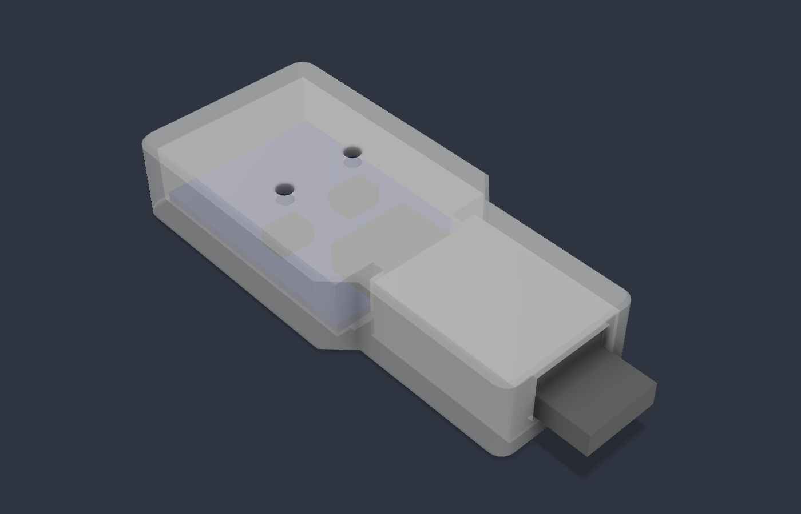

# Tilt Hub box

One printed piece, 47.5 × 21.8 × 9.0 mm, closed all round. The ESP32-C6 and a USB-C male-to-male adapter are printed
into it. The plug sticks out the front: push the hub into any USB-C charger or computer port.

- Generator: [`Hub.py`](../hardware/mechanical/fusion/Hub/Hub.py), built by `tools/fusion_hub.py`.
- Print file: [`hub_box.stl`](../hardware/mechanical/stl/hub/hub_box.stl), already in print orientation.
- Parts: [bill of materials](../hardware/BOM.md#tilt-hub-1).

The ESP's sizes are measured. **The adapter's sizes are still estimates from the listing photo.** Measure the real
one and set them in `Hub.py` before printing: body length, width and thickness; plug length; and the gap between the body and the ESP's socket when it is pushed home.

## Print it

1. Flash the ESP on the bench first ([firmware](../firmware/tilt_hub/README.md)). Do not solder pins on it.
2. Push the adapter into the ESP.
3. Slice at **0.2 mm layers**, no supports. Add a **pause after layer 39** (7.8 mm): the last layer of the walls,
   just before the roof. The build prints the right layer for the sizes in `Hub.py`; it moves when they change.
4. At the pause, drop the ESP and adapter in, parts side up, plug through the slot in the front. They must drop in
   by themselves and lie flat. Run a finger over the top: **nothing may stand above the walls**, or the nozzle hits it.
   If it does not fit, cancel the print (you have lost about a quarter of an hour, not the parts).
5. Resume. The nozzle passes 0.4 mm over the adapter and bridges the roof. The bridge sags onto the adapter and
   holds it down.

## Buttons

Two pinholes in the roof, for a paper clip, one over each button. With the plug pointing toward you: **BOOT is the
right hole, RST the left.** Factory reset: hold BOOT for 10 s.

## How it holds

- A thin lip in front of the adapter's body stops it pulling out. A web behind it takes the push of plugging in, so
  the ESP's own socket carries no load.
- The lip is 0.6 mm thick and takes that much off the plug's reach (5.7 mm left).
- Above the plug the lip is open (the plug drops in from above), so the adapter's front shows there.
