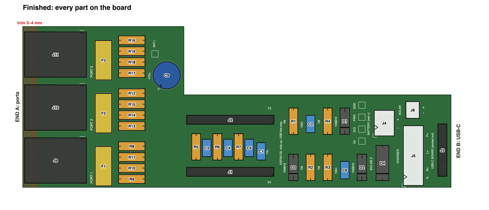
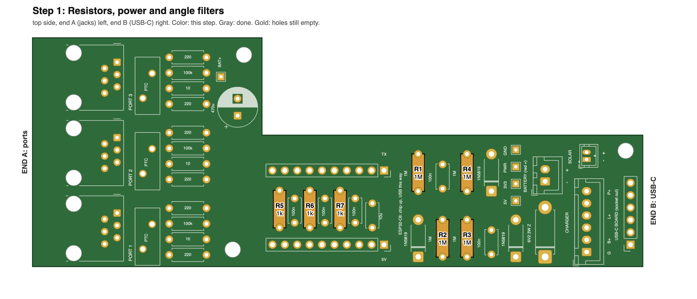
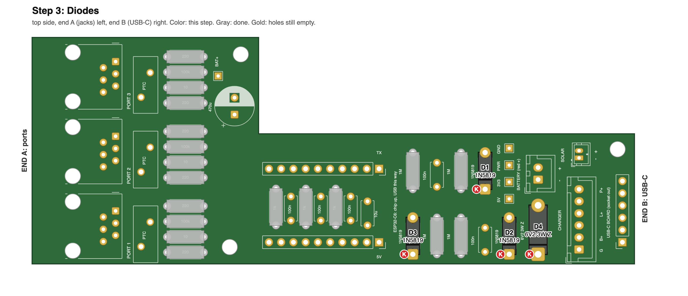
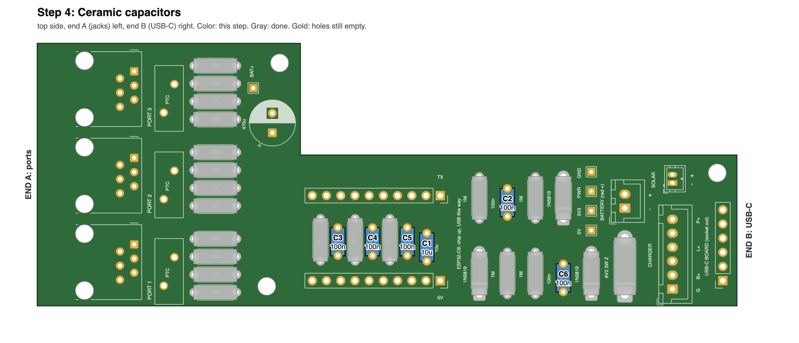
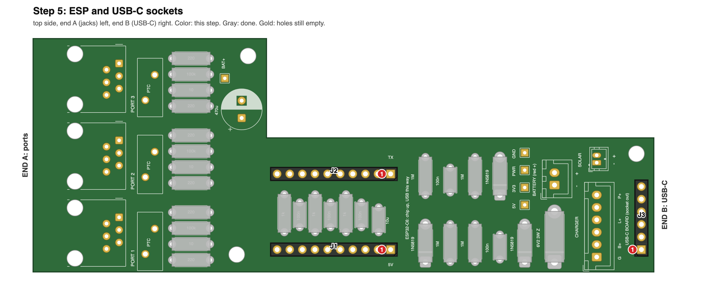
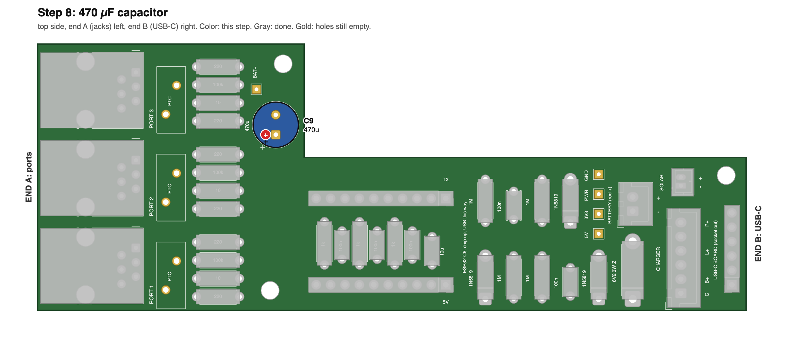
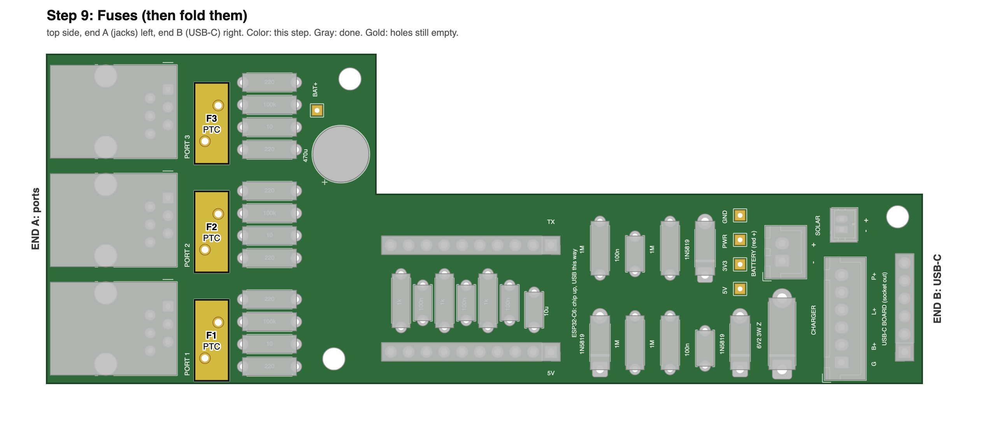

# Building the controller PCB, step by step

For the carrier PCB, v2.1 ([hardware/pcb](../hardware/pcb/README.md)). Every picture, part list and position here is
generated from the real board file by [`tools/pcb_guide.py`](../tools/pcb_guide.py), so it matches the board you hold.
It is the PCB counterpart of the [dev board guide](dev-board-build.md): the circuit is the same, but there is no hand
wiring. Every part drops into its own holes, and the copper does the rest.

**Order:** lowest parts first, so the board lies flat on the bench while you solder: resistors, diodes, small
capacitors, then the sockets and headers, the jacks, the big capacitor and the fuses (tallest) last. Then meter checks,
the leads, and plugging in. In each picture the step's parts are in color and labeled; done parts are gray; the
gold holes are still empty. End A (the RJ12 jacks) is on the left, end B (the USB-C socket) on the right.

**The silkscreen prints each part's value** (1M, 220, 100n, 1N5819 …), not its reference, so you can match parts to the
board without the picture. The references (R1, D3 …) are only in this guide.

**For the V5 box:** after each step, **trim every lead to 1.8 mm or less under the board**. The PCB sits 2.4 mm off
the box floor.

## Parts for one board

| Part | Qty | References | Step |
|---|---|---|---|
| 1M | 4 | R1, R2, R3, R4 | 1 |
| 1k | 3 | R5, R6, R7 | 1 |
| 220 | 6 | R9, R8, R13, R12, R17, R16 | 2 |
| 10 | 3 | R10, R14, R18 | 2 |
| 100k | 3 | R11, R15, R19 | 2 |
| 1N5819 | 3 | D1, D2, D3 | 3 |
| 1N5920B 6.2V 3W | 1 | D4 | 3 |
| 10uF | 1 | C1 | 4 |
| 100nF | 5 | C2, C3, C4, C5, C6 | 4 |
| ESP32-C6 SuperMini socket (5V row) | 1 | J1 | 5 |
| ESP32-C6 SuperMini socket (TX row) | 1 | J2 | 5 |
| USB-C breakout socket | 1 | J3 | 5 |
| Battery (18650, JST-XH 2-pin) | 1 | J4 | 6 |
| Charger (JST-XH 6-pin) | 1 | J5 | 6 |
| Solar (optional, JST-ZH 2-pin) | 1 | J8 | 6 |
| RJ12 port 1 | 1 | J9 | 7 |
| RJ12 port 2 | 1 | J10 | 7 |
| RJ12 port 3 | 1 | J11 | 7 |
| 470uF 10V | 1 | C9 | 8 |
| 0.75A PTC | 3 | F1, F2, F3 | 9 |
| ESP32-C6 SuperMini (male pins on, flashed on the bench) | 1 | plugs into J1 / J2 | 13 |
| USB-C breakout (Cermant) + its 2-wire lead to J3 | 1 | | 11 |
| MCP73871 charger module + 4-wire harness (6-pin XH housing) | 1 | J5 | 11 |
| 18650 cell with its JST-XH plug | 1 | J4 | 12 |
| Solar panel lead with a JST-ZH 2-pin plug (optional) | 1 | J8 | 11 |

Nothing goes in the five square **test pads** (TP1 BAT+, TP2 5V, TP3 3V3, TP4 PWR, TP5 GND, a row near the middle and
one by the 470 µF). They're for the meter. The three big holes (H1–H3) take the box's M3 screws.

## Which parts have a direction?

| Part | Direction matters? | How to tell |
|---|---|---|
| Resistors, ceramic capacitors, fuses | **No** | either way round |
| **1N5819 diodes (D1–D3), 6.2 V zener (D4)** | **YES** | the **band** on the part goes over the **square pad**, where the silkscreen has its thick band line (red **K** in the pictures) |
| **470 µF capacitor (C9)** | **YES** | **long leg (+) in the square pad**, by the silkscreen's **+**; the can's stripe (−) on the shaded half of the circle |
| **Sockets J1, J2, J3** | fit either way, but **solder them straight** | pin 1 is the square pad |
| **JST headers J4, J5, J8** | **YES** | match the silkscreen outline. Before soldering, push the plug in and hold it over the board: the wires must land on the pads named on the silkscreen (J4: **−  +**, J5: **G  B+  ·  L+  ·  P+**, J8: **−  +**) |
| **RJ12 jacks** | fit only one way | two plastic pegs |
| **ESP32-C6** | **YES** | **chip up, its USB toward end B** (silkscreen: "ESP32-C6: chip up, USB this way"); its 5V pin in J1 pin 1 |
| **Battery** | **YES** | **red wire on +** of J4. Check with the meter before plugging in |

A reversed diode just won't conduct. A reversed electrolytic, battery or charger plug can damage parts. Check those twice.



## Step 1: Resistors under the ESP and in the power section (7)



Flat on the board, legs bent at the body to the hole spacing (7.62 mm), either way round. The three 1k (angle filters)
sit where the ESP goes: they have to go in before its sockets.

| Ref | Value | Bands (4-band / 5-band) | What it does |
|---|---|---|---|
| R1 | 1M | brown black green gold / brown black black yellow brown | battery divider top |
| R2 | 1M | brown black green gold / brown black black yellow brown | battery divider bottom |
| R3 | 1M | brown black green gold / brown black black yellow brown | input-power divider top |
| R4 | 1M | brown black green gold / brown black black yellow brown | input-power divider bottom |
| R5 | 1k | brown black red gold / brown black black brown brown | angle filter |
| R6 | 1k | brown black red gold / brown black black brown brown | angle filter |
| R7 | 1k | brown black red gold / brown black black brown brown | angle filter |

Not sure of a color? Measure it (1M reads 0.98–1.02 MΩ).

## Step 2: Resistors behind the jacks (12)


Four behind each jack, in a row across the board, the same order at every port. Starting from the board's long straight
edge (bottom in the picture): **220, 10, 100k, 220** (silkscreen shows the values). Mixing up the 10 Ω and
a 220 Ω is the easy mistake: the 10 Ω powers the tilter's angle sensor, and through 220 Ω it won't read.

| Port | 220 (IN2) | 10 (EN) | 100k (EN pull-down) | 220 (IN1) |
|---|---|---|---|---|
| 1 | R9 | R10 | R11 | R8 |
| 2 | R13 | R14 | R15 | R12 |
| 3 | R17 | R18 | R19 | R16 |

Bands: 220 **red red brown** (5-band: red red black black), 10 **brown black black** (brown black black gold),
100k **brown black yellow** (brown black black orange).

## Step 3: Diodes (4)



**Band over the square pad** (the silkscreen draws the band). The zener is the bigger one (D4, "6V2 3W Z", its holes
10 mm apart).

| Ref | Part | What it does |
|---|---|---|
| D1 | 1N5819 | USB-C in → PWR (stops the panel feeding back into USB) |
| D2 | 1N5819 | solar in → PWR (stops USB feeding back into the panel) |
| D3 | 1N5819 | battery + → the ESP's 5V pin |
| D4 | 1N5920B 6.2V 3W | clamps PWR at 6.2 V (a sunny panel's open-circuit voltage) |

## Step 4: Ceramic capacitors (6)



Either way round, pushed down to the board. **C1 is the 10 µF ("106")**, the other five are 100 nF ("104"). C3–C5
sit under the ESP, beside the 1k resistors from step 1.

| Ref | Value | Marking | What it does |
|---|---|---|---|
| C1 | 10uF | 106 | ESP 5V |
| C2 | 100nF | 104 | battery divider filter |
| C3 | 100nF | 104 | angle filter |
| C4 | 100nF | 104 | angle filter |
| C5 | 100nF | 104 | angle filter |
| C6 | 100nF | 104 | input-power divider filter |

## Step 5: ESP and USB-C sockets (3)



1. **ESP sockets J1, J2 (10-way):** push both onto the ESP32-C6's pins, set the ESP and sockets into the board
   (chip up, USB toward end B), solder one pin at each end of each socket, check they sit flat and square, solder the
   rest, then lift the ESP back out. That way the two rows end up exactly the ESP's width apart.
2. **USB-C socket J3 (6-way)**, at end B. In the V5 box the USB-C board sits on the end wall, and a 2-wire lead plugs
   into **J3 pins 1 (VBUS) and 2 (GND)** (step 11), so only those two pins are used, but solder all six for strength.
   Pin 1 is the square pad, at the room-side edge.

## Step 6: JST headers (3)


Three different headers, so no plug fits the wrong one:

| Ref | Header | For | Pins (silkscreen) |
|---|---|---|---|
| J4 | JST-XH 2-pin (B2B-XH-A) | the 18650 | **−  +** (red wire on +) |
| J5 | JST-XH 6-pin (B6B-XH-A) | the charger harness | **G  B+  ·  L+  ·  P+** (pins 3 and 5 empty) |
| J8 | JST-ZH 2-pin (B2B-ZR), the small one | solar (optional) | **−  +** |

**Orientation is everything here.** The headers only take a plug one way, so a header soldered backwards puts the
battery in backwards. Match each header to its silkscreen outline. Then, before soldering, push the actual plug in and
hold it over the board: the cell's **red wire must sit over +**. Solder one pin, check it sits flat, then the rest.

## Step 7: RJ12 jacks (3)


Amphenol 87180-066LF, opening out over end A. Their two pegs only fit one way. **Press each one fully down and
square to the board edge** before soldering the six pins: the box's openings in end wall A are cut to the plug's
outline with 0.35 mm to spare, so a tilted jack shows. Solder the two outer pins, check from the front, then the rest.

## Step 8: 470 µF capacitor (1)



C9, beside the jack strip. **Long leg (+) into the square pad** by the silkscreen's **+**. The silkscreen circle's
**shaded half is the − side**: the stripe on the can goes there. Push it right down: in the V5 box it has 2–3 mm under
the lid's groove.

## Step 9: Fuses, then fold them (3)



F1–F3, the yellow 0.75 A resettable fuses (Bel 0ZRE0075FF), one behind each jack, either way round. Solder them
fully seated. **Then fold each one** for the box: bend both legs over **toward the ESP (end B)**, about **1.6 mm
below the body** (not at the body: the coating can crack), so the disc lies flat over its own four resistors, roughly
8–13 mm above the board. Fold them straight, not skewed: in the box, F1's disc ends 0.35 mm from a screw post and
F3's 1.3 mm from the 470 µF.

## Step 10: Meter checks, nothing plugged in

Set the meter to beep (continuity). Black probe on **TP5 (GND)**:

| Red probe on | Expect | If it beeps |
|---|---|---|
| TP1 BAT+ | no beep (a short chirp is the 470 µF charging, fine) | short on battery +: look at C9, the fuses, D3 |
| TP2 5V | no beep (the 10 µF may chirp) | short on the ESP's 5V: C1, D3, the sockets |
| TP3 3V3 | no beep | short on the ESP's 3V3: the sockets |
| TP4 PWR | no beep | short on the charger input: D1, D2, **D4 backwards** |
| each jack's pin 1 (battery +, after the fuse) | no beep | solder bridge at the jack |

Then **diode mode**, red on TP4 (PWR), black on TP5 (GND): about 0.7–0.9 V is wrong (D4 is in backwards: its band must
be on the square pad); open ("OL") is right.

Finally, look at the underside in good light for bridges between neighboring pads, especially the sockets and
jacks, and check every lead is trimmed to 1.8 mm or less.

## Step 11: Leads (charger harness, USB-C lead, solar)

Built on the bench; the full details are in the [V5 box guide](controller-v5.md#the-charger-subassembly).

**Charger harness (J5), 4 wires** in a 6-pin JST-XH housing. Pins 3 and 5 stay empty (pull those two out of a
pre-made 6-wire lead). The module's GND pads are all one connection: use the one next to PWR. Beep them to each other
first.

| J5 pin | Silk | Charger pad | Wire |
|---|---|---|---|
| 1 | G | GND (next to PWR) | black 22 AWG |
| 2 | B+ | BATT | red 22 AWG |
| 3 | · | (empty) | |
| 4 | L+ | LOAD (soldered from under the module) | red 22 AWG |
| 5 | · | (empty) | |
| 6 | P+ | PWR | red 22 AWG |

Hold the housing over J5 before plugging it in: G over G, P+ over P+.

**USB-C lead (J3), 2 wires, ~45 mm:** red from the USB-C board's **VBUS** pin, black from its **GND** pin, to a 2-pin
piece of male header that plugs into **J3 pins 1 (VBUS) and 2 (GND)**. Mark the VBUS end.

**Solar (J8, optional):** the panel lead gets a JST-ZH 2-pin plug, **− on pin 1** (silk −), **+ on pin 2**.

## Step 12: First power (no ESP yet)

1. **Battery polarity:** before the cell goes on, hold its plug against J4 and check the red wire is over **+**. Then
   with the meter on volts, measure the plug: red probe on its red wire should read **+3.0 to +4.2 V**. A minus sign
   means the plug is wired backwards. Don't plug it in.
2. Plug the **charger harness into J5**, then the **battery into J4**. The battery reaches the board only through the
   charger, so J5 goes first.
3. Measure against **TP5 (GND)**:

| Pad | Expect |
|---|---|
| TP1 BAT+ | about the cell's voltage (3.0–4.2 V) |
| TP2 5V | 0.1–0.4 V under TP1 (it comes through D3) |
| TP3 3V3 | 0 V (it comes from the ESP, not plugged in yet) |
| TP4 PWR | 0 V. Plug USB-C into the USB-C board: **4.6–4.8 V**, and the charger's LEDs light |

If TP1 reads 0, check the J5 harness (pins 2 and 4) and that the cell isn't flat.

## Step 13: Plug in the ESP

1. **Unplug the battery** (J4).
2. Flash the ESP32-C6 on the bench first (through its own USB-C). In the box there's no room for a cable.
3. Plug it into J1 / J2: **chip up, its USB toward end B**, its 5V pin in J1's square pad. Push it fully down.
4. Battery back in. **TP3 should read 3.3 V**, and the ESP boots.

Then it goes into the box: [V5 assembly](controller-v5.md#assembly).

## Regenerate this guide

```bash
/Applications/KiCad/KiCad.app/Contents/Frameworks/Python.framework/Versions/3.9/bin/python3 tools/pcb_guide.py --png
```
