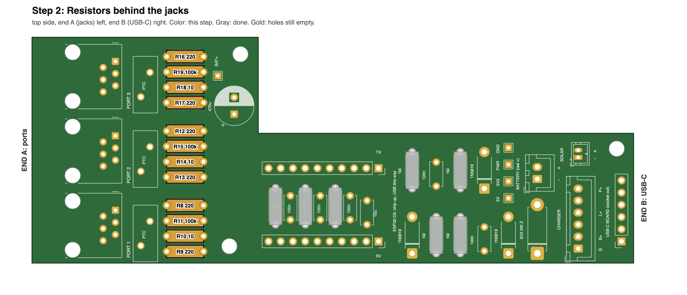
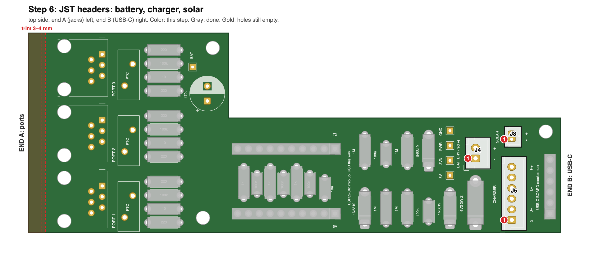
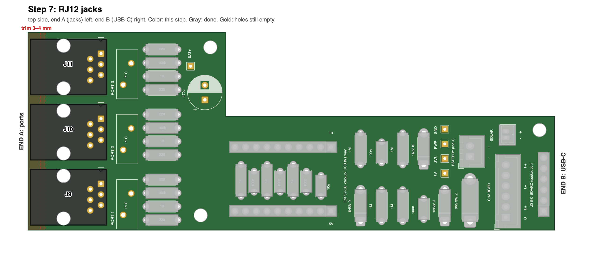
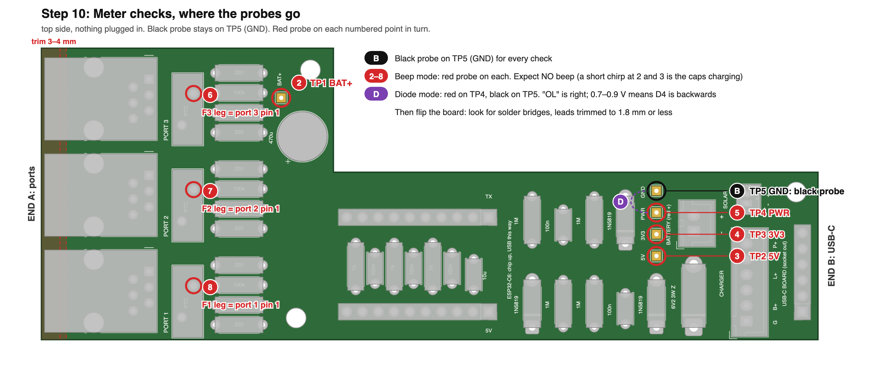
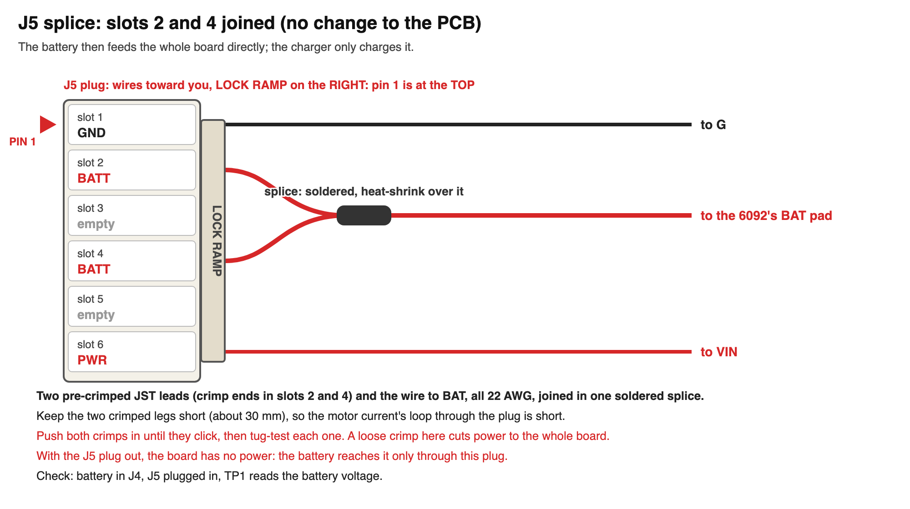
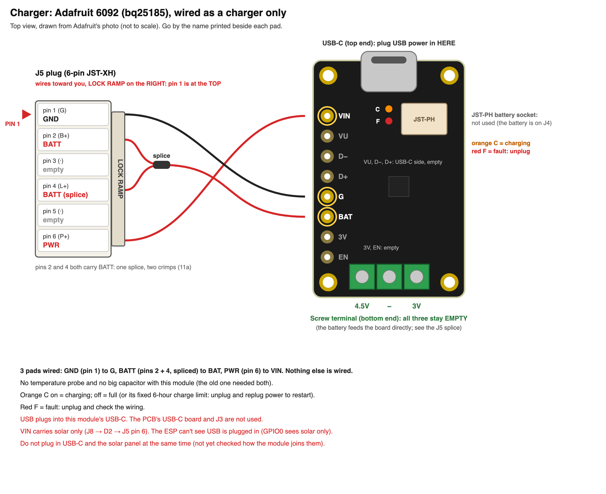

# Building the controller PCB, step by step

For the carrier PCB, v2.1 ([hardware/pcb](../hardware/pcb/README.md)). Every picture, part list and position here is
generated from the real board file by [`tools/pcb_guide.py`](../tools/pcb_guide.py), so it matches the board you hold.
It is the PCB counterpart of the [dev board guide](dev-board-build.md): the circuit is the same, but there is no hand
wiring. Every part drops into its own holes, and the copper does the rest.

**Order:** lowest parts first, so the board lies flat on the bench while you solder: resistors, diodes, small
capacitors, then the sockets and headers, the jacks, the big capacitor and the fuses (tallest) last. Then meter checks,
the leads, and plugging in. In each picture the step's parts are in color and labeled; done parts are gray; the
gold holes are still empty. End A (the RJ12 jacks) is on the left, end B (the USB-C socket) on the right.

**The silkscreen prints each part's value** (1M, 220, 100n, 1N5819 …), not its reference, so you can match parts to the
board without the picture. The references (R1, D3 …) are only in this guide.

**For the V5 box:** after each step, **trim every lead to 1.8 mm or less under the board**. The PCB sits 2.4 mm off
the box floor.

## Parts for one board

| Part | Qty | References | Step |
|---|---|---|---|
| 1M | 4 | R1, R2, R3, R4 | 1 |
| 1k | 3 | R5, R6, R7 | 1 |
| 220 | 6 | R9, R8, R13, R12, R17, R16 | 2 |
| 10 | 3 | R10, R14, R18 | 2 |
| 100k | 3 | R11, R15, R19 | 2 |
| 1N5819 | 3 | D1, D2, D3 | 3 |
| 1N5920B 6.2V 3W | 1 | D4 | 3 |
| 10uF | 1 | C1 | 4 |
| 100nF | 5 | C2, C3, C4, C5, C6 | 4 |
| ESP32-C6 SuperMini socket (5V row) | 1 | J1 | 5 |
| ESP32-C6 SuperMini socket (TX row) | 1 | J2 | 5 |
| USB-C breakout socket (optional, not used with the 6092) | 1 | J3 | 5 |
| Battery (18650, JST-XH 2-pin) | 1 | J4 | 6 |
| Charger (JST-XH 6-pin) | 1 | J5 | 6 |
| Solar (optional, JST-ZH 2-pin) | 1 | J8 | 6 |
| RJ12 port 1 | 1 | J9 | 7 |
| RJ12 port 2 | 1 | J10 | 7 |
| RJ12 port 3 | 1 | J11 | 7 |
| 470uF 10V | 1 | C9 | 8 |
| 0.75A PTC | 3 | F1, F2, F3 | 9 |
| ESP32-C6 SuperMini (male pins on, flashed on the bench) | 1 | plugs into J1 / J2 | 13 |
| Adafruit 6092 charger (bq25185), charging only, + 3-wire harness (6-pin XH housing) | 1 | J5 | 11 |
| Extra pre-crimped JST lead for the J5 battery splice (slot 4) + heat-shrink | 1 | J5 plug | 11 |
| 18650 cell with its JST-XH plug | 1 | J4 | 12 |
| Solar panel lead with a JST-ZH 2-pin plug (optional) | 1 | J8 | 11 |

Nothing goes in the five square **test pads** (TP1 BAT+, TP2 5V, TP3 3V3, TP4 PWR, TP5 GND, a row near the middle and
one by the 470 µF). They're for the meter. The three big holes (H1–H3) take the box's M3 screws.

## Which parts have a direction?

| Part | Direction matters? | How to tell |
|---|---|---|
| Resistors, ceramic capacitors, fuses | **No** | either way round |
| **1N5819 diodes (D1–D3), 6.2 V zener (D4)** | **YES** | the **band** on the part goes over the **square pad**, where the silkscreen has its thick band line (red **K** in the pictures) |
| **470 µF capacitor (C9)** | **YES** | **long leg (+) in the square pad**, by the silkscreen's **+**; the can's stripe (−) on the shaded half of the circle |
| **Sockets J1, J2, J3** | fit either way, but **solder them straight** | pin 1 is the square pad |
| **JST headers J4, J5, J8** | **YES** | match the silkscreen outline. Before soldering, push the plug in and hold it over the board: the wires must land on the pads named on the silkscreen (J4: **−  +**, J5: **G  B+  ·  L+  ·  P+**, J8: **−  +**) |
| **RJ12 jacks** | fit only one way | two plastic pegs |
| **ESP32-C6** | **YES** | **chip up, its USB toward end B** (silkscreen: "ESP32-C6: chip up, USB this way"); its 5V pin in J1 pin 1 |
| **Battery** | **YES** | **red wire on +** of J4. Check with the meter before plugging in |

A reversed diode just won't conduct. A reversed electrolytic, battery or charger plug can damage parts. Check those twice.


## Step 0: Trim the jack edge (for the V5 box)

**v2.1 boards only** (back silkscreen "controller v2"). v2.2 boards come with this edge already in place: skip this step.

Cut **3 to 4 mm** off the board's jack edge (end A, the 47 mm wide end), straight across. The V5 box (rev M) has the
jacks come through its end wall, which needs that edge out of the way. Any cut between 3 and 4 mm fits: the box locates
the board by its three screws, not by this edge.

- Draw the line 3.5 mm in from the edge on both sides, then score it deeply along a straightedge on both faces and snap
  it over the edge of a bench, or cut with a fine-tooth saw. Sand the edge flat.
- Fiberglass dust is an irritant: cut it damp, or wear a mask, and wipe up afterward.
- Only the ground copper fill reaches that edge, no traces, so the cut can't break a connection. The jacks' peg holes
  stay 2.8–3.8 mm in from the new edge.
- Do it **before** soldering anything, so the board lies flat and nothing gets knocked.

## Step 1: Resistors under the ESP and in the power section (7)


Flat on the board, legs bent at the body to the hole spacing (7.62 mm), either way round. The three 1k (angle filters)
sit where the ESP goes: they have to go in before its sockets.

| Ref | Value | Bands (4-band / 5-band) | What it does |
|---|---|---|---|
| R1 | 1M | brown black green gold / brown black black yellow brown | battery divider top |
| R2 | 1M | brown black green gold / brown black black yellow brown | battery divider bottom |
| R3 | 1M | brown black green gold / brown black black yellow brown | input-power divider top |
| R4 | 1M | brown black green gold / brown black black yellow brown | input-power divider bottom |
| R5 | 1k | brown black red gold / brown black black brown brown | angle filter |
| R6 | 1k | brown black red gold / brown black black brown brown | angle filter |
| R7 | 1k | brown black red gold / brown black black brown brown | angle filter |

Not sure of a color? Measure it (1M reads 0.98–1.02 MΩ).

## Step 2: Resistors behind the jacks (12)



Four behind each jack, in a row across the board, the same order at every port. Starting from the board's long straight
edge (bottom in the picture): **220, 10, 100k, 220** (silkscreen shows the values). Mixing up the 10 Ω and
a 220 Ω is the easy mistake: the 10 Ω powers the tilter's angle sensor, and through 220 Ω it won't read.

| Port | 220 (IN2) | 10 (EN) | 100k (EN pull-down) | 220 (IN1) |
|---|---|---|---|---|
| 1 | R9 | R10 | R11 | R8 |
| 2 | R13 | R14 | R15 | R12 |
| 3 | R17 | R18 | R19 | R16 |

Bands: 220 **red red brown** (5-band: red red black black), 10 **brown black black** (brown black black gold),
100k **brown black yellow** (brown black black orange).

## Step 3: Diodes (4)


**Band over the square pad** (the silkscreen draws the band). The zener is the bigger one (D4, "6V2 3W Z", its holes
10 mm apart).

| Ref | Part | What it does |
|---|---|---|
| D1 | 1N5819 | USB-C in → PWR (stops the panel feeding back into USB) |
| D2 | 1N5819 | solar in → PWR (stops USB feeding back into the panel) |
| D3 | 1N5819 | battery + → the ESP's 5V pin |
| D4 | 1N5920B 6.2V 3W | clamps PWR at 6.2 V (a sunny panel's open-circuit voltage) |

## Step 4: Ceramic capacitors (6)


Either way round, pushed down to the board. **C1 is the 10 µF ("106")**, the other five are 100 nF ("104"). C3–C5
sit under the ESP, beside the 1k resistors from step 1.

**Out of 100 nF?** Any **ceramic** capacitor from 47 nF to 1 µF works in C2–C6 ("473", "104", "224", "474", "105"),
and they can be mixed: each one works on its own. They only smooth a reading; the value changes how fast a reading
settles, never the number it settles to. Use the same value on C3–C5 if you can, so the three ports respond alike. A
missing C2–C6 doesn't stop anything working (the readings are just noisier). **Not** an electrolytic like 100 µF, and
**C1 must be the 10 µF.**

| Ref | Value | Marking | What it does |
|---|---|---|---|
| C1 | 10uF | 106 | ESP 5V |
| C2 | 100nF | 104 | battery divider filter |
| C3 | 100nF | 104 | angle filter |
| C4 | 100nF | 104 | angle filter |
| C5 | 100nF | 104 | angle filter |
| C6 | 100nF | 104 | input-power divider filter |

## Step 5: ESP and USB-C sockets (3)


1. **ESP sockets J1, J2 (10-way):** push both onto the ESP32-C6's pins, set the ESP and sockets into the board
   (chip up, USB toward end B), solder one pin at each end of each socket, check they sit flat and square, solder the
   rest, then lift the ESP back out. That way the two rows end up exactly the ESP's width apart.
2. **USB-C socket J3 (6-way): optional, not used.** USB now plugs into the charger's own USB-C (step 11), so nothing
   plugs into J3. Leave it empty, or solder it anyway (harmless; it keeps the option of the old USB-C board).
   Pin 1 is the square pad, at the room-side edge.

## Step 6: JST headers (3)



Three different headers, so no plug fits the wrong one:

| Ref | Header | For | Pins (silkscreen) |
|---|---|---|---|
| J4 | JST-XH 2-pin (B2B-XH-A) | the 18650 | **−  +** (red wire on +) |
| J5 | JST-XH 6-pin (B6B-XH-A) | the charger harness | **G  B+  ·  L+  ·  P+** (pins 3 and 5 empty; with the 6092, pins 2 and 4 both get the battery wire: step 11) |
| J8 | JST-ZH 2-pin (B2B-ZR), the small one | solar (optional) | **−  +** |

**Orientation is everything here.** The headers only take a plug one way, so a header soldered backwards puts the
battery in backwards. On the two XH headers (J4, J5) **the wall with the two slots faces end A** (toward the ESP); the
silkscreen outline shows those slots. That's the side the plug's lock ramp clicks into. Then, before soldering, push the
actual plug in and hold it over the board: the cell's **red wire must sit over +**. Solder one pin, check it sits flat,
then the rest.

## Step 7: RJ12 jacks (3)



Amphenol 87180-066LF, opening out over end A (past the trimmed edge). Their two pegs only fit one way. **Press each one
fully down and square** before soldering the six pins: in the box each jack slides through an opening cut to its own
outline with 0.3 mm to spare, so a tilted jack won't go in. Solder the two outer pins, check from the front, then the
rest.

## Step 8: 470 µF capacitor (1)


C9, beside the jack strip. **Long leg (+) into the square pad** by the silkscreen's **+**. The silkscreen circle's
**shaded half is the − side**: the stripe on the can goes there. Push it right down: in the V5 box it has 2–3 mm under
the lid's groove.

## Step 9: Fuses, then fold them (3)


F1–F3, the yellow 0.75 A resettable fuses (Bel 0ZRE0075FF), one behind each jack, either way round. Solder them
fully seated. **Then fold each one** for the box: bend both legs over **toward the ESP (end B)**, about **1.6 mm
below the body** (not at the body: the coating can crack), so the disc lies flat over its own four resistors, roughly
8–13 mm above the board. Fold them straight, not skewed: in the box, F1's disc ends 0.35 mm from a screw post and
F3's 1.3 mm from the 470 µF.

## Step 10: Meter checks, nothing plugged in



Set the meter to beep (continuity). Black probe on **TP5 (GND)** (black ring "B" in the picture) for every check;
the red probe goes on each numbered point in turn:

| # | Red probe on | Expect | If it beeps |
|---|---|---|---|
| 2 | TP1 BAT+ | no beep (a short chirp is the 470 µF charging, fine) | short on battery +: look at C9, the fuses, D3 |
| 3 | TP2 5V | no beep (the 10 µF may chirp) | short on the ESP's 5V: C1, D3, the sockets |
| 4 | TP3 3V3 | no beep | short on the ESP's 3V3: the sockets |
| 5 | TP4 PWR | no beep | short on the charger input: D1, D2, **D4 backwards** |
| 6–8 | each fuse's jack-side leg (same as that jack's pin 1: battery + after the fuse) | no beep | solder bridge at that jack or fuse |

Then **diode mode** ("D" in the picture), red on TP4 (PWR), black on TP5 (GND): about 0.7–0.9 V is wrong (D4 is in backwards: its band must
be on the square pad); open ("OL") is right.

Finally, look at the underside in good light for bridges between neighboring pads, especially the sockets and
jacks, and check every lead is trimmed to 1.8 mm or less.

## Step 11: The charger, the battery and solar

**Charger: Adafruit 6092 (bq25185), used as a charger only.** The battery feeds the whole board directly (motors and
ESP), and the charger just keeps it topped up. A charger's own load output can only supply about 1 A, not enough for
three motors at once; an 18650 supplies 3 A or more. (The first build used a no-name MCP73871 module. It charged at
only 0.05–0.15 A instead of 0.35 A, even off the PCB, and starved the ESP on USB: see
[the v3 must-test list](pcb-v3-concept.md#must-test-on-the-v2-board-before-ordering-v3).)

**Cut list (one box):**

| Lead | Wire | Cut | From → to |
|---|---|---|---|
| Splice leg A | 22 AWG, pre-crimped JST lead | about 30 mm | J5 slot 2 → the splice |
| Splice leg B | 22 AWG, pre-crimped JST lead | about 30 mm | J5 slot 4 → the splice |
| Charger BATT | 22 AWG | about 50 mm | the splice → **BAT** pad |
| Charger GND | 22 AWG, pre-crimped JST lead | 76 mm | J5 pin 1 → **G** pad |
| Charger PWR | 22 AWG, pre-crimped JST lead | 76 mm | J5 pin 6 → **VIN** pad (carries solar) |
| Battery | the cell's own JST-XH lead (needs ≥ 45 mm) | as is | cell → J4 |
| Solar (optional) | the panel's flat 2-core cable | to suit | through end wall B → JST-ZH plug in J8 |

The pre-crimped JST leads are 152 mm with a crimp on both ends: cut them so the crimp end goes in the J5 housing.

### 11a: The battery splice in the J5 plug (slots 2 and 4)



Nothing changes on the PCB. On the board, J5 pin 2 is the battery and pin 4 is the board supply; putting the battery
wire in **both** slots joins them, so the battery feeds the board directly.

1. Two pre-crimped leads, cut to about **30 mm**: their crimp ends go in **slot 2** and **slot 4**.
2. Strip the two bare ends and the wire to the 6092's **BAT** pad, twist all three together, solder, and slide
   heat-shrink over the joint.
3. If your J5 plug still has the old LOAD wire in slot 4, pull it out first (lift the plastic tab over its crimp with a
   pin and slide it back out).
4. **Both crimps click in, then tug-test each one.** The motor current goes through these two crimps; a loose one cuts
   power to the whole board.
5. **With the J5 plug out, the board has no power.** The battery reaches it only through this plug.

### 11b: Charger (Adafruit 6092)



1. **Three wires, soldered to the pads by their printed names:**
   - J5 **pin 1 (GND)** → **G** (or the **−** screw terminal)
   - J5 **pin 2 (BATT)** → **BAT** (bottom edge)
   - J5 **pin 6 (PWR)** → **VIN** (the DC / solar pads)
2. **Leave empty:** the **4.5V** and **3V** screw terminals, the JST-PH battery socket, and EN.
3. No temperature probe and no big capacitor: this module doesn't use them.
4. **Crimp the three ends into the 6-pin housing:** pin 1 GND, pin 2 BATT, pin 6 PWR. Pins 3, 4, 5 empty.
5. **Which end is pin 1:** hold the plug with the **wires toward you** and the **lock ramp up**: pin 1 is on the
   **left** (as drawn upright in the pictures: lock ramp on the right, pin 1 at the top). That's JST's XH
   drawing). To be sure, push the **empty** housing into the soldered J5 first (it only fits one way), look down, and
   mark the cavity over the silkscreen **G**. That's pin 1.
6. **Tug-test every crimp.** On the first board the PWR crimp lost contact twice: TP4 read 4.8 V while the module's
   input read 0 V.

**The lights:** orange **C** on = charging, off = full. Red **F** = a fault: unplug and check the wiring. The chip stops
charging after **6 hours** nonstop; unplugging and replugging the power restarts it (for solar, the sun going down does).

**USB:** plug USB power into the **6092's own USB-C** (full 5 V, straight into the charger). The PCB's USB-C board,
its lead and J3 are no longer used; D1 just sits idle. Two things to know:

- **The ESP can't tell USB is plugged in.** GPIO0 (PSENSE) watches the PWR line, which now only carries solar.
  Charging works the same; only the firmware's "USB present" reading is lost. One wire from the 6092's **VU** pad could
  bring it back, once we've checked how VU connects inside the module.
- **Don't plug in USB-C and the solar panel at the same time** until we've checked how the 6092 joins its USB-C and VIN.

### 11c: Battery

The 18650 plugs into **J4** with its own JST-XH lead: nothing to make. Before it ever goes in:

1. Hold its plug against J4: the **red wire must sit over the silkscreen +**.
2. Meter on **DC volts**, red probe on the plug's red wire: **+3.0 to +4.2 V**. A minus sign means the plug is wired
   backwards: don't plug it in.
3. **Charge it first** (see "Charging the battery on the bench" below): the ESP needs the cell above about 3.8 V.

### 11d: Solar (optional)

The panel's flat 2-core cable comes in through the slot in end wall B and gets a **JST-ZH 2-pin plug**: **− on pin 1**
(silk −), **+ on pin 2** (silk +). **Check the panel's polarity with the meter in sun before crimping**: on the first
board the panel was wired backwards (D2 blocked it, nothing was damaged). Behind a window it needs daylight: a 6 V panel
in a dim room reads about 1 V and charges nothing.

### Charging the battery on the bench

The fastest way to fill a flat cell, without the PCB:

1. Unplug the battery from J4.
2. Two clip leads: battery **red → BAT**, battery **black → the − screw terminal** of the 6092.
3. USB-C straight into the 6092. Orange **C** lights.
4. About 2 hours from 3.6 V at 1 A. Done when **C** goes out. Unplug, wait a minute, measure: **4.1–4.2 V** = full.

**Never connect USB straight to the battery:** 5 V pushes a lithium cell past 4.2 V and it can swell or catch fire.

| Cell reads (resting) | Charge |
|---|---|
| 4.2 V | full |
| 3.9 V | about 75% |
| 3.7 V | about 50% (the "3.7 V" on the label is the average, not full) |
| 3.6 V | about 25–30% |
| 3.0 V | empty |

## Step 12: First power (no ESP yet)

Meter on **DC volts** (V with a straight line, "V⎓" or "DCV", not the wavy V~; range 20 if it has ranges). Black probe
on **TP5 (GND)** for every reading.

1. **Battery polarity:** hold its plug against J4: red wire over **+**, and the plug reads **+3.0 to +4.2 V**.
2. Plug the **charger harness into J5**, then the **battery into J4**. Through the splice in the J5 plug, the battery
   reaches the board directly.
3. Measure:

| Pad | Expect |
|---|---|
| TP1 BAT+ | the cell's voltage (3.0–4.2 V) |
| TP2 5V | 0.1–0.4 V under TP1 (it comes through D3) |
| TP3 3V3 | 0 V (it comes from the ESP, not plugged in yet) |
| TP4 PWR | 0 V. Plug USB into the 6092: TP4 **stays 0 V** (it only sees solar) and the orange light comes on. With the solar panel in daylight: about 5.5–6 V |

**TP1 is the cell** (through the J5 splice); TP2 is always 0.1–0.4 V lower, so don't read the battery off TP2. While
it charges the cell reads a little high: for a true reading, unplug USB for a minute first.

If TP1 reads 0, check the J5 plug is in and both splice crimps (slots 2 and 4) are clicked in, and that the cell isn't flat.

## Step 13: Plug in the ESP

1. **Unplug the battery** (J4).
2. Flash the ESP32-C6 on the bench first (through its own USB-C). In the box there's no room for a cable.
3. Plug it into J1 / J2: **chip up, its USB toward end B**, its 5V pin in J1's square pad. Push it fully down.
4. Battery back in. **TP3 should read 3.3 V**, and the ESP boots. With the cell below about 3.8 V, TP3 sags toward
   3.0 V (D3 and the ESP's regulator each take a little) and the ESP resets whenever Wi-Fi transmits: charge the cell first.
   (v3 fixes this with a 3.3 V converter: [v3 must-test list](pcb-v3-concept.md#must-test-on-the-v2-board-before-ordering-v3).)

Then it goes into the box: [V5 assembly](controller-v5.md#assembly).

## If something reads wrong

| Symptom | Likely cause | Check |
|---|---|---|
| Readings make no sense | meter on the wrong setting (AC, mV, or Ω) | dial on **DC volts**, range 20 |
| Minus sign on a reading | probes swapped, or a plug wired backwards | black on TP5; measure the plug by itself |
| Solar in: TP4 has voltage but the charger's VIN reads 0 V | PWR crimp not making contact | push the crimp in until it clicks, tug-test it |
| TP1 and TP2 fine, TP3 about 3.0 V, ESP keeps resetting | cell too low (below about 3.8 V) | charge it (bench charging above) |
| Cell barely rises after hours | charger not charging properly | USB power meter between charger and cable: about **1 A** while charging (6092) |
| ESP not on Wi-Fi | not powered, or browning out | TP3 = 3.3 V? Unplug power 5 s to restart it |

## Regenerate this guide

```bash
/Applications/KiCad/KiCad.app/Contents/Frameworks/Python.framework/Versions/3.9/bin/python3 tools/pcb_guide.py --png
```
