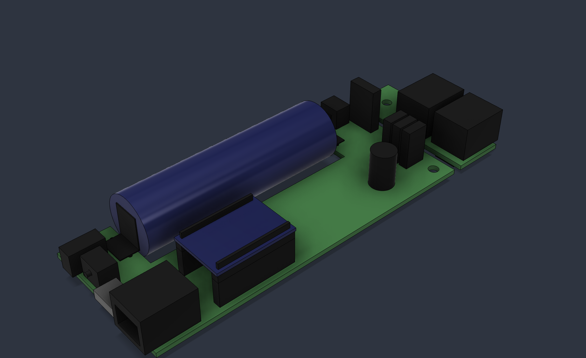
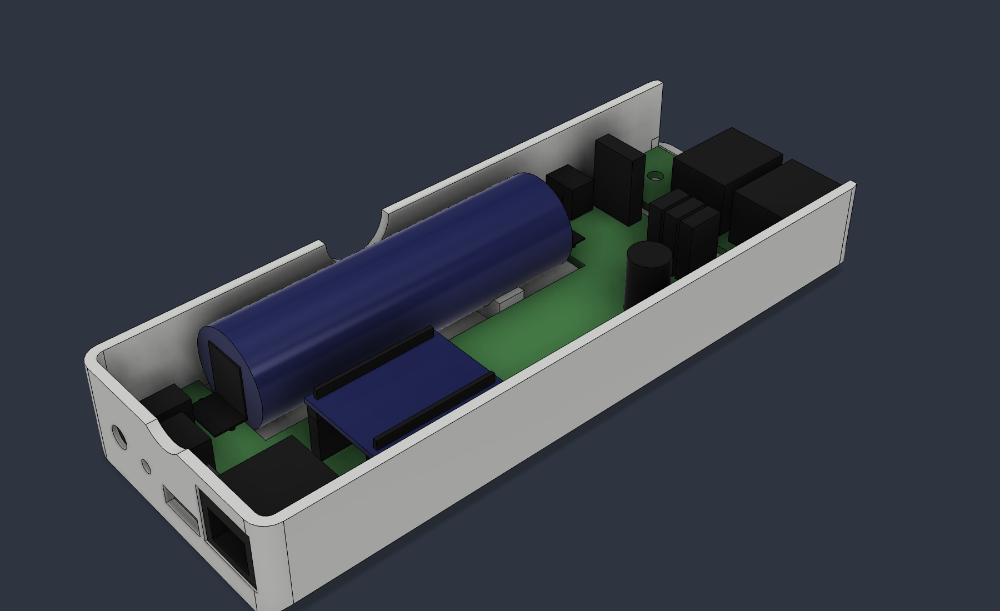
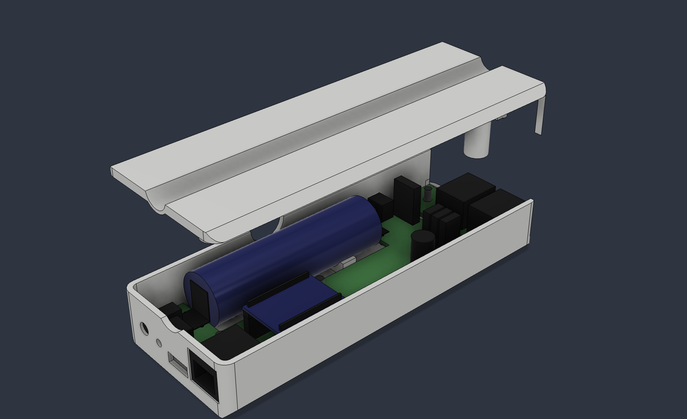
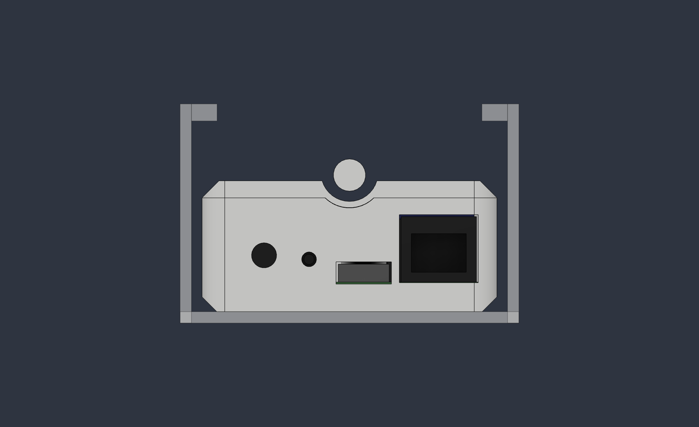
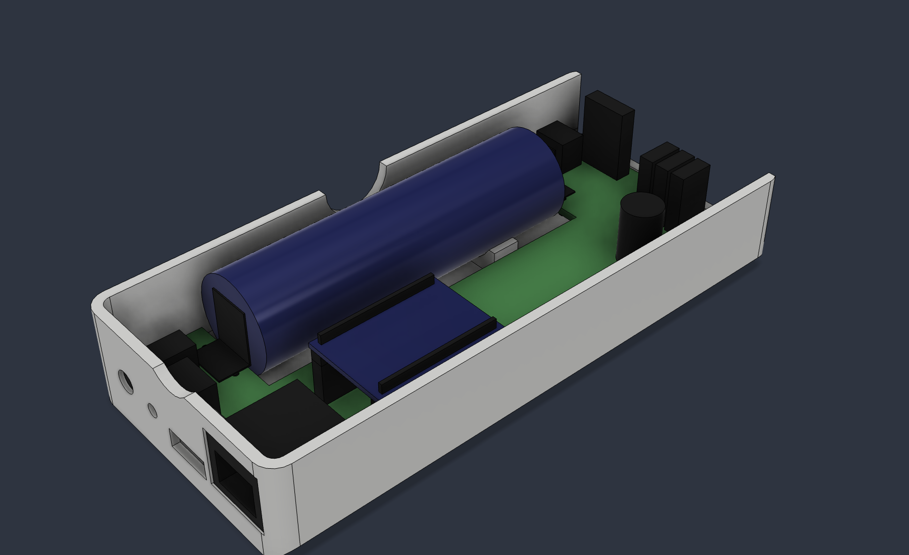

# Controller PCB v3: design (rev 5, hand-solder)

The next controller board. **Nothing is ordered yet.** This is the design to review before the schematic, the
KiCad layout and the box are drawn ([#23](https://github.com/DrakeAnglin/tilt/issues/23)). Not needed to build the
current version (PCB v2.2).

**Rev 5 (2026-11-27)** replaces rev 4. Rev 4 had the board factory solder a leadless charger chip; costed out, that
came to about $29 a board against about $16–18 for a bare board and parts. So v3 is a **bare board, hand-soldered**, as
[#23](https://github.com/DrakeAnglin/tilt/issues/23) asked. Every part that is not a plain resistor, capacitor or
diode has a maker's datasheet, linked in [the parts table](#parts-and-their-datasheets).

## What it is, in short

One board, 47 mm wide, that carries everything: the cell, the charger, USB-C, the solar jack, the ESP32-C6 and the
ports. No wires, no harness, no separate charger board.



A mock-up from the [fit study](#fit-study-the-board-in-the-box): the real board is not drawn yet.

| | v2.2 today | v3 |
|---|---|---|
| Charger | Adafruit 6092 board ($8.95) on a hand-made 3-wire harness | A TI charger chip (BQ21040, about $1) soldered to the board |
| Cell | 18650 with a soldered lead and plug | Any protected 18650, dropped in between two contacts on the board. A cell with a lead plugs in instead |
| USB-C | on the charger board | on the board |
| Solar | 2-pin plug inside the box | 3.5 × 1.35 mm barrel jack at the end wall |
| 3.3 V for the ESP and the sensors | sags to about 3.0 V (sensors drop out, [#139](https://github.com/DrakeAnglin/tilt/issues/139)) | its own regulator: 3.3 V down to about a 3.5 V cell |
| Reset | unplug the cell | a button at the end wall |
| One blind | same long board | cut the end section off: about 22 mm shorter |
| USB or solar | cannot tell | each has its own sense line |
| Soldering | about 45 through-hole parts + a crimped harness | about 60 parts, 6 of them small surface-mount parts |
| Box | 157.4 × 51.8 × 23.0 mm | 134.8 × 51.8 × 23.0 mm, or 114.8 mm long for one blind. Same width, height, bevels and rod groove |
| Cost per board, 3 ports, no ESP or cell | about $21 | about $16–18 |

## Decisions and why

### 1. Hand-soldered, with a few small chips
Everything is through-hole except six small parts with legs an iron can reach: the charger (6 legs), the
regulator (5 legs), a transistor for each sensor switch (3 legs each) and the USB-C socket (6 pads). The legs are
0.95 mm apart. No factory assembly, no stencil.

### 2. The charger is a TI BQ21040
A linear charger for one cell, in a 6-leg package, with a full TI datasheet. It only charges; the cell feeds the
board, as on v2.2.

- **Why this one:** when the input sags it holds the input at 4.3 V and takes what current there is, instead of
  dragging a small solar panel down. It survives 30 V on its input. It draws 1 µA from the cell when idle. It has a
  temperature input, so charging stops when the box is too hot or too cold (requirement E-4, open until now).
- **Charge current: 540 mA** (a 1 kΩ resistor). A 2600 mAh cell fills in about 5.5 hours. Higher would only make the
  small chip throttle on heat. Its safety timer is 10 hours.
- **It switches off above 6.5 V** (and survives 30 V), and a panel reaches 7 V with no load. v3 does not clamp
  the panel with a zener: a zener would have to burn the whole panel's power as heat in the box whenever the cell is
  full, and it cannot take 2 to 6 panels. Instead the solar jack feeds the charger through **two plain diodes in
  series** (1N4001). While charging, the chip holds its input at 4.3 V, so the panel sits near 6 V, where it works
  best. A cold panel in bright sun with a full cell can push the input above 6.5 V; the chip then rests, and
  starts again by itself when the light drops a little. The cost is at most a late top-up of a cell that is already
  over 90 % full. While the solar input is that high, USB does not charge either. A wrong adapter in the solar jack
  (up to 24 V, the jack's rating) does no harm. The board has a place for a third diode, bridged as made, in case
  the panels measure higher than 7 V.
- **USB** comes in through one low-loss diode (1N5817), so the chip still sees about 4.6 V.
- **Charging ends** when the current falls to about 50 mA. If the board itself draws more than that for hours
  with USB in, charging never ends and the 10-hour timer stops it. The firmware keeps its plugged-in average
  under about 40 mA.
- **Not used:** the TP4056 (a thin 3-page datasheet, and no input regulation), and ready-made charger modules (no
  datasheet at all).
- No power path: with no cell in, USB alone does not run the ESP reliably. Same as v2.2.
- Temperature: a 10 kΩ sensor by the cell with 1.0 kΩ in series, and 237 kΩ (1 %) on the board from the chip's
  temperature pin to ground. Charging is allowed from about 5 to 43 °C (47 °C at the chip's worst tolerance), and a
  broken sensor lead cannot switch the safety timer off.

### 3. The ESP32-C6 stays a SuperMini on sockets
v3 feeds the SuperMini's **3V3 pin** from the board's own regulator, and leaves its 5V pin empty.

- Why: on v2.2 the ESP gets the cell through a diode and then its own regulator, which costs about 0.6 V. At a 3.6 V
  cell the 3.3 V line is 3.0 V, under what the AS5600 sensor needs.
- The regulator is a Richtek RT9080-33: 600 mA, 2 µA idle. It loses about 0.08 V at 150 mA and 0.16 V at 300 mA
  (0.27 V at worst). So the 3.3 V line holds down to about a 3.5 V cell, and is about 3.2 V at the 3.35 V motor
  cut-off.
- It gets 10 µF on its input and 22 µF on its output, for the radio's 300 mA bursts (1 µF is only what keeps it
  stable).
- **Rule: put the cell in before plugging USB into the ESP itself.** With no cell, that USB would push the 3.3 V
  line backwards through the regulator. (A diode to guard this was considered and dropped: its leakage could lift
  the 3.3 V line while the board sleeps.) With that USB in, the reset button does nothing: unplug it first.
- The SuperMini has no maker's datasheet, and its own parts (its regulator, back-fed, and its two lights) may draw
  40 to 400 µA asleep, going by other people's measurements. It is the one part chosen on bench results, not
  paper, so it is the first bench test.

### 4. Each sensor gets a real power switch
Today an ESP pin powers each tilter's sensor directly and loses 0.26 V on the way. v3 puts a transistor (AO3401A)
on each port's EN line, fed from the 3.3 V line, with 6.8 Ω in series instead of 10 Ω (low enough to cost only
0.04 V, high enough that a crushed cord cannot pull the 3.3 V line down). The firmware change is small:
the pin is low for "on" instead of high.

This fixes the controller's end only. At the far end of a 3 m cord a running motor lifts the tilter's ground: thin
phone cord is about 0.64 Ω per wire, so 0.3 A costs about 0.2 V. With a 3.3 V line the sensor then sees about
3.1 V; at a low cell and a hard start it can still dip under its 3.0 V. So: a bench check at 3 m with a low cell,
cords of 26 AWG where they are long, and the firmware keeps ignoring a dropout during a start.

### 5. The cell drops into a notch, between two contacts
The board has a notch the size of the cell. The cell lies in the notch on two saddles in the box, exactly where it
lies on v2.2, between a fixed contact (+) and a spring contact (−) soldered to the board at the notch's ends.

- **Why not a holder on top of the board:** it was the first choice (Keystone 1043P). The review put it in the box
  numbers: the holder stands 18 mm above the board and its inner edge is under the tilt rod's groove, so it cuts
  into the groove. The groove may not move, so the holder is out.
- **The contacts:** Keystone 596 (a fixed button, +) and Keystone 590 (a leaf spring, −). Both are board-mount parts
  from Keystone's catalog, made for AA cells, which puts their contact 6 to 7 mm above the board: the height of this
  cell's center.
- **They take one length of cell: protected button-top cells of 68 to 70 mm**, the common size. The leaf is pressed
  1.3 to 3.3 mm over that range.
- **One change to the parts:** each has three legs, and the middle one sits right under the cell's end, where the
  board has to be cut away. The middle leg is clipped off and the contact stands on its two outer legs and its base.
  On paper that holds; it is the first thing to prove with sample parts ([open items](#open-items-before-the-layout)).
- A finger notch in the box's back wall lets the cell be lifted out.
- If the contacts fail their test, the fallback is the cell with a lead, as today.
- **A cell put in backwards:** the board has a 3 A resettable fuse in the cell's + lead and a diode (1N5822) across the
  board side of it. A backwards cell is shorted through the diode, and the fuse or the cell's own protection opens.
  The chips see about −0.6 V for a moment instead of −4 V. That is still past their −0.3 V rating, so this has to
  pass a bench test before it is trusted.
- A thin printed gate in front of the + contact, which a button top passes and a flat end does not, may still be
  possible. It is tried with the sample parts, as an extra.
- **A cell with a lead** (about 66 mm) lies in the same notch and plugs into a 2-pin JST-XH header on the same
  guarded line; it does not reach the contacts. One or the other: never two cells.
- Protected cells only, as today.

### 6. One cell, not two
A second cell does not fix battery life; the idle drain does.

| Average drain | One 2600 mAh cell | Two cells |
|---|---|---|
| 25–30 mA (measured now, [#6](https://github.com/DrakeAnglin/tilt/issues/6)) | about 4 days | about 8 days |
| 1.5 mA | about 2 months | about 4 months |
| 0.5 mA (the target) | about 6 months | about a year |

The drain is the idle current plus the moves (three blinds, six moves a day each, add roughly 0.1 to 0.4 mA).
At today's drain two cells still mean charging every week. Once the firmware sleeps properly, one cell meets the
2-month goal with room to spare. For more life in the same space: a protected 3400–3500 mAh cell, if it is
no longer than 69 mm.

### 7. Ports 2 and 3 are on a cut-off section
Port 1 is at end A with USB-C and the solar jack. Ports 2 and 3 sit on a section at end B, joined to the board by a
10 mm neck with a printed **cut line**.

- **For one blind:** cut the neck with a small saw and file the edge. The board is then 109.6 mm instead of
  129.6 mm, and goes in the short box. Leave out the fuses and jacks for ports 2 and 3.
- The end section has its own screw hole, so a cord pushed into its jacks does not lever on the neck. The copper
  stays 0.5 mm back from the cut line.
- **For two blinds:** keep the section, fit one jack. Same box as three.
- The fuses and resistors for ports 2 and 3 stay on the main board. A port whose fuse is not fitted has no battery
  power on its traces, so only dead copper ends show at the sawn edge.

### 8. No power monitor chip; four sense lines instead
| Signal | Pin | Tells the firmware |
|---|---|---|
| Cell voltage | GPIO3 (as today) | Battery level |
| Solar jack voltage, before its diodes | GPIO0 | a panel is lit (Light Schedules) |
| USB plugged in, before its diode (on or off, not a voltage) | GPIO15 | USB is plugged in |
| Charging (the chip's status line) | GPIO8 | the first charge after power arrives is running |

- **Leakage:** a diode that is "off" still leaks a little, more when hot, and that could make a dark jack look live.
  The solar diodes are a low-leakage type, and the USB sense has a 1 kΩ load on it (390 Ω over 620 Ω, about 5 mA,
  only while USB is in), so the worst leakage reads as "off". A 10 kΩ resistor protects the pin.
- The charger's status line is low for the first charge and for a temperature stop, and off for top-ups, so the
  firmware treats it as a hint. Its light runs from the 3.3 V line. While it is low, the ESP cannot be put in
  flashing mode with the BOOT button: unplug the charge cable first.
- GPIO8 and GPIO15 also carry the SuperMini's two lights. Whether they still read cleanly decides these two pins,
  so it is part of the first bench test. If GPIO15 fails, USB sense is dropped and the firmware reports "not sure"
  when a panel is lit, as v2.2 does.

### 9. No low-light harvester
A window with no direct sun gives about 1 mA per panel, which no linear charger can use. A harvester chip costs $5–6
and brings in about 5 mAh a day per panel. Left out.

### 10. No capacitor for the tilter on this board
A capacitor only helps a motor driver if it sits next to the driver, and the driver is at the other end of the cord.
The controller carries the reservoir for motor starts: the 470 µF on battery +.

## The circuit

```
USB-C VBUS ─►|───┐ (1N5817)
  (sense→GPIO15) │                              ┌── 1 M / 1 M ─► GPIO3
solar jack ►|─►|─┴─► IN  BQ21040  OUT ── BAT ───┼── 3 A fuse ── cell + contact / JST-XH   (cell −: GND)
  (sense→GPIO0)       │   │                     ├── 1N5822 to GND (backwards-cell diode), 470 µF
          status→GPIO8┘   └ 10 k sensor         ├── RT9080 3.3 V ─► ESP 3V3 pin, sensor switches ×3
              + light        by the cell        │        ▲ reset button holds it off
                                                └── 0.75 A fuse ×3 ─► RJ12 pin 1
RJ12 (unchanged): 1 battery +, 2 IN1, 3 GND, 4 angle, 5 EN, 6 IN2
  IN1, IN2: ESP pin ─ 220 Ω ─ jack      angle: jack ─ 1 k ─ ESP pin, 100 nF
  EN: 3.3 V ─ AO3401A (ESP pin low = on, slowed so the 3.3 V line does not dip) ─ 6.8 Ω ─ jack
  against static, at each jack: 10 nF on IN1 and IN2, 100 nF on EN (the angle line has its 100 nF already)
```

- **Everything runs straight from the cell**, as today: motors through their fuses, the ESP through the regulator.
- **USB and solar together:** each has its own diode path into the charger, so neither feeds the other.
- **Reset button:** it holds the 3.3 V regulator off. Hold it for 2 seconds.
- **Idle cost of the board itself:** about 15 to 50 µA (charger 1, regulator 2, cell divider 2, the 470 µF's
  leakage, and each plugged-in tilter's sleeping driver at about 2 µA). The SuperMini comes on top.
- **The board's USB-C is for charging only.** Flashing by cable still means the ESP's own USB, with the lid off.

### Pins
The port pins do not move.

| Port | IN1 | IN2 | EN (low = on) | Angle |
|---|---|---|---|---|
| 1 | GPIO14 | GPIO18 | GPIO7 | GPIO6 |
| 2 | GPIO19 | GPIO20 | GPIO5 | GPIO4 |
| 3 | GPIO16 | GPIO17 | GPIO1 | GPIO2 |

Cell voltage GPIO3, solar voltage GPIO0, charging GPIO8, USB voltage GPIO15. GPIO9 (the BOOT button) stays free:
it must be high at start-up, so nothing may pull it low. No pin is spare.

## Parts and their datasheets

Numbers are from the datasheet named, read 2026-11-27. "Stock" parts are already on hand from v2.2.

| Part | Exact part | Datasheet | What was checked |
|---|---|---|---|
| Charger | TI **BQ21040DBVR** (SOT-23-6) | [bq21040.pdf](https://www.ti.com/lit/ds/symlink/bq21040.pdf) | input 4.45–6.45 V, off above 6.5–6.8 V, survives 30 V; holds a weak input at 4.3 V; 540 / R for the current, 800 mA max; 1 µA from the cell; 10 h timer; temperature input for a 10 k sensor |
| 3.3 V regulator | Richtek **RT9080-33GJ5** (TSOT-23-5) | [DS9080](https://www.richtek.com/assets/product_file/RT9080/DS9080-09.pdf) | 600 mA; dropout 310 mV typical, 530 max at 600 mA; 2 µA idle; 5.5 V max in; 1 µF in and out; enable pin |
| Sensor switch ×3 | Alpha & Omega **AO3401A** (SOT-23) | [AO3401A](https://www.aosmd.com/pdfs/datasheet/AO3401A.pdf) | 85 mΩ at 2.5 V drive |
| Cell contact + | Keystone **596** (button) | [catalog p. 11](https://www.keyelco.com/userAssets/file/M65p11.pdf), [holes p. 35](https://www.keyelco.com/userAssets/file/M65p35.pdf) | plate 9.1 × 11.4 mm, button 7.0 mm above the board; middle leg clipped |
| Cell contact − | Keystone **590** (leaf) | same pages | leaf reaches 4.1 mm; spacing = cell + 2.3 mm; middle leg clipped. Force and resistance are not published: measured on samples |
| Cell fuse | radial resettable fuse, about 3 A hold, 16 V or more: **not picked** | needed at the schematic | holds 2 A or more at 60 °C; 50 mΩ or less; must fit 10 × 3.5 × 15 mm standing |
| Backwards-cell diode | **1N5822** (3 A Schottky) | onsemi 1N5820 series | to read at the schematic: surge rating |
| USB-C socket | GCT **USB4125-GF-A** | [drawing](https://gct.co/files/drawings/usb4125.pdf) | power only; 6 pads plus 4 through-hole shell tabs; both CC pins brought out for the 5.1 k resistors; 3 A |
| Solar jack | Same Sky (CUI) **PJ-007** | [pj-007.pdf](https://www.sameskydevices.com/product/resource/pj-007.pdf) | for a 3.5 × 1.35 mm plug; through-hole; 7.4 mm high; 24 V |
| Reset button | C&K **PTS645VL39-2 LFS** | [datasheet](https://www.farnell.com/datasheets/3762905.pdf) | right-angle, through-hole, 6 × 6 mm |
| Temperature sensor | Vishay **NTCLE100E3103JB0** (10 k) | [ntcle100.pdf](https://www.vishay.com/docs/29049/ntcle100.pdf) | B 3977; with 1.0 kΩ in series, charging is allowed from about 5 to 43 °C (worked out from the charger's thresholds) |
| Solar diodes ×2 (place for a 3rd) | **1N4001** | any maker | low leakage; 1 A, enough for six panels |
| USB diode | **1N5817** | onsemi 1N5817 series | 0.45 V at most at 1 A; leaks up to 1 mA, hence the 1 kΩ sense load |
| ESP32-C6 chip | Espressif | [datasheet](https://documentation.espressif.com/esp32-c6_datasheet_en.html) | 3.0–3.6 V supply; start-up pins; transmit peaks up to about 315 mA |
| ESP32-C6 SuperMini board | no maker's datasheet | bench-measured | pin order as on v2.2 |
| RJ12 jack | Amphenol **87180-066LF** | stock | as v2.2 |
| Port fuse ×3 | radial resettable fuse, about 1.1 A hold, 16–30 V: **not picked** | needed at the schematic | 0.3 Ω or less after a trip; must fit 7.5 × 3.1 × 13 mm standing. The Bel fuses in stock are too wide and too high in resistance |
| Diodes, 470 µF, JST-XH header, sockets | 1N5819 and the rest | stock | as v2.2 |
| Resistors, capacitors, lights | from the kits | | |

To buy new for v3: the charger, regulator, three transistors, cell contacts, the two new fuses and diodes, USB-C
socket, solar jack, button and sensor. DigiKey's live stock was not checked. The 6.2 V zeners on hand are not used.

## Cost

Per board, 3 ports, without the ESP and the cell.

| | v2.2 | v3 |
|---|---|---|
| Bare board | about $2 | about $2 |
| Charger | $8.95 | about $1 |
| Cell contacts, cell fuse and diode | none (the cell has a lead) | about $2 |
| 3 RJ12 jacks, 3 fuses | about $5.60 | about $5.60 |
| Everything else | about $4.50 (harness parts, zener, sockets, capacitor, small parts) | about $6–8 (regulator, switches, USB-C, solar jack, button, sensor, sockets, capacitors, small parts) |
| **Total** | **about $21** | **about $16–18** |

These are estimates from list prices, without shipping. Having JLCPCB solder everything was costed at about $29 a
board with US duty, which is why rev 4 was dropped.

## Open items before the layout

1. **Sample parts for the cell contacts, first.** One Keystone 596 and one 590, middle legs clipped, soldered to
   a scrap board: push on the button with about 3 kg, put a cell in and out 50 times; nothing may rock or lift.
   Measure how far the 596's button stands out and how far the 590's leaf reaches, then the resistance through both
   contacts with a 68 mm and a 70 mm cell (20 mΩ is the aim). Only then are the two footprints and the notch's ends
   fixed. Everything else on the board can be drawn before that.
2. **Bench test: the SuperMini fed at its 3V3 pin.** 3.3 V from a bench supply into 3V3, 5V pin empty. Check that it
   runs Thread and Bluetooth, measure its sleep current (the 0.5 mA target depends on it), check that plugging USB
   into the ESP at the same time does no harm, and that GPIO8 and GPIO15 read an on/off line with the lights on them.
3. **Bench test: a low cell, a 3 m cord and a motor start.** Cell at 3.35 V, the ESP fed at 3V3 from a regulator on
   the cell, the sensor switched by an AO3401A with 6.8 Ω: stall a motor, start three together. The ESP must not
   restart, and the sensor must read. Measure the sensor's supply at the tilter.
4. **Bench test: the charger.** One BQ21040 on a breakout: about 540 mA from USB through a 1N5817; one panel and
   three panels in sun through two 1N4001; the panels' voltage with no load, cold; what the chip does in bright sun
   with a full cell; USB and panel together.
5. **Shorted EN line.** The 6.8 Ω resistor is rated 2 W (it carries about 1.6 W into a shorted cord), and the
   firmware switches a port off within a second when no sensor answers, and leaves it off after a restart during
   switch-on. Bench: short pin 5 to ground; the ESP stays up and the port is reported.
6. **Bench test: a backwards cell.** The 3 A fuse and the 1N5822 with a charger and a regulator on the line: cell in
   backwards with and without USB. Nothing is damaged, and it works again with the cell turned round.
7. **Bench tests: the rest.** Charging stops near 43 °C and near 5 °C, and with the sensor lead open; charging
   ends with the board's own load on; the 3.3 V line holds through radio bursts at a 3.5 V cell.
8. **At layout:** the USB-C socket's mouth close enough to the end wall's outer face for a plug to seat; USB-C and the solar jack at least 14 mm apart so both plugs fit, with the reset button clear of
   both plugs; the ESP 1.5 mm nearer the room side than on v2.2, clear of the rod groove; copper round the charger
   chip for heat, and the temperature sensor by the cell, away from it.

## Fit study: the board in the box

Built in Fusion from a mock-up of the board (its outline and every tall part), before the board is drawn
(`hardware/mechanical/fusion/ControllerV3/ControllerV3.py`, run by `tools/fusion_controller_v3.py`). It is not a
print file yet.






| Check, both lengths | Result |
|---|---|
| Box | 134.8 mm (3 ports) or 114.8 mm (1 port) × 51.8 × 23.0 mm. v2.2 is 157.4 mm long |
| Parts against each other, the tray and the lid | no collisions |
| Nothing outside the box's outside shape | none |
| Rod groove | same center, floor height and radius as v2.2; the rod clears it |
| Tilting into the rail | the rail's walls spread 0.2 mm, the same as v2.2 |
| Cell | 0.3 mm under the lid, 3.7 mm from the groove, 1.1 mm from the board's edge |
| Putting the board in | end A first, end B up 1°, slide 2.5 mm into end wall A, drop |
| Printed parts | tray and lid are each one piece |
| A cable in the ESP's own USB, lid off | clear path |

What is different from the v2.2 box: the tray's end wall B is only a low sill, and the rest of that wall is part of
the lid, with the windows for jacks 2 and 3 open downward. That is what lets a board with jacks at both ends go in.

Not proven by this study: the contacts on two legs (sample test), the fuses (not picked; they must fit the sizes in
the parts table), the ESP board's exact size, and anything about the real copper. Lifting the cell out by hand and
the lid's end wall are checked on the first print.

## What gets made before any order

1. Schematic and KiCad board, generated like v2 (`hardware/pcb`), DRC and ERC clean, with a 3D model of the board
   and its parts, to the outline of the fit study.
2. The fit study run again with that 3D model in place of the mock-up, in both lengths, and the print files.
3. Pictures of the board and of the board in the box.
4. A printed box and a printed dummy board, tried in a real headrail.
5. An outside review of the schematic, the board and the fit, as was done for this design (three rounds, by a
   reviewer with no part in writing it, until both sides agreed). Changes agreed there go in.
6. Firmware: EN low = on, the new sense pins, a v3 line in the pin table.
7. Then the order.

## First-board checks

1. No cell, USB in: note what the charge light does (the 470 µF can look like a cell to the chip).
2. Cell in: charge light on, about 0.55 A on a USB meter; 3.3 V on the 3V3 test pad; the ESP starts.
3. USB out: the ESP keeps running. Reset button: it restarts.
4. USB and a panel in sun together: neither jack shows the other's voltage.
5. All three ports moving at once on a 3.5 V cell: no restart, sensors read.
6. Idle current with a meter in the cell lead.
