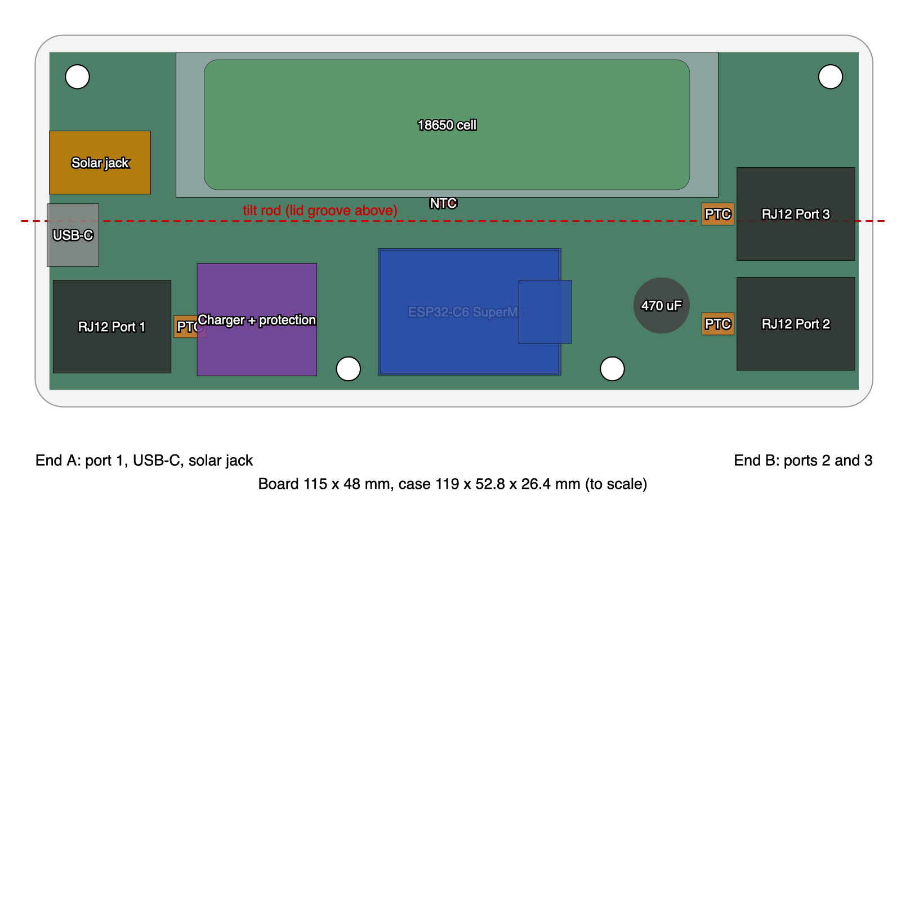
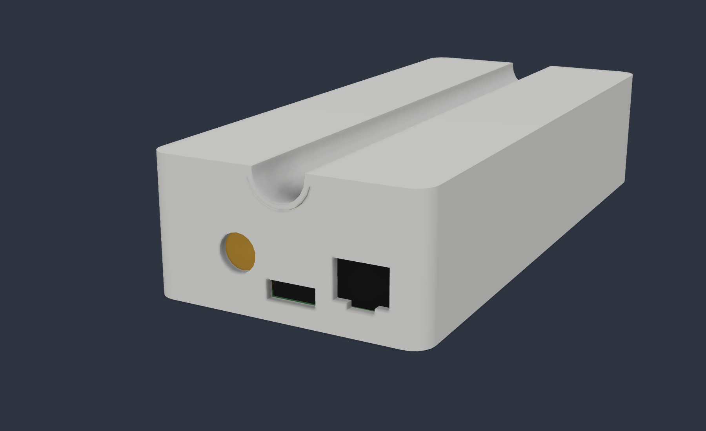

# Controller PCB v3: concept

One board that carries everything (cell, charger, USB-C, solar jack, three RJ12 ports, the ESP32-C6), so the case
is just a shell with openings. This is the placement-and-parts proposal for review, before the schematic and routing.



| | V5 (today) | **v3 concept** |
|---|---|---|
| Case | 164.6 × 52.5 × 25.8 mm | **119.0 × 52.8 × 26.4 mm** (45 mm shorter) |
| Inside the case | PCB + charger module + capacitor + USB-C board + cell, wired together | **one board**, four screws |
| Brackets | cell saddles, charger seats, capacitor saddle, USB-C card slot, PCB nest | **none**: four bosses under the board |
| Wiring | charger harness, battery lead, USB lead, solar lead | **none** (only the cords outside) |
| Height set by | the charger's capacitor | the cell's top (0.4 mm under the lid) |

Checked in Fusion with every part as a datasheet-sized block in a minimal case in the rail: **no interference**,
including the tilt rod against the lid. The ESP's pins have 3 mm under the groove.


| | |
|---|---|
|  |  |

## What's on the board, and why
| Function | Part | Why this one |
|---|---|---|
| Charger | **TI BQ25185** (LCSC C19725033, WSON-10 2.2 × 2) | 3.0–18 V operating input, 25 V tolerant: the 6 V panel (≈7 V open-circuit) plugs straight in, so there's **no zener clamp**. **Power path**: the ESP runs from SYS while the cell charges. Battery-tracking input regulation for weak sources (the panel). Standalone, so the charge current is set by a resistor. Charge and power-good pins go to the ESP, so it can finally see charge status. It replaces the BQ24076; a BQ24074 / MCP73871 would shut off at ~6.6 V, below the panel's open-circuit voltage |
| Cell protection | DW01A + FS8205A (both JLC basic parts) | so a plain, **unprotected** 18650 is safe (over-discharge, over-charge, short) |
| Cell | **Keystone 1042P** 18650 holder, through-hole, 77.05 × 20.65 × 14.86 mm | any standard 18650: button or flat top, protected or not. *Check the 1042P's accepted cell length against the cells you buy (protected cells are ~69 mm)* |
| Temperature | 10 k NTC against the holder, into the charger's TS pin | stops charging when hot. You already have these NTCs |
| USB-C | 16-pin SMD receptacle (JLC basic part) + two 5.1 k CC resistors, at the board edge | mounted on the board, no breakout or lead |
| Solar | **CUI PJ-002AH** barrel jack, right angle, 14.4 × 9 × 11 mm, 2.0 mm pin | plugs in from outside through a round opening in the end wall; the panel lead gets a 5.5 × 2.1 plug. Nothing passes through a hole |
| Source OR-ing | two Schottkys (USB, solar) into the charger's input | either source charges; neither back-feeds the other |
| Ports | 3 × RJ12 **87180-066LF** (the 10 you bought): 1 at end A, 2 at end B | the plug-shaped openings, latch notch and bezel from V5 carry straight over |
| Port protection | **SMD 0.75 A PTC** (1812) per port | replaces the 23 mm-tall radial fuses: nothing to fold |
| Port filters | same circuit as v2 (220 Ω IN1/IN2, 10 Ω + 100 k EN, 1 k + 100 nF angle), SMD | |
| ESP32-C6 SuperMini | **on sockets** (as now), placed on the room side, clear of the groove | stays replaceable. Soldering it isn't needed for fit |
| Bulk | 470 µF on the motor supply | |

## How the power works
```
USB-C VBUS --|>|--+                       SYS (3.5-4.4 V) --> ESP 5V pin (its LDO makes 3.3 V)
                  +--> BQ25185 IN --------+
solar jack --|>|--+     (3-18 V)          BAT --> DW01A/FS8205A --> 18650
                                                      |
                                                      +--> 0.75 A PTC x3 --> RJ12 pin 1 (motor supply)
CHG, PG --> ESP GPIO      BAT/2 divider --> ESP ADC      NTC --> TS
```
The motors run from the protected cell directly, not through the charger's power path. Their 1 A peaks never
touch the charger, and the ESP keeps running from SYS during a motor start.

GPIO budget (SuperMini: 0–7, 14, 15, 18–20, TX16/RX17, 8/9 strapping): 3 ports × (IN1, IN2, EN, angle ADC) = 12, plus
battery ADC, CHG, PG = **15 of 18**. The four ADC inputs (3 angle + battery) fit GPIO0–6.

## How it's built
- **JLC assembles the small surface-mount parts:** charger, protection, resistors and capacitors, PTCs, USB-C. The
  charger and protection chips are too small to hand-solder. It's about the price of the bare boards plus a few dollars of parts.
- **You solder the through-hole parts:** three RJ12s, the barrel jack, the cell holder, the two ESP sockets.
- **The case** becomes a tray with four bosses under the board's holes and the openings at both ends, and a lid with
  the round rod groove. The board screws down; the cell drops into its holder; the lid goes on.

## Decisions for you before I draw the schematic
1. **JLC assembly** of the surface-mount parts (needed for the charger chip): OK?
2. **Solar connector:** a 5.5 × 2.1 barrel jack (robust, polarized, common plugs). The alternative is a smaller
   1.35 mm barrel, which takes a smaller opening.
3. **Port split:** 1 at end A (with USB-C and solar), 2 at end B. Flip it if your blinds sit the other way round the controller.
4. **Cells:** protected or unprotected 18650s. The board protects either way; this only decides which length the holder has to take.

## Next
Schematic, then a KiCad board generated like v2 (netlist → placement → routing → DRC / ERC / parity). After that, the
V6 case around the real board, the PCB export into the same Fusion fit check, and a JLC order with assembly.
