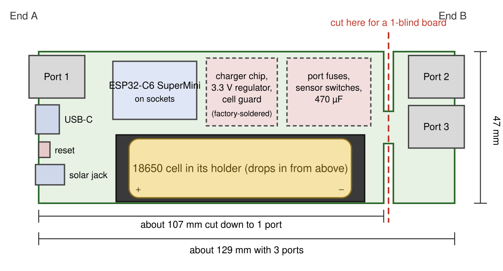

# Controller PCB v3: design (rev 4, proposal)

The next controller board. **Nothing is ordered yet.** This is the design to review before the schematic and the
KiCad layout are drawn ([#23](https://github.com/DrakeAnglin/tilt/issues/23)). Not needed to build the current
version (PCB v2.2).

**Rev 4 (2026-11-27)** replaces rev 3 (hand-solder only, modules on headers). What changed: the charger is now a
chip on the board, soldered by the board factory; the cell drops in; the ports for blinds 2 and 3 are on an end
section you can cut off.

## What it is, in short

One board, 47 mm wide, that carries everything: the cell, the charger, USB-C, the solar jack, the ESP32-C6 and the
ports. No wires, no harness, no separate charger board.



| | v2.2 today | v3 |
|---|---|---|
| Charger | Adafruit 6092 board ($8.95) on a hand-made 3-wire harness | The same chip (bq25185) on the board, about $1.40 |
| Cell | 18650 with a soldered lead and plug | Any protected 18650, dropped into a holder on the board. A cell with a lead still plugs in |
| USB-C | on the charger board | on the board |
| Solar | 2-pin plug inside the box | 3.5 × 1.35 mm barrel jack at the end wall |
| 3.3 V for the ESP and the sensors | sags to about 3.0 V (sensors drop out, [#139](https://github.com/DrakeAnglin/tilt/issues/139)) | its own regulator, 3.3 V down to a 3.4 V cell |
| Reset | unplug the cell | a button at the end wall |
| One blind | same long board | cut the end section off: about 22 mm shorter |
| Charge status to the ESP | none (a light on the charger) | yes, and a light |
| Hand soldering | about 45 parts + a crimped harness | about 8 parts |
| Box (estimate) | 157 mm long, 23 mm tall | about 134 mm long, or about 112 mm for one blind; about 3 mm taller on the cell side |

## Decisions and why

### 1. The charger chip goes on the board, soldered by the factory
The Adafruit 6092 is a bq25185 chip with a few small parts round it, and Adafruit publishes the schematic. v3 copies
that circuit onto the board: same chip, 4.2 V, 1.1 A input limit. The charge current drops from 1 A to 0.75 A: in a
closed box the chip gets hot at 1 A and throttles itself anyway.

- The chip is 2 × 2 mm with no legs, so it cannot be hand-soldered. JLCPCB places it (their part C19725033, in
  stock). They also place every other small part: resistors, capacitors, diodes, the USB-C socket.
- Why this chip and not a cheaper one: it is the only one found that takes the solar panel's 7 V directly (good to
  18 V, survives 25 V), so the 6.2 V zener goes away; it runs the ESP from USB while it charges; and it draws only
  4 µA from the cell when idle. The cheap chargers (TP4056 class, $0.20) stop at 6 V, need a clamp for the panel, and
  have no way to run the board while charging.
- A plug-in charger module (rev 3's plan) is dropped: it costs more and brings the harness back.
- The chip stops after 6 hours of nonstop charging. A 2600 mAh cell takes about 4.5 hours at 0.75 A. The ESP gets
  the chip's charge-enable line, so the firmware can restart a charge that timed out, and stop charging when the
  box is over 45 °C.
- This changes [#23](https://github.com/DrakeAnglin/tilt/issues/23)'s "hand-solder only, bare PCB" rule. That rule
  and an on-board charger cannot both hold.

### 2. The ESP32-C6 stays a SuperMini on sockets
A bare ESP32-C6 module costs about the same ($4), so there is nothing to save, and the SuperMini can be flashed on
the bench and swapped. One change: v3 feeds the SuperMini's **3V3 pin** from the board's own regulator, and leaves its
5V pin empty.

- Why: on v2.2 the ESP gets the cell through a diode and then its own regulator, which costs about 0.6 V. At a 3.6 V
  cell the 3.3 V line is 3.0 V, under what the AS5600 sensor needs.
- The new regulator (RT9080-33, 600 mA, 2 µA idle) loses about 0.1 V, so the line holds 3.3 V until the cell is
  down to about 3.4 V, and is still 3.2 V at the 3.35 V motor cut-off.
- The SuperMini's own parts (its regulator, back-fed, and its two lights) may draw 40 to 400 µA asleep, going by
  other people's measurements. That is most of a 0.5 mA budget, so it is the first bench test.

### 3. Each sensor gets a real power switch
Today an ESP pin powers each tilter's sensor directly and loses 0.26 V on the way. v3 puts a small transistor switch
on each port's EN line, fed from the 3.3 V line. The sensor then sees the full 3.3 V. The firmware change is small:
the pin is low for "on" instead of high.

### 4. The cell drops into a holder on the board
A standard through-hole 18650 holder (Keystone 1043P, 77 × 21 × 15 mm) is soldered to the board. The cell presses
in from above. No lead, no plug.

- Why a holder and not bare contacts: it is one known part with a drawing, it grips the cell, and the "P" type is
  sold as polarized against a cell put in backwards (to confirm with one in hand). An earlier idea, a notch in the board with a contact at
  each end, kept the box at 23 mm but needed two contacts nobody sells as a matched pair. It stays as the fallback.
- **The price is height.** The cell sits about 4 mm higher than today, so the box grows about 3 mm on the cell
  side, beside the tilt rod (the rail has 36 mm inside; the box is 23 mm). The CAD has to show the rod still clears
  the lid and the box still tilts in past the rail's lips. That check comes before the layout
  ([open items](#open-items-before-the-layout)).
- The holder takes cells up to about 69 mm, so most protected cells fit. Check a new brand's length before buying.
- **A cell put in backwards must do no harm.** Three layers: the polarized holder; protected cells, which cut off
  a short on their own; and a **cell guard** on the board, a transistor switch that connects the cell only when + is
  on the + contact.
- **The cell guard is not finished.** The simple version works when a cell goes into a dead board. The review found
  two holes: with USB plugged in the switch stays closed after the cell is pulled, so a backwards cell would meet a
  live contact; and it cannot wake a cell whose own protection has tripped. It needs a fast turn-off and a wake
  path, simulated and then tried on a breadboard, before the layout.
- **Cells with a lead still work.** The board keeps a 2-pin JST-XH header beside the holder, on the same guarded
  line.
- A 10 kΩ temperature sensor on the board beside the holder stops charging when the box is very hot or freezing
  (requirement E-4, open until now).
- Protected cells only, as today.
- A cheaper holder ($0.46 from JLCPCB's list, against $2.90) is possible if its drawing matches. Not checked yet.

### 5. One cell, not two
A second cell does not fix battery life; the idle drain does.

| Average drain | One 2600 mAh cell | Two cells |
|---|---|---|
| 25–30 mA (measured now, [#6](https://github.com/DrakeAnglin/tilt/issues/6)) | about 4 days | about 8 days |
| 1.5 mA | about 2 months | about 4 months |
| 0.5 mA (the target) | about 6 months | about a year |

The drain is the idle current plus the moves (three blinds, six moves a day each, add roughly 0.1 to 0.4 mA).
At today's drain two cells still mean charging every week. Once the firmware sleeps properly, one cell meets the
2-month goal with room to spare. Two cells in parallel also need care (a full cell dumps into an empty one), and a
second cell adds 75 mm.

- For more life in the same space: a protected 3400–3500 mAh cell (about a third more). It takes about 6 hours to
  fill, so the firmware's charge restart matters for it.

### 6. Ports 2 and 3 are on a cut-off section
Port 1 is at end A with USB-C and the solar jack. Ports 2 and 3 sit on a section at end B, joined to the board by a
10 mm neck with a printed **cut line**.

- **For one blind:** cut the neck with a small saw and file the edge. The board is then about 107 mm instead of
  129 mm, and goes in the short box. No jacks to buy for ports 2 and 3.
- **For two blinds:** keep the section, fit one jack. Same box as three.
- The fuses and resistors for ports 2 and 3 stay on the main board, so nothing live crosses the cut: only dead copper ends show at the sawn edge. Each of those
  two ports gets battery power through a solder jumper that is open as made: bridge it with a blob of solder only if
  the port is used.
- Why a cut line and not perforations: JLCPCB bills a board with snap-off holes or slots as two designs (a surcharge
  on the boards, and $8 more on assembly). A neck in a plain outline is one design. It is also stiffer, which matters
  because cords get pushed into those jacks.

### 7. No power monitor chip
Rev 3 had an INA3221 current monitor. It is out: with a 0.1 Ω shunt it resolves 0.4 mA, so it cannot see the idle
drain that matters (0.5 mA), and it costs a chip, three shunts and two pins. v3 gives the ESP four plain signals
instead, which cover what [#23](https://github.com/DrakeAnglin/tilt/issues/23) asks for:

| Signal | Pin | Tells the firmware |
|---|---|---|
| Cell voltage | GPIO3 (as today) | Battery level |
| Solar jack voltage, before its diode | GPIO0 | a panel is lit (Light Schedules); solar or USB |
| Charging (the chip's status line) | GPIO8 | the chip is charging. Charging with a dark panel means USB |
| Charge enable (to the chip) | GPIO15 | stop charging when hot; restart after the 6-hour stop |

The chip's second status line (fault) drives a light only: the ESP has no pin left for it. A fault and a normal
charge both pull the charging line low, so the firmware tells them apart by time and by the cell voltage.
GPIO8 and GPIO15 also carry the SuperMini's two lights; that they still read and drive cleanly is a bench check.

Idle current is measured on the bench with a meter in the cell lead ([#6](https://github.com/DrakeAnglin/tilt/issues/6)).

### 8. No low-light harvester
A window with no direct sun gives about 1 mA per panel; the charger chip needs about that much just to wake. A
harvester chip that can use it costs $5–6 plus its own parts, and would bring in about 5 mAh a day per panel. Left
out. With the idle drain fixed, one charge lasts months, and a panel in direct sun (about 100 mA) works with the
charger as it is.

### 9. No capacitor for the tilter on this board
The 10 µF question: a capacitor only helps a motor driver if it sits next to the driver, and the driver is at the
other end of the cord. The DRV8833 board in the tilter has its own. What the controller board should carry is the big
reservoir for motor starts, and it does: the 470 µF on battery +. The tilter needs nothing added.

## The circuit

```
USB-C VBUS ──►|──┐                 ┌── SYS (4.5 V on USB / the cell on battery)
                 │                 │        └─► 3.3 V regulator ─► ESP 3V3 pin, sensor switches ×3
solar jack ──►|──┴─► IN  bq25185  ─┤                 ▲ reset button holds it off
  (sense→GPIO0)        │  │        └── BAT ──┬── cell guard ── cell holder + / JST-XH   (cell −: GND)
  status → GPIO8, lights ┘  └ 10 k sensor     ├── 1 M / 1 M ─► GPIO3
  enable ← GPIO15             by the cell     ├── 470 µF
                                              └── 0.75 A fuse ×3 ─► RJ12 pin 1 (ports 2, 3: solder jumper)
RJ12 (unchanged): 1 battery +, 2 IN1, 3 GND, 4 angle, 5 EN, 6 IN2
  IN1, IN2: ESP pin ─ 220 Ω ─ jack      angle: jack ─ 1 k ─ ESP pin, 100 nF
  EN: 3.3 V ─ switch (ESP pin low = on, slowed so the 3.3 V line does not dip) ─ 10 Ω ─ jack
```

- **Motors run straight from the cell**, as today, not through the charger chip. The chip's own battery switch trips
  at 3.1 A and can latch off until USB is plugged in; the motors stay clear of it.
- **The ESP runs from the chip's SYS output.** On USB it runs even with a flat or missing cell. On battery the
  chip cuts the ESP off when the cell falls to 3.0 V, which protects the cell. The risk: a motor start that dips a
  low cell under 3.0 V would restart the ESP. A solder jumper lets the regulator take the cell directly instead, and
  the dip is a bench test before the order.
- **USB and solar together:** each has its own diode into the charger, so neither feeds the other. The higher one
  charges. USB gets a low-loss diode (SS34). Solar gets a low-leakage one, and its voltage divider is about 100 kΩ,
  so USB cannot make the solar reading look lit.
- **Reset button:** it holds the 3.3 V regulator off. Hold it for 2 seconds.
- **Idle cost of the board itself:** about 12 µA (charger 4, regulator 2, cell guard 4, divider 2). The SuperMini
  comes on top.
- **The board's USB-C is for charging only.** Flashing by cable still means the ESP's own USB, with the lid off.
  Updates go over the air.

### Pins
The port pins do not move, so the firmware's pin table only gains a few lines.

| Port | IN1 | IN2 | EN (low = on) | Angle |
|---|---|---|---|---|
| 1 | GPIO14 | GPIO18 | GPIO7 | GPIO6 |
| 2 | GPIO19 | GPIO20 | GPIO5 | GPIO4 |
| 3 | GPIO16 | GPIO17 | GPIO1 | GPIO2 |

Cell voltage GPIO3, solar voltage GPIO0, charging GPIO8, charge enable GPIO15. GPIO9 (the BOOT button) stays free:
it must be high at start-up, so nothing may pull it low.

## Who solders what

| Soldered by JLCPCB (top side) | Soldered by hand |
|---|---|
| bq25185 charger and its parts, 2 input diodes | RJ12 jack per port used (1 to 3) |
| 3.3 V regulator | 2 socket strips for the ESP |
| cell guard (2 transistors), 3 sensor switches | the cell holder |
| 3 port fuses (surface-mount, low-resistance type, so no more folding them over) | 470 µF capacitor |
| all resistors and small capacitors, temperature sensor | solar jack (DC003-1.3), only if solar is used |
| USB-C socket (power only), reset button, charge and fault lights | JST-XH battery header, only for a cell with a lead |

Parts already on hand that v3 still uses: RJ12 jacks, socket strips, 470 µF capacitors, JST-XH headers, ESP32-C6
boards, cells with leads. No longer needed: the 6092, the 6-pin harness parts, the zener, through-hole diodes,
resistors and fuses.

## Cost

Per controller, without the ESP, the cell, the jacks and the box (those do not change). Prices from JLCPCB's parts
list on 2026-11-27.

| | v2.2 | v3, order of 5 | v3, order of 10 |
|---|---|---|---|
| Bare board | about $2 | about $2 | about $1.50 |
| Charger | $8.95 | in the assembly | in the assembly |
| Harness parts, zener, diodes, fuses, resistors | about $3.50 | none | none |
| Assembly: fixed fees ($8.18 setup, $1.53 stencil, $3.07 for each of about 6 special parts) | none | about $5.60 | about $2.80 |
| Assembly: the parts and placing them | none | about $3.20 | about $3.20 |
| Cell holder (Keystone 1043P), solar jack | none | about $3 | about $3 |
| **Total** | **about $14.50** | **about $13.80** | **about $10.50** |
| With JLCPCB's lowest US duty (35 %) on their part | | about $17.50 | about $13 |
| With the highest (90 %) | | about $23.50 | about $17 |

Not in these numbers: shipping. The bare-board price is a guess (the board is longer than JLCPCB's 100 mm cheap
size), and the duty rate only shows in the cart. On the other side, the v2.2 cell with a soldered lead costs a few
dollars more than a plain protected cell, which is not counted either.

So, plainly: **v3 does not save much money.** In an order of 10 with a low duty it is $1 to $4 cheaper per
controller; in an order of 5, or with a high duty, it costs the same or more. The cheap holder would take about $2.50
off. The sure gains are the ones in the table at the top: no harness, a steady 3.3 V, 8 parts to solder. Get the
real quote before deciding the quantity.

A further saving, not decided: RJ12 jacks at $0.10–0.23 from JLCPCB's list instead of the $1.43 Amphenol. Their
footprint has to be checked against the Amphenol's first.

## Open items before the layout

1. **Bench test first: the SuperMini fed at its 3V3 pin.** 3.3 V from a bench supply into 3V3, 5V pin empty. Check
   that it runs Thread and Bluetooth, measure its sleep current, check that plugging USB into the ESP at the same
   time does no harm, and that GPIO8 and GPIO15 work as a status input and an enable output with the lights on them.
2. **Bench test: a low cell and a motor start.** A 6092 wired the v3 way on a v2 board (the ESP from its 4.5V
   terminal, the motors from the cell): cell at 3.35 V, stall a motor, three blinds starting together. The ESP must
   not restart. This is the old list's "ESP on a low cell" test, still open.
3. **Box height with the holder.** Put the holder and the cell on the board in the box CAD: the rod clears the lid,
   the box tilts in past the lips, nothing pokes out. If it fails: the notch with end contacts, or a cell with a lead.
4. **Cell guard.** Simulate, then breadboard: cell in backwards with USB live, cell swapped with USB live, a tripped
   cell woken by USB. If no simple circuit passes, the guard is left off and the polarized holder, protected cells
   and "unplug USB before you change the cell" carry it.
5. **Bench test: the EN switch.** One transistor on a breadboard between 3.3 V and a tilter's EN line: the sensor
   reads every time, with the cell at 3.5 V.
6. **Quote.** Upload the finished files to JLCPCB for the real price with duty.
7. **At layout:** three screw holes that work in both lengths; USB-C and the solar jack at least 14 mm apart so
   both plugs fit; the ESP 1.5 mm nearer the room side than on v2.2, clear of the rod groove; copper round the
   charger chip for heat, and the temperature sensor away from it; how far the USB-C socket overhangs the edge; the
   DC jack's holes; the regulator's dropout at 150 mA; a low-resistance fuse.

From the old "must test on the v2 board" list: the brown-out on USB and the trickle charge were the old MCP73871
module (gone), and the lost crimp was the harness (gone). Solar behind a window is measured
([#8](https://github.com/DrakeAnglin/tilt/issues/8)). The low-cell test stays, as item 2. The USB charge rate is
checked on the first v3 board.

## First-board checks

On the first assembled board, before any more are built:

1. No cell, USB in: 3.3 V on the 3V3 test pad, the ESP starts.
2. Cell in the right way: charge light on, about 0.75 A on a USB meter. Cell in backwards, with and without USB,
   and with USB in, cell pulled and put back backwards: nothing gets warm, and it works again with the cell turned
   round.
3. USB out: the ESP keeps running. Reset button: it restarts.
4. USB and a panel in sun together: neither jack shows the other's voltage.
5. All three ports moving at once on a 3.5 V cell: no restart, sensors read.
6. Idle current with a meter in the cell lead.

## Next

1. Review of this design; the bench tests; the box height check.
2. Schematic and KiCad board, generated like v2 (`hardware/pcb`), DRC and ERC clean, with JLCPCB's parts and
   placement files.
3. Box for the new board, in two lengths, with the fit checks.
4. Firmware: EN low = on, the new sense pins, a v3 line in the pin table.
5. Quote, then the order.
