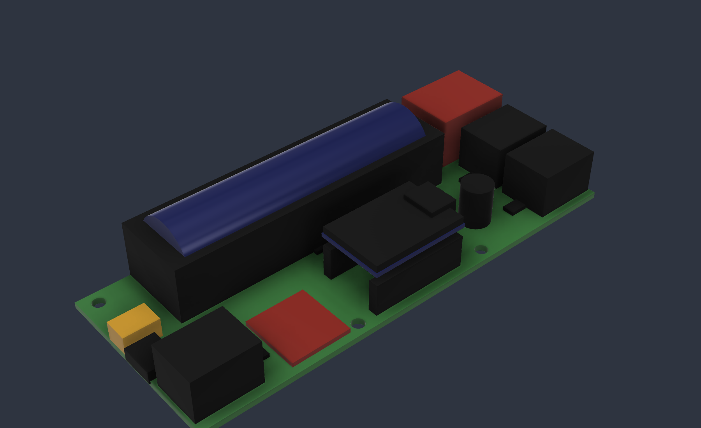
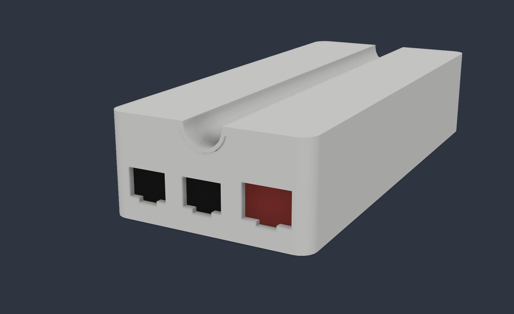

# Controller PCB v3: concept (rev 2)

One board that carries everything: the cell, charger, USB-C, solar jack, three tilter ports and a lifter port, and the
ESP32-C6. The case is then just a shell with openings. This is the placement-and-parts proposal for review, before the
schematic and routing.


| | V5 (today) | **v3 concept** |
|---|---|---|
| Case | 164.6 × 52.5 × 25.8 mm | **121.0 × 52.8 × 26.4 mm** (44 mm shorter) |
| Inside the case | PCB + charger module + capacitor + USB-C board + cell, wired together | **one board**, four screws |
| Brackets | cell saddles, charger seats, capacitor saddle, USB-C card slot, PCB nest | **none**: four bosses under the board |
| Wiring inside | charger harness, battery lead, USB lead, solar lead | **none** |
| Ports | 3 tilter | 3 tilter + **1 lifter (RJ45)** |

Checked in Fusion with every part as a datasheet-sized block in a minimal case in the rail: **no interference**,
including the tilt rod against the lid. The cell's top sets the height (0.4 mm under the lid). The ESP's pins have
3 mm under the groove.



| | |
|---|---|
|  |  |

## What's on the board
| Function | Part | Notes |
|---|---|---|
| Charger | **TI BQ25185** (LCSC C19725033, WSON-10 2.2 × 2) | 3.0–18 V operating input, 25 V tolerant: the 6 V panel (≈7 V open-circuit) plugs straight in, with **no zener**. Power path (the ESP runs while the cell charges), battery-tracking input regulation for the panel, charge-status pin to the ESP. The usual alternatives (BQ24074, MCP73871) shut off at ~6.6 V, under the panel's open-circuit voltage |
| Cell protection | DW01A + FS8205A (JLC basic parts) | so any standard 18650, protected or not, is safe |
| Cell | 18650 in a **Keystone 1042P** holder (77 × 21 × 15 mm, through-hole) | see "Is the 18650 right?" below |
| Temperature | 10 k NTC at the holder → charger TS pin | no charging when the cell is hot (you have these) |
| USB-C | 16-pin SMD receptacle + 5.1 k CC resistors, at the board edge | |
| Solar | **3.5 × 1.35 mm barrel jack, SHOU HAN DC003-1.3** (LCSC C668594, JLC can solder it) | 9 × 6.3 × 5 mm, round 4 mm opening in end wall A. The panel lead gets a 3.5 × 1.35 plug (common) |
| Source OR-ing | 2 Schottkys (USB, solar) | either charges, neither back-feeds the other |
| Tilter ports | 3 × RJ12 87180-066LF (yours): 1 at end A, 2 at end B | V5's plug-shaped openings carry over |
| **Lifter port** | **RJ45 8P8C** at end B, its own **2 A** PTC | see below |
| Port fuses | SMD PTCs (1812): 0.75 A × 3, 2 A × 1 | nothing to fold |
| ESP32-C6 SuperMini | **on sockets**, room side, clear of the groove | stays replaceable |

```
USB-C VBUS --|>|--+                     SYS --> ESP 5V pin (its LDO makes 3.3 V)
                  +--> BQ25185 IN ------+
solar 1.35 --|>|--+    (3-18 V)         BAT --> DW01A/FS8205A --> 18650
                                                    |
                         0.75 A PTC x3 <------------+------------> 2 A PTC --> RJ45 lifter (2 x VBAT, 2 x GND)
                         RJ12 tilters (pin 1)
CHG --> ESP      battery/2 --> ESP ADC      NTC --> TS
```

**GPIO:** 4 ports × (IN1, IN2, EN, angle) = 16, plus the battery ADC and CHG = **18 of the SuperMini's 18 free pins**.
The 5 analog inputs fit GPIO0–6. That's full: the charger's power-good pin is left off (CHG and the battery trend tell the
same story). If the lifter needs more signals later, its own small driver/MCU at the lifter can talk over 2 of the RJ45's wires (I²C).

## The lifter port
Raising slats means lifting the stack, roughly **6–15 W** for small blind motors (about 1 A at 12 V). From a
3.7 V cell that's **3–4 A peaks**, more than an RJ12's thin wires should carry. So the 4th port is an RJ45:
- **pins 1, 2:** battery +. **Pins 3, 6:** GND. Two wires each way, about 2 A on 24 AWG cable, fused at 2 A.
- **pins 4, 5, 7, 8:** IN1, IN2, EN and angle/sensor, the same signals as a tilter. The lifter can have the tilter's
  driver + AS5600 arrangement, or its own driver (and a boost to 12 V if it needs one) at the motor end.

The energy is no problem: 2 lifts a day at 12 W for 15 s is 0.1 Wh against the cell's ~9 Wh. Only the peak current
matters, and a high-drain 18650 handles it (below). If the lifter design ends up needing much more, we revisit it then.
The port and its wiring are reserved now, so no new board is needed.

## Is the 18650 right?
| Option | Capacity | Fits? | Verdict |
|---|---|---|---|
| **18650, high-drain** (e.g. Molicel P28A 2800 mAh / 35 A, Samsung 25R 2500 mAh / 20 A) | 9–10 Wh | yes (this layout) | **recommended**: standard, cheap ($4–6), holders everywhere, easily handles lifter peaks |
| 21700 (4000–5000 mAh, 30–45 A) | 15–18 Wh | +3.5 mm wide, +2.6 mm tall, +4 mm long | worth it only if the ESP has to stay always-on without solar, or the lifter is heavy |
| LiPo pouch | any | flat | no standard size or holder, swells in heat (a sunny window), easy to puncture: no |
| LiFePO4 18650 | ~5 Wh | yes | safest in heat, but 3.2 V makes the N20s weaker (already torque-limited): no |
| AA NiMH ×2–3 | 2.4–3.6 V | — | too low a voltage for the motors: no |

What decides the capacity is the ESP. As a Thread sleepy device it averages roughly 1–2 mA, so a 2800 mAh cell runs
~2–4 months on its own. Always-on (Thread router) is ~30–40 mA, ~3 days, which needs the panel. The motors are a
rounding error. The window's heat matters more than capacity: the NTC stops charging above ~45 °C, and the case should
stay out of direct sun.

## Costs, stock and lead times (checked 2026-11)
| Part | Source | Price | Stock / lead time |
|---|---|---|---|
| BQ25185DLHR | LCSC C19725033 | $1.83 (1), $1.12 (1k) | 2,377 at LCSC; TI: active |
| DC003-1.3 jack | LCSC C668594 | ~$0.1 | in JLC's assembly library |
| Keystone 1042P holder | DigiKey 36-1042P-ND | ~$5.40 (1), $4.23 (25) | ~7,600 in stock; 14-week factory lead time if that runs out. Alternative: MPD BH-18650-PC or a generic LCSC 18650 holder (JLC can solder those) |
| DW01A, FS8205A, USB-C, R/C | JLC basic parts | cents | stocked |
| SMD PTCs (0.75 A, 2 A) | LCSC | ~$0.2–0.4 | stocked |
| RJ45 8P8C right angle, unshielded | LCSC | ~$0.3–0.6 | stocked |
| RJ12 87180-066LF | you have 10 | — | — |
| 18650 cell (high-drain) | battery shops | $4–6 | — |

## JLC assembly: yes, they'd do all of it
JLC solders through-hole parts too: hand-soldered, $3.50 labour per order plus a small per-joint charge. So the board
can arrive with **everything soldered** (charger, protection, USB-C, solar jack, RJ12s, RJ45, holder, ESP sockets). You
plug in the ESP and the cell. If they don't stock a part (your RJ12s, the Keystone holder), it can be bought through their
global sourcing, or left off for you to solder.

**Estimate for 5 boards** (JLC's published Economic PCBA rates; the real quote comes from uploading the files):

| | |
|---|---|
| PCB, 117 × 48 mm, 2-layer, ×5 | ~$5–8 |
| Assembly setup + stencil | $9.71 |
| Extended-part fees (~5 parts × $3.07) | ~$15 |
| SMD joints (~180 per board × 5 × $0.0016) | ~$1.50 |
| Through-hole labour + joints | ~$9 |
| Parts (~$16/board fully loaded, ~$5 without RJ12s/holder) | ~$25–80 |
| Shipping (DHL) | ~$15–20 |
| **Total** | **~$80–140 for 5** (~$16–28 each), depending on who supplies the RJ12s and holders |

When the board is drawn I'll generate the BOM and placement files and fill in JLC's quote form (stopping before checkout, as with
the PCB) so you see the exact number.

## Decided
- JLC assembly: yes (quote first).
- Solar: 3.5 × 1.35 mm barrel jack.
- Port split: doesn't matter. 1 + USB-C + solar at end A; 2 + lifter at end B.
- Cells: either. The board protects them; the holder takes both lengths (check the 1042P's length range against the cell you buy).

## Next
1. Your OK on the 18650 recommendation and the lifter port.
2. Schematic, then a KiCad board generated like v2 (netlist → placement → routing → DRC / ERC / parity), then the
   PCB's 3D export into this same Fusion fit check.
3. BOM + placement files → JLC quote. Then the V6 case around the real board.
