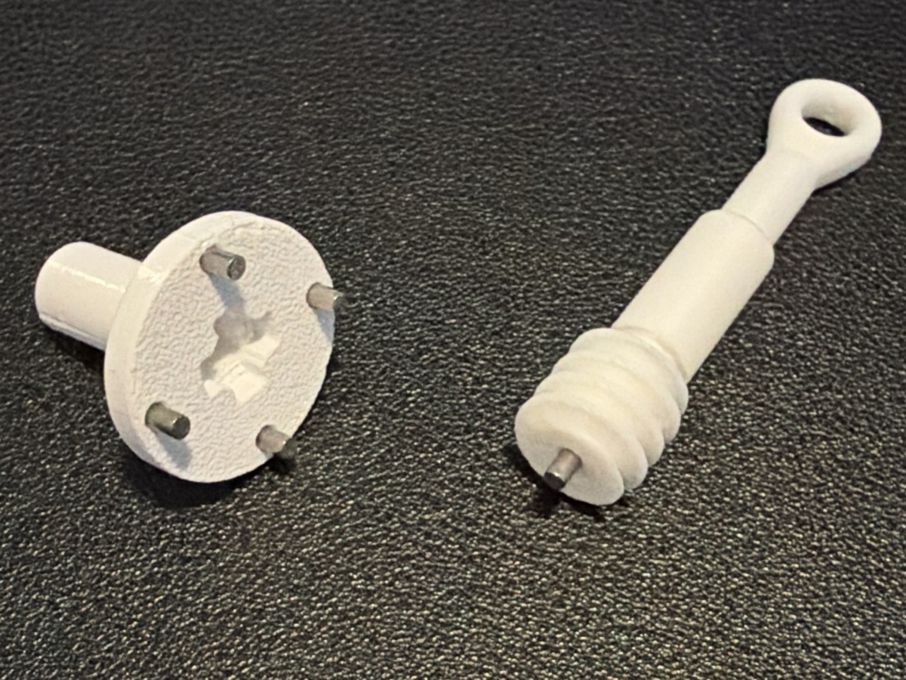

# Tilter assembly: the printed parts

One tilter, from printed parts to ready for the blind. This page is the **mechanical build**: printed parts,
screws, pins, grease. Each step says what goes in, and ends with a photo of how it looks when that step is done.

The tilter has two subassemblies:
1. **Sensor module** (the electronics): RJ12 breakout, DRV8833 motor driver and AS5600 angle sensor, wired together.
   Build it first, on the bench: [sensor module](tilter-wiring.md).
2. **Mechanical build** (this page). The finished sensor module goes in at step D1.

Short version and design notes: [tilter README](../hardware/mechanical/stl/tilter/README.md).

## What you need
**Tools:** soldering iron (it presses the inserts and solders the motor leads), flush cutters, tweezers, M3 and
M1.6 drivers for the screws, a toothpick for the grease.

**Grease:** Super Lube 21030 (PTFE). Use a toothpick and a **thin film**: about a rice grain per gear. Too much
picks up dust and slows the motor. Where it goes is marked **Grease** in each step.

## Step 0. Sort the kit
Lay everything out in four groups, one per part of this page, before you start. Then nothing gets left out, and a
missing part shows up now and not halfway through.

| Group | Printed | Bought |
|---|---|---|
| **A. Prep** | bearing shell, tray, carrier, worm case half with the pin hole, tray lid | 6 M3 heat-set inserts, 5 Ø2 × 6 dowel pins |
| **B. Gearbox** | case right (main half), case left (lid), worm, worm wheel, ring cup, 4 planets, sun 27T | 2 M3 × 25 |
| **C. Motor end** | motor shell, motor pinion, cluster (20T / 9T), sensor sleeve | N20 motor, 2 M1.6 × 4 |
| **D. Tray and lid** | magnet gear | the finished sensor module, the Ø4 × 2 magnet, 2 M3 × 20, 1 M3 × 25, 1 M3 × 8, 6 felt pads |

The parts in group A go on to B and D once they are prepped. Keep the grease out with all of them.

📷 **Photo 00:** the kit laid out in its four groups, labeled A to D, with the finished sensor module in D.

---

## Part A: prepare the printed parts

### A1. Clean up
A quick look over every printed part. It does not need to be perfect.
- **Seams:** feel each part that turns or slides (worm, wheel, gears, carrier hub, sleeve nose, the bores they run
  in). Scrape or sand off any seam bump with a hobby knife or a nail file.
- **Gears:** pick off stringing and any blob between teeth. Run a fingernail round each gear; it should feel even.
- **Support:** pick the support out of the tray lid's gear cage.
- **Test-fit:** each gear on its pin or shaft should turn freely by hand.

📷 **Photo A1:** the tray lid with the support removed.

### A2. Heat-set inserts (6)
Soldering iron, insert on the tip, press straight down until it is flush with the surface. Let it cool before
moving on. Check each one is straight: an M3 screw should start by hand.

**Tray: 2.** One in the tall post at the back corner, one in the low block at the front corner.

**Bearing shell: 4**, two on each face: two on the cup side (the big round cup), two on the flat side.

| Cup side | Flat side |
|---|---|
|  |  |

### A3. Dowel pins (5)
- **4 into the carrier**, one in each pocket, pressed to the bottom. They are the planet axles.
- **1 into the worm case** at the worm's top end.

Press them in with flat pliers or a light tap. They must be straight: a tilted pin binds its planet.

---

## Part B: the gearbox
Grease every gear as it goes in.

### B1. Worm and wheel
Worm wheel into the main half (case right), then the worm, its thread end over the top pin.
**Grease:** the worm's thread and the wheel's teeth. Turn the worm by its loop a few times to spread it.

📷 **Photo B1:** worm and wheel in the main half, lid off.

### B2. Worm case lid
Case left on. The worm should still turn by hand, with no tight spot through a full turn of the wheel.

📷 **Photo B2:** worm case closed.

### B3. Ring cup and planets
Ring cup onto the wheel's hex. The 4 planets onto the carrier's pins, carrier into the cup.
**Grease:** the planets' teeth, the ring cup's teeth, and the carrier's hub where it runs in the wheel.

📷 **Photo B3:** looking into the ring cup, 4 planets in place.

### B4. Bearing shell and sun
Bearing shell over the cup (its two pins find the lid). Sun piece (27T) in, its sun into the planets.
Two **M3 × 25** from the main half's back into the bearing shell. **Snug, not tight.**
**Grease:** the sun's teeth and the 27T gear.

Check: turn the sun by hand; the wheel should turn, slowly.

📷 **Photo B4:** bearing shell on, sun showing, two bolts in.

---

## Part C: the motor end

### C1. Motor into the motor shell
N20 onto its plate with the 2 **M1.6 × 4** (heads down in their wells). Motor pinion onto the motor shaft (D-shaft
lines up with the flat).

📷 **Photo C1:** motor shell with the N20 and pinion.

### C2. Cluster gear
Drop the cluster (20T / 9T) in. Set the motor shell on the bearing shell: its two pins find their holes. It has no
bolts of its own yet. Hold it there; the cluster's axle comes in step D2.
**Grease:** pinion, both cluster gears.

📷 **Photo C2:** motor shell sitting on the bearing shell, cluster in.

### C3. Sensor sleeve
Push the sleeve's nose through the motor plate from the back. Turn it until the lugs drop into the carrier (the
last 2.4 mm). Its gear now sticks out of the plate.
**Grease:** the sleeve's nose.

📷 **Photo C3:** sleeve in, its gear sticking out.

---

## Part D: tray, boards and lid

### D1. Sensor module: AS5600 into the tray
With the tray off the tilter: the sensor module's AS5600 onto its studs, **chip up**. It cannot go in later: it lies under the sleeve's
gear.

📷 **Photo D1:** tray with the AS5600 on its studs.

### D2. Tray on
Tray on from the back (two pins find the motor shell). Two **M3 × 20** through its end wall:
- **Room-side bolt** goes through the cluster gear. Turn the gear until the bolt finds its bore. This bolt is the
  cluster's axle.
- **Floor bolt** under the sensor board.

**Snug only.** A hard-tightened axle bolt bows the motor plate onto the cluster.

Check: the motor shaft turns by hand (slowly) and the whole train moves.

📷 **Photo D2:** tray on, both bolts in.

### D3. Motor leads, driver, RJ12
Solder the white pair to the N20's two tabs (either way round). DRV8833 down into its slots, then the RJ12 board,
jack up. Tuck the leads flat so nothing sits above the tray walls.

📷 **Photo D3:** looking into the tray from above, all boards seated, leads tucked.

### D4. Magnet gear and lid
Press the magnet into the magnet gear's hub. Slide the gear into the lid's gear cage from the rod side until its
hub clicks into its seat.
**Grease:** the magnet gear's teeth.

📷 **Photo D4:** the lid upside down, magnet gear in its cage.

### D5. Lid on
Lower the lid straight down over the jack. The gear turns itself into mesh. **M3 × 25** down through the column
and the sensor board; **M3 × 8** in the corner. Snug.

📷 **Photo D5:** the closed tilter, jack side.

### D6. Felt pads
4 under the floor (one each corner), 1 on the middle of each long side wall. Felt, not rubber.

📷 **Photo D6:** underside with the 4 pads.

---

## Done: check before the blind
1. Plug it into a controller port with an RJ12 cord (pin 1 to pin 1).
2. Set it up in the Tilt app ([build guide, step 8](build-guide.md#8-set-up-in-the-tilt-app)). Keep it on the
   bench for this.
3. Then into the rail, and push the rod through. Turn the wand a little if it stops. If the rod binds, use thinner
   pads or leave the side ones off.

📷 **Photo 99:** the finished tilter in the rail, rod through.

## Photos
Photos go in `docs/photos/tilter/`, named by step: `00-kit.jpg`, `a2-tray-inserts.jpg`, `b1-worm.jpg`, and so on.
Shoot on a plain white or gray background, from above, with the part filling most of the frame.
