# Tilter assembly: the printed parts

One tilter, from printed parts to ready for the blind. This page is the **mechanical build**: printed parts,
screws, pins, grease. Each step says what goes in, and ends with a photo of how it looks when that step is done.

The tilter has two subassemblies:
1. **Sensor module** (the electronics): RJ12 breakout, DRV8833 motor driver and AS5600 angle sensor, wired together.
   Build it first, on the bench: [sensor module](tilter-wiring.md).
2. **Mechanical build** (this page). The finished sensor module goes in at steps D1 to D3.

Short version and design notes: [tilter README](../hardware/mechanical/stl/tilter/README.md).

## What you need
**Tools:** soldering iron (it presses the inserts and solders the motor leads), flush cutters, tweezers, M3 and
M1.6 drivers for the screws, a toothpick for the grease.

**Screws:** tighten every screw down unless the step says otherwise. Only the tiny motor screws (C1) and the
optional temporary screws (C5) stay snug.

**Grease:** Super Lube 21030 (PTFE). Where it goes is marked **Grease** in each step.
- **A thin film is all it needs.** Put a little on, spread it with your finger, then wipe off what is left over.
- **Too much grease is worse than too little.** The extra has to be pushed out of the way by the gears, and you can
  feel it as a light drag when you turn them. It also picks up dust.

## Step 0. Sort and clean up
**Sort.** Lay everything out in four groups, one per part of this page, before you start. Then nothing gets left
out, and a missing part shows up now and not halfway through.

| Group | Printed | Bought |
|---|---|---|
| **A. Prep** | bearing shell, tray, carrier, worm, tray lid, magnet gear | 6 M3 heat-set inserts, 5 Ø2 × 6 dowel pins, the Ø4 × 2 magnet |
| **B. Gearbox** | case right (main half), case left (lid), worm, worm wheel, ring cup, 4 planets | 2 M3 × 20 |
| **C. Motor end** | motor shell, sun piece (27T), motor pinion, cluster (20T / 9T), sensor sleeve | N20 motor, 2 M1.6 × 4 |
| **D. Tray and lid** | (tray, lid and magnet gear from A) | the finished sensor module, 2 M3 × 20, 1 M3 × 25, 1 M3 × 8, 6 foam pads |

The parts in group A go on to B and D once they are prepped. Keep the grease out with all of them.

**Clean up.** A quick look over every printed part. It does not need to be perfect.
- **Support:** remove the support from the tray lid's gear cage.
- **Seams:** feel each part that turns or slides (worm, wheel, gears, carrier hub, sleeve nose, the bores they run
  in). Scrape or sand off any seam bump with a hobby knife or a nail file.
- **Gears:** pick off stringing and any blob between teeth. Run a fingernail round each gear; it should feel even.
- **Test-fit:** each gear on its pin or shaft should turn freely by hand.

---

## Part A: prepare the printed parts

### A1. Heat-set inserts (6)
Soldering iron, insert on the tip, press straight down until it is flush with the surface. Let it cool before
moving on. Check each one is straight: an M3 screw should start by hand.

**Tray: 2.** One in the tall post at the back corner, one in the low block at the front corner.

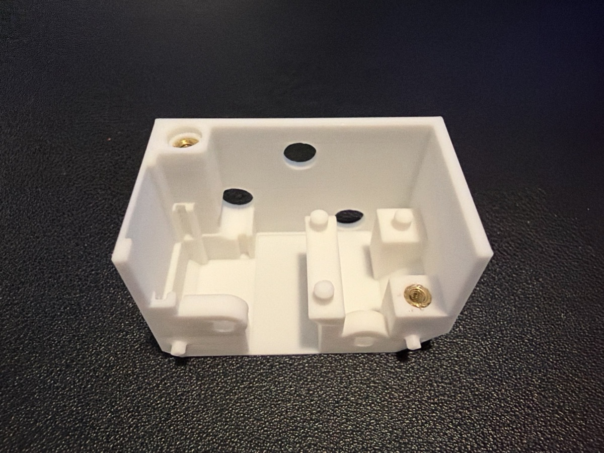

**Bearing shell: 4**, two on each face: two on the cup side (the big round cup), two on the flat side.

| Cup side | Flat side |
|---|---|
| 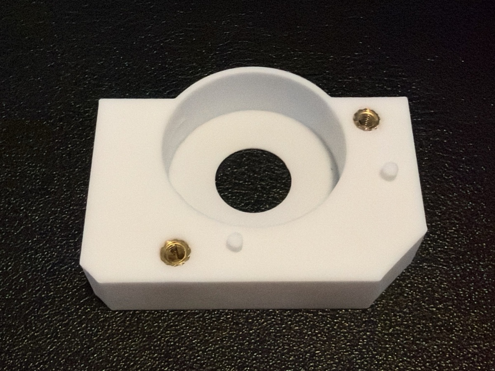 | 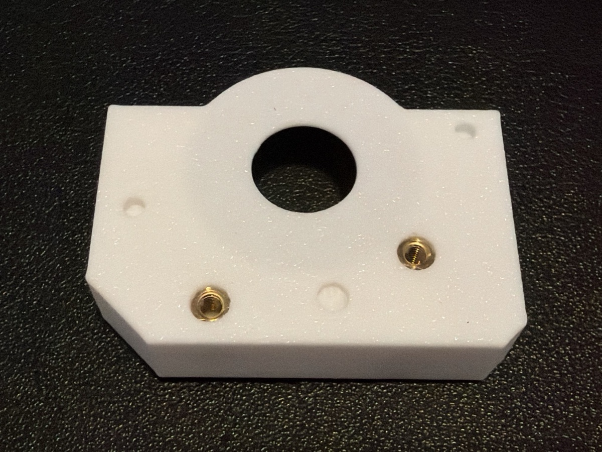 |

### A2. Dowel pins (5)
- **4 into the carrier**, one in each pocket, pressed to the bottom. They are the planet axles.
- **1 into the worm's thread end** (the end away from the loop). Press it in firmly: it stays in the worm and turns
  in a small pocket in the case.

Press them in with flat pliers or a light tap. They must be straight: a tilted pin binds its gear.

### A3. Magnet into the magnet gear
Press the Ø4 × 2 magnet into the hub of the magnet gear (the small 8-tooth gear).
- Use a **plastic** tool to push it, not metal: the magnet jumps to steel tweezers or a screwdriver. A spare printed
  part works well. Set the magnet on the hub's hole, push it in from the top, then seat it.
- It does not need to be perfectly flush. **Flush or a little below is fine; it must not stick out.** The magnet
  sits 0.8 mm above the sensor chip, and the sensor reads fine a bit farther away, but a magnet that sticks out can
  hit the chip.

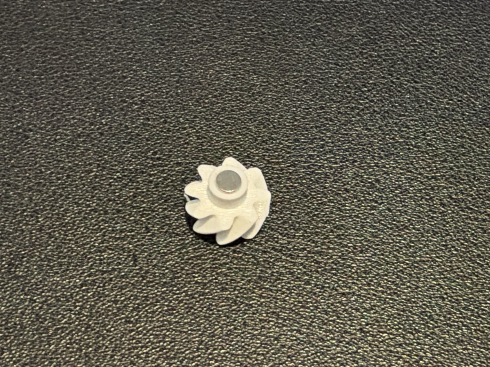

---

## Part B: the gearbox
Grease every gear as it goes in.

### B1. Worm and wheel
**Grease** first, then fit:
- the worm's thread, and the plain shaft where it runs in the case,
- the worm wheel's teeth.

Spread it with your finger and wipe off the extra. Worm wheel into the main half (case right), then the worm, its
pin into its pocket in the case. Turn the worm by its loop a few times: the wheel should turn with no tight spot.

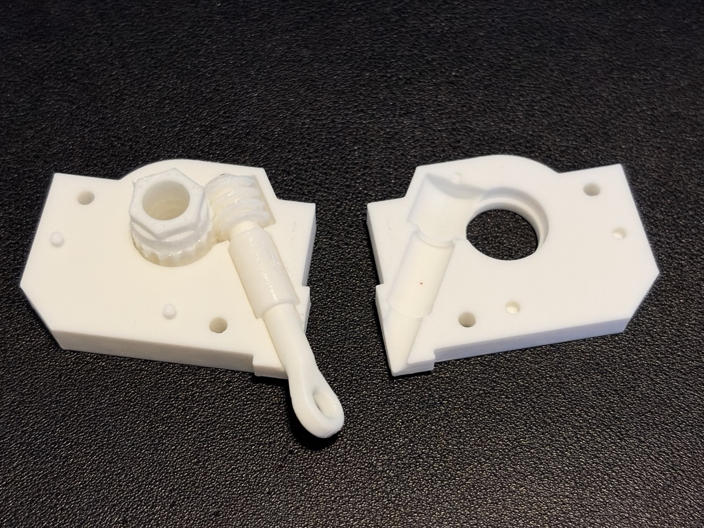

### B2. Worm case lid
Case left on. The worm should still turn by hand, with no tight spot through a full turn of the wheel.

### B3. Ring cup and planets
Ring cup onto the wheel's hex. Planets onto the carrier's pins, then the carrier into the cup.
- **Planets bed side away from the carrier.** The face that sat on the print bed is often a little tighter. Put it
  facing up, away from the carrier, so the planets spin freely.
- The planets should float freely on their pins. Nothing here is tight.

**Grease** a thin film on everything that touches: the pins, the planets' teeth, the ring cup's teeth, and the
carrier's hub where it turns in the wheel.

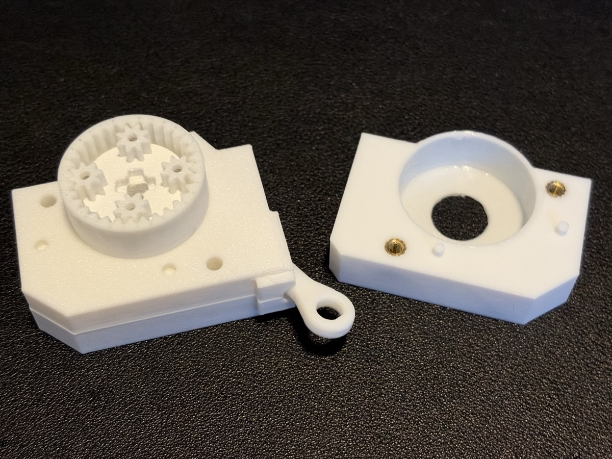

### B4. Bearing shell on
Bearing shell over the cup, cup side down (its two pins find the lid). Two **M3 × 20** from the main half's back into
the bearing shell's inserts. Tighten them down.

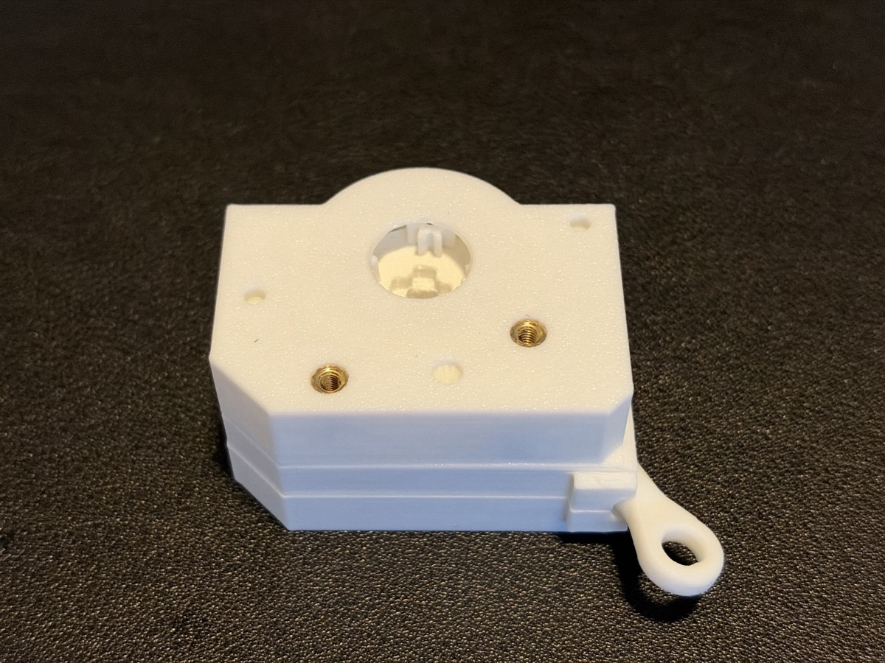

---

## Part C: the motor end
The motor shell holds the motor and three gears. Build it on the bench, gear side up, then it goes onto the gearbox.

### C1. Motor into the motor shell
N20 onto its plate with the 2 **M1.6 × 4** screws (heads down in their wells).
**Snug only.** These are tiny screws in plastic: tighten until they stop, then no more, or they strip the plastic.

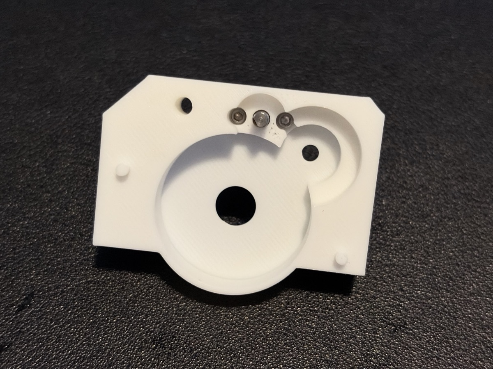

### C2. The three gears
Turn the motor shell gear side up. **Grease** each gear before it goes in: a thin film on the teeth and on the
flat faces that rub on the shell.
1. **Sun piece** (the big 27T gear, sun up) into the big round room.
2. **Motor pinion** onto the motor shaft. Its hole has a flat to match the flat on the shaft: line them up and push
   it on.
3. **Cluster** (20T / 9T) into the last room, meshing with the pinion and the sun piece's 27T. It has no axle yet:
   the tray bolt goes through it in step D2 and becomes its axle.

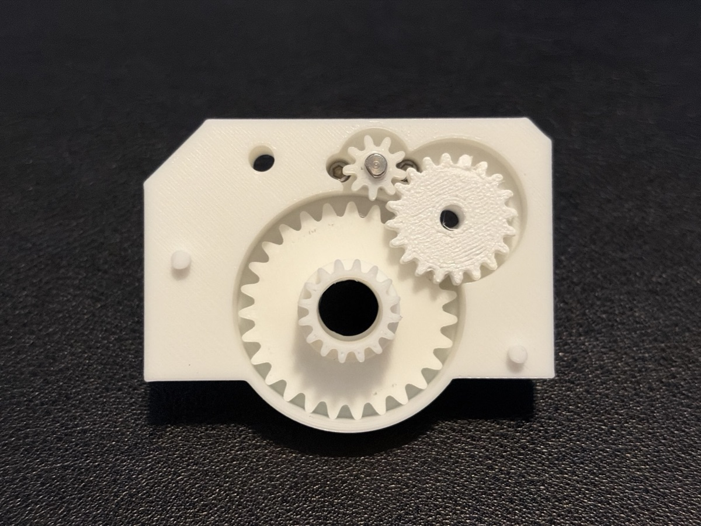

### C3. Onto the gearbox
Set the motor shell on the bearing shell: its two pins find their holes, and the sun goes into the planets. Turn the
pinion a little if it does not drop in. It has no bolts of its own yet; hold it there until step D2.

Check: turn the cluster by hand; the whole train should turn, slowly.

### C4. Sensor sleeve
**Grease** the sleeve's nose. Push it through the motor plate from the back and turn it until the lugs drop into the
carrier (the last 2.4 mm). Its gear now sticks out of the plate.

### C5. Hold it together
The motor shell has no bolts of its own: the tray's two bolts hold it on (step D2).
- **Sensor module ready?** Go straight on to Part D.
- **Not ready yet?** Put two **M3 × 16** in, snug only, through the motor shell into the bearing shell, so it holds
  together while you wait. The one nearer the room side goes through the cluster gear. Take them out again at D2.

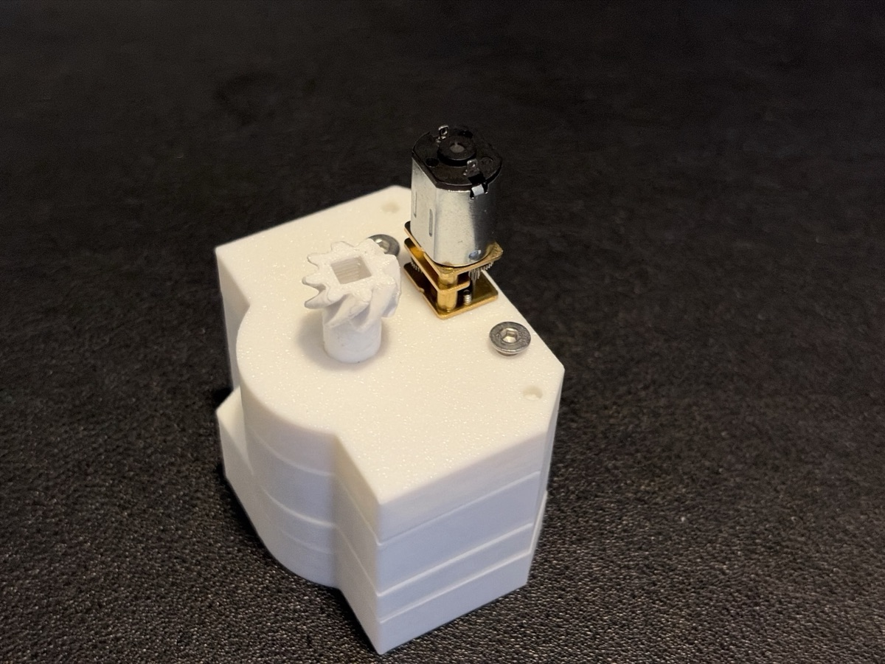

---

## Part D: tray, boards and lid

### D1. Motor leads
If you used the M3 × 16 in step C5, take them out now.

Solder the sensor module's two motor leads to the N20's two tabs (either way round: the controller learns the
motor's direction on its first moves). This is easy now, with only the motor in the way. Then move the module off
to the side so its wires don't tangle while the tray goes on.

### D2. Tray on
**Put the two M3 × 20 through the tray's end wall first**, then lower the tray on (its two pins find the motor
shell). This is much easier than fishing the screws in from the back afterward.
- The **room-side bolt** goes through the cluster gear and is its axle. Turn the gear a little until the bolt finds
  its hole.
- The **floor bolt** goes in beside it.

Tighten both down, but don't overtighten the room-side bolt: pulled too hard, it bows the motor plate onto the
cluster gear. Then check: the worm's loop turns the whole train, with no tight spot.

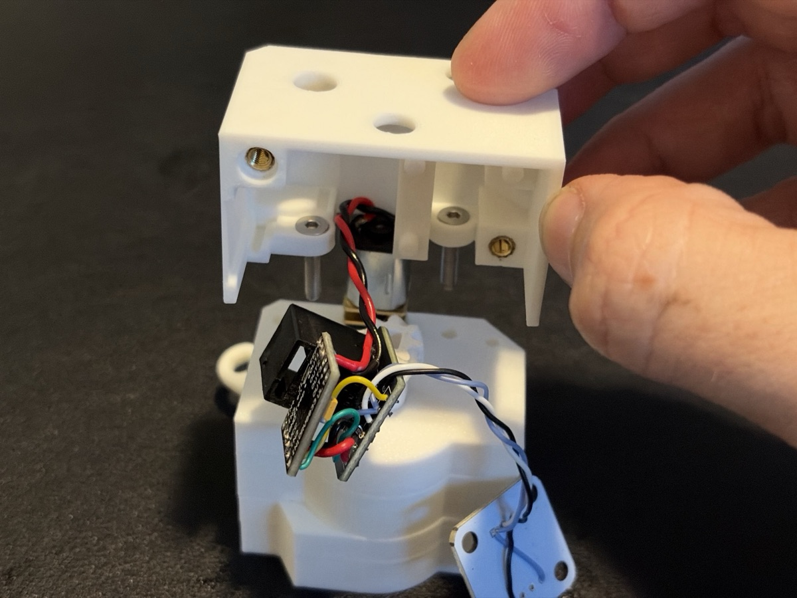

### D3. Electronics in
This step is a little fiddly. Go slowly: the thin wires break if they get pinched.
1. **AS5600** onto its studs, **chip up**.

   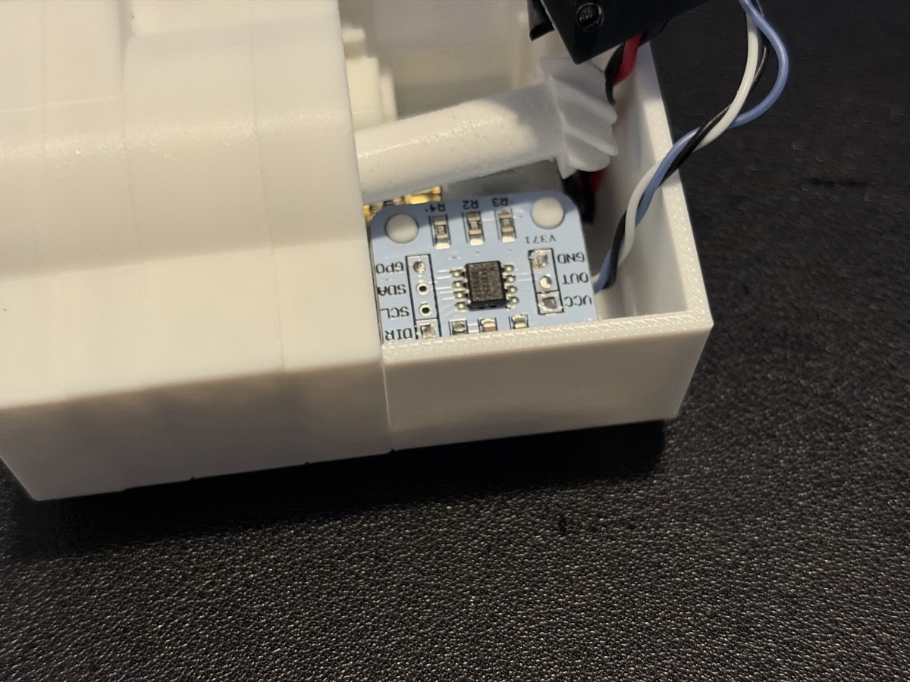

2. **RJ12 board** into its slot first, jack up.
3. **DRV8833** last. Nudge it down into place with a small flat screwdriver while you press down on the RJ12 board.
   Don't force it: if it stops, look for a wire in the way.

   | RJ12 in its slot | All three boards in |
   |---|---|
   | 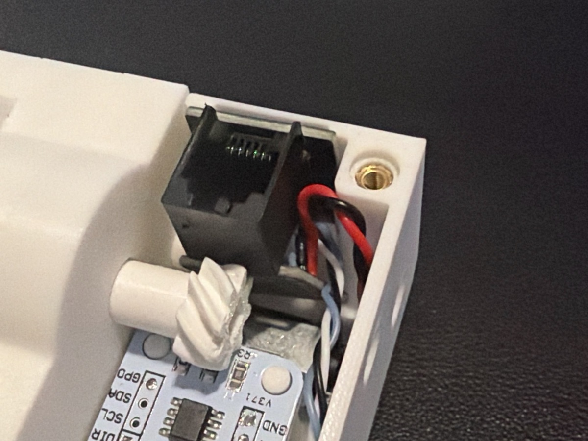 | 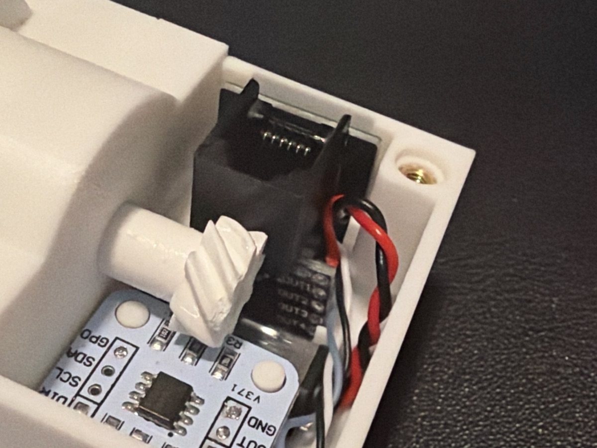 |

4. **Check the sensor sleeve's gear** is still in place over the AS5600: pushing the boards in can move it.
5. Tuck any loose wire under the AS5600. Nothing should sit above the tray walls.

There is very little room behind the boards. That is why the wires between the motor, the boards and the RJ12 have
to be short ([sensor module](tilter-wiring.md)).

### D4. Magnet gear and lid
Slide the magnet gear (magnet already in, step A3) into the lid's gear cage from the rod side until its
hub clicks into its seat.
**Grease:** the magnet gear's teeth.

### D5. Lid on
Lower the lid straight down over the jack. The magnet gear turns itself into mesh with the sleeve's gear. Two screws:
- **M3 × 25** on the sensor side, down through the lid's column and the AS5600.
- **M3 × 8** in the far corner.

Tighten them down.

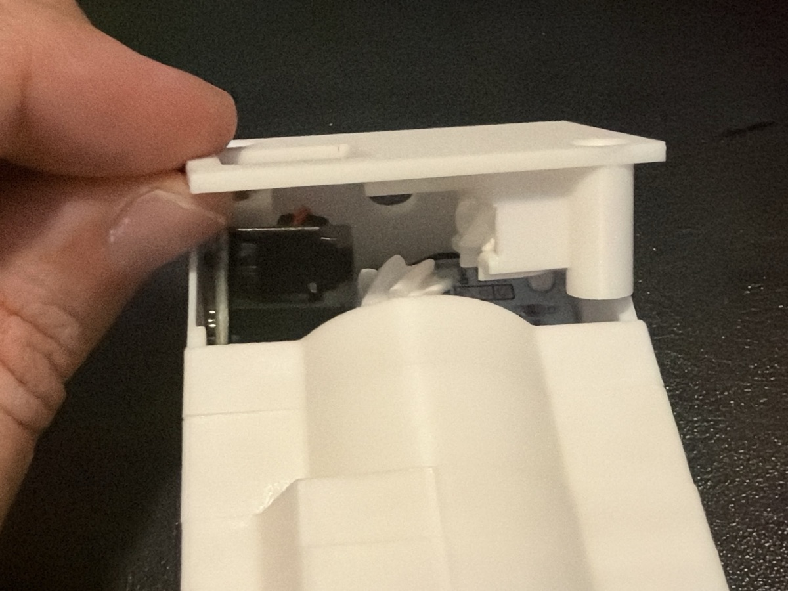

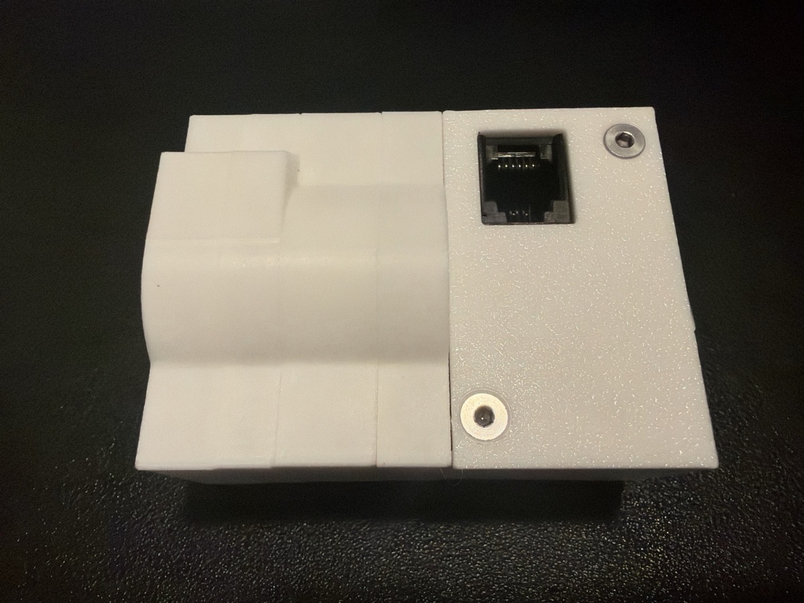

### D6. Foam pads
Stick-on foam pads, about 10 mm across and 2 mm thick: 4 under the floor (one each corner), 1 on the middle of
each long side wall. They keep the tilter off the metal rail, so the rail does not pick up the motor's buzz. Use
soft foam (or felt), not hard rubber: hard rubber passes the vibration on. If the rod binds once the tilter is in,
leave the side pads off.

📷 **Photo D6:** coming soon: where the pads go.

---

## Done: check before the blind
1. Plug it into a controller port with an RJ12 cord (pin 1 to pin 1).
2. Set it up in the Tilt app ([build guide, step 8](build-guide.md#8-set-up-in-the-tilt-app)). Keep it on the
   bench for this.
3. Then into the rail, and push the rod through. Turn the wand a little if it stops. If the rod binds, use thinner
   pads or leave the side ones off.

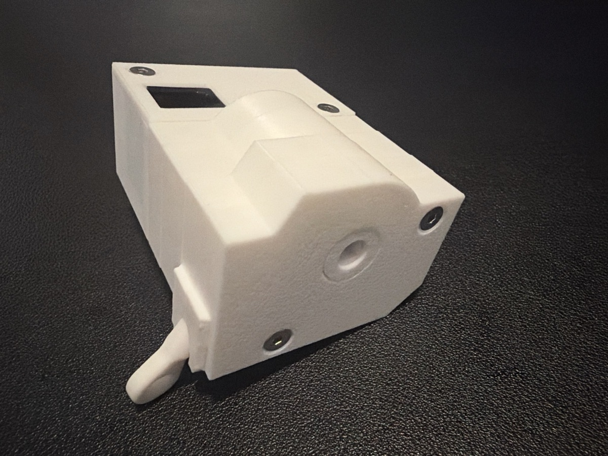

## Photos
Photos go in `docs/photos/tilter/`, named by step: `a1-tray-inserts.jpg`, `b1-worm-and-wheel.jpg`, and so on.
Shoot on a plain white or gray background, from above, with the part filling most of the frame.
