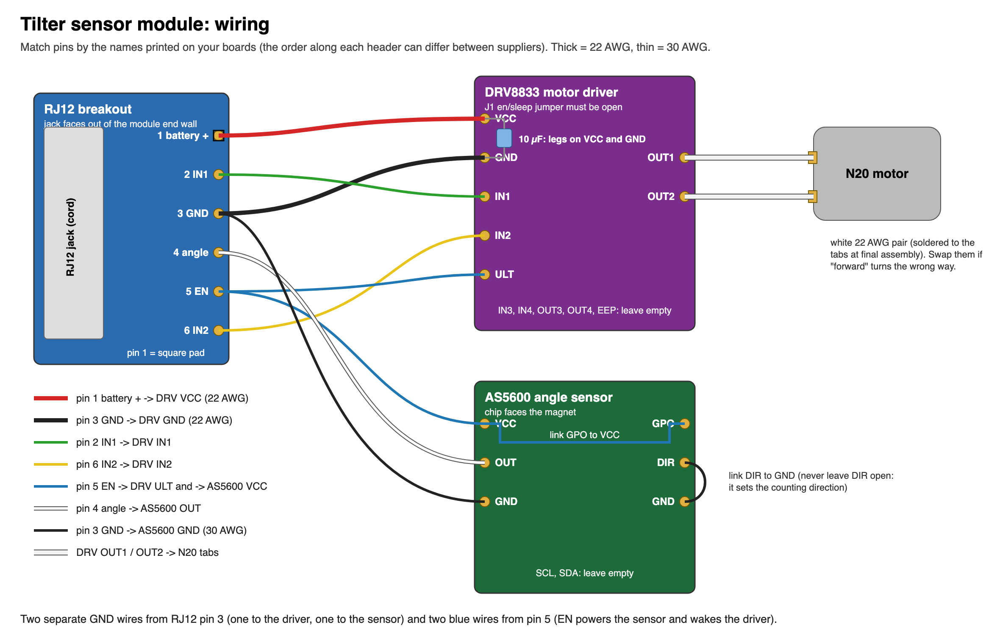

# Wiring a tilter (the motor side)

Each tilter's **sensor module** holds three small boards: the **RJ12 breakout** (where the phone cord plugs in), the
**DRV8833** motor driver and the **AS5600** angle sensor, plus two leads to the **N20 motor**. The controller only sends
battery power and logic down the cord; the driver right here turns that into motor current. Same colour code as the
controller, so a cord can be checked end to end by colour.

## Parts for one tilter
| Part | Qty |
|---|---|
| RJ12 6P6C breakout (risingsaplings) | 1 |
| DRV8833 motor driver board (Suuoo) | 1 |
| AS5600 board (with its Ø4 × 2 magnet, already in the sensor gear) | 1 |
| N20 motor (fitted in the lid) | 1 |
| Ceramic capacitor 10 µF (106) | 1 |
| **22 AWG** stranded: 1 red, 1 black, ~6 cm each (battery +, GND to the driver) | 2 |
| **30 AWG** silicone, ~6 cm each: green, yellow, blue ×2, white, black | 6 |
| White 22 AWG two-conductor pair, ~8 cm (motor leads) | 1 |
| Heat-shrink (small) | a few |

## 1. Prepare the boards (before any wiring)
**DRV8833: check the sleep jumper.** The driver's sleep pin (ULT) must be free for the EN wire to control. The jumper
is a tiny pair of pads at the top edge marked **J1** between the words **"en"** and **"sleep"** (some batches print
it **J2**: same jumper).
1. Look at J1: **open** (two separate pads) on the owner's boards, which is what we want: nothing to cut. If yours is
   **bridged** (copper or a solder blob joining the pads), scrape the bridge through with a hobby knife or wick the
   solder off.
2. Meter on **resistance (Ω)** between **ULT** and **VCC**:
   - **megohms (MΩ) or open:** good, ULT is free.
   - **near 0 Ω / beeps:** the jumper is still closed: cut it.
   - **a few kΩ (e.g. 4.7 kΩ):** the board has a pull-up resistor on ULT. It keeps the driver awake whenever EN isn't
     pulled low and feeds battery voltage into the EN line (which powers the AS5600 and goes to an ESP pin). Remove
     that resistor before wiring (ask first if you're not sure which one it is).

**AS5600: three checks and two links.**
1. **Link GPO to VCC** with a short bare wire across the two pins on the board (analog output mode, as the controller
   reads it).
2. **Link DIR to GND** the same way. DIR sets which way the angle counts; left open it floats and the reading can
   flip direction at random.
3. **3.3 V operation:** the controller powers the sensor at 3.3 V. At 3.3 V the chip needs its 5V and 3V3 supply pins
   joined: on most of these boards the VCC pin already feeds both (meter: VCC beeps to both legs of the small
   capacitor next to the chip). If yours doesn't, bridge them.
4. Some versions have a pull-up resistor (often **R4**) on the OUT line. If the angle later reads stuck near the top
   of the range, remove it.
5. Mechanical: file ~1 mm off the board edge nearest the rod so it fits its seat (see the
   [tilter build](../hardware/mechanical/stl/v0.4/README.md)).

**Check the cord** before you trust it: meter beep mode, plug end to plug end. **Pin 1 must beep to pin 1** (not
pin 6) on every cord: "straight-wired" is used loosely in listings, and a reversed cord puts battery + on IN2.

## 2. Wire it
Solder the leads to the **RJ12 breakout first** (pin 1 = the square pad), because in the module it slides in with its
leads already attached. Then run each lead to its board. Cut leads ~6 cm and trim to length when you fit the boards in
the module; strip 2–3 mm, tin, solder, heat-shrink where bare wire could touch a neighbour.

| # | From | To | Wire |
|---|---|---|---|
| 1 | RJ12 **pin 1** (battery +) | DRV8833 **VCC** | **red**, 22 AWG |
| 2 | RJ12 **pin 3** (GND) | DRV8833 **GND** | **black**, 22 AWG |
| 3 | RJ12 **pin 2** (IN1) | DRV8833 **IN1** | **green**, 30 AWG |
| 4 | RJ12 **pin 6** (IN2) | DRV8833 **IN2** | **yellow**, 30 AWG |
| 5 | RJ12 **pin 5** (EN) | DRV8833 **ULT** | **blue**, 30 AWG |
| 6 | RJ12 **pin 5** (EN) | AS5600 **VCC** | **blue**, 30 AWG (second wire on the same pad) |
| 7 | RJ12 **pin 4** (angle) | AS5600 **OUT** | **white**, 30 AWG |
| 8 | RJ12 **pin 3** (GND) | AS5600 **GND** | **black**, 30 AWG (second wire on the same pad) |
| 9 | 10 µF capacitor | DRV8833 **VCC** and **GND** | its own legs, right on those two pins (any way round) |
| 10 | DRV8833 **OUT1** and **OUT2** | N20 motor tabs | white 22 AWG pair, ~8 cm. **Leave the motor ends loose** until final assembly |

Why two wires from pins 3 and 5: GND is split so the motor's current returns on its own wire, not through the
sensor's; EN both powers the sensor and wakes the driver, so it goes to both. Leave **IN3, IN4, OUT3, OUT4, EEP** on
the driver and **SCL, SDA** on the sensor empty.

## 3. Check before plugging in
Meter in beep mode, nothing connected:
- RJ12 **pin 1 to pin 3** (battery + to GND): **no beep**.
- Pin 5 (EN) to pin 3 (GND): no beep. Pin 4 (angle) to pin 3: no beep.
- Each RJ12 pin to its board pin per the table: beep. Pin 1 to pin 6 and pin 2 to pin 5: **no** beep (catches a
  lead on the wrong pad).
- DRV8833 ULT to VCC: megohms or open (no jumper, no pull-up).

## 4. Final assembly
At final assembly, solder the white pair's free ends to the N20's two tabs (either way round; swap them later if the
motor turns the wrong way), route them as the [tilter build](../hardware/mechanical/stl/v0.4/README.md) step 4
describes, and slide the module onto the lid.

## Next
Test it on the bench before it goes on a blind: [bench-test.md](bench-test.md) plugs this tilter into an ESP on a
breadboard through a real RJ12 cord.
