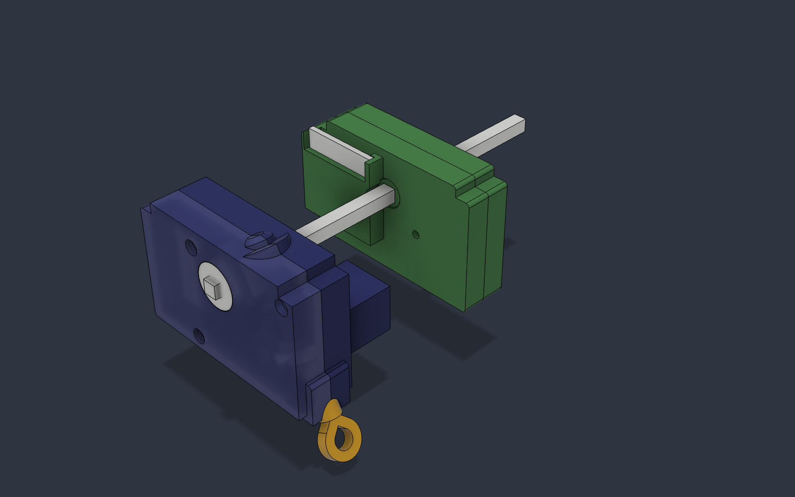

# Motorized tilter: build & test guide (v0.3)



Two units, both press-fit between the rail walls:
- **Tilter** replaces the blind's factory tilter. It keeps the factory **worm** and **worm wheel**, adds a small N20
  gear motor, and keeps the wand working by hand.
- **Sensor module** clips onto the tilt rod anywhere along the rail. The rod runs straight through it, at any length.
  An AS5600 magnetic sensor reads the rod's angle through a pair of gears, so the controller always knows the slat
  angle, even right after power-up or after someone used the wand.

```
 TILTER   tilt rod ── worm wheel (factory 16T) ◄── worm (factory, 16:1, self-locking)
                                                     │ 8-ridge spline
                                           ADAPTER (printed): 8T 45° helical gear + teardrop wand loop
                                                     │ crossed helical, not self-locking → wand back-drives the motor
                                           PINION (printed, 7T) on the N20 motor
 SENSOR   tilt rod ── ROD GEAR (24T, square bore) ── SENSOR GEAR (14T) ── magnet ··· AS5600 board
          60° of slat travel = 103° at the magnet (absolute, single turn)
```

## Parts

### Printed (files in [stl/](stl/), settings there)
`case_right`, `case_left`, `adapter`, `motor_pinion` (tilter) · `sensor_case_left`, `sensor_case_right`, `rod_gear`,
`sensor_gear` (sensor module)

### Hardware
| Item | Qty | Notes |
|---|---|---|
| Factory worm + worm wheel | 1 each | From the blind's tilter (drill out the 3 rivets) |
| N20 gear motor, **no encoder**, 3 mm D-shaft ≥ 9 mm | 1 | 5–6 V, **1:30–1:50 recommended** so the wand can back-drive it. Full 60° ≈ 3 motor turns |
| M1.6 × 4 screw | 2 | N20 gearbox face (heads sink into counterbores in the pinion pocket) |
| M2 × 16 screw | 3 | Tilter halves (heads sit flush in the lid) |
| M2 × 12 screw | 2 | Sensor module halves |
| AS5600 breakout, ≤ 23.4 × 23.4 mm, chip centred | 1 | I²C to the controller |
| 6 × 2.5 mm diametric neodymium magnet | 1 | Often sold with AS5600 boards |
| Wire | — | 2-core motor lead, 4-core sensor lead (3V3, GND, SDA, SCL) |

## Tilter assembly
1. **Strip the factory tilter:** drill out the 3 rivets and keep the worm and worm wheel.
2. **Motor:** push the N20 into the pod of `case_right` from the open end until the gearbox face seats. Fit 2 × M1.6 × 4
   from inside the pinion pocket.
3. **Pinion:** press `motor_pinion` onto the shaft, hub toward the motor, until the hub touches the wall (CA on the flat
   if loose).
4. **Worm wheel:** drop it into its pocket, barrel through the bearing hole.
5. **Worm + adapter:** slide `adapter` onto the worm's splined end. Lay the worm in its groove with both flanges in their
   pockets. The adapter gear meshes with the pinion, and the loop hangs out through the notch block.
6. **Hand check:** turn the loop. The worm wheel should turn smoothly, and so should the motor shaft. Nothing should rub.
7. **Lid:** fit `case_left` (2 pegs locate it), 3 × M2 × 16.

## Sensor module assembly
1. Press the magnet into the head of `sensor_gear`.
2. Lay `rod_gear` and `sensor_gear` into `sensor_case_right`: shaft into its blind hole, magnet head toward the open side.
3. Fit `sensor_case_left` (pegs locate it), 2 × M2 × 12. The magnet head sits flush in the face inside the board frame.
4. Slide the AS5600 board into the frame from the top, chip facing the magnet.

## Install in the headrail
1. Take the rod out. Thread it through the sensor module's rod gear and through the tilter's worm wheel.
2. Press the tilter down between the rail walls with the block in the corner notch. The small dome over the worm sits
   in the rail's open top slot.
3. Press the sensor module in wherever there's ~18 mm free on the rod, board frame facing either way.
4. Re-seat the rod through the tilt drums, hook the wand onto the teardrop loop, and run the wires to the controller.

## First power-on test (bench)
- Motor at low PWM first: the slats should tilt through the full ~60° in about a second.
- Read the AS5600 angle while tilting by hand. It should change by about 103° end to end, with no jumps.
- Listen: any ticking means something rubs. Note where. Every clearance is a parameter in `TiltParts.py`.
