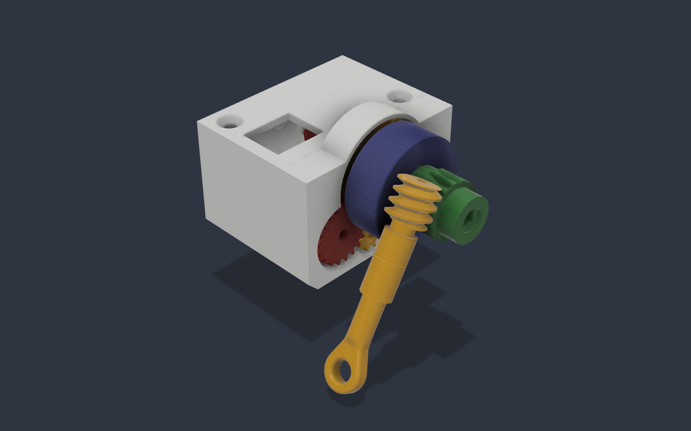
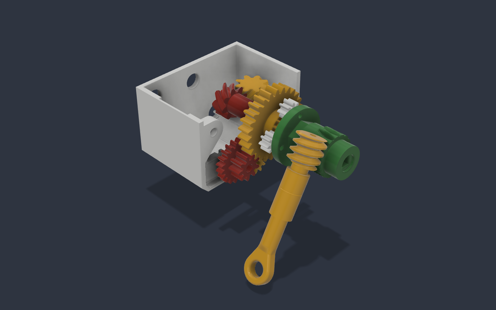

# Tilter v0.9: the sensor follows the carrier

Built by `python3 hardware/mechanical/fusion/fusion.py exec tools/fusion_tilter.py --timeout 1800` (`fusion/Tilter/Tilter.py`).
Drawn 2026-11-15; rev B and rev C the same day from the owner's reviews (short floating sleeve, no front rib, plain back wall; then thin walls at every joint, narrower motor-side gears, shorter tray; rev D: the two walls round the motor gears are skins; rev E/F: motor land with screw wells, gear room filled in round the gears, roof hump to the front, two case bolts, bigger bevel, the cluster's axle bolt also holds the tray). **Not printed yet.**

## Why
The blinds' tilt rods are short: a crimp stops them about 21 mm into the tilter. In v0.8 the sensor's gear sat on the
rod at the far end, so it never turned. v0.9 takes the sensor's motion from the tilter's own carrier, and still lets a
long rod slide right through.

## What changed against v0.8
| | v0.8 (rev J) | v0.9 |
|---|---|---|
| Sensor drive | rod gear on the rod, at the far end | **sensor sleeve**, 33 mm long: the same gear on the back end of a tube that runs forward through the motor plate and the sun piece to the carrier; four lugs on its nose sit in slots in the carrier's back. Square bore right through for the rod. It floats: the lugs stop it toward the front, a square block under the lid, behind the top of its gear, stops it toward the back (the block ends above the magnet gear, so that gear still slides into its cage). |
| Sensor place | 2.7 mm behind the motor plate, behind a rib | right against the motor plate (the rib is gone: the plate is the tray's front wall) |
| Back wall | notch for the rod gear's sleeve, closed by a lid tab | plain, with one round hole for a long rod |
| Planetary set | 14 / 8 / 30 teeth, module 0.8, ratio 3.14 | 16 / 8 / 32 teeth, module 0.75, ratio 3.0. Same ring size. The sun's bore grows from 6.6 to 8.2 mm for the sleeve. |
| Motor train | 4 gears on 2 stages, 88 : 1 (run with one cluster since 2026-11-15, 21 : 1) | **one cluster** (20T / 9T), 20 : 1. R1, P2 and the tube are gone. The 27T / 9T pair is 3.5 mm wide (was 5) and sits at the motor plate; the 20T / motor pinion pair (3.2 mm) sits on the tip of the motor's shaft, at the bearing wall. |
| Walls at the joints | bearing wall 3.0, motor plate 3.2, worm-case lid 8.33 thick, ring cup floor 3.5 | bearing wall **0.8**, motor plate **1.2**, worm-case lid **7.3** (1.0 mm skin on the ring cup), ring cup floor **2.8** |
| Carrier | hub 11 mm into the wheel | hub runs the whole wheel: a rod only 12 mm in is fully gripped |
| Gear room | 16.5 mm deep | 7.6 mm deep |
| Sensor sleeve length | (rod gear 34 mm) | 31.4 mm |
| Length | 86.7 mm | **68.6 mm** |
| Bolts | 10 | **6**: 2 case (M3 × 25), 2 tray (M3 × 20), 2 lid (M3 × 25 through the sensor board, M3 × 8 at the corner). The tray's room-side bolt is also the cluster gear's axle: it goes from a lug in the tray through the motor plate and the cluster into the bearing shell. |
| Tray | 34.5 mm long | **31.2 mm**: RJ12 2 mm nearer the motor plate, lid's corner bolt moved in front of the RJ12 board's plane |
| Housing parts | 6 | 6 (joining any two would need support material) |

Unchanged: worm, worm case outline, the order of things in the tray (AS5600 back side, RJ12 over the DRV8833 room side),
magnet gear, lid's gear cage, the wand, the motor's place.

## Parts
Housing (PLA): `case_right`, `case_left`, `bearing_shell`, `motor_shell`, `tray`, `tray_lid`.
Drive: `worm`, `worm_wheel`, `ring_cup`, `carrier`, `planet` × 4, `sun_27t`, `cluster`, `motor_pinion`.
Sensor: `sensor_sleeve`, `magnet_gear`.
`print/` has every part turned to its print orientation (`python3 tools/orient.py`).

Every part is new or changed except the worm. Reuse from a v0.8 tilter: worm, magnet gear, motor pinion, all hardware.

## Print notes
- **Sensor sleeve**: stands on its gear's flat back face (13 mm across, 37 mm tall), lugs up. No bevel, no support.
- **Tray lid**: support under the gear shelf, as before.
- Meshing or rubbing pairs in different plastics, as before (sleeve and magnet gear PETG in the PLA housing).
- Grease the carrier's hub and the sleeve's nose.

## Assembly (what is different)
Bolts: case 2 × M3 × 25; tray 2 × M3 × 20 (the room-side one is the cluster's axle); lid: sensor bolt M3 × 25, corner bolt M3 × 8. Tighten the axle bolt snug, not hard.
1. Build the worm case, bearing shell and planetary as before. The cluster and motor pinion go in the motor shell.
2. The motor shell has no bolts of its own. Hold it on the bearing shell; the cluster sits in its pocket and gets its
   axle when the tray's bolt goes in.
3. **Sensor sleeve**: push its nose through the motor plate from the back and turn it until the lugs drop into the
   carrier (the last 2.4 mm). It now sticks out of the plate with its gear on the end.
4. **Press the AS5600 onto its studs in the tray first**, with the tray still off. (It lies under the sleeve's gear, so
   it cannot go in afterwards.)
5. Slide the tray on from the back. Its two M3 × 20 bolts go through the motor shell into the bearing shell: the
   room-side one through the cluster gear (turn the gear until the bolt finds its bore), the floor one under the sensor
   board. Both are reached through holes in the back wall.
6. Drop the DRV8833 and the RJ12 into their slots.
7. Lid on (the magnet gear turns itself into mesh as it comes down). The lid's finger sits behind the sleeve's gear.

## Walls where parts meet (rev C)
Where two parts lie against each other the walls are thin now; bolt-head seats are kept.
- Tray's front rib against the motor plate: removed (rev B).
- Bearing wall (between the planetary and the motor gears): 3.0 -> 0.8 mm. It only keeps the gears apart.
- Motor plate: 3.2 -> 1.2 mm. The N20's two screws each stand on a 1 mm pad on the gear side, beside the 27T and the
  9T and clear of both: with M1.6 x 4 screws 1.8 mm goes into the motor (was 2.2).
- The cluster's axle bolt (flat head) sits 0.6 mm deep in the plate and stands 1.1 mm proud inside the tray, in front
  of the DRV8833.
- The motor's shaft is longer than the stack now: its tip goes through the bearing wall into a 2 mm pocket in the
  bearing shell's block.
- Running gaps between gears and walls stay 0.3 mm.
- Worm case's lid: 8.33 -> 7.3 mm thick. Its skin over the worm is 1.0 mm and lies on the ring cup's floor.
- Ring cup's floor: 3.5 -> 2.8 mm (the wheel's hex sits 2.7 mm deep in it).

## Rev E (owner's review)
- **Motor land.** A raised land on the motor plate, up to 0.3 mm under the motor pinion. The pinion cannot work its way
  down the shaft. The two M1.6 × 4 screw heads sit down in Ø3.5 wells in the land (3.2 mm deep), with 1.8 mm under each
  head, so 2.2 mm goes into the motor as in v0.8. They are below the surface, not flush: flush would need 6 mm screws.
- **Gear room = the gears' negative (rev F).** The motor shell is solid except a pocket round each gear at its own depth,
  with 0.5 to 0.7 mm of room round the teeth: the 27T's bore right through; the cluster's 20T pocket on top with a
  smaller pocket for its 9T below; the motor pinion's pocket, whose floor is the land. The motor's two screw wells run
  from the open face down. Every gear still drops straight in (swept).
- **Roof.** The hump over the ring cup runs on over the worm case to the very front. The cone over the worm's top end
  is replaced by a straight shoulder beside the hump, same height. Nothing overhangs when the case halves print.
- **Shoulder's slope (rev H, styling).** The shoulder's room-side face is parallel to the worm (60° from level) and sits
  2.0 mm outside the worm's pocket, instead of a 45° corner chamfer.
- **Two case bolts** on a diagonal (top back, bottom room side). The third, in the back-side bottom corner, is gone.
- **Bevel** on the back-side bottom corner: 8 mm (was 5), the whole length. 8 is the most that leaves 2 mm of plastic
  round the sensor bolt's insert in the tray.
- **Axle bolt = tray bolt** (owner's idea). The room-side tray lug and its bolt and insert are gone; a lug in the tray at
  the cluster's axle takes the axle bolt. Its flat head sits flush in the lug. RJ12 right against the motor plate.
  The tray did not get shorter: the motor (28.5 mm) sets its length now.

## Rev I (owner, after the first v0.9 print): locating pins
Two Ø2.5 × 2 mm pins in Ø2.8 holes at each joint between housing parts, like the worm case's own pins. A pin always
grows from a face that is up when its part prints; the hole is in the other part.

| Joint | Pins on | Holes in | Where (Y, Z) |
|---|---|---|---|
| worm case's lid / bearing shell | bearing shell's front face | lid's outer face | (21, 18) and (-3, 6) |
| bearing shell / motor shell | motor shell's open face | bearing shell's back face | (21, 18) and (-21, 30) |
| motor shell / tray | tray's front face | motor shell's plate face | (19.5, 6.5) and (-21.9, 6) |

The tray's two pins are diamond-shaped (a square on its corner): they print lying sideways, and a diamond needs no
support where a round pin would sag. They go in the same round holes. Changed parts: `case_left`, `bearing_shell`,
`motor_shell`, `tray`. The lid on the tray already has its spigot and the sensor bolt's column.

## Rev G (owner's review): thin pieces
- The low block behind the DRV8833's far end runs solid to the end wall (it had become a 0.05 mm sliver with a gap
  behind it when the board moved back).
- **Lid's corner mount** goes up to the tray's rim. The insert's top is 1.5 mm under the rim; above it is a round socket
  and the lid has a matching short spigot (Ø5.8), so the lid finds its place and sits square. The bolt is **M3 × 8**.
- Motor shell: the sliver between one screw well and the 9T's pocket is opened up; the shaft hole is Ø3.5 so 1 mm
  stands between it and the wells.
- New check: `tools/fusion_thin_v9.py` (run after the build). It shoots a ray into the material from points all over
  each housing part and lists every wall under 1.0 mm. What it still lists is on purpose:
  bearing wall 0.8 (skin between the gear rooms); roof over the ring cup 1.0 (height limit); tray floor under the
  motor 0.75 (the motor sits in a dip); tray wall behind the RJ12's solder joints 0.8 (pocket, rev J); a 2 mm2 spot of
  0.8 on each worm case half beside the worm.

## Tray bolts and the RJ12 (rev C)
The owner's idea was to swap the two tray bolts (room-side one to the floor, sensor-side one to the top) so the RJ12 could
move toward the motor plate. Neither spot is free: the floor on the room side is the cluster gear's pocket in the motor
shell, and a lug at the top of the back side would sit over the sensor board's corner. Same result another way:
- room-side bolt moved in and up, (-19.3, 24.5) -> (-18.3, 27.0), so the RJ12 board passes beside its head;
- RJ12 and DRV8833 1.8 mm nearer the motor plate;
- lid's corner bolt moved from behind the RJ12 board to in front of its plane (Y -18.5), into the far corner.
The tray is 29.2 mm inside now (was 32.5). The motor needs 28.5, so that is the floor.

## Checked in Fusion
- No part touches another (a rod right through the device included).
- Gears turned through their meshes in motor mode, wand mode and at the fast end: no overlap. The sleeve turns clear of
  the sun piece, cluster, motor shell and tray.
- Assembly paths swept in the order above: sleeve in, sensor board onto the tray, tray on (board passing under the
  sleeve's gear), other boards down, lid down, rod in. All clear.
- Sleeve end play: 0.25 mm forward (lugs on the carrier), 0.35 mm back (gear on the lid's stop block).
- The magnet gear still slides into the lid's cage from the rod side (only its two snap bumps touch).
- Tray bolt head seats: 100 % solid round both heads.
- Thinned walls checked slice by slice: no holes.
- Print files scanned for overhangs: only the lid's gear shelf needs support.

## Not proven yet
- Module 0.75 planetary teeth on the 0.4 mm nozzle (v0.8's were 0.8).
- The sun piece's wall under its teeth is 0.9 mm. The sleeve's wall at the bore's corners is 0.9 mm.
- The axle bolt now clamps as well. The tray's lug is tied to its wall and floor so the load goes round the gear room,
  but a hard-tightened bolt could still bow the 1.2 mm motor plate onto the cluster.
- Both tray bolts are low (Z 12 and Z 5): nothing clamps the top of the tray to the motor shell.
- The sleeve hangs 14.6 mm out of the motor plate with nothing under its gear but the rod (when the rod reaches).
- Lug fit in the carrier (3.0 mm lugs in 3.1 mm slots): this sets the sensor's play against the carrier.
- No Bambu plate has been made.
