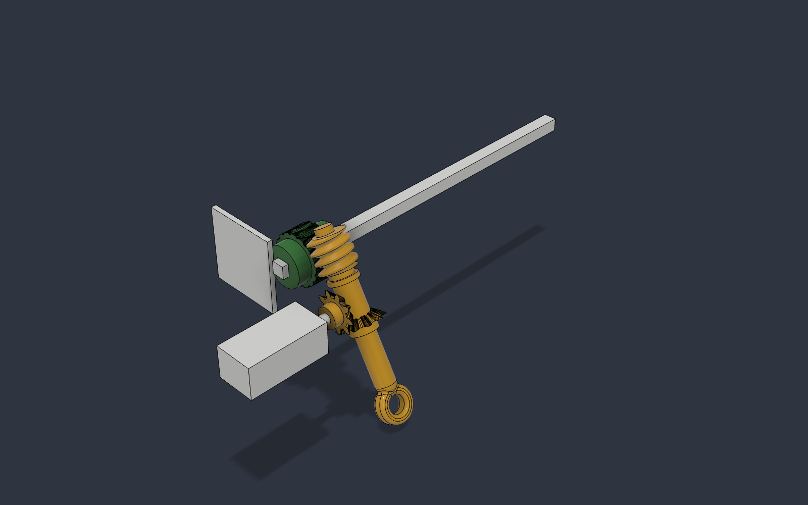

# v0.4 print files: all printed (first test build)

Every moving part is printed; nothing comes from the factory tilter (no rivets to drill). The geometry that matters
stays the same as the factory and v0.3: 4 mm rod, the worm at 60° so the **wand hangs from the same teardrop loop at
the same angle** and leaves through the corner notch, and a **16:1 single-start worm** (self-locking, 11–12 wand turns
end to end). The motor drives the worm through **v0.3's crossed 45° helical pair (8T : 7T)**, with the 8T now printed as
part of the worm (no spline joint). The motor sits beside the worm, so its uncut shaft runs past the pinion into the main
half, and its gearbox sits in a 1.5 mm square inset in the flat 8.3 mm lid.

Generated by [`fusion/TiltPartsV4`](../../fusion/TiltPartsV4/TiltPartsV4.py), checked in Fusion with
[`tools/fusion_verify_v4.py`](../../../../tools/fusion_verify_v4.py) and
[`tools/fusion_wallcheck.py`](../../../../tools/fusion_wallcheck.py) (`GEN` = the v0.4 generator).

| File | What | Print orientation |
|---|---|---|
| `worm.stl` | **One piece**: single-start worm (m 0.88, Ø11.4, 5.2° lead, 25° flanks), Ø8.2 bearing barrel from the thrust step to the gear, 8T 45° helical gear 6.5 mm wide, collar, shaft and teardrop wand loop | **standing on its thread end, loop up**, 8 mm brim, no supports (see below) |
| `worm_wheel.stl` | 16T worm wheel, teeth generated from the worm's motion, Ø12.5 barrel, 4.25 mm square rod bore | standing on a barrel end |
| `motor_pinion.stl` | 7T 45° helical, 6 mm wide, D-bore all through (sits on the shaft's D-flat) | on a gear face |
| `sensor_gear.stl` | 18T sensor gear with the worm wheel's ~5° helix (left hand), short Ø8 head with a press-fit crush-rib pocket for the Ø4 × 2 magnet, Ø4.3 bore for the case pin | gear face down, magnet pocket up |
| `case_right.stl` | Main half (9.3 mm): 3 M3 heat-set insert holes in its back face, 2 alignment pegs, Ø4 pin the sensor gear turns on | back face down, split face up |
| `case_left.stl` | Flat 8.3 mm lid: 1.5 mm N20 inset, AS5600 pocket, 2 bolt holes through the board's corners + 1 countersunk, 2 peg sockets | **outer face down** (split face and pockets up) |

`print/` holds every STL already rotated to these orientations ([`tools/orient_v04.py`](../../../../tools/orient_v04.py)),
and [`tilter_v04_H2D_white_PLA.3mf`](tilter_v04_H2D_white_PLA.3mf) ([`tools/bambu_v04.py`](../../../../tools/bambu_v04.py), parts square to the bed) is a ready Bambu Studio project (H2D 0.4, 0.12 mm Fine,
4 walls, 40 % infill, white PLA Basic, tree supports from the build plate only, 8 mm brim, all 6 parts on one plate).

**Printing the one-piece worm:** it stands 54.5 mm tall on the flat end of its threads (Ø11), so every round surface
(threads, barrel, gear) prints with its axis vertical: round and true, no seam between parts. There is
no top pin any more: the worm runs in one long journal below its threads plus the wand exit. Nothing faces down
except the barrel's 1.1 mm step under the neck; the gear's lower tooth ends are bevelled 45° (crossed helicals touch only
in the middle of the gear, which stays full width) and its root is coned into the journal. Both thread ends are
chamfered 45° (no knife-edge thread run-outs; the bottom one also stops elephant's foot). Use the 8 mm brim; no
supports.

**Settings:** gears in PETG or PLA+ at 0.12 mm layers, 4 walls, 40 %+ infill. Cases PETG at 0.16–0.2 mm. No supports.
The lid's AS5600 pocket floor and the motor inset print as bridges over the bed face (≤ 20 mm). PLA is fine for a test fit; for the
real install PETG is safer, since a headrail in direct sun can pass PLA's ~55 °C softening point. Grease the
worm, wheel, thrust steps and helical gears (plastic-safe PTFE grease: Super Lube 21030, see the BOM). Print the worm and the worm wheel
in different plastics (e.g. PETG worm, PLA wheel): the same plastic rubbing on itself has more friction.

## Hardware per unit
| Item | Qty | Where |
|---|---|---|
| M3 heat-set insert, Ø4.0 × 6.7 mm hole | 3 | Main half's back face; ≥ 1.3 mm wall all round |
| M3 × 18 flat head | 2 | Through the AS5600 board's two diagonal holes and the lid → inserts (clamp board and case) |
| M3 × 16 flat head (90° countersunk) | 1 | Lid → insert, top corner on the worm side |
| M1.6 × 4 | 1 | N20 gearbox face |
| Ø2 × 6 mm steel dowel pin | 1 | Pressed into the case's dome; the worm's thread end turns on it (bearing above the threads) |
| Ø4 × 2 mm diametric magnet | 1 | Comes with the AS5600 board; pressed into the sensor gear's head (no glue) |

Steel screws close to the magnet can bend its field a little: stainless (A2) screws are the safer choice for the two
through the board. The brass inserts don't matter.

## Assembly
1. **Inserts:** press 3 M3 inserts into the main half's back face (soldering iron, ~220 °C for PETG).
2. **Worm wheel** into `case_right` (barrel into the bearing).
3. **Top pin:** press the Ø2 × 6 dowel into the hole at the top of the worm's groove (2 mm in, 4 mm sticking out).
   **Worm** (one piece with the wand loop) onto it (the pin goes into the hole in the thread end), barrel in its bearing, meshing with the wheel; the
   loop runs out through the notch block.
4. **Sensor gear:** press the magnet into its head with a flat tool (vise or a bolt head) until it bottoms, about
   0.1 mm below flush. Eight smooth crush ribs grip it, no glue. Drop the gear onto the main half's pin.
5. **Motor:** N20 into the lid's 1.5 mm inset, 1 × M1.6 × 4 from inside the pinion pocket, then slide the pinion onto
   the shaft's D-flat (flush with the shaft end). **Don't cut the shaft**: all 10 mm are used, its tip runs on into the
   main half.
6. **Close:** lid onto the main half (pegs into sockets), easing the pinion into mesh with the worm's gear and the
   sensor gear's head into its bore. 1 × M3 × 16 flat head in the countersunk hole.
7. **AS5600:** lay the board on the lid (chip facing in over the pocket, square to the case) and bolt it with
   2 × M3 × 18 flat heads through its two diagonal holes away from the rod: they run through the lid into the main
   half's inserts, so they hold the case together too. Wires leave from the board's outer side.
8. **Turn the loop by hand:** the wheel and the motor shaft should both turn smoothly, with no ticks and no axial
   clunk in the worm (only its two thrust steps locate it, 0.1 mm each way). Marker test: ink the end faces, run it
   under load, and only the two thrust steps and the teeth should show wear.

## Fits (after the first print)
- Worm journals, top pin and wand shaft: 0.35 mm radial (0.15 was nearly a snap fit); worm threads 0.6 mm.
- Worm tilt (tools/worm_tilt.py): with both bearings below the threads the worm could tip 2.8° and its thread end
  rubbed the case walls; the thread centre could drift 0.72 mm off the wheel. A Ø2 steel pin above the threads plus
  0.25 mm (barrel) / 0.3 mm (collar, wand exit) radial fits limit it to 0.8° and 0.11 mm, and nothing but the
  bearings can touch the case even at that tilt.
- Worm thrust (after the load test bound up): axial load goes only onto two small steps, up onto the barrel's top
  step and down onto the collar's step at the wand exit (mean radius ~3.7 mm; thrust friction grows with that
  radius), 0.1 mm end play each. Every other end face runs clear: 1 mm at the thread end and the gear's thread side,
  0.4 mm at the gear's collar side. The barrel (Ø8.2, the collar's size) is the worm's radial bearing.
- Worm and wand are now one print (the two-piece version's hex joint added play and misalignment).
- Gear meshes unchanged (they fit well).

## Checked in Fusion
- No interference between any printed part, the N20, the rod, the AS5600 board or the rail.
- Worm / wheel: no contact through two full worm turns, ~0.6° of backlash each way at the wheel (the wrong
  direction collides, which confirms the teeth are cut the right way round).
- Crossed helicals: no contact through a full worm turn (the wrong direction collides), ~7° of backlash at the pinion.
- Sensor gear runs 0.04 mm clear of the wheel; magnet to AS5600 chip 1.1 mm (AS5600: 0.5–3 mm; closer suits the small Ø4 × 2 magnet),
  through a 0.6 mm lid wall.
- Walls ≥ 0.4 mm everywhere (owner's minimum); ≥ 1.3 mm round every insert; the only exception is the angled rim
  where the wand bore leaves the notch block.
- Every STL is a closed mesh.

## Still to confirm
- AS5600 board: holes measured (4 × Ø3.7 on a 16 mm square, chip in the middle); the board outline is still assumed ≤ 23.4 mm
  square (`board_w`), which only sizes the pocket's rim.
- How the printed worm pair feels and wears; whether the wheel's square bore needs ±0.1 mm; the helical mesh by hand
  (`hx_cd_extra`, 0.20, opens it up).

## Sensor module (2026-10-29)
`sensor_module.stl` (print/ has it end wall down, open face up, no supports). **case_left / case_right changed:** all
four case bolts now go in from the main half's back face (countersunk there) and through the lid; no inserts in the
case any more. Reprint both halves.

Assembly
1. Tilter: worm, wheel, gears, sensor gear + magnet, N20 in the lid (M1.6 screw). No case bolts yet.
2. Module on the bench, everything in through the open face:
   - press 4 inserts into its bosses;
   - RJ12 breakout (leads soldered first): room side, above where the motor will go; slide it along its two grooved
     rails until the jack sits flush in the end wall and the spring latch clicks behind its back edge (release: push
     the latch toward the side wall with a small screwdriver);
   - DRV8833 (J2 cut, leads soldered): back-middle, standing on its floor rail, top edge in the upper rail, components
     facing the middle; slide in to the stop;
   - AS5600 board into its seat at the open face, chip facing out, pressed onto its pin (**file ~1 mm off the board
     edge nearest the rod**, header edge away from the rod). It also closes the DRV8833's rails.
   - Wire it all; leave two leads from OUT1/OUT2 for the motor.
3. Solder the two leads to the N20's tabs, slide the module onto the lid face (the can drops into the cradle), and fit
   4 × M3 × 25 flat head from the main half's back face.
4. Tilt rod in through the module's tube at any time.
