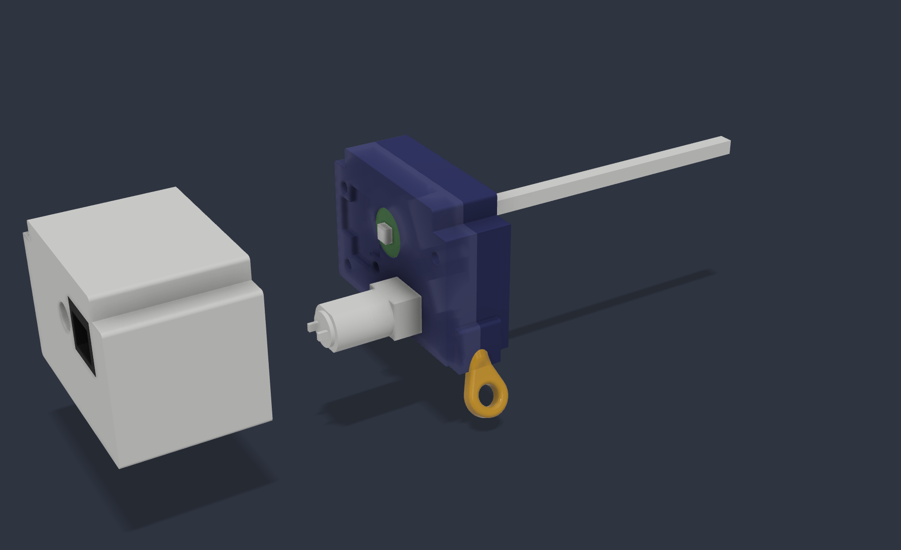

# v0.4 print files: tilter, sensor module, controller box

Every moving part is printed; nothing comes from the factory tilter. The geometry that matters stays the factory's:
4 mm square rod, the worm at 60° so the **wand hangs from the same teardrop loop at the same angle** and leaves through
the corner notch, and a **16:1 single-start worm** (self-locking, 11–12 wand turns end to end). The N20 drives the worm
through a crossed 45° helical pair (8T on the worm : 7T pinion). The sensor module on the lid side carries the AS5600,
the tilter's DRV8833 and the RJ12 jack.

Generators: [`TiltPartsV4`](../../fusion/TiltPartsV4/TiltPartsV4.py) (tilter), [`TiltPod`](../../fusion/TiltPod/TiltPod.py)
(sensor module, built and checked against the tilter by [`tools/fusion_tiltpod.py`](../../../../tools/fusion_tiltpod.py)),
[`ControllerV4`](../../fusion/ControllerV4/ControllerV4.py) (controller box, see [controller-v4.md](../../../../docs/controller-v4.md)).

## Files (per tilter unless noted)
| File | What | Print orientation |
|---|---|---|
| `worm.stl` | **One piece**: single-start worm (m 0.88, Ø11.4, 5.2° lead, 25° flanks), Ø2 pin hole in its thread end, Ø8.2 barrel, 8T 45° helical gear, collar, shaft and teardrop wand loop | standing on its thread end, loop up, 8 mm brim |
| `worm_wheel.stl` | 16T worm wheel (teeth generated from the worm's motion), Ø12.5 barrel, 4.25 mm square rod bore | on a barrel end |
| `motor_pinion.stl` | 7T 45° helical, 6 mm wide, D-bore | on a gear face |
| `sensor_gear.stl` | 18T with the worm wheel's ~5° helix (left hand), press-fit crush-rib pocket for the Ø4 × 2 magnet | gear face down |
| `case_right.stl` | Main half (9.3 mm): 3 countersunk M3 bolt holes in its back face, 2 alignment pegs, Ø4 sensor-gear pin | back face down |
| `case_left.stl` | Flat lid (8.3 mm): 1.5 mm N20 inset, 3 M3 clearance holes, 2 peg sockets | outer face down |
| `sensor_module.stl` | Cup on the lid side: AS5600 seat, DRV8833 rails, RJ12 rails with spring latch, N20 cradle, rod tube, 3 insert bosses | end wall down, no supports |
| `controller_v4_tray.stl` / `controller_v4_lid.stl` | Controller box (**×3**) | tray floor down; lid top face down |

`print/` holds every STL already rotated to these orientations ([`tools/orient_v04.py`](../../../../tools/orient_v04.py)).
`tilter_v04_H2D_white_PLA.3mf` is the Bambu project from the earlier build (before the sensor module); rebuild it with
[`tools/bambu_v04.py`](../../../../tools/bambu_v04.py) before reusing it.

**Settings:** gears PETG or PLA+ at 0.12 mm, 4 walls, 40 %+ infill; cases and module 0.16–0.2 mm. No supports anywhere:
the worm stands on its thread end with all round surfaces vertical; the module's bosses run straight up from its end
wall; the lid's pockets and the box's jack windows are short bridges. PLA for test fits, PETG for the install (a sunny
headrail can pass PLA's ~55 °C). Print the worm and worm wheel in different plastics; grease with Super Lube 21030.

## Hardware per tilter
| Item | Qty | Where |
|---|---|---|
| M3 × 25 flat head | 3 | Main half's back face → both halves (2 through the AS5600 board) → module inserts |
| M3 heat-set insert (M3 × 5.7, Ø4.0 hole) | 3 | Sensor module bosses |
| M1.6 × 4 | 1 | N20 gearbox face |
| Ø2 × 6 mm steel dowel pin | 1 | Pressed into the case's dome; the worm's thread end turns on it |
| Ø4 × 2 mm diametric magnet | 1 | Comes with the AS5600 board; pressed into the sensor gear |
| AS5600 board, DRV8833 (+ 10 µF), RJ12 breakout, N20 | 1 each | |

## Assembly
1. **Main half:** worm wheel into its bearing. Press the Ø2 dowel into the hole at the top of the worm's groove
   (2 mm in), then the worm onto it, barrel in its bearing, meshing with the wheel; the loop leaves through the notch.
   Press the magnet into the sensor gear (flat tool, ~0.1 mm below flush; crush ribs grip it) and drop the gear on its pin.
2. **Lid:** N20 into the 1.5 mm inset, 1 × M1.6 × 4, pinion onto the shaft's D-flat (don't cut the shaft). Lid onto the
   main half (pegs into sockets), easing the pinion into mesh. No bolts yet.
3. **Sensor module, on the bench** (everything goes in through its open face):
   - press 3 inserts into its bosses;
   - RJ12 breakout (leads soldered first): room side, above the motor's place; slide it along its two grooved rails
     until the jack is flush in the end wall and the latch clicks behind its back edge (release: push the latch toward
     the side wall with a small screwdriver);
   - DRV8833 (J1 en/sleep jumper open, leads soldered): against the back wall, edges in its rails, components facing in; slide to the stop;
   - AS5600 board into its seat, chip facing out, onto its pin (**file ~1 mm off the board edge nearest the rod**,
     header edge away from the rod). It also closes the DRV8833's rails;
   - wire it all ([RJ12 pinout](../../../../docs/architecture.md#connectors-everything-modular)); leave two leads from
     OUT1/OUT2 for the motor.
4. **Join:** solder the two leads to the N20's tabs; route them up from the tabs, under the RJ12's inner rail and over
   the bottom board column to the DRV8833. Slide the module onto the lid face (the can drops into the cradle) and fit
   3 × M3 × 25 from the main half's back face.
5. **Check:** turn the loop by hand. The wheel and the motor shaft turn smoothly, no ticks, no axial clunk in the worm.
6. **Rod:** slides in through the module's tube at any time; it may stay sticking out.

## Fits and checks
- Worm: 0.25 mm radial at the barrel, 0.3 mm at the collar and wand exit, 0.6 mm at the threads; the Ø2 pin above the
  threads limits its tilt to 0.8° ([`tools/worm_tilt.py`](../../../../tools/worm_tilt.py)). Axial load only on two small
  thrust steps (0.1 mm end play each); every other end face runs ≥ 0.4 mm clear.
- Checked in Fusion: no interference between any printed part, the N20, the boards, the rod or the rail; worm/wheel and
  crossed helicals run a full turn without contact (~0.6° and ~7° backlash); sensor gear 0.04 mm clear of the wheel;
  magnet to chip 1.1 mm; walls ≥ 0.4 mm (≥ 1.3 mm round every insert).
- Sensor module: the board's seat faces are one plane; the RJ12 board and DRV8833 slide in from the open face without
  touching anything; a 2 mm bundle for the motor leads routes clear.

## Still to confirm on the real parts
- How the printed worm pair feels and wears; the wheel's square bore (±0.1 mm); the helical mesh by hand (`hx_cd_extra`).
- The RJ12 jack height (modeled 13.0 mm).
