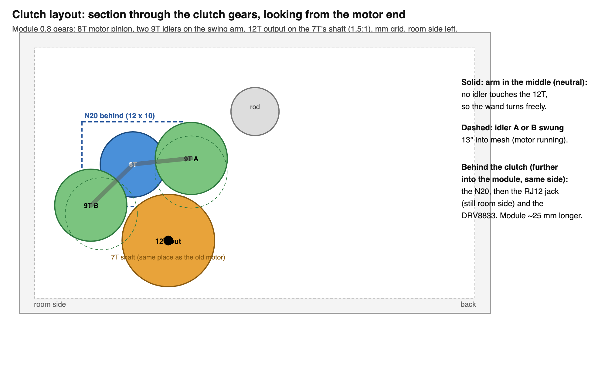

# Tilter v0.5: swing-arm clutch (print and test)

v0.4 made the wand spin the N20 backward through its gearbox (hard by hand), and the N20 drove the worm through the
same train (too weak for a medium blind). v0.5 adds a printed **swing-arm clutch** in the motor's path:

```
N20 ── 9T pinion ── 9T idler A or B (on a swing arm) ── 12T ── (same shaft) 7T ── worm's 8T ── worm ── rod
```

**Rev 2 (after an independent review):**
- Taller clutch teeth, so the contact ratio is 1.16 / 1.18 (it was below 1).
- 9T pinion, for more wall round its D-bore.
- 1.0 mm neutral gap, for a ±8° neutral window.
- A **clutch plate** that holds the motor's gearbox nose and the clutch shaft's end, so the gear spacing no longer
  depends on the module's bolts.
- Two soft spring fingers in the arm's hub instead of stiff pads.
- A full-length pinion hub under the arm.
- A real shoulder for the 12T, and thrust rings so the 7T rubs only near its axis.

**Rev 3 (second review):**
- The clutch plate locates on the **pinion's hub** (the shaft's true axis); its square pocket is now loose
  (anti-rotation only).
- Standard gear spacing: contact ratio 1.29.
- Bearing clearances 0.1 mm.
- Journal Ø3.6, so the 12T's bore passes over it.
- 0.35 mm end float for the 7T shaft, with a wider thrust ring.
- The 12T sits on a Ø5 D-section with a Ø6 shoulder (stronger than the hex).
- **Steel Ø3 × 8 idler pins** (a printed-pin arm is included for bench tests on the 150 RPM motor).

- **Motor on:** two soft spring fingers in the arm's hub grip the pinion's hub lightly (about 1 N·mm), so the arm
  swings with the pinion (20.4°) until one idler meshes the 12T. A printed stop post sets the exact mesh depth. While it drives, the tooth
  forces push the arm *into* the stop, so it stays engaged.
- **End of every move:** the firmware gives a short reverse nudge (about 20° of pinion rotation). That swings the arm
  back to the middle, where neither idler touches the 12T (1.0 mm tip gap).
- **Wand:** turns only the worm and the 7T/12T shaft. The motor never turns. The self-locking worm still holds the
  slats with the power off.
- The 9T:12T adds 1.33:1. **The clutch's real gain is that the motor can now be slow and strong:** the wand never
  turns it, so a high-ratio gearbox doesn't hurt hand use. With a 150 RPM N20 the rod torque is only about the same as
  v0.4 (the extra mesh and the thrust eat the 1.33:1). **Use a 100 RPM N20 (about 1.5× the torque, ~7 s end to end) or a
  60 RPM one (about 2.5×, ~12 s).**

Generators: [`TiltPartsV5`](../../fusion/TiltPartsV5/TiltPartsV5.py) (clutch, lid, 7T shaft; worm, wheel, sensor gear
and main half come from v0.4's code), [`TiltPodV5`](../../fusion/TiltPodV5/TiltPodV5.py) (sensor module), checked by
[`tools/fusion_tilter_v5.py`](../../../../tools/fusion_tilter_v5.py).



## Files
| File | What | Print |
|---|---|---|
| `clutch_pinion.stl` | 9T (m 0.8, tall teeth), D-bore on the N20's flat, full-length round hub the arm pivots on | teeth down |
| `clutch_arm.stl` | swing arm: hub with 2 spring fingers, holes for 2 × Ø3 × 8 steel pins, bosses, tail with the stop slot | flat |
| `clutch_arm_printed_pins.stl` | the same arm with printed Ø3 pins: **bench tests on the 150 RPM motor only** (they won't survive a slower, stronger motor) | arm plate flat, pins up |
| `clutch_plate.stl` | runs on the pinion's hub and the shaft's Ø3.6 journal; loose square pocket on the gearbox nose; Ø3 stop post | post up (the pocket's ceiling is a 10 mm bridge) |
| `clutch_idler.stl` | 9T idler (**print 2**) | flat |
| `clutch_12t.stl` | 12T, D-bore (slides over the journal onto the D-section, stops on the Ø6 shoulder; a drop of CA glue) | flat |
| `clutch_shaft.stl` | 7T 45° helical + thrust ring + Ø6 shaft + Ø5 D-section + Ø3.6 journal; turns on a Ø4 pin in the main half | standing on the 7T face (pin hole down) |
| `case_left.stl` | lid: motor socket gone, Ø5.4 bore for the clutch shaft | outer face down |
| `case_right.stl` | main half: Ø4 pin and thrust boss for the 7T | back face down |
| `sensor_module.stl` | 68.7 mm long: N20 tunnel (loose fit), AS5600, DRV8833, RJ12 (room side, behind the motor) | end wall down |
| `worm.stl`, `worm_wheel.stl`, `sensor_gear.stl` | unchanged from v0.4 | as v0.4 |

**Settings:** gears and the arm PETG or PLA+, 0.12 mm layers, 4 walls, 40%+ infill. The clutch gears are module 0.8
(the same tooth size class as the 7T). Cases and module 0.16–0.2 mm.

## Hardware
Same as v0.4, minus the M1.6 motor screw, plus **2 × Ø3 × 8 mm steel dowel pins** per tilter (idler axles, pressed
into the arm). For real torque: **a slower N20 (100 or 60 RPM, 6 V)**. The printed-pin arm lets you test the clutch
before the dowels arrive.

## Assembly
1. **Main half:** worm wheel, Ø2 dowel and worm as v0.4. Drop the **clutch shaft** onto the Ø4 pin (7T meshing the
   worm's 8T), sensor gear with its magnet onto its pin.
2. **Lid** onto the main half, the shaft through the lid's bore (pegs into sockets).
3. **12T:** slide it over the journal onto the hex until it stops on the shaft's shoulder (flush with the hex's
   end); a drop of CA glue.
4. **Module, on the bench:** inserts, RJ12 (slides in behind the motor's place, room side), DRV8833 and AS5600 as v0.4.
   Solder the motor leads to the N20 first. Slide the **N20 into its tunnel** from the open face, wires first (out of
   the tunnel's back toward the DRV8833), until its can stops on the two ledges.
5. **Clutch, in the module, in this order** (the pinion's teeth are bigger than the arm's bore):
   1. **Clutch plate** onto the gearbox nose (square pocket), stop post toward you.
   2. **Press the two steel pins** into the arm from its flat side (flush), then the **idlers** onto them (a little
      grease on the pins).
   3. **Arm** flat against the plate, its slot over the stop post, hub over the motor shaft. Turn it to the middle of
      its slot.
   4. **Pinion, hub first,** through the arm's hub and the plate's bore onto the shaft's D-flat, until its hub end
      sits 0.8 mm off the gearbox face (its tooth end is then flush with the shaft's tip). The fingers click round the
      hub. A trace of grease on the hub is fine.
6. **Join:** keep the arm in the middle of its slot. Prop the motor up to the middle of its tunnel (it sits loose)
   and slide the module onto the lid face. The 12T goes in between the idlers first, then the shaft's journal enters
   the plate's bore (lead-in chamfer). 3 × M3 × 25 from the main half's back face, as v0.4.
7. **Check by hand:**
   - The wand turns the rod smoothly, and the motor shaft doesn't move.
   - Turn the motor's pinion by hand: the arm swings, one idler meshes and the rod turns. Turn it back a little and the
     arm returns to the middle.

## Firmware rule (the clutch depends on it)
- **Start of a move:** the first ~20° of pinion rotation only swings the arm into mesh (a few tens of ms).
- **End of every move:** brake, then **reverse for about 20° of pinion rotation at 60% PWM or more** (low PWM is
  unreliable on an N20), then coast. The neutral window is ±8° of arm rotation. Time the nudge on the bench by watching
  the arm through the open module.
- **Stall cut-off:** stop within ~0.1 s when the angle stops changing. The clutch parts are sized for running torque, not
  repeated stalls.
- If a nudge is ever missed, turning the wand in the motor's last direction still knocks the idler out by itself. The
  other direction turns the motor backward (as v0.4) until the next move resets the arm.

## Checked in Fusion
- No interference between any part, with the arm **in the middle and at both stops** (idlers rolled round the pinion as
  they really would be). Only the AS5600 board's locating pin (a press fit by design) and its edge by the rod (file
  ~1 mm off, as v0.4) show up.
- Stop contact exact at both stops; the meshed idler sits at the standard 8.40 spacing (contact ratio 1.29).
- Idler tips 1.0 mm from the 12T in the middle; the idler not in use 3.3 mm away when the other one is driving; arm swing
  21.4° to each stop, neutral window about ±8°.
- Reviewed twice by an independent agent (rev 1: 9 issues, rev 2: 6); every must-have is in rev 3.
- Under load the tooth forces push the arm into its stop (it stays engaged), checked by a force balance.
- 7T on the worm's 8T: 6.9° of backlash (contact-free window).
- All STLs closed; the new parts print in their stated orientation with no overhang (the clutch shaft's pin hole has a
  cone tip). The case halves' overhangs are v0.4's (the AS5600 pocket bridges).

## Still to confirm on the real parts
- The fingers' grip: enough to swing the arm. If the arm doesn't swing, the hub printed small: a strip of tape round
  the hub adds grip.
- The nudge timing on the real motor and battery voltage.
- Whether the medium blind turns: measure the motor current while it moves.
