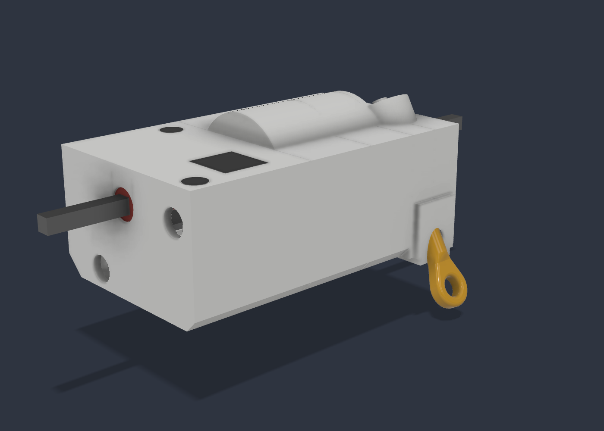
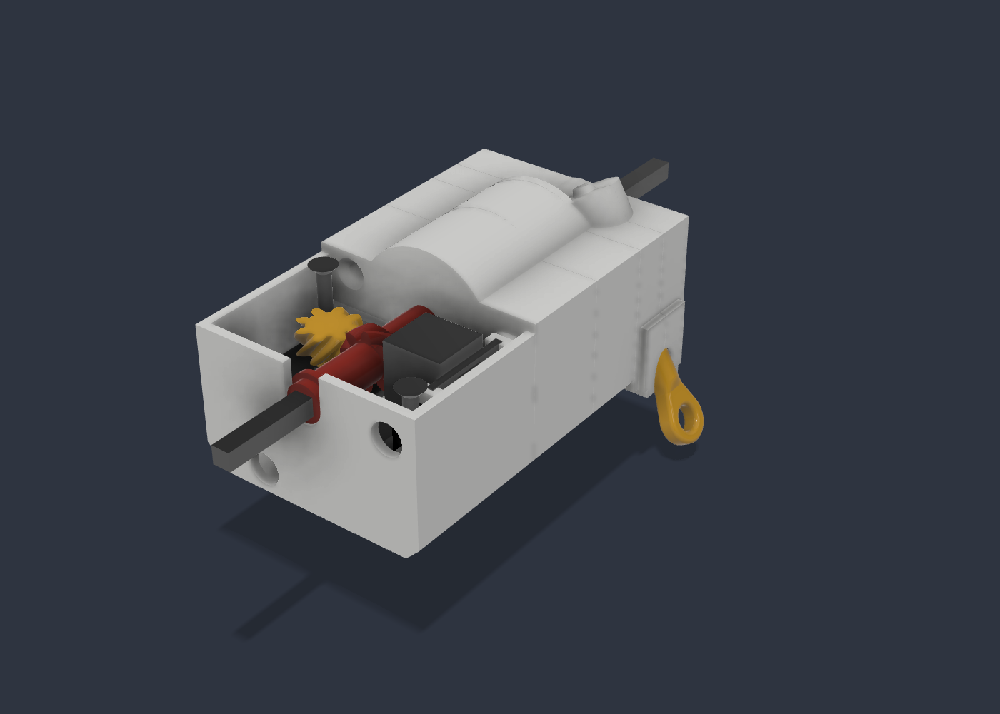
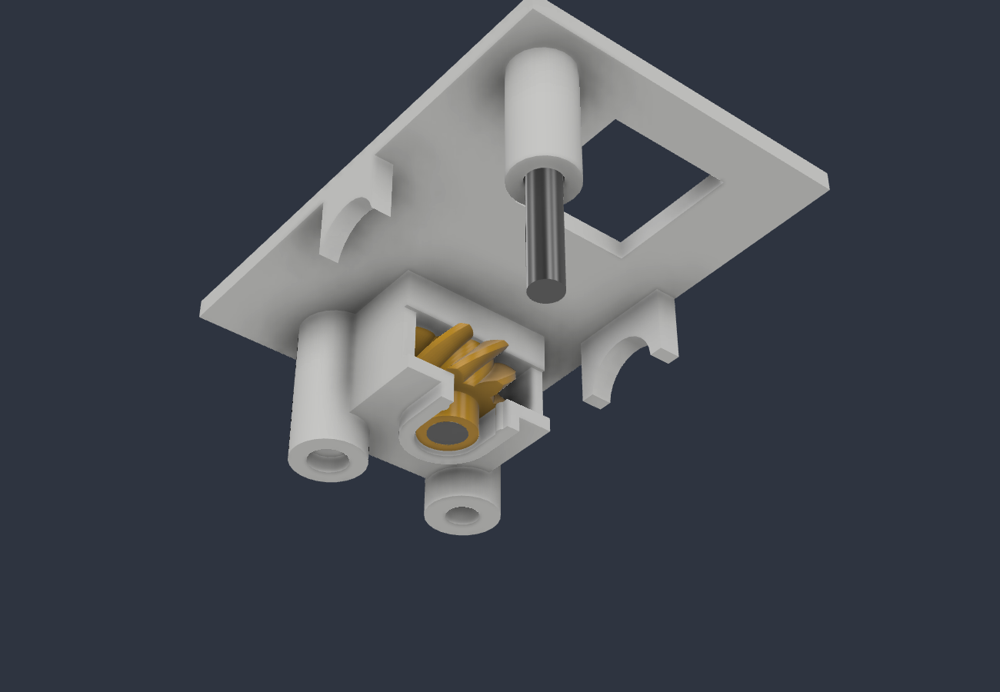

# Tilter v0.8: finished housing

v0.7's drive (it moved the medium blind fully both ways) in a closed housing that also holds the motor, the angle
sensor, the motor driver and the RJ12 jack. **The rod slides right through the whole device.**

Built by `python3 hardware/mechanical/fusion/fusion.py exec tools/fusion_tilter_v8.py` (`TiltPartsV8`). This is rev J (rev I with the RJ12 jack's real height: tray and tray lid changed). Rev K adds the sensor bar and the long-hub carrier (see below).

## Shape
- One outline end to end: 51.5 mm wide, 33.2 mm tall, **square top**. Bottom corners chamfered: **5 mm on the back
  (sensor) side, 3 mm on the room side** (the worm's corner is left square: the worm comes out there).
  Gear roof 39.9 mm. **77 mm** from the tilter's center to the far end (was 91).
- The whole outside is **one material** (white PLA). No clips: the rod centers the device.
- The lid's top is flat: two flush bolt heads and the RJ12 jack, flush, in a close opening.

## Parts (from the blind side to the rail's end)
| Part | Holds |
|---|---|
| main half + lid | worm and worm wheel |
| bearing shell | ring cup, carrier, planets; the sun piece turns in its wall |
| motor shell | the four gears of the motor train; the N20 screws to its back |
| tray | open on top, 2 mm walls. N20 body, AS5600, RJ12 breakout, DRV8833 |
| tray lid | cover **and** sensor mount |

Why the drive is still four slices: each wall between them is a bearing for a gear, and the ring cup and the motor
gears can only go in through the open face of their slice. Merging any two traps a gear.

## Inside the tray
- **Back side: AS5600**, flat, chip up, on its four holes: three studs (Ø3.6, an easy push fit) and one M3 insert
  (the hole nearest the motor shell). The front studs stand on a rail that runs from rib A to the end wall.
- **Rod gear:** its sleeve runs the whole length of the tray. One end lies in rib A's saddle, the other in a notch
  in the end wall; a collar just inside the end wall keeps it from sliding. No rib in the middle.
- **Room side: RJ12**, standing along the wall beside the motor, jack toward the rod, mouth up and flush. Its two
  upright edges drop into **slots in two ribs** that grow out of the wall; it stands on the slots' floors. The lid's
  opening (0.3 mm gap) holds the jack's top.
- **DRV8833** stands under the jack, between the RJ12 board and the motor, its two ends in slots in the lower part
  of the same two ribs. It goes in before the RJ12.
- **Lid = sensor mount, one unit:** two columns stand on the AS5600's back corners. One takes an M3 × 25 down
  through lid, column and board into the insert; the other sits over a stud. Between them hangs the **gear cage**:
  a block over the magnet gear, two cheeks, a back wall, and a shelf under the gear with a keyhole. The gear slides
  in from the rod side and its hub snaps past two small bumps into a round seat.
- **Two lid bolts, on a diagonal:** the sensor bolt (back side, by the motor shell) and a corner bolt (room side,
  far end; M3 × 25 through a column into a block in the corner). No tongue into the motor shell. A tab under the
  lid closes the end wall's notch over the rod gear.
- **Tray to motor shell:** 2 × M3 × 8, heads on short lugs inside the tray, driver through the end wall.
- The room-side tray bolt is behind the RJ12: lift the RJ12 out to reach it.

RJ12 numbers used (yours): board 20 × 20.25 × 1.5; jack 12.3 wide, **14.7 off the board** (first taken as 13: the
lid's opening was 1 mm small and the jack would have rubbed the rod gear), 14.7 long, mouth 2.75 past the board.
The board now stands 1.5 mm nearer the room-side wall, so the jack clears the rod gear by 0.5 mm. Its solder joints
go into a 1.1 mm pocket in that wall: **trim them to 1.5 mm or less.**

Rev J reprint: `tilter_v08j_H2D_tray_and_lid.3mf` (tray + tray lid, PLA).

## Rev K: the sensor follows the carrier, not the rod (2026-11-15)
The blind's rod is shorter than the tilter (a crimp stops it about 21 mm in), so it never reached the rod gear and the
sensor stood still. Rev K takes the sensor's motion from the tilter's own carrier:

| Part | File | What changed |
|---|---|---|
| **Sensor bar** (new) | `sensor_bar.stl` | 3.9 mm square bar, 68 mm long. Pushed in from the rail's end, through the rod gear, the gearbox tube and the sun piece, into the back 4.5 mm of the carrier's square bore. Split, slightly wide ends (4.35 mm) hold it without play: two prongs in the carrier, a sprung window in the rod gear. The flat head stops on the rod gear's end and is the grip for pulling it out. Prints lying flat, PLA. |
| **Carrier** | `carrier.stl` | The hub now runs almost the whole worm wheel (to 1.5 mm from the blind-side face, was 11 mm in). The square bore is 23 mm long: a rod that only goes 12 mm in is still fully gripped. Prints disc down. |
| **Worm wheel** | `worm_wheel.stl` | Its bore is opened to 8.8 mm for the longer hub (0.8 mm lip left at the blind-side end). Same teeth, same hex. |

How it goes together: nothing else changes. With the tilter assembled, turn the bar's head until its tip drops into the
carrier (you feel it go in the last 4 mm) and push until the head meets the rod gear. The rod then stops on the bar's
tip, 20 mm from the blind-side face.

The bar alone also works with the old carrier and wheel, as long as the rod goes in no more than 19 mm (the old square
bore is only 13 mm long and the bar takes the last 4.5).

Grease the carrier's hub: it now turns in the wheel over its whole length (both PLA).

Not proven yet: the sprung fits (sized for holes that print about 0.1 small and bars that print about 0.1 big); sensor
backlash through the bar.

## Print
`python3 tools/orient_v08.py && python3 tools/bambu_v08.py` writes the parts that need reprinting:

| File | What |
|---|---|
| `tilter_v08i_H2D_PLA_PETG.3mf` | one project, two plates: plate 1 PLA, plate 2 PETG |
| `tilter_v08i_H2D_PLA_only.3mf`, `tilter_v08i_H2D_PETG_only.3mf` | the same two plates as separate one-plate projects |
| `tilter_v08_assembly.stl` | every printed part in its assembled place, one STL (for viewing; not for printing) |

| Plate 1: PLA (the whole housing) | Plate 2: PETG |
|---|---|
| main half, lid, bearing shell, motor shell, tray, tray lid | rod gear, magnet gear |

**The tray lid needs support** under the gear shelf (it prints top down); nothing else does.

**Keep:** all the drive gears (ring cup, carrier, planets, sun, R1, P1, P2, pinion, worm wheel) and the worm.

## Hardware
- 8 × M3 × 25 flat head, 2 × M3 × 8 flat head, 10 × M3 heat-set inserts
- 2 × M1.6 × 4 (motor), 4 × Ø2 × 5.9 dowels (planets), 1 for the worm's top pin; Ø4 × 2 magnet

| Inserts | Where | Bolt |
|---|---|---|
| 3 | bearing shell, the face that meets the lid | M3 × 25 from the main half's back |
| 3 | bearing shell, the flat gear-side face | M3 × 25 from the motor shell's back |
| 2 | motor shell, back face | M3 × 8 from inside the tray |
| 1 | tray, the buttress on the back wall nearest the motor shell | M3 × 25 through the lid |
| 1 | tray, the block in the far room-side corner | M3 × 25 through the lid |

## Assembly
1. **Press in the inserts.**
2. **Solder the harness on the bench:** motor, DRV8833, AS5600, RJ12 board. About 60 mm of wire between parts.
3. **Worm case:** wheel and worm into the main half, lid on. Ring cup onto the hex. Carrier and planets in.
4. **Bearing shell** over the cup. 3 bolts from the main half's back. Sun piece in.
5. **Motor shell:** screw the N20 on. Drop in: pinion, P1, R1, P2. Axle bolt in from the back. Bring it up to the
   bearing shell; tighten the axle bolt and the 2 bolts beside it.
6. **Tray:** hold the boards up. Slide the tray under the motor, up to the motor shell. 2 × M3 × 8 through the two
   holes in the end wall.
7. **AS5600** onto the three studs, chip up, solder rows toward the motor and toward the far end. Press it down.
8. **DRV8833** down into the two low slots, chips toward the room. Then **RJ12** down into the two tall slots, jack up.
9. **Rod gear** into rib A's saddle and the end wall's notch, collar just inside the end wall.
10. **Lid:** press the magnet into the gear's hub. Slide the gear into the cage under the lid from the open side
    until its hub clicks into the round seat. Pick the support out of the cage first. Lower the lid straight down
    over the jack (turn the gear a little so it meshes). 2 bolts, snug.
11. **Into the rail.** Then push the rod through. Turn the wand a little if it stops.

## Checked in Fusion
- No part touches another, standing still or turning (motor, three boards, plug and every bolt included).
- Each part was moved along its way in, the magnet gear along its slot, the lid with its gear straight up. All
  clear. The one contact is meant: the AS5600 presses onto its studs.
- The wall behind every bottom chamfer is solid. Every part is one closed solid.
- Print check: overhangs are hole tops and short bridges (5 mm at most).

## Not proven yet
- **Magnet gear's snap:** the keyhole's neck is 0.2 mm narrower than the hub. Too tight or too loose is a one-number change.
- **Magnet gap:** 0.8 mm, set by the lid's columns on the board; the gear has 0.3 mm of up-and-down play.
- **RJ12 jack height:** flush assumes the jack is 14.7 long with its mouth 2.75 past the board. Each 0.5 mm of
  error shows as a 0.5 mm step at the lid.
- **AS5600 holes:** modeled Ø3.7, 8 mm out from the middle each way (the v0.5 module's numbers).
- **The sensor's reading** near the steel rod and the two bolts 11 mm from the magnet.
- **No clips:** 2 mm of side play each side until the rod is in.
- **Going in from the top:** width is what the rail fights, and that did not change.
