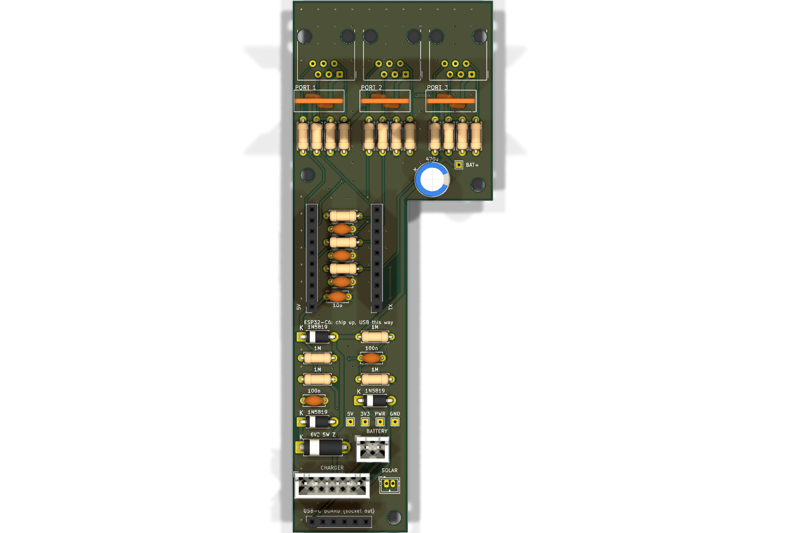

# Controller PCB (v2.2, carrier board)

**v2.2 (2026-11-07): the jack edge is 3.5 mm shorter.** For the controller box's end wall, the RJ12 jacks come through
the wall, so the board's jack edge moves 3.5 mm in and the jacks overhang it by 2.95 mm. Everything else is v2.1:
same parts, same copper, same holes. Only the outline moved, the ground fill pulled back with it, and the 11 ground
stitching vias that sat 2 mm from the old edge are gone. Back silkscreen reads "v2.2". The v2.1 boards already
made get the same edge cut by hand, 3–4 mm (see [the build guide, step 0](../../docs/pcb-build.md)). v2.1 as ordered
is tagged `pcb-v2.1-ordered` in git.

The controller's board: a 2-layer PCB where the **ESP32-C6 SuperMini** plugs into female header sockets; the
**18650**, the **charger** (an **Adafruit 6092**, through a 6-pin harness) and the optional **solar panel** plug into
three *different* JST headers; the **three RJ12 jacks** sit on the board edge with a fuse and
protection resistors behind each. Everything is through-hole and hand-soldered; there is no hand wiring.

The board was drawn for an MCP73871 charger module and a separate USB-C board (J3). The build now uses the Adafruit
6092 with its own USB-C instead, with no copper change: the harness and the battery splice in the J5 plug are in
[the build guide, step 11](../../docs/pcb-build.md#step-11-the-charger-the-battery-and-solar). J3 stays empty.

**Build it:** [docs/pcb-build.md](../../docs/pcb-build.md) (a picture per step). **Parts:** [BOM](../BOM.md#one-controller). **Box:** [docs/controller-box.md](../../docs/controller-box.md).



| | |
|---|---|
| Size | 47 × 121.5 mm (v2.2; v2.1 was 125), T-shaped: a 47 mm strip at the port end carries the jacks and their fuses / resistors, the 27 mm body runs alongside the 18650 |
| Layers | 2, GND poured on both and stitched with ~80 vias; 1 mm motor-return GND track from the jacks to the battery / charger GND |
| Tracks | 0.3 mm signals, 0.6–0.8 mm power; 0.2 mm clearance; vias 0.7 / 0.35 mm |
| Checks | KiCad 10: **DRC 0 violations, 0 unconnected; ERC 0 violations; schematic ↔ board parity 0 differences** (re-run 2026-11-07, v2.2) |
| Files | [schematic (PDF)](controller/controller-schematic.pdf), [controller.kicad_pro](controller/controller.kicad_pro) (open in KiCad), [parts list (CSV)](controller/controller-bom.csv), [controller-pcbway.zip](controller/controller-pcbway.zip) (Gerbers + drill: upload this) |

Generated, not drawn: [netlist.py](netlist.py) holds the parts and connections; [schematic.py](schematic.py) writes the
schematic from it; [board.py](board.py) places the parts, routes the copper with [router.py](router.py), pours and
stitches GND and adds the silkscreen. Rebuild:

```bash
python3 hardware/pcb/schematic.py
/Applications/KiCad/KiCad.app/Contents/Frameworks/Python.framework/Versions/3.9/bin/python3 hardware/pcb/board.py
```

## What changed from v1 (after the peer review)
| Review item | v2 |
|---|---|
| Battery plug fits the wrong 2-pin header (could short the cell) | Three different connectors: battery JST-XH 2, charger JST-XH **6**, solar JST-**ZH** 2. The charger header is pinned **GND, BATT+, –, LOAD+, –, PWR+** so the battery's 2-pin plug, pushed into it at any offset, either lands correctly or touches one live pin: never a short |
| EN floating at boot | 100 kΩ pull-down on each EN |
| Cable lines straight into ESP pins | 220 Ω series on IN1 / IN2; **10 Ω** on EN (EN also powers the tilter's AS5600, ~6.5 mA: 220 Ω would starve it) |
| No per-port overcurrent protection | 0.75 A resettable fuse (Bel Fuse 0ZRE0075FF) on each port's battery + |
| No bulk capacitance near the jacks | 470 µF on battery + |
| Angle shifts while a motor runs | Firmware note ([firmware/README.md](../../firmware/README.md)): final reading with the motor stopped |
| Zener heat in sun | 3 W zener (1N5920B, 6.2 V) on a 5 W-size footprint (the 1N5341B's 8.9 mm body is too long for the 10.16 mm pitch, and the small panel never needs 5 W) |
| Input-power divider unfiltered | 100 nF added |
| GND pour in islands | ~80 stitching vias; filter-cap GND pads solid to the pour |
| Motor return through the analog ground | Dedicated 1 mm GND track: jacks → bulk cap → battery / charger GND |
| No test points | Pads for BAT+, 5V, 3V3, PWR, GND |
| ESP USB unreachable | ESP turned: its USB faces end B over low parts, so a cable fits with the ESP plugged in |
| No schematic | Real KiCad schematic, ERC clean, parity-checked against the board |
| Brown-out ~15 % early (Schottky to the ESP's 5V) | **Kept.** The real fix is an ideal-diode IC or a P-MOSFET with a gate driver, which are surface-mount; planned for the integrated v3 |

## Pre-order review (2026-11-02)
Checked on the files being ordered: ERC 0, DRC 0 (0 unconnected), schematic ↔ board parity 0; every ESP socket pin
traced to its GPIO; diode bands (pad 1 = cathode) and the 470 µF's + checked against their nets; drill file: 2 layers,
1.6 mm, smallest hole 0.35 mm (vias), hole counts match the parts (18 RJ12 pins, 6 jack posts, 3 mounting holes).
Added for v2.1: **+/− and pin labels on the battery, charger and solar connectors** (silkscreen only).

Things that can still be adjusted at assembly, so they don't need a new order:
- **Battery header orientation:** the 2-pin JST-XH footprint is symmetric, so the header can be soldered either way
  round. **Before soldering J4, push the cell's plug into the loose header and hold it over the footprint: the red
  wire must sit over the hole marked "+".** If not, turn the header around before soldering. (J4: pin 1 −, pin 2 +.)
- **D3 (ESP supply diode):** if the ESP browns out at low battery and you never plug USB into the ESP itself with the
  battery fitted, solder a wire link in D3's place (no 0.3 V drop).
- **Pin plan:** all in firmware (per-board pin table), no copper change.

Known limits (by design, not blockers): no reverse-battery protection beyond the keyed, labeled connectors (a
MOSFET-based one is surface-mount or a TO-220; planned for v3); each port's battery + passes a 0.75 A PTC (~0.3 Ω)
and the cord (~0.6 Ω per wire for 3 m of flat cord), which costs some motor voltage on long runs.

## Ordering
1. pcbway.com → PCB Instant Quote → **Quick-order PCB** → upload [controller-pcbway.zip](controller/controller-pcbway.zip).
2. **2 layers, FR-4, 1.6 mm, 1 oz copper, HASL lead-free**, min track / spacing **6/6 mil**, min hole **0.3 mm**,
   solder mask green (or white to match the build), silkscreen white, **quantity 5**.
3. Check the quote before paying (roughly $5–20 for 5 plus shipping). Bring one board up fully before building three.

## Pin plan (v2)
| Port | IN1 | IN2 | EN | Angle (ADC) |
|---|---|---|---|---|
| 1 | GPIO14 | GPIO18 | GPIO7 | GPIO6 |
| 2 | GPIO19 | GPIO20 | GPIO5 | GPIO4 |
| 3 | GPIO16 (TX) | GPIO17 (RX) | GPIO1 | GPIO2 |

Battery voltage GPIO3, input-power voltage GPIO0. RJ12 pinout (both ends): 1 battery +, 2 IN1, 3 GND, 4 angle, 5 EN, 6 IN2.

## Rebuild the files
```bash
K=/Applications/KiCad/KiCad.app/Contents/MacOS/kicad-cli
$K sch erc hardware/pcb/controller/controller.kicad_sch
$K pcb drc --schematic-parity hardware/pcb/controller/controller.kicad_pcb
$K pcb export gerbers --layers F.Cu,B.Cu,F.Mask,B.Mask,F.Silkscreen,B.Silkscreen,Edge.Cuts --subtract-soldermask -o hardware/pcb/controller/gerbers/ hardware/pcb/controller/controller.kicad_pcb
$K pcb export drill --format excellon --excellon-separate-th -o hardware/pcb/controller/gerbers/ hardware/pcb/controller/controller.kicad_pcb
```

## Later (v3)
On hold: [docs/pcb-v3-concept.md](../../docs/pcb-v3-concept.md). Its must-test list is checked on this board first.
